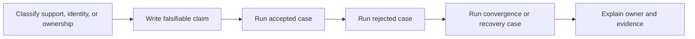
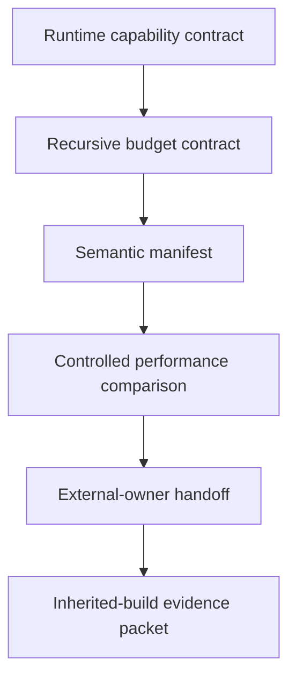

# Exercises

Use one isolated `portability-evidence-lab/` for the whole set:

```text
portability-evidence-lab/
├── Makefile
├── child/
├── config/
├── inputs/
├── tools/
└── evidence/
```

Keep generated logs and measurements under the repository `artifacts/` directory when you
work in the course checkout.

For every exercise, preserve:

| Contract claim | Accepted case | Rejected case | Settled or recovery case |
| --- | --- | --- | --- |

A happy-path command cannot prove a gate, manifest, recursive budget, or handoff.



The work accumulates:



## Exercise 1: Prove a portability contract

Write a contract for a build that requires GNU Make grouped targets and secondary
expansion, POSIX `/bin/sh`, and one Python executable. Do not use release-prefix filters
to infer Make capabilities.

What to hand in:

- a `.FEATURES` gate that names only missing capabilities
- explicit `SHELL` and `.SHELLFLAGS`
- a Python variable restricted to one executable name or path, with arguments separate
- accepted and rejected tool-presence cases
- one compatibility test beyond executable presence
- a CI support matrix that distinguishes tested releases from feature discovery

## Exercise 2: Prove a recursive budget boundary

Create parent and child Makefiles with four independent child recipes. Compare a literal
`gmake` invocation, `+$(MAKE)`, and a wrapper that ends with `exec "$MAKE"`.

What to hand in:

- dry-run evidence showing which forms enter the child plan without publication
- parent and child `MAKELEVEL` and literal `MAKEFLAGS`
- start/end interval evidence under parent `-j2`
- proof that peak recipe overlap is no greater than two and reaches two
- one rejected attempt that copies or edits jobserver flags, with the reason it is invalid
- a statement of which observation is portable intent and which is host-specific transport

## Exercise 3: Publish a semantic manifest safely

Model `MODE`, effective locale, and compiler identity. Decide which facts are pinned,
attested, or diagnostic-only. Reevaluate semantic facts every invocation and publish only
changed canonical content.

What to hand in:

- strict validation for finite configuration values
- a process-local candidate, interruption cleanup, comparison, and rename
- two equal invocations preserving manifest digest and modification time
- one changed semantic fact invalidating a downstream artifact
- equal hashes from two independent workspaces with equal declared facts
- concurrent debug and release builds using distinct output namespaces
- an explanation of which raw environment fields were excluded and why

## Exercise 4: Locate a performance cost

Define clean, no-op, and one-input rebuild workloads for one goal. Measure planning and
real execution repeatedly while holding job count, tools, locale, storage location, and
output capture constant.

What to hand in:

- preparation and exact command for each workload
- warm-up policy, repetition count, median, and range
- wall, user, and system time where available
- one hypothesis assigning cost to a layer
- one controlled experiment, such as `-rR` in a copy or removal of one repeated probe
- selected-rule and output-equivalence checks after the experiment
- a sentence explaining why `-n` is not a pure decision timer

## Exercise 5: Design a tool handoff

Choose dependency resolution or release promotion. Write both a Make-owned design and an
external-owner design, then decide which truth model fits.

What to hand in:

- failure classification supported by evidence
- input identity, invocation, success output, failure output, and interface version
- publication, retry, resume, and rollback owner
- a file or digest boundary that Make can verify
- failure injection before, during, and after handoff
- a comparison route that cannot create two publication owners
- the former writer that must be removed after the handoff

## Exercise 6: Separate diagnosis from enforcement

Build a `doctor` target that reports Make features, shell contract, executable resolution,
locale, recursion depth, and selected configuration. Build a separate `contract-check`
that rejects missing required capabilities before any artifact recipe starts.

What to hand in:

- advisory `doctor` output under two controlled environments
- the contract target and every publication frontier it gates
- missing-tool rejection with no residue
- available-tool acceptance that reaches publication
- a compatibility rejection for a present but unsupported tool
- an explanation of why sibling prerequisites do not establish left-to-right ordering

## Exercise 7: Make shell failure portable

Audit a recipe containing `[[ ... ]]`, `source`, a pipeline, and an unquoted path. Keep a
POSIX shell contract and rewrite it so every required failure reaches Make.

What to hand in:

- the repaired recipe
- tests for present and missing input paths
- an injected failure in the first pipeline command
- an explanation of how you avoided relying on non-POSIX `pipefail`
- one case where declaring Bash would be clearer than translating the recipe
- proof that a path containing spaces is handled as one argument

## Exercise 8: Test recursion through a wrapper

Add a wrapper that selects a child directory and invokes Make. First let it call the
`make` found on `PATH`; then pass the parent-selected `$(MAKE)` and replace the wrapper
process with it.

What to hand in:

- literal, declared-direct, and declared-wrapper planning traces
- proof that the wrapper uses `exec`
- relative recursion-depth evidence through direct and wrapper entry routes
- peak-overlap measurements under the same parent budget
- one interruption result showing no detached child remains
- a bounded recursion policy stated relative to supported public entrypoints

## Exercise 9: Prove manifest identity under contention

Extend Exercise 3 with two simultaneous Make processes. Run equal configurations against
one namespace, then different configurations against separate namespaces. Interrupt one
writer during candidate generation.

What to hand in:

- process-local candidate paths from both equal-state writers
- a valid final manifest with no partial content
- cleanup evidence after interruption
- different-mode outputs coexisting without writer overlap
- downstream query status after the settled equal-state case
- an explanation of why atomic rename alone cannot repair one path with two meanings

## Exercise 10: Harden an inherited build

Combine at least five defects:

- one missing runtime capability contract
- one undeclared recursive or wrapper boundary
- one non-file input with unstable or stale identity
- one unmeasured performance complaint
- one concern whose durable state belongs to another owner

Include one decoy symptom that is nearby but not causal.

What to hand in:

- before-and-after support, semantic-input, and ownership contracts
- an observation ledger that rejects the decoy
- the paired specimen evidence used to understand each mechanism
- project-specific accepted, rejected, concurrent, and settled cases
- a repeated performance comparison with correctness guards
- the external handoff interface and failure owner
- a final incident explanation reproducible without instructor commentary

## Before you read the answers

Do not open `exercise-answers.md` until every exercise has a rejected case. For performance
work, the rejection may be an unsupported hypothesis rather than a failed command: record
which measurement ruled it out.

## Mastery standard

A complete packet distinguishes:

- supported environment from observed environment
- semantic input from diagnostic context
- atomic publication from configuration identity
- recursive intent from measured token conservation
- performance symptom from cost-layer evidence
- external command containment from durable ownership handoff

If one conclusion depends on "it worked once," continue the experiment.
