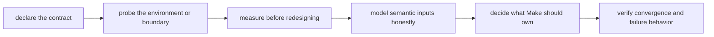

# Exercises

Use these after reading the five core lessons and the worked example. The goal is not to
recite vocabulary. The goal is to turn fuzzy portability and hermeticity complaints into
declared contracts, measured observations, and justified tool boundaries.

## How to work through this set

Treat the ten exercises as one full lab day on hardening an inherited build.

Before each answer:

1. name the assumption or boundary you are testing
2. decide whether the assumption is required, optional, or diagnostic only
3. keep the smallest proof or failure message that would let another maintainer verify the
   conclusion

If you skip that classification step, everything starts to sound like "environment issues"
instead of specific, fixable build contracts.

Do the exercises in order. The day is one progression:

- Exercises 1-3 declare capabilities, recursive boundaries, and semantic inputs honestly
- Exercises 4-6 measure layers, choose tool ownership, and build a diagnostic doctor
- Exercises 7-8 harden shell and recursive invocation contracts
- Exercises 9-10 turn those ideas into convergent manifests and a full inherited-build
  audit

Keep one hardening packet as you go. By the end of the day it should contain:

- one portability contract
- one recursion rule you can justify under `-j`, `-n`, and nested invocation
- one convergent representation of a non-file semantic input
- one performance baseline that separates Make overhead from recipe cost
- one `doctor` target with both reporting and fail-fast behavior
- one before-and-after audit of an inherited build across two environments

If those six artifacts are missing, you are probably accumulating opinions instead of
hardening the build.

## Recommended working layout

If you want one lab tree that can support the whole day, use something like:

```text
module05-lab/
├── Makefile
├── build/
├── ci/
├── nested/
├── notes/
├── tools/
└── artifacts/
```

Keep one assumption ledger while you work:

| Assumption | Required capability | Semantic input | Diagnostic only | Proof or failure message |
| --- | ---: | ---: | ---: | --- |

Every row must choose one ownership category. "Environment issue" is not a category.

Also keep one boundary table:

| Concern | Keep in Make | Hand off to another tool | Why |
| --- | ---: | ---: | --- |

That second table matters because "use another tool" is not a complete answer unless you
can explain which proof route survives the handoff.



Use that route on purpose. It keeps the day centered on declared support and ownership
instead of on ad hoc machine-specific fixes.

## Exercise 1: Write a portability contract

You inherit a Make build that uses grouped targets, `python3`, and POSIX shell syntax,
but none of those assumptions are declared. CI sometimes runs an older Make and fails
with unclear syntax errors.

Write a small portability contract section for the build and explain what should fail fast
versus what may use a fallback.

What to hand in:

- the minimum Make and shell contract
- the required tool list
- one optional feature and its safe fallback
- one sentence explaining what the first failure message should optimize for

Study note:
The point is not "support as many environments as possible." The point is to make
supported environments explicit and unsupported ones fail honestly.

## Exercise 2: Repair a recursive boundary

A top-level target currently runs:

```make
vendor:
	make -C vendor/lib all
```

Do not begin by claiming that this invocation always loses the jobserver. Predict two
separate behaviors:

1. whether `make -n vendor` enters the child graph
2. whether a child on your current host inherits parallel flags under `make -j2 vendor`

Run both commands, save their output, then redesign the recipe as `+$(MAKE)`. Repeat the
observations. Explain which result is a declared recursive contract and which result may
depend on GNU Make's jobserver transport.

What to hand in:

- predictions written before execution
- literal and declared dry-run logs
- actual child `MAKELEVEL` and `MAKEFLAGS` for both forms
- the repaired recipe
- one paragraph separating observed inheritance from portable recursive intent

Study note:
A literal GNU Make 4.4 process may inherit a FIFO jobserver on your host. That does not
make it equivalent to `+$(MAKE)`: the parent's planning route still needs to enter the
child graph.

## Exercise 3: Model one non-file input honestly

A binary changes behavior when `MODE=debug` and when a different compiler is selected, but
neither fact appears anywhere in the graph.

First run the capstone `semantic-fault-audit`. Explain why the clock-derived model produces
different hashes from equal tracked inputs while the declared-state control does not.

```sh
gmake -C programs/reproducible-research/deep-dive-make/capstone \
  semantic-fault-audit
```

Then choose `MODE` or compiler identity and build a manifest that:

1. re-evaluates the non-file fact on every Make invocation
2. preserves the existing manifest when candidate content is equal
3. republishes the manifest when the semantic fact changes
4. invalidates one downstream artifact when publication occurs

What to hand in:

- the two clock-state findings and their `hashes_equal` values
- the complete manifest and downstream artifact rules
- evidence that two equal invocations preserve the manifest mtime and hash
- evidence that one changed semantic value changes the manifest and downstream artifact
- one sentence separating evaluation from publication

Study note:
`cmp` cannot detect a changed environment fact if Make never runs the recipe. A complete
design must explain both why the candidate is evaluated and why equal content is not
republished.

## Exercise 4: Separate performance layers

A teammate says, "Make is slow, so we should rewrite the build logic." You are not yet
allowed to change the build. You are only allowed to measure.

Describe the smallest measurement loop you would run to distinguish parse or decision cost
from recipe cost and trace volume.

What to hand in:

- the commands you would run
- the specific numbers you would compare
- one sentence on how different results would change the diagnosis
- one sentence explaining why "felt slow" is not enough

Study note:
This exercise exists to stop premature rewrites. Measure first, then decide where the
cost actually lives.

## Exercise 5: Decide whether Make should still own the problem

A build is now being asked to handle:

- artifact compilation
- dependency download and version solving
- long-running environment promotion
- manual approval checkpoints

Classify which concerns Make should still own and which concern most strongly suggests a
tool boundary.

What to hand in:

- the concern Make should definitely keep
- the concern that most strongly argues for another tool
- one sentence explaining how you would preserve the proof route after the handoff
- one sentence explaining why handing off everything would also be a mistake

Study note:
This is an ownership exercise, not an ideology exercise. Another tool is not a magic
answer unless boundaries and proofs remain clear.

## Midday self-check

Before you move into doctor targets, shell portability, and recursive budget behavior,
make sure your packet can already answer these questions cleanly:

- which capabilities are truly required for the build contract
- which recursive boundary facts the parent and child must share
- which semantic input you modeled as a convergent file and why
- which concern clearly belongs outside Make without destroying the proof route

If you cannot answer those four questions in plain language, return to Exercises 1-5 and
make the packet more explicit before continuing.

## Exercise 6: Build a toolchain doctor

Write a phony `doctor` target that reports the GNU Make version, shell, compiler path,
Python path, locale, and recursion depth. Keep that diagnostic report separate from a
`contract-check` target that rejects missing required tools before any artifact recipe
starts.

First inspect the required-tool rows from `environment-contract-audit`. Explain why the
late-check model leaves a zero-byte version file. Then build one artifact target that has
the gate as an order-only prerequisite. Test under `-j2` with an unavailable tool and an
available tool.

What to hand in:

- the `doctor`, `contract-check`, and artifact rules
- output from one diagnostic run
- a missing-tool run with the deliberate message and proof that no artifact files exist
- an available-tool run that publishes the expected files
- one explanation of why `all: contract-check artifact` does not impose order under `-j`
- one sentence separating tool presence from tool-version compatibility

Study note:
A doctor reveals context. A gate enforces a requirement. Keeping those responsibilities
separate makes failure placement and advisory output easier to review.

## Exercise 7: Remove a hidden shell dependency

This recipe works when a developer has configured Bash but fails under a POSIX shell:

```make
SHELL := /bin/sh

report:
	@if [[ -f data.csv ]]; then echo ready; fi
```

Repair the recipe without changing the declared shell. Explain why setting `SHELL` makes
the contract more honest than relying on a login-shell preference.

What to hand in:

- the portable recipe
- the command used to test it
- one other shell feature you would audit before claiming portability
- one sentence explaining when declaring Bash would be the more honest choice

Study note:
Portability does not mean never using Bash. It means declaring Bash when Bash is really
part of the supported contract.

## Exercise 8: Preserve the parallel budget across recursion

Run the capstone environment contract audit:

```sh
gmake -C programs/reproducible-research/deep-dive-make/capstone \
  environment-contract-audit
```

Use the recursive-boundary rows as a specimen review. Read both dry-run traces, both
actual-run traces, and the child outputs. Then run the program-level wrapper and explain
why its absolute `MAKELEVEL` can differ while the parent-child relationship remains
valid.

What to hand in:

- the two recursive findings from `summary.tsv`
- the exact line that appears only in the declared dry-run trace
- proof that neither dry-run route created `child.out`
- the actual `MAKEFLAGS` observations without claiming they are universal
- a relative `MAKELEVEL` assertion that works through both entry routes
- one sentence explaining why aggregate `PASS` does not endorse literal recursion

Study note:
Dry-run visibility and actual jobserver inheritance answer different questions. A
reviewable recursive boundary needs evidence for both.

## Exercise 9: Prove an environment manifest converges

Represent `MODE`, compiler identity, and locale in one manifest. Build it once in each of
two clean workspaces with the same declared values and compare hashes. In one workspace,
run again without changing those facts, then change only `MODE`.

What to hand in:

- the manifest rule
- equal first-build hashes from the two clean workspaces
- an unchanged mtime and hash from the repeated equal-state invocation
- a changed hash and content after changing `MODE`
- the trace line showing the downstream artifact rebuild after manifest publication
- one sentence explaining why locale belongs in the manifest only when it affects meaning

Study note:
This exercise combines two different claims: clean-room reproducibility and incremental
convergence. One cannot substitute for the other.

## Exercise 10: Harden an inherited build

Choose a small Makefile with at least one undeclared tool, one shell assumption, one
recursive call, or one environment-sensitive output. Audit it on two environment
configurations and harden the weakest boundaries.

What to hand in:

- a before-and-after portability contract
- evidence from both environments
- one measurement that separates Make overhead from recipe cost
- a decision about which concerns remain in Make and which belong elsewhere
- one sentence naming the weakest boundary you fixed first and why

Study note:
The goal is not to rewrite the build into purity. The goal is to make the support
contract, ownership, and failure behavior clear enough that another maintainer can keep it
healthy.

## Before you read the answers

Do not open `exercise-answers.md` until you can already point to:

- one declared required capability
- one modeled semantic input
- one recursive invocation you can justify
- one concern that clearly belongs outside Make
- one convergent doctor or manifest behavior you can explain

If you do not yet have those five things, the answer page will sound sharper than it can
teach.

## Mastery standard for this exercise set

Across all ten answers, the module wants the same habits:

- you name the assumption or boundary being tested
- you choose evidence before you choose a fix
- you explain the fix in terms of contract, convergence, measurement, or ownership

If an answer says only "hardening is important," keep going.
