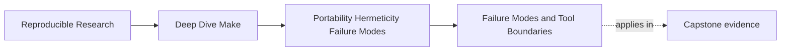
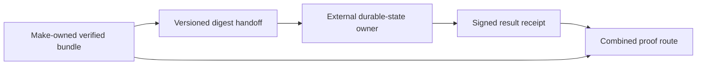

# Failure Modes and Tool Boundaries


<!-- page-maps:start -->
## Page Maps




<!-- page-maps:end -->

A tool boundary is an interface between owners. Saying "use a workflow engine" or "keep it
in Make" is not a design until inputs, outputs, failure behavior, and proof are named.

## Classify the failed state before choosing a tool

| Failure class | Broken truth | First evidence | Likely owner |
| --- | --- | --- | --- |
| graph | file edge, freshness, or output ownership | trace, database entry, repeated build | Make |
| environment contract | required runtime or semantic input | gate result, origin, manifest | Make contract plus supplying environment |
| recipe execution | one external command cannot produce its declared output | command status, candidate residue, tool log | recipe tool |
| long-lived orchestration | retries, approvals, remote state, or compensation outlive one process | state history and recovery drill | workflow or deployment system |
| dependency resolution | version constraints and package graph need semantic solving | lock resolution explanation | package manager |
| policy decision | a human or organization must authorize a transition | signed approval or policy evaluation | governance system or reviewer |

Do not infer the class from where the error message appeared. A compiler can fail because
Make supplied a stale generated header; that remains a graph defect. A Make recipe can
fail because a deployment approval expired; that is not file freshness.

```mermaid
flowchart TD
  incident["Observed failure"]
  bytes["Is incorrect file truth sufficient to explain it?"]
  graph["Repair Make graph"]
  process["Can one bounded process own success and rollback?"]
  recipe["Keep explicit recipe boundary"]
  durable["Does state outlive the Make process or require human policy?"]
  handoff["Define durable external owner and file handoff"]

  incident --> bytes
  bytes -->|yes| graph
  bytes -->|no| process
  process -->|yes| recipe
  process -->|no| durable --> handoff
```

## Use repair, contain, or hand off deliberately

There are three responses:

| Response | Meaning | Example |
| --- | --- | --- |
| repair | Make's graph is the right model; correct it | add a missing generated-header prerequisite |
| contain | external tool owns bounded work inside one recipe | compiler produces one candidate object |
| hand off | another system owns durable semantics beyond one recipe | deployment system owns promotion and rollback |

Containment is common and healthy: Make has always orchestrated external programs. The
boundary is crossed only when the external system owns state that cannot honestly be
represented by the recipe's declared file transaction.

## Test whether file identity is enough

Make remains a strong owner when all of these are true:

- inputs can be named as files or convergent semantic manifests
- success produces a bounded, inspectable output set
- freshness explains when work is needed
- interruption can be recovered through file state
- one invocation can report success or failure without hidden durable state

Consider moving ownership when several of these are true:

- work waits hours or days for external events
- retries and backoff must survive process termination
- human approval changes authorization, not artifact freshness
- rollback or compensation is a first-class operation
- remote state is authoritative and cannot be reconstructed from repository artifacts
- dynamic branching depends on runtime records rather than a declared target set

A stamp cannot turn long-lived remote state into local file truth merely by recording
"done."

## Define the handoff contract before migration

Every external owner needs a reviewable interface:

| Contract field | Question |
| --- | --- |
| input identity | which immutable files, digests, schemas, and policy values cross? |
| invocation | which command or API begins work, and is it safe to retry? |
| success output | which receipt or artifact proves completion? |
| failure output | where are structured diagnostics and partial-state identity recorded? |
| atomicity | when is the result visible, and can consumers observe a partial result? |
| ownership | which system is allowed to write each path or remote object? |
| recovery | who retries, rolls back, or resumes after interruption? |
| versioning | how does either side reject an incompatible interface? |
| proof | which existing assertions remain, and what new assertion covers the handoff? |

If the proposed design says only "Make calls the new tool," ownership is still blurred.

## Worked boundary: dependency resolution

Weak design:

```make
deps:
	@for package in $(PACKAGES); do \
	  curl -O "https://example.invalid/$$package-latest.tar.gz"; \
	done
```

This recipe hides version choice, integrity, network failure, and cache identity.

A package manager should own semantic resolution and emit a lock file. Make can own
materialization from that governed result:

```make
LOCK := dependencies.lock
DEPS_MANIFEST := build/dependencies.manifest

$(DEPS_MANIFEST): $(LOCK) | build/
	@set -eu; \
	candidate="$@.candidate.$$$$"; \
	trap 'rm -f "$$candidate"' EXIT HUP INT TERM; \
	package-tool materialize --locked --manifest "$$candidate"; \
	test -s "$$candidate"; \
	mv "$$candidate" "$@"

app: $(DEPS_MANIFEST) $(OBJECTS)
	$(LINK.o) $(OBJECTS) -o $@
```

The durable interface is the lock plus materialization manifest. The package tool owns
constraint solving and integrity. Make owns the edge from resolved dependencies to the
artifact.

The package tool's offline and cache behavior is still part of the support contract. The
example shows ownership; it does not prescribe one package manager.

## Worked boundary: release promotion

Make can assemble and verify an immutable release bundle:

```make
release-bundle: app SBOM.json checksums.txt
	tools/publish-bundle-candidate $@ app SBOM.json checksums.txt
```

Promotion across environments involves durable remote state, authorization, retries, and
rollback. Give that to a deployment system. The handoff can be:

```text
Make output:
  bundle digest
  checksum manifest
  software bill of materials
  verification report

Deployment input:
  immutable bundle digest
  target environment
  policy reference

Deployment output:
  signed promotion receipt
  resulting remote revision
  failure or rollback record
```

Make may offer a convenience target that submits the digest. It must not write a local
`deployed.stamp` and treat that as authoritative proof of remote state.

## Preserve proof while changing ownership

Use a bounded migration route:

1. freeze the current input/output and failure observations
2. write the proposed handoff contract
3. run the external implementation in a non-publishing comparison mode
4. compare artifacts or receipts under accepted and rejected cases
5. switch one public owner
6. remove the former writer so dual ownership cannot persist
7. retain the comparison as a regression proof

Never run two deployment or publication owners in parallel merely to compare them. Shadow
comparison is appropriate only when the operation is read-only or writes to isolated
evidence destinations.



## Failure injection makes ownership visible

Test the boundary at four points:

| Injected failure | Expected owner response |
| --- | --- |
| invalid or missing input manifest | Make rejects before handoff |
| external tool rejects compatible-looking input | external owner returns structured failure; no success receipt |
| process interrupted after submission | external owner exposes durable status and idempotent resume/query |
| receipt schema unsupported by Make-side verifier | verifier rejects; artifact remains distinct from promotion state |

If both sides retry independently, or both can publish the same output, the interface has
not assigned ownership.

## Decision record

Before moving a concern, write:

- the failure class and evidence
- why file freshness is or is not sufficient
- current and proposed owner
- input, success, and failure artifacts
- retry and recovery owner
- version compatibility rule
- acceptance and rejection proofs
- former writer that will be removed

This turns a tool preference into a reviewable engineering decision.

## Practice before moving on

Choose one awkward build concern. Produce two competing designs:

1. a Make-owned repair using honest file or manifest state
2. an external-owner handoff with the full interface table

Inject one failure before, during, and after the boundary. Decide using the resulting
ownership and recovery evidence, not which configuration syntax you prefer.

## End-of-page checkpoint

Before leaving, make sure you can explain:

- why the location of an error message does not identify the failure class
- how repair, containment, and handoff differ
- which long-lived state signals that file freshness is no longer sufficient
- every field required in a durable handoff contract
- why a local stamp cannot prove remote deployment state
- how to compare implementations without creating two publication owners
- which failure injections reveal retry and recovery ownership
