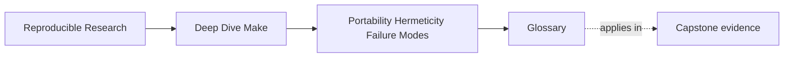
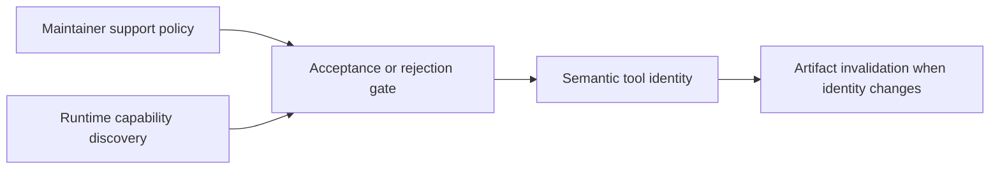
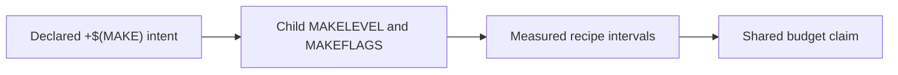
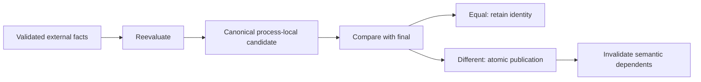
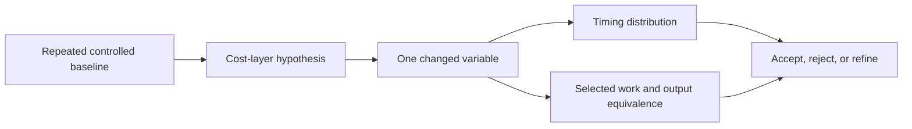

# Glossary

<!-- page-maps:start -->
## Page Maps

<!-- page-maps:end -->

Use this reference when words such as "portable," "hermetic," "parallel," or "slow" hide
several different claims.

## Support contract

| Term | Meaning |
| --- | --- |
| portability contract | Declared Make behavior, shell semantics, tools, platforms, and fallback promises supported by the project. |
| supported release | A runtime version maintainers test and promise to handle; not synonymous with one advertised feature. |
| capability | Exact behavior required by the build, such as grouped-target semantics. |
| feature token | Runtime capability name reported through GNU Make's `.FEATURES`. |
| feature gate | Early rejection or selection based on required advertised behavior. |
| behavioral probe | Bounded test of exact required behavior when no direct feature token exists. |
| contract check | Enforcing target that rejects an unavailable or incompatible requirement before publication. |
| doctor target | Advisory target that reports observed context without deciding that the context is supported. |
| executable identity | One tool name or path, kept separate from its argument variables. |
| presence | Proof that an executable resolves; weaker than compatibility. |
| compatibility | Proof that the resolved tool implements the behavior accepted by the artifact recipe. |
| fallback | Alternate implementation that must preserve the stated output and failure contract. |
| unsupported environment | Context outside the promised contract, rejected with an actionable boundary message. |
| shell contract | Declared `SHELL`, `.SHELLFLAGS`, syntax, quoting, and failure behavior assumed by recipes. |

## Recursive Make and jobserver

| Term | Meaning |
| --- | --- |
| recursive Make boundary | Parent recipe that deliberately enters a child Make graph. |
| declared recursion | `+$(MAKE)` or an equivalent recognized wrapper contract. |
| jobserver | GNU Make's shared token protocol for bounding parallel recipes across recursive processes. |
| jobserver transport | Pipe, FIFO, or another version-specific mechanism carrying authorization. |
| token conservation | Observed total recipe concurrency remains within the parent budget. |
| oversubscription | Aggregate work exceeds the intended budget, often because children create independent budgets. |
| `MAKELEVEL` | Relative recursion depth; child Make is one level deeper than its immediate parent. |
| `MAKEFLAGS` | Recursive option protocol and diagnostic text; its presence alone does not prove usable authorization. |
| wrapper recursion | Script-mediated child Make boundary whose outer recipe, selected executable, signal behavior, and final `exec` all matter. |
| planning visibility | A top-level dry run enters the child graph and prints its plan without publishing child outputs. |
| output synchronization | Log-grouping behavior such as `--output-sync=recurse`; improves readability without repairing scheduling. |

## External facts and manifests

| Term | Meaning |
| --- | --- |
| non-file input | Build-relevant fact not naturally represented by a source file, such as mode, locale, or compiler identity. |
| semantic input | Fact whose change can alter declared artifact bytes or meaning. |
| diagnostic context | Useful incident fact that does not control artifact meaning and should not drive freshness. |
| pinning | Forcing a semantic input to one supported value, such as `LC_ALL=C`. |
| attestation | Recording a varying semantic input so artifacts can be connected to the state that produced them. |
| semantic manifest | Convergent file representation of validated external facts that drive artifact identity. |
| run record | Event evidence such as start time or operator identity, kept outside artifact freshness unless product meaning requires it. |
| evaluation trigger | Edge such as a force prerequisite that causes Make to reobserve a non-file fact. |
| change-only publication | Compare candidate content and retain existing final identity when semantic content is equal. |
| canonicalization | Mapping raw observations to a stable semantic representation under a documented equivalence rule. |
| clean-workspace equivalence | Independent workspaces with equal declared inputs produce equal semantic manifests or artifacts. |
| incremental convergence | Repeating an equal-state invocation preserves final identity and requests no unjustified downstream work. |
| variant namespace | Output path containing configuration identity, such as `build/debug`, so supported variants can coexist. |
| process-local candidate | Complete work file named to avoid collision between concurrent processes. |
| atomic publication | Rename or equivalent transition that prevents consumers from observing partial final bytes. |

## Performance evidence

| Term | Meaning |
| --- | --- |
| workload state | Prepared clean, no-op, changed-input, planning, or traced condition being measured. |
| warm-up | Unreported preparatory run used to reduce startup or cache anomalies under a documented policy. |
| repetition | Comparable measured run under the same controls. |
| median | Middle result, useful for small noisy samples without fastest-run selection. |
| spread | Variation such as minimum–maximum range that exposes unstable measurements. |
| wall time | Elapsed duration experienced by the caller. |
| user time | CPU time spent in user-space code across the measured process scope. |
| system time | CPU time spent in operating-system work across the measured process scope. |
| orchestration proxy | Measurement such as `gmake -n` that includes parsing, graph work, expansion, printing, and recursive planning rather than one pure layer. |
| controlled experiment | Comparison changing one design variable while workload and environment remain fixed. |
| implicit-search experiment | Bounded `-rR` comparison used to test built-in rule or variable overhead, not an automatic production setting. |
| critical path | Longest dependency-constrained chain limiting wall-time improvement. |
| parallel scaling | Change in duration as job budget changes, accepted only with equivalent outputs. |
| trace volume | Quantity of diagnostic evidence; an operability proxy rather than a correctness or timing result. |
| instrumentation overhead | Cost introduced by tracing, logging, profiling, or output capture. |

## Failure and ownership

| Term | Meaning |
| --- | --- |
| graph failure | Incorrect file edge, freshness decision, or output ownership that Make should repair. |
| environment-contract failure | Required capability or semantic external fact is missing, incompatible, or undeclared. |
| recipe failure | Bounded external command fails to complete its declared file transaction. |
| long-lived orchestration | State, retries, authorization, or compensation that survives beyond one Make process. |
| repair | Correct Make's file and graph truth. |
| containment | External program owns bounded work inside one recipe while Make owns file edges. |
| handoff | Another system owns durable semantics through a versioned interface. |
| tool boundary | Point where concern ownership changes, defined by inputs, outputs, failures, and recovery rather than tool preference. |
| handoff contract | Input identity, invocation, success, failure, atomicity, ownership, recovery, version, and proof agreement. |
| publication frontier | Earliest point at which artifact state can become externally visible. |
| failure owner | System responsible for recording and recovering from a failure at one boundary. |
| idempotency key | Stable request identity allowing external submission to be retried or queried without duplicating the operation. |
| receipt | Structured, verifiable result from an external owner, distinct from a local claim about remote state. |
| shadow comparison | Non-publishing comparison writing only to isolated evidence destinations. |
| former writer | Previous publication owner that must be removed after handoff to prevent dual ownership. |

## Confusable pairs

| Do not conflate | Distinction |
| --- | --- |
| supported version / advertised capability | tested maintenance promise / runtime behavior token |
| tool presence / compatibility | executable resolves / behavior satisfies contract |
| doctor / contract check | advisory context / enforced support boundary |
| `MAKEFLAGS` text / jobserver health | observed protocol string / usable bounded execution |
| recursion depth / parallel budget | process nesting / shared runnable-recipe limit |
| atomic publication / variant identity | no partial final bytes / one path has one semantic meaning |
| no-op convergence / clean-workspace equivalence | stable repeat in one workspace / equal derivation in independent workspaces |
| `-n` time / parse time | orchestration proxy / one component of that proxy |
| trace line count / trace quality | evidence quantity / causal readability |
| external command / external owner | recipe-contained tool / durable-state authority |
| local stamp / remote receipt | local file event / authoritative external result |

## Incident language

Prefer claims that identify evidence and owner:

- "The runtime advertises grouped targets, but this release is outside our tested support
  matrix."
- "The child received jobserver-looking flags; interval evidence shows whether this route
  conserved the two-job budget."
- "Equal facts retained manifest identity, while debug and release published in separate
  namespaces."
- "The repeated no-op measurements implicate orchestration, and the `-rR` experiment
  narrows the suspect without licensing the change."
- "Make owns the immutable bundle; the deployment system owns promotion, retry, rollback,
  and the signed receipt."

These sentences can be reviewed and falsified. "The build is fragile" cannot.
