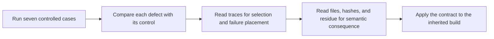
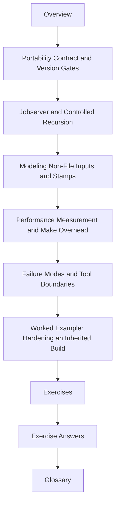

# Module 05: Portability, Hermeticity, and Failure Modes
Modules 01 to 04 teach graph truth, parallel safety, determinism, and exact Make
semantics. Module 05 asks a harder question:

> what assumptions about the machine, shell, tools, and environment are you willing to
> trust, and which ones must be modeled explicitly?

This is the module where a build stops being "correct on my machine" and starts becoming a
declared contract.

## Why this day matters

Many build failures are really contract failures in disguise. The machine, shell, tool
version, locale, or recursive boundary changed, but the build never said which of those
facts mattered.

Module 05 keeps three claims separate:

| Claim | Question | Evidence |
| --- | --- | --- |
| support | can this environment run the build correctly? | accepted and rejected contract cases |
| semantic identity | which external facts change artifact meaning? | convergent manifest and downstream invalidation |
| ownership | should Make still model this concern? | file handoff, failure ownership, and retained proof route |

A tool can be present but unsupported. A supported tool can change artifact meaning and
therefore require attestation. A fully attested process can still be a poor concern for
Make to own. Treating these as one idea produces confused gates and noisy manifests.

## Plan for the day

| Session | Work | Evidence you keep | Stop condition |
| --- | --- | --- | --- |
| contract | run the environment audit; read portability and recursion | paired rejection/acceptance and parent/child observations | you can state what the audit proves and does not prove |
| identity | model one non-file fact | equal-state convergence and changed-state invalidation | manifest identity is stable across repeated and clean-room builds |
| measurement | separate parse, decision, recipe, and observation costs | repeated timings with workload state recorded | the suspected layer has a controlled comparison |
| ownership | classify one concern and harden the inherited example | handoff contract or explicit Make repair | one owner, one failure boundary, one retained proof route |
| practice | complete the ten exercises | cumulative hardening packet | every repair has a negative case and a settled case |

If you have only one hour, run `capstone-environment-contract-audit`, read its guide, and
explain the three required-tool rows. Return for recursion, non-file state, measurement,
and tool boundaries when you can test them rather than merely read about them.

## What this module is for

By the end of Module 05, you should be able to explain five things clearly:

- which parts of the toolchain and shell are required, optional, or unsupported
- how recursion stays bounded and jobserver-aware under `-j`
- which non-file inputs change artifact meaning and how to model them honestly
- how to measure Make overhead instead of guessing about performance
- when a failure is a repairable Make problem and when it points to a tool boundary

## The executable laboratory for this module

Use the environment contract audit as the anchor:



Run it from the repository root:

```sh
gmake -C programs/reproducible-research/deep-dive-make \
  capstone-environment-contract-audit
```

The three families answer different questions:

| Family | Question |
| --- | --- |
| non-file state | when is an external value reevaluated, and when is changed content published? |
| recursive boundary | can the parent plan enter the child graph, and what did the actual child inherit? |
| required tool | does an unavailable capability stop before publication begins? |

Do not collapse those questions into one generic "environment audit."

The audit does not prove:

- that every accepted tool version is semantically compatible
- that a child never oversubscribes on every supported jobserver transport
- that an environment manifest is reproducible in two independent workspaces
- that a performance complaint belongs to Make
- that a proposed tool handoff preserves the artifact contract

Those claims need their own exercises and evidence. `PASS` on a specimen bundle means the
specimens matched their declared expected observations; it is not a blanket portability
certificate.

## Sort assumptions into three contracts

Do not put every environmental fact into one stamp. Classify it first:

| Kind | Example | Build response |
| --- | --- | --- |
| required capability | GNU Make 4.3, `python3`, POSIX shell | detect early and fail with a useful message |
| semantic input | compiler, flags, target architecture | record stable evidence and make outputs depend on it |
| diagnostic context | hostname, current time, terminal color | report separately; do not destabilize artifact identity |

This distinction prevents two opposite mistakes. Ignoring a semantic input creates stale
outputs. Recording every volatile diagnostic as an input creates endless rebuilds.

For one build you know, write at least two facts in each row. If you cannot decide where
a fact belongs, ask: “Could changing this fact change the bytes or meaning of a declared
artifact?” A yes usually indicates a semantic input. A no may still matter for debugging,
but it should not automatically control freshness.

## The question to keep asking

Every time you find an environment-dependent behavior, ask:

> Is this a required capability, a semantic input, or only diagnostic context?

That one classification decision prevents many dishonest stamps and many needless rebuilds.

## Study route



Read the module in that order the first time. Later, return directly to the page that
matches the incident or design boundary you are facing.

## The ten files in this module

1. Overview (`index.md`)
2. [Portability Contract and Version Gates](portability-contract-and-version-gates.md)
3. [Jobserver and Controlled Recursion](jobserver-and-controlled-recursion.md)
4. [Modeling Non-File Inputs and Stamps](modeling-non-file-inputs-and-stamps.md)
5. [Performance Measurement and Make Overhead](performance-measurement-and-make-overhead.md)
6. [Failure Modes and Tool Boundaries](failure-modes-and-tool-boundaries.md)
7. [Worked Example: Hardening an Inherited Build](worked-example-hardening-an-inherited-build.md)
8. [Exercises](exercises.md)
9. [Exercise Answers](exercise-answers.md)
10. [Glossary](glossary.md)

## How to use the file set

| If you need to... | Start here |
| --- | --- |
| define the minimum supported Make, shell, and tools | [Portability Contract and Version Gates](portability-contract-and-version-gates.md) |
| make recursion behave under parallel execution | [Jobserver and Controlled Recursion](jobserver-and-controlled-recursion.md) |
| model environment facts without lying about reproducibility | [Modeling Non-File Inputs and Stamps](modeling-non-file-inputs-and-stamps.md) |
| understand whether Make overhead is actually the bottleneck | [Performance Measurement and Make Overhead](performance-measurement-and-make-overhead.md) |
| classify a failure and decide whether Make is still the right tool | [Failure Modes and Tool Boundaries](failure-modes-and-tool-boundaries.md) |
| see the whole module in one incident narrative | [Worked Example: Hardening an Inherited Build](worked-example-hardening-an-inherited-build.md) |
| test your own understanding | [Exercises](exercises.md) |
| compare your reasoning against a reference answer | [Exercise Answers](exercise-answers.md) |
| stabilize the module vocabulary | [Glossary](glossary.md) |

## The running question

Carry this question through every page:

> if this build changes behavior on another machine or another run, which assumption moved
> and where is that assumption declared?

Good Module 05 answers usually mention one or more of these:

- an undeclared portability boundary
- recursion hidden from planning evidence or detached from the declared jobserver contract
- a non-file input that was real but unmodeled
- performance claims made without measurement
- a failure mode that should have forced a tool-boundary decision earlier

## What a strong Module 05 day looks like

By the end of the day, you should have:

- written one small portability contract
- repaired one recursive invocation so it respects Make's own behavior
- modeled one non-file input with a convergent boundary file
- produced one measurement that separates suspicion from evidence
- named one concern that Make should stop owning

## Commands to keep close

These commands form the evidence loop for Module 05:

```sh
gmake -C programs/reproducible-research/deep-dive-make \
  capstone-environment-contract-audit
make -n all
make --trace all
make -p
make all && make -q all
/usr/bin/time -p make -n all
```

Use them on purpose. Hardening work becomes sloppy when measurement and proof get replaced
with suspicion.

Keep measurement output under the repository `artifacts/` tree and label each run with:

- the requested goal and Make options
- clean, no-op, or changed-input workload state
- environment facts intentionally held constant
- repetition count and summary statistic
- whether output capture or tracing was enabled

A timing with none of that context cannot be compared responsibly.

## Learning outcomes

By the end of this module, you should be able to:

- publish a portability contract instead of relying on workstation folklore
- distinguish declared recursive intent from jobserver flags that happened to survive
- model non-file inputs as explicit build facts without contaminating artifacts
- place required-tool rejection before every publication frontier
- produce at least one meaningful performance measurement before proposing a performance fix
- explain when Make should remain the orchestrator and when another tool should take over

## Exit standard

Do not move on until all of these are true:

- you can name the required Make and shell features without hedging
- you can explain why dry-run visibility and actual jobserver inheritance are separate claims
- you can model one non-file input using a convergent stamp or manifest
- you can explain why a late missing-tool failure may leave a zero-byte file
- you can produce one timing or trace-volume metric and explain what it means
- you can classify one failure as a Make repair, a tool boundary, or a migration trigger
- you can state the file-level handoff and failure owner when another tool takes a concern
- you can complete all ten exercises and defend each decision with observed evidence

When those feel ordinary, Module 05 has done its job.
