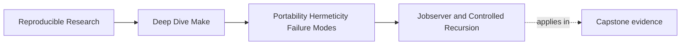

# Jobserver and Controlled Recursion


<!-- page-maps:start -->
## Page Maps




<!-- page-maps:end -->

Recursive Make triggers strong opinions because teams often meet it in bad states.

They inherit builds that:

- call `make` directly from recipes
- lose the `-j` budget inside subdirectories
- behave one way under `make -n` and another way under real execution
- recurse so deeply that nobody can explain who owns scheduling anymore

That can lead to a lazy conclusion:

> recursion is always wrong.

Module 05 needs a more precise answer.

Recursive Make can be acceptable when it coordinates an explicit boundary, stays inside
the parent's parallel budget, and remains observable. It is still multiple local DAGs,
not one global graph.

## The sentence to keep

When you see recursion, ask these questions first:

> Did the parent declare this as a recursive Make boundary? Can its dry run enter the
> child graph? Does the child share the parallel budget?

Do not infer all three answers from one successful build.

## What the jobserver actually is

GNU Make's jobserver is the token budget behind `-jN`.

When the top-level Make starts with `-j8`, it does not want every sub-make to behave as if
it also owns eight independent workers. That would explode the actual concurrency.

Instead, GNU Make coordinates through a shared token mechanism so recursive sub-makes can
participate in the same budget.

The transport has changed across GNU Make versions. Older jobservers commonly used an
inherited pipe; GNU Make 4.4 can advertise a FIFO in `MAKEFLAGS`. You do not need to
memorize the transport, but you do need to distinguish a declared contract from
incidental inheritance.

The practical rule is:

- invoke a sub-make through `$(MAKE)`
- use `+` so planning modes can enter the child graph
- inspect `MAKELEVEL` and `MAKEFLAGS`, but do not treat one host's values as a portability
  guarantee

## Why `$(MAKE)` matters

This is the healthy shape:

```make
subdir:
	+$(MAKE) -C thirdparty all
```

This is an undeclared process invocation:

```make
subdir:
	make -C thirdparty all
```

The second version looks almost identical, but the parent cannot recognize the command
text as its recursive `$(MAKE)` invocation. It therefore cannot reliably apply recursive
handling:

- the line may be skipped by `-n`
- the child's plan can disappear from top-level evidence
- jobserver transport may be lost in invocation environments that do not expose it through
  ordinary environment inheritance

On GNU Make 4.4 with a FIFO jobserver, a literal `gmake` process may happen to inherit
`-j2` and the FIFO reference. That observation is useful, but it does not retroactively
declare recursive intent. Older pipe-based jobservers and other launch contexts can
behave differently.

## Why the `+` prefix matters too

GNU Make recognizes recipe lines containing `$(MAKE)` as recursive in important cases.
It is still clearer to write the complete contract:

```make
subdir:
	+$(MAKE) -C thirdparty all
```

The `+` says that the command must run even when ordinary recipes are suppressed, such as
under `-n`. The child Make receives the dry-run request and prints its own plan; it does
not publish the child output. The spelling communicates intent to Make, reviewers, and
static checks without depending on implicit recognition rules.

## Prove the boundary with the course specimen

Run the paired audit from the repository root:

```sh
gmake -C programs/reproducible-research/deep-dive-make \
  capstone-environment-contract-audit
```

Open:

```text
artifacts/audit/reproducible-research/deep-dive-make/environment-contracts/
```

The recursive comparison has two parent Makefiles:

| Model | Parent recipe | Required dry-run observation |
| --- | --- | --- |
| literal recursion | `$(MAKE_BIN) -C child all` | parent command prints; child plan stays hidden |
| declared recursion | `+$(MAKE) -C child all` | child plan prints; `child.out` stays absent |

The literal form uses a variable only to make the selected Make executable configurable;
it does not use GNU Make's special `$(MAKE)` variable. The difference is semantic, not
typographic.

Read these files together:

- `summary.tsv` names the two findings
- `traces/recursive-boundary-literal-dry-run.log` shows the hidden child plan
- `traces/recursive-boundary-declared-dry-run.log` shows the visible child plan
- each actual-run trace records the child's `MAKELEVEL` and `MAKEFLAGS`

The expected findings are:

```text
LITERAL_RECURSION_HIDES_CHILD_PLAN
DECLARED_RECURSION_EXPOSES_CHILD_PLAN
```

Aggregate `PASS` means both models behaved as declared. It does not endorse the broken
model.

## Controlled recursion is different from accidental nesting

There are legitimate reasons to recurse:

- a third-party component has its own maintained Makefile
- a build step is intentionally delegated to a separate tree
- the top-level build is coordinating a bounded number of local build systems

Those can be valid.

What is not valid is accidental nesting where recursion is used because:

- the build structure is unclear
- the team did not want to model dependencies
- the logs were already confusing, so one more layer seemed harmless

Recursion is a boundary. If you use it, you owe the reader a clear explanation of what
crosses that boundary and what stays local.

## Read `MAKELEVEL` relatively

GNU Make exposes recursion depth through `MAKELEVEL`.

Each recursive Make increments `MAKELEVEL`. A program-level wrapper can add legitimate
levels before your boundary, so an absolute value from one command is not universal.
State the boundary as a relative claim:

> the child is exactly one Make level below this parent.

You can still enforce a repository-specific ceiling when the entry route is fixed:

```make
ifneq ($(filter 3 4 5 6 7 8 9,$(MAKELEVEL)),)
$(error recursion depth exceeded)
endif
```

Document why that ceiling matches the public entry routes. A copied guard with an
unexplained number is not evidence.

## A tiny recursion example

Top-level Makefile:

```make
.PHONY: all subdir

all: subdir

subdir:
	+$(MAKE) -C lib all
```

`lib/Makefile`:

```make
.PHONY: all

all:
	@printf 'MAKELEVEL=%s\n' '$(MAKELEVEL)'
	@printf 'MAKEFLAGS=%s\n' '$(MAKEFLAGS)'
```

Run both execution and planning:

```sh
make -j4 all
make -n all
```

Check three separate claims:

- execution reaches the child and increments `MAKELEVEL`
- the child receives the parent's parallel contract in `MAKEFLAGS`
- dry run prints the child recipe without creating its output

## Dry-run lies are a real failure mode

One reason this lesson matters is that `make -n` is often used as a trust-building tool.
But if recursion is hidden badly, `-n` becomes less informative.

Compare:

```make
literal:
	$(MAKE_BIN) -C lib all

declared:
	+$(MAKE) -C lib all
```

With `make -n literal`, seeing the command text proves only that the parent would launch a
process. It does not reveal the child's file decisions. With `make -n declared`, the child
interprets `-n` and exposes those decisions.

That distinction is why dry-run visibility is stronger evidence of declared recursion
than seeing jobserver text survive on one machine.

## Output synchronization is about readability, not truth

Under parallel recursion, logs can become chaotic. GNU Make offers `--output-sync=recurse`
to make recursive output easier to read.

That can be very useful, but remember what it is and is not:

- it improves log readability
- it does not fix a lost jobserver
- it does not repair missing edges
- it does not make recursion justified if the structure is already wrong

This distinction matters because people often mistake cleaner logs for healthier
coordination.

## When recursion is a warning sign

Recursion should trigger review when:

- the top-level build and sub-build both claim the same output paths
- the sub-make needs information that is not passed explicitly
- the recursion depth is not intentionally bounded
- the top-level build cannot explain whether the sub-make consumes the same `-j` budget
- the only reason recursion exists is to avoid modeling dependencies

Those are not small style issues. They are signs that the orchestration boundary is doing
more harm than good.

## A good pattern for recursive boundaries

If you do need recursion, document it in a way you can explain clearly:

```make
.PHONY: thirdparty

thirdparty:
	+$(MAKE) -C thirdparty all
```

Then say in the surrounding docs or comments:

- why the boundary exists
- which outputs belong to the sub-build
- whether the top level depends on a file, a directory contract, or a public target from
  that subtree

This keeps recursion from turning into unexplained ceremony.

## Failure signatures worth recognizing

### "`-j8` is fast at the top level but slow inside subdirectories"

The child may have lost jobserver access, or its graph may simply expose little parallel
work. Inspect the invocation and the child's `MAKEFLAGS` before deciding.

### "`make -n` did not show what the recursive build would do"

That points to a process invocation the parent does not treat as a recursive command.
Use the paired audit before changing syntax by guesswork.

### "The build hangs only under parallel recursion"

That may signal jobserver misuse, accidental nested builds, or a recursive boundary that is
passing responsibilities unclearly.

### "Nobody can explain what the recursive step owns"

That usually means the boundary was created for convenience rather than design.

## A review question that sharpens recursive designs

Take any recursive invocation and ask:

1. why is this a separate build boundary
2. which outputs does the sub-make own
3. what actual-run evidence shows about its parallel budget
4. whether `-n` enters the child graph without publishing
5. how deep is recursion allowed to go

If those answers are weak, the recursive structure is probably weak too.

## What to practice from this page

Run the environment contract audit, then explain one recursive boundary in plain
language:

1. why the recursion exists
2. how the sub-make is invoked
3. what the actual child reports in `MAKEFLAGS`
4. what the dry-run trace reveals inside the child
5. where the depth limit should live

Do not write "the budget is preserved because I saw `-j2`." Explain why `+$(MAKE)` is the
declared contract even when a literal process happens to inherit the same flags.

If you can explain all five without hand-waving, the recursion is probably under control.

## End-of-page checkpoint

Before leaving this lesson, make sure you can explain:

- why `$(MAKE)` is semantically different from plain `make`
- why the `+` prefix matters for recursive invocations
- why recursion needs a bounded, explainable ownership boundary
- how `MAKELEVEL` helps control depth
- why readable parallel logs are useful without being a substitute for correct jobserver behavior
