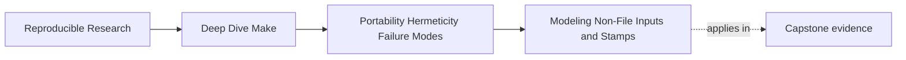
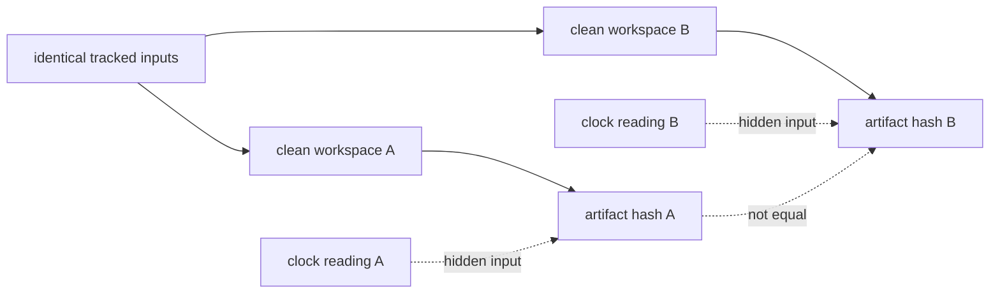

# Modeling Non-File Inputs and Stamps


<!-- page-maps:start -->
## Page Maps




<!-- page-maps:end -->

By Module 05, you usually understand file prerequisites well enough to see one of the
remaining problems clearly:

the build depends on more than files.

It may depend on:

- the compiler version
- the shell locale
- an environment flag
- a selected tool path
- a feature toggle passed in from CI

Those facts are real. If they change artifact meaning, pretending they do not exist does
not make the build simpler. It makes it dishonest.

This page is about learning how to model those facts without poisoning the build with
noise.

## The sentence to keep

Ask this every time you discover an environmental fact:

> if this value changed, would the declared artifact meaning change?

If the answer is yes, the build needs to model it somehow.

If the answer is no, it should not be turned into ceremonial metadata just because it is
easy to collect.

That distinction matters.

## Hermeticity is not the same thing as isolation fantasy

People sometimes hear "hermetic" and imagine a build that ignores the outside world
completely.

That is rarely the practical goal in normal engineering. The useful goal is narrower:

> the build should declare and control the external facts that matter to artifact meaning.

This module calls that "hermetic enough."

That means:

- important environmental inputs are named
- those inputs are either pinned or attested
- the resulting evidence converges
- the build does not inject fresh entropy just to look rigorous

## The difference between pinning and attesting

There are two healthy ways to handle an external fact:

| Approach | When to use it | Example |
| --- | --- | --- |
| pinning | the value should be fixed for correctness | `export LC_ALL := C` |
| attesting | the value may vary, but the build must record what it was | compiler version manifest |

Pin when you want the build to behave the same way everywhere.

Attest when you need to acknowledge a real dependency but cannot or should not force one
global value.

The mistake is collecting attestation data that changes on every run even when artifact
meaning did not.

## Common non-file inputs worth thinking about

These are the usual suspects:

- `CC`, `CFLAGS`, `CPPFLAGS`, `LDFLAGS`
- locale variables such as `LC_ALL`
- the specific compiler or interpreter path
- feature toggles such as `MODE=debug`
- selected compression or archive tool identity
- repository state if it is intentionally injected into the artifact

Do not model every one by reflex. First decide whether it truly changes the artifact
meaning or only changes operator convenience.

## A small compiler-attestation example

Suppose a binary should rebuild if the compiler identity changes.

One honest pattern is:

```make
TOOLCHAIN_STAMP := build/toolchain.stamp

.PHONY: FORCE
FORCE:

$(TOOLCHAIN_STAMP): FORCE | build/
	@set -eu; \
	candidate="$@.candidate.$$$$"; \
	trap 'rm -f "$$candidate"' EXIT HUP INT TERM; \
	"$(CC)" --version | sed -n '1p' > "$$candidate"; \
	if test -r "$@" && cmp -s "$$candidate" "$@"; then \
	  :; \
	else \
	  mv "$$candidate" "$@"; \
	fi

app: $(TOOLCHAIN_STAMP) main.o util.o
	$(CC) $(CFLAGS) main.o util.o -o $@
```

This pattern matters because it converges:

- `FORCE` makes Make re-evaluate a fact that has no natural file prerequisite
- the stamp content changes only when the semantic fact changes
- the file is not rewritten pointlessly every run
- the application target now has an explicit edge to that build fact

That is a much healthier design than hiding the compiler identity entirely.

Do not remove `FORCE` just because the stamp is a file. Without an evaluation trigger,
Make sees an existing target with no newer prerequisite and never runs the recipe that
could discover a changed compiler. `FORCE` controls evaluation; `cmp` controls
publication. Both parts are required.

The process-local candidate prevents two Make processes from truncating the same work
file. It does not make two conflicting final publications correct. If
`MODE=debug` and `MODE=release` can run concurrently in one workspace, they need distinct
output namespaces or an explicit exclusion policy. Atomic rename prevents partial bytes;
it cannot decide which artifact meaning should win.

## Compare clock-derived state with declared state

A no-op rebuild is not enough to prove a stamp is reproducible. Once a stamp exists in a
workspace, Make may correctly reuse it even if the first build created it from hidden
entropy. A stronger test starts two clean workspaces from the same declared inputs and
compares the resulting artifacts.

The capstone semantic audit performs that test. Run:

```sh
gmake -C programs/reproducible-research/deep-dive-make/capstone \
  semantic-fault-audit
```

Then inspect the clock-state rows in:

```text
artifacts/audit/reproducible-research/deep-dive-make/semantic-faults/report.json
```

Both models begin with the same tracked input:

```text
mode.txt -> analysis
```

The broken model invents state at build time:

```make
artifact.txt: mode.txt state.stamp
	printf 'mode=%s\nstate=%s\n' \
	  "$$(cat mode.txt)" "$$(cat state.stamp)" > $@

state.stamp:
	$(PYTHON) -c 'import time; print(time.time_ns())' > $@
```

The wall clock is now part of artifact meaning even though no graph edge names or
controls it:



The control derives the stamp from declared state:

```make
artifact.txt: mode.txt state.stamp
	printf 'mode=%s\nstate=%s\n' \
	  "$$(cat mode.txt)" "$$(cat state.stamp)" > $@

state.stamp: mode.txt
	cp mode.txt $@
```

Predict the observations before reading the report:

| Model | Tracked inputs equal? | State source | Artifact hashes |
| --- | --- | --- | --- |
| clock-derived | yes | independent wall-clock readings | different |
| declared-state | yes | `mode.txt` | equal |

The important report fields are `first_artifact`, `second_artifact`, `first_sha256`,
`second_sha256`, and `hashes_equal`. The expected findings are:

```text
CLOCK_STATE_DRIFT_REPRODUCED
DECLARED_STATE_STABLE
```

The first finding is a successful reproduction of a defect, not approval of the model.
The second establishes a controlled contrast: identical declared state produces
identical semantic output.

### State identity must survive a clean-room question

For any proposed stamp, ask:

> Could another clean workspace derive the same file from the same declared inputs?

If the answer depends on when the build ran, who ran it, or which random value happened
to be chosen, the stamp is recording an event rather than representing semantic state.

That distinction leads to three different destinations:

| Fact | Appropriate destination | Why |
| --- | --- | --- |
| `MODE=analysis` changes artifact behavior | artifact-driving state file | it changes meaning and can converge |
| build start time is useful to operators | log or sidecar run record | it describes the event, not the artifact state |
| release timestamp is required by the product contract | declared, normalized input | it affects meaning and must be governed |

Clocks are not forbidden. Undeclared clocks are incompatible with a claim that equal
inputs produce equal artifacts.

## Why timestamps are often the wrong attestation

Beginners often try to "prove" rigor by writing timestamps into manifests or stamps:

```make
.PHONY: FORCE
FORCE:

build/env.stamp: FORCE
	@date > $@
```

That file changes every run, which means it destroys convergence and turns attestation into
entropy.

The question is not "can I record something?" The question is "can I record the semantic
fact in a stable way?"

A better shape is:

```make
.PHONY: FORCE
FORCE:

build/env.stamp: FORCE
	@set -eu; \
	candidate="$@.candidate.$$$$"; \
	trap 'rm -f "$$candidate"' EXIT HUP INT TERM; \
	{ \
	  printf 'CC=%s\n' '$(CC)'; \
	  printf 'LC_ALL=%s\n' '$(LC_ALL)'; \
	} > "$$candidate"; \
	if test -r "$@" && cmp -s "$$candidate" "$@"; then \
	  :; \
	else \
	  mv "$$candidate" "$@"; \
	fi
```

Now the candidate is evaluated on every invocation, but the durable file changes only
when the declared inputs change.

## Canonicalize meaning, not incidental spelling

An attestation is useful only if equal semantic states produce equal content. Decide how
to handle these cases:

| Raw observations | Same semantic input? | Manifest policy |
| --- | --- | --- |
| `CC=cc` and `CC=/usr/bin/cc` resolve to the same executable | often | record one chosen identity, such as version plus target triple |
| `LC_ALL` unset while locale categories are inherited | not proven | compute the effective locale or pin `LC_ALL` |
| compiler banner contains installation path or build date | maybe | retain only fields demonstrated to affect supported behavior |
| flags differ only in whitespace | tool-dependent | never normalize without proving equivalence |
| environment contains access tokens | no artifact meaning | exclude secrets completely |

Canonicalization is a contract, not string cleanup. Keep raw diagnostic observations in a
separate evidence bundle when they are useful for incidents but too volatile to drive
freshness.

Validate values before interpolating them into recipes. A finite value such as `MODE`
should match one allowed token. Tool variables should name one executable, with arguments
stored separately. This prevents a manifest recipe from turning unconstrained Make text
into unintended shell syntax.

## Stamps are not junk files

Stamps can feel artificial at first. The healthier view is:

> a stamp is a named graph node for a semantic fact that does not already have a natural
> file output.

If the build meaning depends on "which compiler version produced this artifact," then a
stamp or manifest may be the cleanest way to name that dependency.

The stamp is not the workaround. The hidden dependency was the workaround.

## What should not be modeled

This question matters just as much as what should be modeled.

Examples that often do not belong in artifact-driving stamps:

- the wall-clock time of the build
- the exact username of the operator
- the terminal width
- a process work directory that does not affect outputs

These facts may be interesting for logs or telemetry. That does not mean they belong in
rebuild logic.

If you model too much, the build becomes noisy and unstable.

## Attestation must not contaminate the artifact

One subtle failure mode is mixing evidence into the artifact itself in a way that ruins
equivalence.

For example:

- embedding build time into a binary that should otherwise be reproducible
- writing a host-specific path into a generated header used by normal compilation
- appending a diagnostic signature directly into a shared package payload

Sometimes that is required by the product. Often it is just a convenience that destroys
reproducibility.

A better pattern is to keep attestation adjacent to the artifact:

- a sidecar manifest
- a separate verification bundle
- a stamped contract file

That way the build can both prove its environment and preserve artifact equivalence.

## A small feature-flag example

Suppose CI passes `MODE=debug` and local builds default to `release`.

That is a real non-file input. You can model it with a small mode manifest:

```make
MODE_MANIFEST := build/mode.manifest

.PHONY: FORCE
FORCE:

$(MODE_MANIFEST): FORCE | build/
	@set -eu; \
	candidate="$@.candidate.$$$$"; \
	trap 'rm -f "$$candidate"' EXIT HUP INT TERM; \
	printf 'MODE=%s\n' '$(MODE)' > "$$candidate"; \
	if test -r "$@" && cmp -s "$$candidate" "$@"; then \
	  :; \
	else \
	  mv "$$candidate" "$@"; \
	fi

app: $(MODE_MANIFEST) main.o
	$(CC) $(CFLAGS) main.o -o $@
```

This has two teaching benefits:

- the mode becomes a visible build fact
- the manifest gives you a stable place to inspect what the build believed

It also has two distinct runtime behaviors worth testing:

- `make MODE=release` twice evaluates twice but publishes once
- changing to `make MODE=debug` publishes new manifest content and invalidates `app`

Add a third test: launch two supported configurations concurrently. If both target the
same `build/mode.manifest` and `app`, the graph has a configuration-identity defect even
though each candidate is published atomically. A truthful variant layout is:

```make
MODE ?= release
VALID_MODES := release debug
ifeq ($(filter $(MODE),$(VALID_MODES)),)
$(error MODE must be one of: $(VALID_MODES))
endif

MODE_ROOT := build/$(MODE)
MODE_MANIFEST := $(MODE_ROOT)/mode.manifest
APP := $(MODE_ROOT)/app
```

Now debug and release state can coexist, and the path tells reviewers which semantic
configuration it represents.

## Failure signatures worth recognizing

### "The build differs across machines, but the file graph looks identical"

That usually means a non-file input is real but unmodeled.

### "The selftest never converges after we added provenance files"

That often means the provenance files record timestamps or other fresh entropy rather than
stable semantic facts.

### "We know the compiler matters, but we do not know which compiler produced this artifact"

That means attestation is missing or too informal.

### "Every rebuild touches the same stamp even when nothing changed"

That is a stamp design bug. The graph fact is being rewritten instead of compared and
published only on change.

## A good design question

When you propose a stamp or manifest, ask three things:

1. which semantic fact does it represent
2. which targets depend on that fact
3. can the file converge when the fact does not change
4. can two supported configurations publish without competing for one path

If you cannot answer all three, the stamp is not ready yet.

## What to practice from this page

Take one non-file input in the capstone or your own build and classify it:

1. does it change artifact meaning
2. should it be pinned or attested
3. what file should represent that fact
4. which targets should depend on it
5. how will you keep the representation convergent

If you can answer those cleanly, you are modeling the environment instead of merely
observing it.

## End-of-page checkpoint

Before leaving this lesson, make sure you can explain:

- why hermeticity is about declared external facts, not isolation fantasy
- when to pin an input and when to attest it
- why timestamps are usually poor build facts
- why two clean workspaces are a stronger stamp test than one no-op rebuild
- how artifact hashes reveal a hidden clock-derived input
- why stamps and manifests can improve graph truth
- why process-local candidates prevent partial publication but do not repair configuration
  identity collisions
- why canonicalization needs a semantic argument
- why provenance should often live beside the artifact rather than inside it
