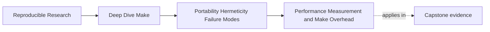

# Performance Measurement and Make Overhead


<!-- page-maps:start -->
## Page Maps




<!-- page-maps:end -->

A useful performance claim names a workload state, a cost layer, and a comparison:

> In a settled workspace, parsing and deciding the `all` goal takes a median 1.8 seconds
> across seven runs; disabling an unused implicit-rule family reduces that median to 0.6
> seconds without changing the selected recipes or outputs.

"Make feels slow" names none of those facts.

## Define the workload before timing

The same goal has several legitimate workloads:

| Workload | Preparation | Question |
| --- | --- | --- |
| clean build | remove governed build outputs | total materialization cost |
| no-op build | complete one build, change nothing | steady-state orchestration and freshness cost |
| one-input rebuild | change one declared input reproducibly | incremental selectivity and critical path |
| planning run | use `-n` on a controlled state | parse, graph, expansion, and printing proxy |
| traced run | enable `--trace` separately | evidence volume and instrumentation overhead |

Do not average these workloads together. A faster clean build can accompany a slower no-op
build, and both facts may matter.


## Separate the cost layers

| Layer | Work performed | Useful discriminator |
| --- | --- | --- |
| startup and parsing | process startup, includes, immediate expansion, parse-time probes | no-op and planning runs; probe inventory |
| graph decision | implicit search, prerequisite traversal, freshness checks | explicit-rule or `-rR` controlled comparison |
| recipe expansion and scheduling | expand selected recipes, coordinate jobserver and recursion | selected recipe count and recursive plan |
| external tools | compile, test, compress, copy, link | per-tool timing or tool profiler |
| storage and cache | metadata queries, reads, writes, remote filesystem latency | repeat on controlled storage/cache state |
| observation | console rendering, trace generation, log synchronization | same run with and without capture |

Wall time alone cannot assign a layer. Use a controlled change that affects one layer more
than the others.

## `-n` is a proxy, not a decision-only timer

`gmake -n` still:

- reads and may remake makefiles
- evaluates parse-time `$(shell ...)`, `$(file ...)`, and `!=`
- constructs and traverses the graph
- expands recipes selected for printing
- writes the printed plan
- may enter declared recursive Make lines

So a slow dry run suggests orchestration or observation cost, but it does not isolate
"decision time." Redirecting output removes terminal rendering from the measurement, yet
recipe expansion and string generation remain.

Use dry run as a discriminator:

| Observation | Supported conclusion | Unsupported leap |
| --- | --- | --- |
| no-op `-n` is slow and real no-op is similarly slow | orchestration likely matters | parsing alone is the cause |
| `-n` is cheap and changed-input rebuild is slow | selected recipes or I/O likely dominate | compiler is definitely at fault |
| `-n` becomes fast with `-rR` | built-in rule/variable machinery is implicated | keep `-rR` without proving the build contract |
| traced run is much slower | instrumentation matters | trace line count equals machine cost |

`-rR` is an experiment first. Retain it only if the build declares all rules and variables
it needs and the output-equivalence checks pass.

## Build a repeatable measurement packet

Create a repository-owned evidence directory:

```sh
mkdir -p artifacts/performance/make-module-05
```

For each workload, preserve:

- exact command and working directory
- Make version, shell, compiler identity, locale, and job count
- preparation command or input mutation
- at least one warm-up excluded from the summary
- several measured repetitions
- wall, user, and system time
- output digest or another correctness assertion

Run timings one command at a time:

```sh
/usr/bin/time -p gmake -n all \
  > artifacts/performance/make-module-05/noop-plan.log

/usr/bin/time -p gmake all \
  > artifacts/performance/make-module-05/noop-build.log
```

`time` writes its measurements to standard error on common systems. Capture it according
to the local implementation and keep Make diagnostics separate; otherwise errors and
timings become one ambiguous stream.

Do not report only the fastest run. For small samples, median and range are more honest
than a many-decimal average. If results vary widely, investigate the uncontrolled source
before claiming a speedup.

## Diagnose parsing and decision cost

Start with an inventory rather than a rewrite:

```sh
rg -n '\\$\\(shell|\\$\\(file|^[A-Za-z_][A-Za-z0-9_]*[[:space:]]*!=' \
  Makefile mk/
```

Then form one hypothesis:

| Suspect | Controlled experiment | Correctness guard |
| --- | --- | --- |
| repeated tool probe | cache one read-only result per parse | accepted and rejected capability cases unchanged |
| broad wildcard discovery | replace with declared manifest in a copy | discovered target set identical |
| implicit-rule search | compare with `-rR` | same selected recipes and output digests |
| generated `eval` families | replace one bounded family with static pattern rules | database target/prerequisite entries equivalent |
| excessive included fragments | combine only generated fragments in a copy | origin, include order, and rebuild behavior unchanged |

The experiment changes one variable. A wholesale Makefile rewrite cannot tell you which
change mattered.

## Diagnose recipe and I/O cost

If planning is cheap but real work is slow, inspect the selected tools:

- time the dominant compiler, linker, test, or archive invocation
- distinguish CPU time from wall time waiting on storage or network
- verify whether the recipe repeats work because its output contract is weak
- check whether one long recipe hides parallelizable file targets
- keep tool caches either deliberately warm or deliberately cold across comparisons

Do not split one semantically atomic publication merely to create more parallel jobs.
Performance changes remain subordinate to output ownership and failure safety.

## Measure parallel scaling without losing correctness

Run the same prepared workload at supported budgets:

```sh
gmake -j1 all
gmake -j2 all
gmake -j4 all
```

For each budget, record wall time, peak recipe overlap where practical, and output digests.
Interpret the shape:

| Scaling result | Next question |
| --- | --- |
| near-linear improvement | does memory or I/O remain safe at the next supported budget? |
| early plateau | is the critical path serial, the graph missing independence, or the tool internally parallel? |
| regression at higher `-j` | are CPU, memory, storage, or nested tools oversubscribed? |
| different output digest | stop; this is a correctness failure, not a performance result |

Recursive builds also need jobserver evidence. Never give each child its own `-jN` and call
the aggregate faster without measuring total concurrency.

## Treat trace volume as an operability measure

Count trace lines only after capturing a comparable workload:

```sh
gmake --trace all \
  > artifacts/performance/make-module-05/trace.log
wc -l artifacts/performance/make-module-05/trace.log
```

Line count is a proxy for evidence volume, not explanatory quality or execution cost.
Review a sample:

- can each line be attributed to one target and rule?
- is recursion synchronized enough to follow?
- does the trace contain repeated noise that hides causal lines?
- did trace capture materially alter wall time?

Optimize observation separately. `--output-sync=recurse` can improve readability without
changing graph truth.

## A worked interpretation

Suppose seven settled runs produce:

| Command | Median wall time | Range | Interpretation |
| --- | ---: | ---: | --- |
| `gmake -n all` with output discarded | 1.7 s | 1.6–1.9 s | orchestration proxy is material |
| `gmake all` with output discarded | 1.8 s | 1.7–2.0 s | recipes add little in settled state |
| `gmake -rR -n all` in a test copy | 0.5 s | 0.5–0.6 s | built-in search is a useful suspect |
| `gmake -rR all` after one input change | 4.1 s | 4.0–4.3 s | full contract still needs equivalence proof |

The next action is not yet "add `-rR` everywhere." Compare selected rules, rebuild causes,
and output hashes under the normal and experimental modes. Performance evidence proposes
a candidate; correctness evidence licenses it.

## Review checklist

Reject a performance change when:

- baseline and changed runs use different workload states
- only one measurement is reported
- output capture or tracing differs without being named
- caches, job count, or tool versions changed silently
- the change improves time by hiding required work
- the output contract or settled query was not rechecked

Accept the claim only when the report names the layer, controlled variable, result
distribution, correctness guard, and readability tradeoff.

## Practice before moving on

Choose one capstone route and produce:

1. clean, no-op, and one-input workload definitions
2. repeated planning and real-run timings
3. one trace-volume observation kept separate from timing
4. one layer hypothesis
5. one controlled experiment testing that hypothesis
6. output-equivalence and convergence checks after the experiment

If the result is "the recipe tool dominates," that is a useful result. It prevents an
expensive Make rewrite aimed at the wrong layer.

## End-of-page checkpoint

Before leaving, make sure you can explain:

- why workload state must be fixed before timing
- why `-n` is an orchestration proxy rather than a pure decision timer
- how repeated measurements and spread prevent fastest-run storytelling
- how `-rR` can test an implicit-search hypothesis without becoming an automatic fix
- why parallel speedups require output-equivalence and jobserver evidence
- why trace volume measures operability, not graph correctness
