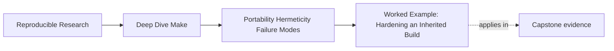
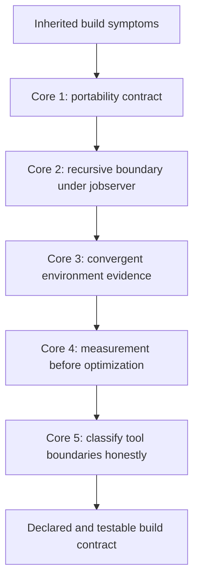

# Worked Example: Hardening an Inherited Build


<!-- page-maps:start -->
## Page Maps




<!-- page-maps:end -->

The five core lessons in Module 05 are easiest to trust when they all appear in one build
that is recognizably imperfect. This walkthrough uses the course's executable specimens
before applying the repairs to a larger sketch. You can follow it without inventing a
private sample project.

## Begin with paired evidence

From the repository root, run:

```sh
gmake -C programs/reproducible-research/deep-dive-make \
  capstone-environment-contract-audit
```

Open:

```text
artifacts/audit/reproducible-research/deep-dive-make/environment-contracts/
```

Start with `summary.tsv`, then use `report.json`, `traces/`, and `workspace/` to test each
summary against the underlying evidence.

The audit gives three broken/control pairs:

| Contract family | Broken observation | Control observation |
| --- | --- | --- | --- |
| non-file state | `MODE=debug` request retains release artifact | changed mode publishes once, equal mode converges |
| recursive boundary | parent dry run hides the child plan | parent dry run enters child plan without publishing |
| required tool | missing command leaves an empty version file | gate rejects cleanly and accepts an available tool |

`PASS` means each specimen behaved as its model declared. It does not mean the broken
models are acceptable.

This example starts with a build that "mostly works":

- the lead developer can run it locally
- CI sometimes fails in ways nobody can reproduce quickly
- parallel output is confusing
- provenance files exist, but they break convergence
- the team suspects Make itself is the main problem

That is exactly the kind of build many teams inherit.

## The incident report

Assume you inherit a repository with these complaints:

1. CI fails on a machine with an older Make
2. the recursive sub-build is absent from top-level dry-run evidence, and nobody has
   checked whether it shares the parallel contract
3. the build records environment information, but `make -q all` still returns `1` after a
   successful run
4. the team says the build is "slow," but nobody can say whether Make or the compiler is
   responsible
5. someone proposes replacing Make entirely with a workflow tool

That is enough to begin.

## The starting Makefile shape

Here is the simplified build:

```make
SHELL := /bin/sh

MODE ?= release

include mk/generated-env.mk

.PHONY: all thirdparty

all: thirdparty app package

thirdparty:
	make -C vendor/lib all

api.h api.json: gen_api.py schema.yml
	python3 gen_api.py

app: api.h main.o
	$(CC) $(CFLAGS) main.o -o $@

package: app
	tar -czf app.tar.gz app

mk/generated-env.mk:
	@printf 'BUILD_TIME := %s\n' "$$(date +%s)" > $@
```

Every line here is plausible. That is what makes the example useful.

## Establish the inherited build's own evidence

The specimen proves the failure mechanisms. Now collect the inherited build's state.

Run:

```sh
make all
make -q all; echo $?
make -n all > build/dry-run.log
make --trace all > build/trace.log
/usr/bin/time -p make all >/dev/null
```

Record observations, not conclusions:

- whether the build converges
- whether the top-level dry run enters the vendor graph
- which targets Make says it selected
- whether full execution is slow enough to measure by layer

Do not call the recursive boundary a jobserver leak merely because the build is slow.
The child may expose little parallel work, and a GNU Make 4.4 FIFO may survive an
undeclared process invocation. The dry-run gap is already a reproducible defect.

## Declare the portability contract

CI fails on an older Make. Do not patch the symptom first. Ask what the build requires.

Suppose `gen_api.py` really needs grouped targets in the final design. Then the build needs
a contract near the top:

```make
ifeq ($(origin MAKE_VERSION),undefined)
$(error GNU Make is required)
endif

MIN_GNU_MAKE_OK := $(if $(filter 4.3% 4.4% 4.5% 5.%,$(MAKE_VERSION)),yes,)
ifeq ($(MIN_GNU_MAKE_OK),)
$(error GNU Make 4.3 or newer required; found $(MAKE_VERSION))
endif

PYTHON ?= python3

.PHONY: contract-check
contract-check:
	@command -v "$(PYTHON)" >/dev/null 2>&1 || { \
	  printf 'contract: missing required tool %s\n' "$(PYTHON)" >&2; \
	  exit 2; \
	}
```

Make the gate a prerequisite of the public build before any artifact recipe can publish.
Now the CI failure becomes a declared boundary rather than a random parser error or an
empty probe file.

This is the Core 1 lesson in action:

- required tools and versions are stated explicitly
- unsupported environments fail early
- the build stops pretending that all Make implementations are equivalent
- an available-tool control proves that the gate does not reject everything

## Repair the recursive boundary

The inherited build uses:

```make
thirdparty:
	make -C vendor/lib all
```

That is an undeclared process invocation. On some hosts it loses jobserver access; on GNU
Make 4.4 with a FIFO it may happen to inherit the parent's flags. In either case, the
parent's dry run does not enter the child graph.

Repair it to:

```make
.PHONY: thirdparty

thirdparty:
	+$(MAKE) -C vendor/lib all
```

Then run both `make -n thirdparty` and `make -j2 thirdparty`. The planning run should expose
the child's recipes without creating outputs. The execution run should show a child
`MAKELEVEL` exactly one greater than its parent and the inherited `MAKEFLAGS`. Bound depth
only after accounting for every supported entry route; an absolute level copied from one
wrapper is not a portable guard.

This is Core 2:

- `$(MAKE)` declares recursive semantics
- `+` keeps the child plan visible under dry run
- relative `MAKELEVEL` evidence distinguishes the boundary from an unexplained absolute
  number

## Make environment evidence converge

The inherited file:

```make
mk/generated-env.mk:
	@printf 'BUILD_TIME := %s\n' "$$(date +%s)" > $@
```

is trying to attest environment state. In reality, it injects fresh entropy every run and
prevents convergence.

The healthier question is:

> which environmental facts actually change artifact meaning?

Suppose the important ones are `MODE`, `CC`, and `LC_ALL`. Then write a convergent
manifest:

```make
ENV_MANIFEST := build/env.manifest

.PHONY: FORCE
FORCE:

$(ENV_MANIFEST): FORCE | build/
	@printf 'MODE=%s\nCC=%s\nLC_ALL=%s\n' '$(MODE)' '$(CC)' '$(LC_ALL)' > $@.tmp
	@cmp -s $@.tmp $@ 2>/dev/null || mv $@.tmp $@
	@rm -f $@.tmp

app: $(ENV_MANIFEST) api.h main.o
	$(CC) $(CFLAGS) main.o -o $@
```

`FORCE` and `cmp` solve different problems:

- `FORCE` reevaluates command-line and environment state on every invocation
- `cmp` prevents equal content from replacing the manifest

Without `FORCE`, a later `MODE=debug` request leaves the release manifest stale. Without
`cmp`, every invocation republishes the manifest and rebuilds the application.

This is Core 3:

- environment facts become explicit
- changed facts propagate and equal facts converge
- attestation sits beside the artifact instead of poisoning it

## Identify whether Make is actually the performance problem

The team says the build is slow.

Compare:

```sh
/usr/bin/time -p make -n all >/dev/null
/usr/bin/time -p make all >/dev/null
make --trace all > build/trace.log
wc -l build/trace.log
```

Interpret the measured ratio rather than borrowing example numbers. If full execution is
far slower than dry-run decision work, recipe execution dominates this observation. If
both are slow, inspect parse and graph-decision costs before blaming recipes.

One timing run is not a benchmark. Repeat the same command, record the environment, and use
the module's performance lesson before making a migration argument.

This is Core 4:

- separate performance layers before proposing fixes
- use measurement to reject the wrong explanation

## Model coupled outputs as one generation event

The build also has:

```make
api.h api.json: gen_api.py schema.yml
	python3 gen_api.py
```

If this duplicates under `-j`, that is not a reason to migrate away from Make. It is a
reason to model the generation honestly.

GNU Make 4.3 or newer can express the shared generation event directly with a grouped
target:

```make
api.h api.json &: gen_api.py schema.yml
	python3 gen_api.py
```

Make now runs the generator once and knows that one recipe updates both outputs. If your
portability contract must support older GNU Make, a stamp can represent the event, but it
needs an explicit integrity check: deleting `api.h` while leaving the stamp would
otherwise look up to date. A guarded fallback verifies both outputs before publishing the
stamp and fails clearly if one later disappears:

```make
API_STAMP := build/api.stamp

$(API_STAMP): gen_api.py schema.yml | build/
	python3 gen_api.py
	@test -s api.h && test -s api.json
	@touch $@

api.h api.json: $(API_STAMP)
	@test -s $@ || { \
	  echo "$@ is missing; run 'make clean-generated all'" >&2; \
	  exit 1; \
	}
```

The grouped target is clearer when it is available. The fallback is shown to make the
portability tradeoff visible, not to pretend that a stamp automatically proves every
output still exists. Automatic recovery of independently deleted coupled outputs is one
reason to prefer grouped targets when the supported Make version allows them.

## Decide the real tool boundary

The remaining awkward part may be packaging:

```make
package: app
	tar -czf app.tar.gz app
```

This is still fine inside Make because the concern is file-oriented and the output contract
is simple.

But imagine the team now wants:

- dependency resolution
- multi-environment release promotion
- long-running approval workflows
- retry policies and remote execution state

That is the moment to ask whether Make should remain the orchestrator while another tool
owns those richer workflow concerns.

This is Core 5:

- classify the concern first
- keep Make where it models artifacts well
- move stateful workflow concerns only when the boundary is clear

## The repaired sketch

The hardening pass leaves the build closer to this:

```make
SHELL := /bin/sh
.SHELLFLAGS := -eu -c

ifeq ($(origin MAKE_VERSION),undefined)
$(error GNU Make is required)
endif

MIN_GNU_MAKE_OK := $(if $(filter 4.3% 4.4% 4.5% 5.%,$(MAKE_VERSION)),yes,)
ifeq ($(MIN_GNU_MAKE_OK),)
$(error GNU Make 4.3 or newer required; found $(MAKE_VERSION))
endif

MODE ?= release
PYTHON ?= python3
ENV_MANIFEST := build/env.manifest

.PHONY: all contract-check FORCE thirdparty
FORCE:

all: thirdparty app package

contract-check:
	@command -v "$(PYTHON)" >/dev/null 2>&1 || { \
	  printf 'contract: missing required tool %s\n' "$(PYTHON)" >&2; \
	  exit 2; \
	}

thirdparty: | contract-check
	+$(MAKE) -C vendor/lib all

$(ENV_MANIFEST): FORCE | build/
	@printf 'MODE=%s\nCC=%s\nLC_ALL=%s\n' '$(MODE)' '$(CC)' '$(LC_ALL)' > $@.tmp
	@cmp -s $@.tmp $@ 2>/dev/null || mv $@.tmp $@
	@rm -f $@.tmp

api.h api.json &: gen_api.py schema.yml | contract-check
	python3 gen_api.py

app: $(ENV_MANIFEST) api.h main.o | contract-check
	$(CC) $(CFLAGS) main.o -o $@

package: app | contract-check
	tar -czf app.tar.gz app
```

This sketch still needs the repository's real compile edges and output ownership. It does
establish the environment contracts that the inherited version hid.

## Run the acceptance sequence

Do not stop after reading the repaired sketch. Prove the three changed contracts:

| Check | Required observation |
| --- | --- |
| `make MODE=release app` then `make MODE=debug app` | manifest and app change to debug |
| repeat `make MODE=debug app` | manifest hash and mtime stay fixed; app does not rebuild |
| `make -n thirdparty` | child plan is visible; child outputs are absent |
| `make -j2 thirdparty` | child is one `MAKELEVEL` deeper and reports inherited flags |
| `make PYTHON=bijux-missing-tool all` | deliberate contract message; no publication residue |
| `make PYTHON=python3 all` | gate passes and the build can proceed |

Keep the environment-contract bundle beside this project-specific evidence. The specimen
explains the mechanism; the inherited build's logs prove that the repair applies here.

## What each core contributed



This is why the module is organized the way it is. Hardening is not one trick. It is a
series of clarifications.

## What you should say at the end

A strong summary sounds like this:

> The build was not mainly broken because "Make is flaky." It had an undeclared version
> and tool contract, a recursive boundary hidden from dry-run evidence, a manifest that
> never reevaluated changed non-file state, and an unmeasured performance complaint. We
> added paired contract checks, declared the recursive call, separated manifest evaluation
> from publication, and measured before discussing migration. Only after that did we ask
> whether any concern belonged in another tool.

That is the kind of explanation Module 05 is trying to build.

## What to practice after this example

Take one real inherited build and rewrite its story in the same order:

1. state the symptoms precisely
2. establish the current contract or the lack of one
3. inspect recursive boundaries
4. identify one non-file input worth modeling
5. produce one measurement before proposing a performance fix
6. decide whether any concern has crossed a tool boundary

If you can do that, Module 05 has started to change how you harden builds.

Ask another learner to use only `summary.tsv`, one trace, and one workspace to explain a
broken/control pair. If they must rely on your verbal explanation, improve the evidence
route before adding more detection.
