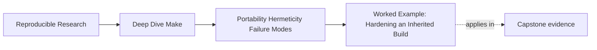

# Worked Example: Hardening an Inherited Build


<!-- page-maps:start -->
## Page Maps




<!-- page-maps:end -->

This example hardens one build without inventing defects that the evidence does not show.
It uses the course specimens for mechanisms, then proves each claim again in the inherited
project.

## Begin with two evidence bundles

Run:

```sh
gmake -C programs/reproducible-research/deep-dive-make \
  capstone-environment-contract-audit
gmake -C programs/reproducible-research/deep-dive-make/capstone \
  semantic-fault-audit
```

The environment bundle provides paired cases for changed non-file state, recursive
planning visibility, and required-tool rejection. The semantic bundle provides the
clean-workspace clock comparison and grouped-publication cases.

`PASS` means each specimen matched its expected observation, including broken specimens
whose defect was reproduced. Read the finding name, trace, and output state.

## The inherited build

```make
SHELL := /bin/sh
MODE ?= release
PYTHON ?= python3
ENV_MANIFEST := build/environment.manifest

.PHONY: all vendor
all: vendor build/app build/app.tar.gz

vendor:
	gmake -C vendor/lib all

$(ENV_MANIFEST): | build/
	@printf 'MODE=%s\nBUILD_TIME=%s\n' \
	  '$(MODE)' "$$(date +%s)" > $@

generated/api.h generated/api.json: schema.yml tools/gen-api.py
	$(PYTHON) tools/gen-api.py

build/app: source.txt generated/api.h $(ENV_MANIFEST) | build/
	$(PYTHON) tools/render-app.py \
	  --source source.txt --environment $(ENV_MANIFEST) --output $@

build/app.tar.gz: build/app
	tar -czf $@ $<
```

The complaints are:

- an older GNU Make reports unclear syntax after grouped targets are proposed
- `gmake -n vendor` does not reveal the child plan
- changing `MODE` after the first build leaves the existing manifest unchanged
- independent clean workspaces produce different manifests because of `BUILD_TIME`
- `-j` sometimes invokes the API generator twice
- the team wants to replace Make because the build is "slow"
- release promotion is being added to the packaging recipe

Each complaint belongs to a different claim.

## Record observations without overclaiming

Run file-target queries, not only the phony aggregate:

```sh
gmake all
gmake -q build/app build/app.tar.gz
gmake -n vendor
gmake -j4 --trace generated/api.h generated/api.json
```

`all` and `vendor` are phony, so `gmake -q all` returning `1` would be expected and would
not prove artifact non-convergence. Query the file targets whose settled state matters.

Create a ledger:

| Observation | Supported conclusion | Not yet proven |
| --- | --- | --- |
| child plan absent under `-n` | recursion is undeclared to planning | jobserver was lost on this host |
| manifest ignores later `MODE` | no evaluation trigger for non-file state | every environment fact belongs in the manifest |
| clean-workspace manifest hashes differ | clock is hidden artifact input | no-op build necessarily rebuilds |
| generator trace contains two starts | output ownership is independent | Make cannot model grouped output |
| one full build is slow | a latency symptom exists | which layer dominates |

## Declare runtime capabilities and tools

The repaired build requires grouped targets and secondary expansion. Gate advertised
features rather than guessing version prefixes:

```make
ifeq ($(origin MAKE_VERSION),undefined)
$(error GNU Make is required)
endif

REQUIRED_MAKE_FEATURES := grouped-target second-expansion
MISSING_MAKE_FEATURES := $(filter-out $(.FEATURES),$(REQUIRED_MAKE_FEATURES))
ifneq ($(strip $(MISSING_MAKE_FEATURES)),)
$(error GNU Make $(MAKE_VERSION) lacks: $(MISSING_MAKE_FEATURES))
endif

SHELL := /bin/sh
.SHELLFLAGS := -eu -c
export LC_ALL := C
PYTHON ?= python3
ifneq ($(words $(PYTHON)),1)
$(error PYTHON must name one executable path)
endif

.PHONY: contract-check
contract-check:
	@command -v "$(PYTHON)" >/dev/null 2>&1 || { \
	  printf 'contract: missing %s\n' "$(PYTHON)" >&2; \
	  exit 2; \
	}
```

Test missing and available tool cases. Finding an executable proves presence, not version
compatibility; add a behavioral or numeric policy if the renderer needs a specific Python
feature.

## Declare the recursive boundary

Replace:

```make
vendor:
	gmake -C vendor/lib all
```

with:

```make
vendor: | contract-check
	+$(MAKE) -C vendor/lib all
```

Now prove two claims separately:

- `gmake -n vendor` enters the child plan without creating child outputs
- an actual `gmake -j2 vendor` records a child exactly one `MAKELEVEL` deeper and measures
  peak recipe overlap within the shared budget

Do not infer token conservation from one `MAKEFLAGS` string.

## Replace event metadata with semantic state

`BUILD_TIME` describes when an event happened; it does not describe application meaning.
Keep it in a run log if operators need it. The artifact-driving manifest contains
validated semantic facts:

```make
VALID_MODES := release debug
ifneq ($(words $(MODE)),1)
$(error MODE must be exactly one of: $(VALID_MODES))
endif
ifeq ($(filter $(MODE),$(VALID_MODES)),)
$(error MODE must be one of: $(VALID_MODES))
endif

MODE_ROOT := build/$(MODE)
ENV_MANIFEST := $(MODE_ROOT)/environment.manifest
APP := $(MODE_ROOT)/app

.PHONY: FORCE
FORCE:

$(ENV_MANIFEST): FORCE | $(MODE_ROOT)/
	@set -eu; \
	candidate="$@.candidate.$$$$"; \
	trap 'rm -f "$$candidate"' EXIT HUP INT TERM; \
	{ \
	  printf 'MODE=%s\n' '$(MODE)'; \
	  printf 'PYTHON=%s\n' "$$("$(PYTHON)" --version 2>&1)"; \
	  printf 'LC_ALL=%s\n' '$(LC_ALL)'; \
	} > "$$candidate"; \
	if test -r "$@" && cmp -s "$$candidate" "$@"; then \
	  :; \
	else \
	  mv "$$candidate" "$@"; \
	fi
```

This design:

- reevaluates non-file facts on every invocation
- keeps equal manifest identity stable
- publishes complete content after interruption-safe candidate generation
- gives debug and release different path identities

Two clean workspaces with the same declared facts must produce equal manifest hashes.
Repeated equal-state invocation must preserve hash and modification time. Changing `MODE`
must publish in a different namespace.

## Give the API generator one owner

```make
generated/api.h generated/api.json &: schema.yml tools/gen-api.py | contract-check
	"$(PYTHON)" tools/gen-api.py
	test -s generated/api.h
	test -s generated/api.json
```

The grouped feature gate appears before this syntax is selected. Under `-j4`, trace and an
invocation log must show one generation event. Delete one group member and prove one
repairing invocation.

## Measure before redesigning

Define three workloads:

| Workload | Goal state |
| --- | --- |
| clean | no governed build outputs |
| no-op | selected mode completely settled |
| changed input | one declared source changed reproducibly |

For each, run repeated measurements with the same job count, tools, locale, and output
capture. Measure planning separately from real execution and keep trace capture out of the
timing comparison.

If no-op `gmake -n` and no-op real build are both expensive, investigate parsing and graph
decision with one controlled experiment such as `-rR` in a copy. If planning is cheap and
the changed-input build is slow, profile the selected renderer or archive tool. Either
result is more useful than a rewrite based on one timing.

## Keep packaging and promotion separate

Building `build/release.tar.gz` from verified files is a file transaction Make can own.
Promotion to a remote environment adds durable authorization, retry, status, and rollback
state.

The handoff is:

| Make publishes | Deployment system owns | Receipt returned |
| --- | --- | --- |
| immutable archive digest, checksums, software bill of materials | environment selection, approval, retry, rollback | signed status and remote revision |

Do not represent remote success with a local `deployed.stamp`. A convenience target may
submit the immutable digest, but the deployment system remains authoritative.

## Repaired build shape

```make
SHELL := /bin/sh
.SHELLFLAGS := -eu -c

ifeq ($(origin MAKE_VERSION),undefined)
$(error GNU Make is required)
endif
REQUIRED_MAKE_FEATURES := grouped-target second-expansion
MISSING_MAKE_FEATURES := $(filter-out $(.FEATURES),$(REQUIRED_MAKE_FEATURES))
ifneq ($(strip $(MISSING_MAKE_FEATURES)),)
$(error GNU Make lacks: $(MISSING_MAKE_FEATURES))
endif

MODE ?= release
VALID_MODES := release debug
ifneq ($(words $(MODE)),1)
$(error MODE must be exactly one of: $(VALID_MODES))
endif
ifeq ($(filter $(MODE),$(VALID_MODES)),)
$(error MODE must be one of: $(VALID_MODES))
endif

PYTHON ?= python3
ifneq ($(words $(PYTHON)),1)
$(error PYTHON must name one executable path)
endif
export LC_ALL := C
MODE_ROOT := build/$(MODE)
ENV_MANIFEST := $(MODE_ROOT)/environment.manifest
APP := $(MODE_ROOT)/app
BUNDLE := $(MODE_ROOT)/app.tar.gz

.PHONY: all contract-check FORCE vendor
FORCE:
all: vendor $(BUNDLE)

contract-check:
	@command -v "$(PYTHON)" >/dev/null 2>&1 || { \
	  printf 'contract: missing %s\n' "$(PYTHON)" >&2; exit 2; \
	}

vendor: | contract-check
	+$(MAKE) -C vendor/lib all

$(ENV_MANIFEST): FORCE | $(MODE_ROOT)/
	@set -eu; \
	candidate="$@.candidate.$$$$"; \
	trap 'rm -f "$$candidate"' EXIT HUP INT TERM; \
	printf 'MODE=%s\n' '$(MODE)' > "$$candidate"; \
	if test -r "$@" && cmp -s "$$candidate" "$@"; then :; \
	else mv "$$candidate" "$@"; fi

generated/api.h generated/api.json &: schema.yml tools/gen-api.py | contract-check generated/
	"$(PYTHON)" tools/gen-api.py
	test -s generated/api.h
	test -s generated/api.json

$(APP): source.txt generated/api.h $(ENV_MANIFEST) | contract-check
	"$(PYTHON)" tools/render-app.py \
	  --source source.txt --environment $(ENV_MANIFEST) --output $@

$(BUNDLE): $(APP) | contract-check
	tar -czf $@ $<

$(MODE_ROOT)/:
	mkdir -p $@

generated/:
	mkdir -p $@
```

Archive metadata normalization is deliberately not claimed here. Module 08 defines that
release contract. This sketch shows the corrected Module 05 boundaries without pretending
to prove portable archive bytes.

## Acceptance matrix

| Check | Required observation |
| --- | --- |
| unavailable `PYTHON` | deliberate failure before artifact publication |
| available `PYTHON` | same gate accepts and build proceeds |
| `gmake -n vendor` | child plan visible, no child output |
| bounded `gmake -j2 vendor` workload | child one level deeper; peak overlap no greater than two |
| two equal clean workspaces | equal environment-manifest hashes |
| repeated equal mode | manifest identity unchanged; file goals query current |
| release and debug in parallel | distinct namespaces with no shared final writer |
| both API members requested under `-j4` | one generator invocation |
| clean/no-op/changed-input timings | repeated, labeled, and paired with correctness checks |
| promotion failure | no false local success stamp; durable external status remains queryable |

## Incident conclusion

The evidence supports this account:

> The build had an undeclared feature and tool contract, recursion hidden from planning,
> stale and clock-derived environment evidence, independent owners for coupled outputs,
> an unclassified performance complaint, and remote workflow state entering a file build.
> We gated advertised capabilities, declared recursion, made semantic manifests
> convergent and configuration-specific, grouped output ownership, measured distinct
> workloads, and defined an immutable deployment handoff.

Another learner should be able to reconstruct every sentence from the paired specimen
bundle and the project-specific acceptance matrix without instructor narration.
