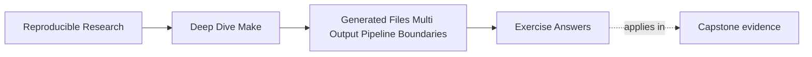

# Exercise Answers


<!-- page-maps:start -->
## Page Maps




<!-- page-maps:end -->

Use this after you have written your own answers. The point is comparison, not copying.

## How to use the answer page well

Do not read a model answer first and then reshape your generator packet to sound similar.

A better rhythm is:

1. finish the exercise with your own graph, traces, and notes
2. write one plain-language explanation of the publication truth
3. compare that explanation with the model answer
4. revise where the model answer exposes a missing boundary, weak consumer edge, or vague
   publication rule

Strong Module 06 answers do not just name a Make feature. They usually do four things:

- they state what publication or boundary truth is at stake
- they point to the evidence that exposes that truth
- they describe the repair as a more honest publication model
- they state when consumers may trust the result set

The strongest self-study packets also leave behind six concrete artifacts:

- one graph story for a generated file
- one honest coupled-output repair
- one justified manifest decision
- one failure-safe staging design
- one deletion-recovery proof
- one complete publication protocol

If your answers rely only on "generators are tricky," the reasoning is still too weak.

## Exercise 1: Tell the graph story of one generated file

A strong answer names one specific output and describes it as a real target:

- output path
- semantic inputs
- consumer edge

For example:

> `build/include/api.h` is generated from `schema/api.yml`, `scripts/gen_api.py`, and any
> modeled boundary file that records relevant generation mode. `main.o` should depend on
> the header because that is the file the compiler actually reads.

The important explanation is:

> The generator itself is not the useful consumer edge; the published file is, because
> that is the artifact the downstream rule actually reads.

## Exercise 2: Repair a coupled output rule

A good explanation says the bug is not merely "parallelism." The bug is that one logical
generation event is modeled too loosely.

A strong grouped-target repair would be:

```make
api.h api.json &: schema/api.yml scripts/gen_api.py
	python3 scripts/gen_api.py
```

A strong stamp repair would be:

```make
API_STAMP := build/api.stamp

$(API_STAMP): schema/api.yml scripts/gen_api.py | build/
	python3 scripts/gen_api.py
	touch $@

api.h api.json: $(API_STAMP)
```

The stamp form needs an additional integrity policy if either output can be deleted while
the stamp remains. A stamp alone does not make that case safe.

The evidence command should usually include a pressured run, such as:

```sh
make -j2 api.h api.json
```

or the same command with `--trace` if you want explicit rebuild reasoning.

The complete output set is:

> every file the single generator invocation promises to publish together, not whichever
> path happened to be requested first.

## Exercise 3: Decide whether a manifest is justified

A strong answer says a manifest is justified only if it names a real boundary fact that is
otherwise awkward to express directly through content edges.

For example, a manifest may be justified if it represents:

- the schema fingerprint
- the generation mode
- the published set of coupled outputs

A stage that validates or summarizes the generated set may reasonably depend on that
manifest.

But a compile step that directly reads `api.h` should still depend on `api.h`, not only
on the manifest. That distinction is the heart of the answer.

The key explanation is:

> A manifest becomes decorative when it merely stands in for a direct file edge that the
> consumer already needs honestly.

## Exercise 4: Protect a pipeline from partial publication

A strong answer separates three moments:

1. temporary generation
2. validation
3. publication

For example:

```make
build/include/api.h build/api.json &: schema/api.yml scripts/gen_api.py | build/
	@python3 scripts/gen_api.py schema/api.yml --out-dir build/tmp
	@python3 scripts/validate_api.py build/tmp/api.h build/tmp/api.json
	@mv build/tmp/api.h build/include/api.h
	@mv build/tmp/api.json build/api.json
```

The key reasoning is:

> Downstream trust begins only after validation and final publication, not while temporary
> content is still being assembled.

Temporary debris may remain for diagnosis; it is not trusted output.

## Exercise 5: Discriminate producer and consumer edge failures

The complete observation table is:

| Specimen | Model | Changed outputs | Final binary text | Finding |
| --- | --- | --- | --- | --- |
| authored header | missing edge | none | `before` | `FAULT_REPRODUCED` |
| authored header | declared edge | `app` | `after` | `REPAIR_VERIFIED` |
| generated producer | missing edge | none | `before` | `FAULT_REPRODUCED` |
| generated producer | declared edge | `generated.h`, `app` | `after` | `REPAIR_VERIFIED` |

Each row has `result=PASS` because the audit observed the contract declared for that
controlled model. For a missing-edge row, the contract is to reproduce stale behavior.
`FAULT_REPRODUCED` is therefore the deciding field: the harness worked, but the graph it
executed is intentionally dishonest.

In the authored-header model, the missing declaration is:

```make
app: config.h
```

The complete rule also retains `main.c`, because source and header both define the binary:

```make
app: main.c config.h
```

The missing-edge trace says there is nothing to do because `config.h` is absent from
Make's reachable prerequisite graph. That trace becomes evidence of a defect only when it
is bound to the changed header and the binary that still prints `before`. Without those
observations, “nothing to do” could simply mean a converged truthful build.

The generated-producer repair restores a different path:

```text
scripts/render_header.py -> generated.h -> app
```

Both governed outputs change because the script first changes the published header's
meaning, then the binary changes because it consumes that header. Adding the script
directly to `app` would be wrong: it might trigger recompilation while leaving
`generated.h` stale, and it would couple the consumer to producer internals.

Production repairs preserve those ownership boundaries:

- for authored or discovered headers, compile with dependency-generation flags and include
  the resulting dependency files so each object names the headers it consumed
- for generated files, declare scripts, schemas, templates, and modeled non-file facts on
  the generated-output rule
- keep consumers dependent on published generated outputs

A strong submission uses the paired declared-edge case as a control. It does not infer the
repair merely from seeing stale output.

## Exercise 6: Build your first generated target

A minimal convergent answer is:

```make
.PHONY: all

all: build/version.h

build/version.h: VERSION | build/
	@printf '#define VERSION "%s"\n' "$$(cat $<)" > $@.candidate
	@cmp -s $@.candidate $@ 2>/dev/null || mv $@.candidate $@
	@rm -f $@.candidate

build/:
	mkdir -p $@
```

The evidence should show one recipe on the first run, no recipe on the second, and one
recipe after changing `VERSION`.

The key explanation is:

> The no-op run proves convergence because unchanged semantic input produces no new
> published artifact content and therefore no honest rebuild reason.

## Exercise 7: Recover from one deleted coupled output

GNU Make 4.3 or newer can model the pair directly:

```make
build/api.h build/api.json &: schema.yml generate.py | build/
	python3 generate.py schema.yml --output build
```

After both files exist, deleting `build/api.json` makes the grouped target out of date.
Requesting the pair causes one generator invocation that refreshes both outputs. The
submission should count actual generator starts, not infer them from file timestamps.

The important explanation is:

> Counting starts is stronger than reading timestamps because it proves the build modeled
> one publication event instead of coincidentally landing on matching file times.

## Exercise 8: Inject a generator failure

A strong design writes only under a staging path before validation:

```make
build/api.h build/api.json &: schema.yml generate.py | build/
	@rm -rf build/stage
	@mkdir -p build/stage
	@python3 generate.py schema.yml --output build/stage
	@python3 validate.py build/stage/api.h build/stage/api.json
	@mv build/stage/api.h build/api.h
	@mv build/stage/api.json build/api.json
```

If generation or validation exits nonzero, the `mv` commands never run. Evidence should
include the nonzero status and checksums proving that previously published files did not
change.

The key explanation is:

> Temporary debris is useful because it helps diagnose the failure without expanding the
> trust boundary to partial published outputs.

## Exercise 9: Choose a publication protocol

For an ordinary local build, staging, validation, and final-path renames may be an
acceptable contract. It prevents invalid generated content from being published during
normal failures.

For readers that must never observe a mixed generation, publish into a new immutable
directory and atomically replace one pointer:

```text
build/releases/sha-a/api.h
build/releases/sha-a/api.json
build/current -> releases/sha-a
```

Build and validate `sha-b`, create a new symlink, then rename that symlink over
`current`. The pointer is the publication event. Two separate file renames cannot provide
the same set-level guarantee.

The important explanation is:

> Set-level publication is stronger than file-level replacement because consumers either
> observe one complete generation or another, never an in-between mix.

## Exercise 10: Repair and prove a complete generator pipeline

A mastery submission proves behavior rather than presenting syntax alone. Its eight-row
observation table should establish:

| Probe | Expected producer behavior | Expected published or consumer behavior |
| --- | --- | --- |
| clean build | generator runs once | both outputs publish; consumer builds |
| immediate rerun | generator does not run | no governed output changes |
| schema or source edit | generator runs once | coupled outputs publish; affected consumer rebuilds |
| generator script edit | generator runs once | coupled outputs publish; affected consumer rebuilds |
| controlled published-header edit | generator does not run | consumer rebuilds because it names the header |
| parallel clean build | one logical generation event | complete output set and consumer succeed |
| delete one coupled output | generator runs once | the coupled set is recovered consistently |
| injected generation or validation failure | attempted producer returns nonzero | trusted output hashes remain unchanged |

The generator-script row proves the producer-input edge. The controlled header row proves
the consumer edge independently. If the header probe reruns the generator, inspect whether
the probe accidentally made a producer prerequisite newer or whether the graph contains an
overbroad edge. If the generator row rebuilds the binary but not the published header, the
consumer has been coupled directly to producer internals and the generated boundary is
still stale.

The graph should show:

```text
schema -------\
generator -----+-> generation -> validation -> coupled publication
mode manifest -/                                |
                                                  +-> consumer
```

The manifest is justified when it carries a semantic fact such as `MODE` that changes the
generated set and cannot be represented by an ordinary source file. A clock-only manifest
or one that merely substitutes for direct schema and script edges is decorative.

After the controlled header probe, restore the generated state before interpreting later
rows. The direct edit is a diagnostic test of consumption, not a supported authoring
workflow.

The final paragraph must distinguish two guarantees:

- staging and validation before final renames can preserve old trusted outputs after an
  ordinary command failure
- two separate final renames do not make a multi-file set atomic for concurrent readers

If readers require set-level atomicity, publish an immutable generation and atomically
switch one pointer to it. The pointer, not each file rename, becomes the publication
boundary.

## What mastery-level answers sound like

A mastery-level answer set in this module does three things well:

- it treats generated outputs as graph targets rather than magical side effects
- it models publication units honestly
- it explains manifests, stamps, and publication protocols as boundary decisions, not just
  syntax choices

That is the standard Module 06 is trying to build.
