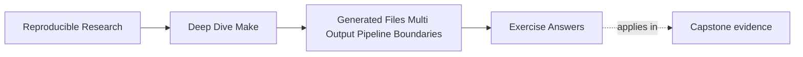

# Exercise Answers


<!-- page-maps:start -->
## Page Maps




<!-- page-maps:end -->

Use this after you have written your own answers. The point is comparison, not copying.

## How to use the answer page well

Do not read a model answer first and then reshape your generator packet to sound similar.

A better rhythm is:

1. finish the exercise with your own graph, traces, and notes
2. write one plain-language explanation of the publication truth
3. compare that explanation with the model answer
4. revise where the model answer exposes a missing boundary, weak consumer edge, or vague
   publication rule

Strong Module 06 answers do not just name a Make feature. They usually do four things:

- they state what publication or boundary truth is at stake
- they point to the evidence that exposes that truth
- they describe the repair as a more honest publication model
- they state when consumers may trust the result set

The strongest self-study packets also leave behind nine concrete artifacts:

- one graph story for a generated file
- one selection, meaning, and provenance ledger
- one honest coupled-output repair
- separate intent and accepted-result manifests
- one failure-safe candidate design
- one deletion-recovery proof
- one corruption-rejection proof
- one competing-publisher result
- one complete publication protocol

If your answers rely only on "generators are tricky," the reasoning is still too weak.

## Exercise 1: Tell the graph story of one generated file

A strong answer names one specific output and describes it as a real target:

- output path
- semantic inputs
- consumer edge

For example:

> `build/include/api.h` is generated from `schema/api.yml`, `scripts/gen_api.py`, and any
> modeled boundary file that records relevant generation mode. `main.o` should depend on
> the header because that is the file the compiler actually reads.

The important explanation is:

> The generator itself is not the useful consumer edge; the published file is, because
> that is the artifact the downstream rule actually reads.

A complete ledger distinguishes three jobs:

| Fact | Selects the producer | Changes output meaning | Identifies accepted bytes |
| --- | --- | --- | --- |
| schema contents | yes | yes | schema digest |
| generator contents | yes | yes | generator digest |
| supported `MODE` | through a convergent intent manifest | yes | normalized value |
| output directory | order-only setup | no | no |
| candidate path | no | no | no |

The non-file value needs a refresh route. A `FORCE` prerequisite may recompute the intent
manifest every invocation while content comparison preserves its timestamp when the
normalized value is unchanged.

A single-file producer writes to `$@.candidate.$$$$`, validates that process-owned file,
and renames it over `$@`. The cleanup trap removes only that candidate after failure.

## Exercise 2: Repair a coupled output rule

A good explanation says the bug is not merely "parallelism." The bug is that one logical
generation event is modeled too loosely.

A strong grouped-target repair would be:

```make
API_HEADER := build/api.h
API_SCHEMA := build/api.json

$(API_HEADER) $(API_SCHEMA) &: schema/api.yml scripts/publish_api_bundle.py | build/
	@python3 scripts/publish_api_bundle.py \
	  --header '$(API_HEADER)' \
	  --json '$(API_SCHEMA)'
```

This requires GNU Make 4.3 or newer. The publication helper owns isolated candidates and
validation; `&:` owns one Make dispatch. If JSON is deleted, requesting the pair runs the
producer once and refreshes both peers.

Inside the grouped recipe, `$@` names the peer that triggered the recipe. It may be the
header in one run and JSON in another, so it is useful evidence but not the identity of the
set.

A simple stamp form is weaker:

```make
API_STAMP := build/api.stamp

$(API_STAMP): schema/api.yml scripts/gen_api.py | build/
	python3 scripts/gen_api.py
	touch $@

api.h api.json: $(API_STAMP)
```

The stamp form needs an additional integrity policy if either output can be deleted while
the stamp remains. It should fail closed or run an explicit reconciliation route. Proxy
rules also need no-op and `gmake -q` testing because a stamp newer than its peers can make
them appear perpetually stale.

The evidence command should usually include a pressured run, such as:

```sh
gmake -j2 api.h api.json
```

or the same command with `--trace` if you want explicit rebuild reasoning.

The complete output set is:

> every file the single generator invocation promises to publish together, not whichever
> path happened to be requested first.

Grouped targets guarantee scheduling inside one Make invocation. They do not create a
filesystem transaction across two paths or coordinate a second Make process.

## Exercise 3: Decide whether a manifest is justified

A strong answer says a manifest is justified only if it names a real boundary fact that is
otherwise awkward to express directly through content edges.

For example, a manifest may be justified if it represents:

- the schema fingerprint
- the generation mode
- the published set of coupled outputs

A stage that validates or summarizes the generated set may reasonably depend on that
manifest.

But a compile step that directly reads `api.h` should still depend on `api.h`, not only
on the manifest. That distinction is the heart of the answer.

The key explanation is:

> A manifest becomes decorative when it merely stands in for a direct file edge that the
> consumer already needs honestly.

A complete answer separates:

```text
api-intent.manifest
  format, normalized mode, schema digest, generator digest, toolchain identity

accepted.manifest
  generation ID, immutable relative paths, output digests
```

The intent record drives requested meaning. The accepted record is written after whole-set
validation. Both use canonical field order and omit clocks, hostnames, candidate paths,
and unordered traversal.

Deleting an output is not detected by a completion stamp. Corrupting a file is not
detected by an input-only intent manifest. An accepted manifest detects either only when
its immutable paths and digests are verified. If it names mutable stable paths, old
manifest content can describe bytes that have already been overwritten.

## Exercise 4: Protect a pipeline from partial publication

A strong answer separates three moments:

1. candidate generation
2. validation
3. publication

For one file, the publication protocol is:

```make
build/report.json: data/input.csv scripts/gen_report.py | build/
	@set -eu; \
	candidate='$@.candidate.$$$$'; \
	trap 'rm -f "$$candidate"' EXIT HUP INT TERM; \
	python3 scripts/gen_report.py data/input.csv > "$$candidate"; \
	python3 scripts/check_report.py "$$candidate"; \
	mv -f "$$candidate" '$@'; \
	trap - EXIT HUP INT TERM
```

The key reasoning is:

> A single-path reader trusts the result only after the same-filesystem rename, not while
> candidate content is being assembled.

For a multi-file reader, generate an immutable directory, validate the set, write its
accepted manifest, and rename one candidate link over the public pointer. Sequential final
renames are insufficient.

The interruption matrix should preserve the previous pointer before validation and after
immutable adoption. Only an interruption after the pointer switch exposes the new complete
generation. Unreferenced immutable generations and abandoned candidates are diagnosable
leftovers; mixed trusted paths are not.

## Exercise 5: Discriminate producer and consumer edge failures

The complete observation table is:

| Specimen | Model | Changed outputs | Final binary text | Finding |
| --- | --- | --- | --- | --- |
| authored header | missing edge | none | `before` | `FAULT_REPRODUCED` |
| authored header | declared edge | `app` | `after` | `REPAIR_VERIFIED` |
| generated producer | missing edge | none | `before` | `FAULT_REPRODUCED` |
| generated producer | declared edge | `generated.h`, `app` | `after` | `REPAIR_VERIFIED` |

Each row has `result=PASS` because the audit observed the contract declared for that
controlled model. For a missing-edge row, the contract is to reproduce stale behavior.
`FAULT_REPRODUCED` is therefore the deciding field: the harness worked, but the graph it
executed is intentionally dishonest.

In the authored-header model, the missing declaration is:

```make
app: config.h
```

The complete rule also retains `main.c`, because source and header both define the binary:

```make
app: main.c config.h
```

The missing-edge trace says there is nothing to do because `config.h` is absent from
Make's reachable prerequisite graph. That trace becomes evidence of a defect only when it
is bound to the changed header and the binary that still prints `before`. Without those
observations, “nothing to do” could simply mean a converged truthful build.

The generated-producer repair restores a different path:

```text
scripts/render_header.py -> generated.h -> app
```

Both governed outputs change because the script first changes the published header's
meaning, then the binary changes because it consumes that header. Adding the script
directly to `app` would be wrong: it might trigger recompilation while leaving
`generated.h` stale, and it would couple the consumer to producer internals.

Production repairs preserve those ownership boundaries:

- for authored or discovered headers, compile with dependency-generation flags and include
  the resulting dependency files so each object names the headers it consumed
- for generated files, declare scripts, schemas, templates, and modeled non-file facts on
  the generated-output rule
- keep consumers dependent on published generated outputs

A strong submission uses the paired declared-edge case as a control. It does not infer the
repair merely from seeing stale output.

The trace proves which graph edge Make followed. It does not identify the accepted
generator, schema, mode, or output digests. Add those facts to provenance evidence after
publication. Provenance complements the producer and consumer edges; it cannot replace
them.

## Exercise 6: Build your first generated target

A minimal convergent answer is:

```make
.PHONY: all

all: build/version.h

build/version.h: VERSION | build/
	@set -eu; \
	candidate='$@.candidate.$$$$'; \
	trap 'rm -f "$$candidate"' EXIT HUP INT TERM; \
	printf '#define VERSION "%s"\n' "$$(cat '$<')" > "$$candidate"; \
	python3 scripts/validate_header.py "$$candidate"; \
	if test -r '$@' && cmp -s "$$candidate" '$@'; then \
	  rm -f "$$candidate"; \
	else \
	  mv -f "$$candidate" '$@'; \
	fi; \
	trap - EXIT HUP INT TERM

build/:
	mkdir -p '$@'
```

The evidence should show one recipe on the first run, no recipe on the second, and one
recipe after changing `VERSION`.

The key explanation is:

> The no-op run proves convergence because unchanged semantic input produces no new
> published artifact content and therefore no honest rebuild reason.

Run two isolated producer processes against a controlled fixture. Their candidate traces
must contain different process IDs. Then force validation to fail and compare the final
header digest with the last accepted digest. The final must remain unchanged, and cleanup
must remove only the failing process’s candidate.

## Exercise 7: Recover from one deleted coupled output

GNU Make 4.3 or newer can model the pair directly:

```make
build/api.h build/api.json &: schema.yml generate.py | build/
	python3 generate.py schema.yml --output build
```

After both files exist, deleting `build/api.json` makes the grouped target out of date.
Requesting the pair causes one generator invocation that refreshes both outputs. The
submission should count actual generator starts, not infer them from file timestamps.

The important explanation is:

> Counting starts is stronger than reading timestamps because it proves the build modeled
> one publication event instead of coincidentally landing on matching file times.

Delete the header in a second run and record `$@` from the grouped recipe. It identifies the
triggering peer and may differ from the JSON-deletion run; the explicit output variables
still identify the set.

Now repeat deletion against the simple stamp form. If the stamp remains fresh, the producer
may not run. A model answer either fails closed with a clear missing-peer error or supplies
a tested reconciliation route. Claiming that the stamp automatically recovers the pair is
incorrect.

## Exercise 8: Inject a generator failure

A strong design writes only under a process-owned candidate path before validation. For a
set-level contract, the state is:

```text
build/api-generations/<generation>.candidate.<process-id>/
build/api-generations/<generation>/
build/api-current -> api-generations/<accepted-generation>
build/api-publication.lock/
```

If generation or validation exits nonzero, the pointer does not change. Evidence should
include the nonzero status, resolved pointer, accepted digests, candidate ownership, and
lock state.

The key explanation is:

> Candidate debris is useful because it helps diagnose the failure without expanding the
> trust boundary to partial published outputs.

Classify each path:

| Path state | Model action |
| --- | --- |
| pointer-referenced immutable generation | preserve |
| unreferenced validated generation | retain for diagnosis or later collection |
| candidate owned by a live producer | leave untouched |
| abandoned candidate | quarantine or remove after evidence capture |
| lock owned by another live publisher | reject or wait according to policy |

Cleanup must never remove another process’s lock or candidate merely because its own
acquisition failed.

## Exercise 9: Choose a publication protocol

For an ordinary local Make build, candidate isolation, validation, and final-path renames may be an
acceptable contract. It prevents invalid generated content from being published during
normal failures, and grouped targets prevent Make dependents from starting before the
recipe finishes. Interruption between final renames can still leave a mixed pair.

For readers that must never observe a mixed generation, publish into a new immutable
directory and atomically replace one pointer:

```text
build/releases/sha-a/api.h
build/releases/sha-a/api.json
build/current -> releases/sha-a
```

Build and validate `sha-b`, create a new symlink, then rename that symlink over
`current`. The pointer is the publication event. Two separate file renames cannot provide
the same set-level guarantee.

The important explanation is:

> Set-level publication is stronger than file-level replacement because consumers either
> observe one complete generation or another, never an in-between mix.

The generation contains an accepted-result manifest with relative paths and digests.
Publication is convergent: if `readlink build/current` already names `releases/sha-b`, the
publisher leaves the link unchanged.

Before adopting a new immutable directory or switching the pointer, acquire the owned
publication lock. A second independent Make process must wait or fail according to the
documented policy; it must not remove a lock it did not acquire. Its candidate remains
process-owned.

The reader resolves `build/current` once:

```sh
generation="$(readlink build/current)"
cat "build/$generation/api.h"
cat "build/$generation/api.json"
```

Resolving `current` separately before each `cat` reintroduces a mixed-generation window.

## Exercise 10: Repair and prove a complete generator pipeline

A mastery submission proves behavior rather than presenting syntax alone. Its twelve-row
observation table should establish:

| Probe | Expected producer behavior | Expected published or consumer behavior |
| --- | --- | --- |
| clean build | generator runs once | both outputs publish; consumer builds |
| immediate rerun | generator does not run | no governed output changes |
| schema or source edit | generator runs once | coupled outputs publish; affected consumer rebuilds |
| generator script edit | generator runs once | coupled outputs publish; affected consumer rebuilds |
| supported mode edit | generator runs once | intent changes; one accepted generation publishes |
| controlled published-header edit | generator does not run | consumer rebuilds because it names the header |
| parallel clean build | one logical generation event | complete output set and consumer succeed |
| delete one coupled output | generator runs once | the coupled set is recovered consistently |
| corrupt one accepted peer | normal consumer is blocked | digest gate rejects the generation |
| injected generation or validation failure | attempted producer returns nonzero | pointer and trusted hashes remain unchanged |
| stop after immutable adoption | retry reuses or verifies the generation | previous pointer remains readable |
| competing publisher | one process owns publication | pointer selects one complete accepted generation |

The generator-script row proves the producer-input edge. The controlled header row proves
the consumer edge independently. If the header probe reruns the generator, inspect whether
the probe accidentally made a producer prerequisite newer or whether the graph contains an
overbroad edge. If the generator row rebuilds the binary but not the published header, the
consumer has been coupled directly to producer internals and the generated boundary is
still stale.

The graph should show:

```text
schema -------\
generator -----+-> intent -> candidate generation -> validation
mode ----------/                                      |
                                                       v
                                  immutable set + accepted manifest
                                                       |
                                              one pointer switch
                                                       |
                                                    consumer
```

The intent manifest is justified when it carries a semantic fact such as `MODE` and input
digests. The accepted manifest is justified when it binds immutable output paths to
validated digests. A clock-only manifest or one that substitutes for direct schema,
script, and output edges is decorative.

After the controlled header probe, restore the generated state before interpreting later
rows. The direct edit is a diagnostic test of consumption, not a supported authoring
workflow.

The final paragraph must distinguish three guarantees:

- candidate isolation and validation before final renames can preserve old trusted outputs after an
  ordinary command failure
- grouped targets keep Make dependents behind one producer recipe
- two separate final renames do not make a multi-file set atomic for concurrent readers

If readers require set-level atomicity, publish an immutable generation and atomically
switch one pointer to it. The pointer, not each file rename, becomes the publication
boundary.

A complete recovery table is:

| State | Recovery |
| --- | --- |
| missing or corrupt peer in disposable accepted copy | reject; regenerate from intent |
| abandoned candidate | capture evidence, then remove |
| unreferenced validated generation | verify and retain, adopt, or collect by policy |
| stale lock with no live owner | use the documented stale-owner recovery route |
| current accepted generation | preserve until replacement is fully accepted |

## What mastery-level answers sound like

A mastery-level answer set in this module does three things well:

- it treats generated outputs as graph targets rather than magical side effects
- it models publication units honestly
- it explains manifests, stamps, and publication protocols as boundary decisions, not just
  syntax choices
- it names the observer protected by each guarantee
- it proves recovery without sacrificing the last accepted generation

That is the standard Module 06 is trying to build.
