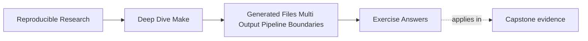

# Exercise Answers


<!-- page-maps:start -->
## Page Maps




<!-- page-maps:end -->

Use this after you have written your own answers. The point is comparison, not copying.

Strong Module 06 answers do not just name a Make feature. They explain:

- what publication or boundary truth is at stake
- what evidence would expose that truth
- why the repair matches the real generator behavior better than the broken version

## Exercise 1: Tell the graph story of one generated file

A strong answer names one specific output and describes it as a real target:

- output path
- semantic inputs
- consumer edge

For example:

> `build/include/api.h` is generated from `schema/api.yml`, `scripts/gen_api.py`, and any
> modeled boundary file that records relevant generation mode. `main.o` should depend on
> the header because that is the file the compiler actually reads.

The important move is that the answer centers the published output, not the vague fact that
"the generator runs."

## Exercise 2: Repair a coupled output rule

A good explanation says the bug is not merely "parallelism." The bug is that one logical
generation event is modeled too loosely.

A strong grouped-target repair would be:

```make
api.h api.json &: schema/api.yml scripts/gen_api.py
	python3 scripts/gen_api.py
```

A strong stamp repair would be:

```make
API_STAMP := build/api.stamp

$(API_STAMP): schema/api.yml scripts/gen_api.py | build/
	python3 scripts/gen_api.py
	touch $@

api.h api.json: $(API_STAMP)
```

The stamp form needs an additional integrity policy if either output can be deleted while
the stamp remains. A stamp alone does not make that case safe.

The evidence command should usually include a pressured run, such as:

```sh
make -j2 api.h api.json
```

or the same command with `--trace` if you want explicit rebuild reasoning.

## Exercise 3: Decide whether a manifest is justified

A strong answer says a manifest is justified only if it names a real boundary fact that is
otherwise awkward to express directly through content edges.

For example, a manifest may be justified if it represents:

- the schema fingerprint
- the generation mode
- the published set of coupled outputs

A stage that validates or summarizes the generated set may reasonably depend on that
manifest.

But a compile step that directly reads `api.h` should still depend on `api.h`, not only on
the manifest. That distinction is the heart of the answer.

## Exercise 4: Protect a pipeline from partial publication

A strong answer separates three moments:

1. temporary generation
2. validation
3. publication

For example:

```make
build/include/api.h build/api.json &: schema/api.yml scripts/gen_api.py | build/
	@python3 scripts/gen_api.py schema/api.yml --out-dir build/tmp
	@python3 scripts/validate_api.py build/tmp/api.h build/tmp/api.json
	@mv build/tmp/api.h build/include/api.h
	@mv build/tmp/api.json build/api.json
```

The key reasoning is that downstream trust begins only after validation and final
publication, not while temporary content is still being assembled.

## Exercise 5: Diagnose one generator failure mode

A strong answer names one failure class and keeps the first evidence command simple.

For example:

- failure class: duplicate execution under `-j`
- first evidence: `make -j2 --trace all`
- likely repair: grouped targets or a stamp representing one generation event

Or:

- failure class: unstable manifest
- first evidence: `make all && make -q all; echo $?`
- likely repair: replace timestamp noise with a convergent manifest that records semantic facts

The strongest answers avoid random shell edits and stay anchored to graph or publication
truth.

## Exercise 6: Build your first generated target

A minimal answer is:

```make
.PHONY: all

all: build/version.h

build/version.h: VERSION | build/
	@printf '#define VERSION "%s"\n' "$$(cat $<)" > $@.candidate
	@mv $@.candidate $@

build/:
	mkdir -p $@
```

The evidence should show one recipe on the first run, no recipe on the second, and one
recipe after changing `VERSION`. The order-only directory prerequisite avoids rebuilding
the header merely because the directory timestamp changed.

## Exercise 7: Recover from one deleted coupled output

GNU Make 4.3 or newer can model the pair directly:

```make
build/api.h build/api.json &: schema.yml generate.py | build/
	python3 generate.py schema.yml --output build
```

After both files exist, deleting `build/api.json` makes the grouped target out of date.
Requesting the pair causes one generator invocation that refreshes both outputs. The
submission should count actual generator starts, not infer them from file timestamps.

## Exercise 8: Inject a generator failure

A strong design writes only under a staging path before validation:

```make
build/api.h build/api.json &: schema.yml generate.py | build/
	@rm -rf build/stage
	@mkdir -p build/stage
	@python3 generate.py schema.yml --output build/stage
	@python3 validate.py build/stage/api.h build/stage/api.json
	@mv build/stage/api.h build/api.h
	@mv build/stage/api.json build/api.json
```

If generation or validation exits nonzero, the `mv` commands never run. Evidence should
include the nonzero status and checksums proving that previously published files did not
change. Temporary debris may remain for diagnosis; it is not trusted output.

## Exercise 9: Choose a publication protocol

For an ordinary local build, staging, validation, and final-path renames may be an
acceptable contract. It prevents invalid generated content from being published during
normal failures.

For readers that must never observe a mixed generation, publish into a new immutable
directory and atomically replace one pointer:

```text
build/releases/sha-a/api.h
build/releases/sha-a/api.json
build/current -> releases/sha-a
```

Build and validate `sha-b`, create a new symlink, then rename that symlink over `current`.
The pointer is the publication event. Two separate file renames cannot provide the same
set-level guarantee.

## Exercise 10: Repair a complete generator pipeline

A mastery submission proves behavior rather than presenting syntax alone. Its transcript
should establish:

- initial generation runs once
- an immediate rebuild is a no-op
- a semantic source edit runs generation once
- `make -j2` does not duplicate the producer
- deleting one grouped output reruns the producer once
- an injected failure returns nonzero and preserves trusted output checksums

The graph should show source and generator inputs entering one generation event,
validation before publication, and consumers depending on published files. The final
paragraph must state whether publication is failure-safe for ordinary command errors or
atomic for concurrent readers; those are different guarantees.

## What mastery-level answers sound like

A mastery-level answer set in this module does three things well:

- it treats generated outputs as graph targets rather than magical side effects
- it models publication units honestly
- it explains stamps, manifests, and pipeline publication as boundary decisions, not just as syntax choices

That is the standard Module 06 is trying to build.
