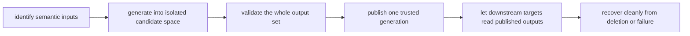
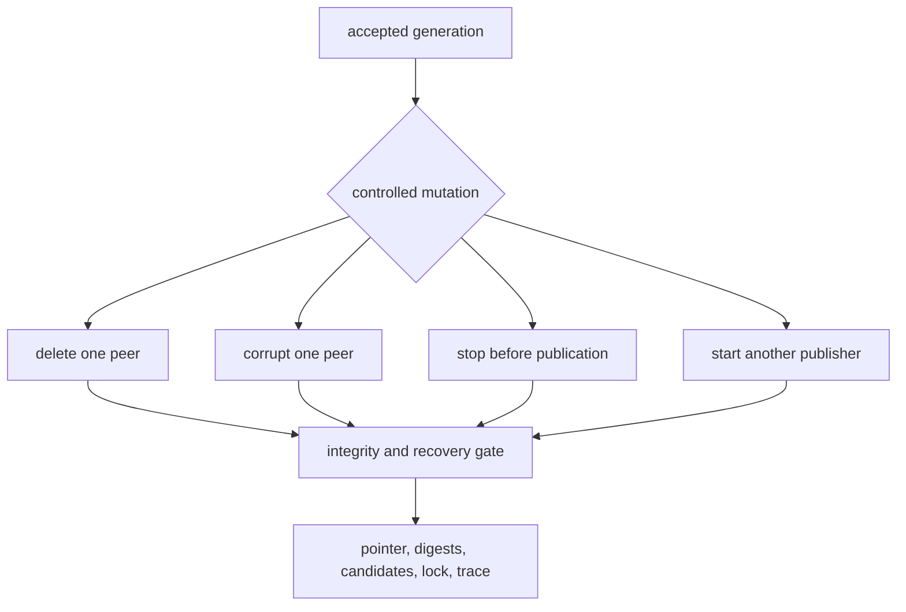

# Exercises

Use these after reading the five core lessons and the worked example. The goal is not to
show off Make syntax. The goal is to make your generation, publication, and consumer
boundary reasoning visible.

## How to work through this set

Treat the ten exercises as one full lab day on publication design for generated outputs.

Before each answer:

1. name the publication or boundary truth you are trying to protect
2. decide which artifact or transcript would prove that truth
3. name the observer: Make dependent, single-path reader, or multi-file reader
4. predict the accepted state and failed state before running the command
5. state exactly when downstream consumers are allowed to trust the output set

If you skip the trust question, generators start to look like magical side effects instead
of publication events with real contracts.

Do the exercises in order. The day is one progression:

- Exercises 1-3 teach you to name generated boundaries, coupled outputs, and justified
  manifests
- Exercises 4-6 turn those ideas into isolated candidates and first-generation rules
- Exercises 7-8 test deletion recovery and failure preservation
- Exercises 9-10 defend complete publication protocols under realistic pressure

Keep one generator packet as you go. By the end of the day it should contain:

- one graph story for a generated file
- one selection, meaning, and provenance ledger
- one honest repair for a coupled-output generator
- separate intent and accepted-result records
- one convergent first-generation example
- one failure drill that preserves trusted outputs
- one deletion and corruption recovery record
- one competing-publisher result
- one full pipeline demonstration with explicit limits

If those nine artifacts are missing, you are probably discussing code generation in general
instead of learning how to publish generated artifacts honestly.

## Recommended working layout

If you want one lab tree that can support the whole day, use something like:

```text
generator-publication-lab/
├── Makefile
├── schema/
├── scripts/
├── build/
├── publish/
├── notes/
└── artifacts/
```

For every generator, keep one publication record:

| Complete output set | Candidate ownership | Validation | Publication event | Observer | Allowed failure leftovers |
| --- | --- | --- | --- | --- | --- |

If the `publication event` column names several unrelated moves, explain how consumers are
protected from observing a mixed generation.

Also keep one consumer table:

| Consumer | Depends on published file | Depends on manifest | Why |
| --- | --- | --- | --- |

That second table matters because not every consumer should depend on every boundary
artifact.



Use that route on purpose. It keeps the day centered on publication truth instead of on
generator implementation details alone.



Passing the ordinary build is only half the exercise. The controlled mutation proves that
the selected evidence can distinguish accepted state from a convincing-looking lie.

## Exercise 1: Tell the graph story of one generated file

Choose a generated file such as a header, manifest, or report output. Explain what makes
it stale and which downstream target actually consumes it.

What to hand in:

- the generated file path
- the semantic inputs that define its meaning
- one consumer target and why it should depend on that published output
- one sentence explaining why the generator itself is not the right dependency edge
- a ledger separating Make selection, output meaning, and accepted provenance
- one modeled non-file input with a refresh route and convergent record
- a target- and process-local candidate path with failure cleanup

Study note:
This exercise is about published artifacts, not vague claims that "the code generator
runs." Downstream targets read files, so the graph should name those files.

## Exercise 2: Repair a coupled output rule

A single generator invocation produces both `api.h` and `api.json`, but the current rule
is naive and occasionally runs twice under `-j`.

Design a repair that gives the build one honest publication event.

What to hand in:

- the bug explanation in plain language
- the required GNU Make version and a grouped-target repair
- one command you would run to prove single invocation under pressure
- one sentence naming the complete output set the event publishes
- a missing-peer run that proves grouped recovery
- an explanation of why `$@` is a trigger member rather than the set identity
- a stamp fallback analysis naming its peer-integrity and query-semantics costs
- one statement separating Make scheduling from external-reader consistency

Study note:
The problem is not merely "parallelism." The problem is that one logical generation event
is modeled too loosely.

## Exercise 3: Decide whether a manifest is justified

A teammate wants to add `build/codegen.manifest`. You are not yet convinced it represents
a real boundary rather than a missing edge.

Explain how you would decide whether the manifest is justified.

What to hand in:

- the specific boundary fact the manifest would represent
- one example of a target that should depend on it
- one example of a target that should still depend on a direct generated output instead
- one sentence explaining when a manifest would only be hiding weak graph design
- separate schemas for requested intent and accepted results
- canonical field ordering and exclusions for host noise
- deletion and corruption probes showing which record detects each fault
- an explanation of why an accepted manifest must point to immutable bytes

Study note:
This is where you learn to separate useful boundary artifacts from decorative paperwork.

## Exercise 4: Protect a pipeline from partial publication

A multi-stage generator writes final output files directly into the trusted output
directory before validation completes. Describe how you would redesign it so downstream
targets never trust partial results.

What to hand in:

- the process-owned candidate rule you would introduce
- the validation step
- the exact publication point after which outputs become trustworthy
- one sentence explaining what may remain behind after failure
- a single-file rename design and its same-filesystem assumption
- a multi-file pointer design when readers require one coherent set
- interruption results before validation, after validation, after immutable adoption, and
  after pointer switching

Study note:
Candidate leftovers can be acceptable for diagnosis. Partial trusted publication
is not.

## Exercise 5: Discriminate producer and consumer edge failures

Run the capstone's paired fault laboratory:

```sh
cd programs/reproducible-research/deep-dive-make/capstone
gmake incremental-fault-audit
```

Before reading `summary.tsv`, predict the changed outputs and final binary text for all
four specimen/model pairs. Then review the summary, JSON report, and matching traces.

What to hand in:

- your predicted and observed four-row table
- one sentence explaining why `PASS` plus `FAULT_REPRODUCED` means the harness worked but
  the missing-edge graph is dishonest
- the absent edge in the authored-header model
- the complete causal path in the declared generated-producer model
- an explanation of why the missing-edge trace can say “Nothing to be done” while the
  binary is semantically stale
- a production repair route for each specimen: compiler dependency data for consumed
  headers, and an explicit generator-script prerequisite for generated output
- a provenance note explaining why the trace alone cannot identify accepted bytes

Study note:
Do not answer “add the generator script to the binary.” That bypasses the published-header
boundary instead of repairing the graph layer that owns the content.

## Midday self-check

Before you move into concrete generation and recovery behavior, make sure your packet can
already answer these questions cleanly:

- which artifact set constitutes one complete generation
- which consumers need direct file edges and which need a boundary artifact
- which point in your pipeline marks the start of downstream trust
- which failure leftovers are diagnostic and which would be dangerous
- which consistency promise applies to Make dependents and which applies to external readers

If you cannot answer those four questions in plain language, return to Exercises 1-5 and
make the packet more explicit before continuing.

## Exercise 6: Build your first generated target

Generate `build/version.h` from a plain-text `VERSION` file. The generated header must
rebuild when `VERSION` changes and remain untouched on a no-op build.

What to hand in:

- the complete rule
- traces from the initial, no-op, and changed-input runs
- the generated header after the change
- one sentence explaining why the no-op run proves convergence
- candidate-path traces from two concurrent producer processes
- an injected validator failure proving the previous header remains unchanged
- a content comparison proving semantically unchanged generation preserves the final path

Study note:
The first generated target should feel calm and inspectable. If it already feels magical,
shrink the design until every edge is obvious again.

## Exercise 7: Recover from one deleted coupled output

Create a grouped rule that produces `build/api.h` and `build/api.json`. Build both, delete
only the JSON file, and ask Make to build both again.

What to hand in:

- the grouped-target rule
- generator invocation counts before and after deletion
- an explanation of why the whole grouped recipe runs
- one sentence explaining why counting starts is stronger than inferring from timestamps
- the `$@` trigger observed for each peer-deletion case
- the same deletion performed against a simple stamp fallback
- a fail-closed or reconciling policy for the stamp case

Study note:
This exercise matters because coupled outputs are about publication units, not just about
sharing a recipe body.

## Exercise 8: Inject a generator failure

Modify a toy generator so it can exit after writing candidate output but before
validation. Run the failed build and inspect candidate, immutable, pointer, and trusted
reader paths.

What to hand in:

- the failure switch or input
- the failing command and exit status
- proof that the previously trusted outputs were not replaced
- one sentence explaining why candidate debris can still be useful
- a state inventory classifying referenced generation, unreferenced generation, live
  candidate, abandoned candidate, pointer, and lock
- proof that cleanup removes only the failing process’s candidate

Study note:
A good failure drill proves both safety and diagnosability.

## Exercise 9: Choose a publication protocol

Compare these requirements:

- two generated files may briefly differ during an interrupted local build
- a serving process must always observe both files from the same generation

Choose a publication design for each requirement and explain why two final-path `mv`
commands are insufficient for the second.

What to hand in:

- the local-build design
- the strict publication design
- a diagram showing the point where downstream trust begins
- one sentence explaining why set-level publication is a stronger contract than file-level
  replacement
- an immutable generation ID and accepted-result manifest
- a convergent pointer switch that does not replace an already-correct link
- a publication-lock rejection case for two independent Make processes
- a reader trace proving the pointer is resolved once before both files are opened

Study note:
This is where the course moves from "files were updated" to "consumers observed one
consistent generation."

## Exercise 10: Repair and prove a complete generator pipeline

Build a small pipeline with source input, generator, two coupled outputs, validator,
intent manifest, accepted-result manifest, immutable generation directory, publication
pointer, and consumer. Demonstrate a clean build, no-op build, source edit, generator
script edit, mode edit, consumed-header probe, parallel build, deleted-output recovery,
corruption rejection, interrupted publication, and competing publisher.

What to hand in:

- the Makefile and generator
- a twelve-row command and observation table
- a graph drawing that distinguishes generation, validation, publication, and consumption
- changed-output predictions and observations for the generator script and consumed-header
  rows
- proof that the generator row follows producer input to published outputs to consumer
- proof that the consumed-header row rebuilds the consumer without rerunning an unrelated
  producer
- one paragraph identifying the remaining publication guarantee and its limits
- one sentence naming which boundary artifact was truly necessary and which would have
  been decorative
- a recovery table for missing peer, digest mismatch, abandoned candidate, unreferenced
  generation, and stale publication lock

Study note:
Directly changing the published header is a controlled consumer-edge probe, not a normal
authoring workflow. Restore the generated state after the observation.

The goal is not to make the pipeline perfect. The goal is to make its guarantees explicit
and honest enough that another maintainer can reason about them.

## Before you read the answers

Do not open `exercise-answers.md` until you can already point to:

- one generated boundary you modeled honestly
- one coupled-output repair you can defend
- one failure that leaves trusted outputs untouched
- one recovery path after deleting a generated artifact
- one publication design whose guarantee you can state precisely
- one accepted-result manifest whose immutable bytes you verified
- one recovery action that preserves the last-known-good generation

If you do not yet have those eight things, the answer page will sound stronger than it can
teach.

## Mastery standard for this exercise set

Across all ten answers, the module wants the same habits:

- you name the publication or boundary truth being tested
- you choose evidence before you choose a repair
- you explain the repair in terms of graph truth, convergence, or publication discipline
- you state which observer the guarantee protects
- you prove one rejected state and one recovery route

If an answer says only "generators are tricky," keep going.
