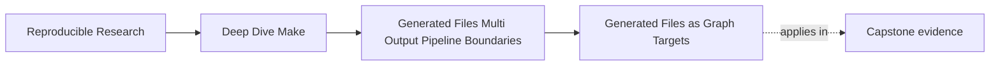
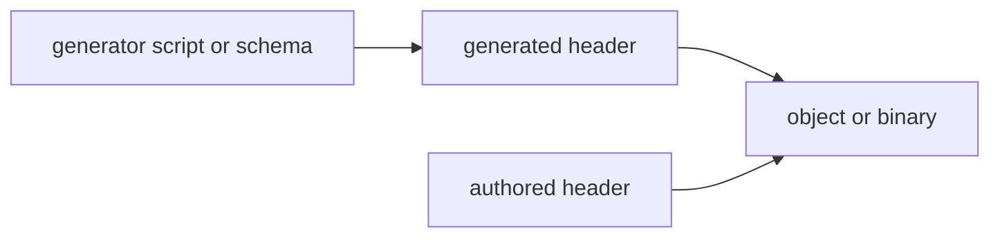
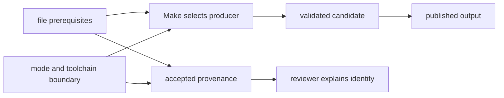

# Generated Files as Graph Targets


<!-- page-maps:start -->
## Page Maps




<!-- page-maps:end -->

The first mistake people make with code generation is not usually a shell mistake. It is a
mental-model mistake.

They talk as if the generator "runs before the build" or "refreshes files when needed,"
but they never state what "needed" actually means.

That language is dangerous because it turns a graph problem into a background ritual.

This page replaces that ritual with a simpler and more useful sentence:

> a generated file is just a target with semantic inputs, a producer, and consumers that
> must depend on the published output.

Once you read generated files that way, many build bugs become ordinary again.

## The sentence to keep

When a generated file goes stale or rebuilds unexpectedly, ask:

> which declared inputs define this file's meaning, and where is the consumer's edge to the
> published output?

That question keeps you focused on graph truth instead of generator mystique.

## Generated does not mean special

Make does not care whether a file came from a compiler, a script, a formatter, or a code
generator. It cares about the same three things it always cares about:

- what target is being promised
- what prerequisites define its meaning
- which recipe is trusted to publish it

That means a generated header such as `build/include/config.h` should be read exactly like
an object file or binary target:

```make
build/include/:
	mkdir -p '$@'

build/include/config.h: schema/config.json scripts/gen_config.py | build/include/
	@set -eu; \
	candidate='$@.candidate.$$$$'; \
	trap 'rm -f "$$candidate"' EXIT HUP INT TERM; \
	python3 scripts/gen_config.py schema/config.json > "$$candidate"; \
	python3 scripts/validate_header.py "$$candidate"; \
	mv -f "$$candidate" '$@'; \
	trap - EXIT HUP INT TERM
```

The beginner mistake is thinking the script is the important part. The graph is the
important part.

The candidate path is part of the publication contract:

- it is target-specific, so two different generated files do not share unfinished bytes
- it is process-specific, so two Make processes do not share a candidate
- it lives beside the final path, so the rename stays on one filesystem
- the trap removes it after failure or interruption

The later pipeline lesson develops this protocol fully. It appears here because a
standalone learner should not have to copy a direct write into a real build and discover
partial publication later.

## A generated file has semantic inputs, not just nearby files

Suppose a generator script reads:

- `schema/config.json`
- `scripts/gen_config.py`
- `MODE`
- the selected Python interpreter version

If those facts can change the meaning of the output, they belong in the modeled contract.

Some of them are ordinary files. Some may need a manifest or stamp. But the core idea is
the same: generated files do not get a free pass on hidden inputs.

That is why Module 06 sits after the hermeticity work in Module 05. You already know how to
think about non-file inputs. Now you must apply that discipline to generation.

## A tiny header-generation example

Start with a small build:

```make
build/include/:
	mkdir -p '$@'

build/include/version.h: data/version.json scripts/gen_version.py | build/include/
	@set -eu; \
	candidate='$@.candidate.$$$$'; \
	trap 'rm -f "$$candidate"' EXIT HUP INT TERM; \
	python3 scripts/gen_version.py data/version.json > "$$candidate"; \
	python3 scripts/validate_header.py "$$candidate"; \
	if test -r '$@' && cmp -s "$$candidate" '$@'; then \
	  rm -f "$$candidate"; \
	else \
	  mv -f "$$candidate" '$@'; \
	fi; \
	trap - EXIT HUP INT TERM

build/main.o: src/main.c build/include/version.h
	$(CC) -Ibuild/include -c $< -o $@
```

This example teaches two important habits:

- the generated header is a normal target with ordinary prerequisites
- the consumer depends on the header itself, not on "the generator happened to run"
- unchanged generated content preserves the published file’s modification time, so
  downstream work converges

If `build/main.o` depends directly on `scripts/gen_version.py` instead of the generated
header, the graph has already become less truthful.

## Consumers should depend on published outputs

This is one of the most common generator bugs:

```make
build/main.o: src/main.c scripts/gen_version.py
	$(CC) -Ibuild/include -c $< -o $@
```

Why is that wrong?

Because `build/main.o` does not actually consume the generator script. It consumes the
published header. The script is a producer input to the header rule, not a direct content
input to the compilation rule.

When you skip that distinction, the build starts coupling consumers to producer internals
instead of to the actual published artifact.

That makes rebuild behavior harder to reason about.

## Staleness should be explainable in plain language

For a generated file, a strong explanation sounds like this:

> `build/include/version.h` rebuilt because `data/version.json` changed, and
> `build/main.o` rebuilt because it consumes that header.

A weak explanation sounds like this:

> the generator must have decided it needed to refresh things.

The whole purpose of Make is to avoid the second kind of answer.

## Locate which edge layer is missing

“The binary stayed stale” does not identify one unique defect. Draw the complete path
before editing:



There are two different questions:

1. Did every semantic producer input point to the generated output?
2. Did every consumer point to the published file it reads?

If the first edge is missing, the generated file stays old and gives its consumers no
reason to rebuild. The downstream graph can be perfectly declared and still receive stale
content. If the second edge is missing, the generated or authored header can change
correctly while the consumer remains old.

This distinction changes where you repair the build:

| Observation after one input change | Likely missing edge | Repair boundary |
| --- | --- | --- |
| generator changed; generated header and binary stayed old | producer input to generated output | generated-file rule |
| header changed; binary stayed old | published header to consumer | compile or dependency-file rule |
| header and binary both changed | neither of these edges is missing | continue investigating the reported symptom |

Do not add every upstream file directly to the binary to make the test pass. That bypasses
the publication boundary. Restore the missing edge at the layer where the content is
actually consumed.

## Separate selection, meaning, and provenance

A prerequisite list performs two jobs that are easy to blur:

1. it helps Make select the producer when an input is newer or missing
2. it documents which file inputs contribute to output meaning

An evidence record performs a third job: it lets a reviewer identify what actually
produced accepted bytes.

| Fact | Selects rebuild? | Changes meaning? | Belongs in provenance? |
| --- | --- | --- | --- |
| `schema/config.json` contents | yes | yes | digest |
| `scripts/gen_config.py` contents | yes | yes | digest |
| supported `MODE` value | through a convergent boundary file | yes | value |
| Python runtime contract | through a toolchain boundary when relevant | possibly | executable and version |
| output directory existence | no; order-only setup | no | no |
| candidate pathname | no | no | no |

Do not add a path to the normal prerequisite list merely because the recipe mentions it.
Do not omit a semantic input merely because it is not naturally a file.



Provenance does not replace graph edges. A digest written after the build can explain an
artifact while still failing to trigger its rebuild. Selection and explanation must agree.

## Prove the distinction with paired models

The capstone includes an isolated audit that executes both defects beside their repairs:

```sh
cd programs/reproducible-research/deep-dive-make/capstone
gmake incremental-fault-audit
```

Before opening its output, predict this table:

| Specimen | Missing-edge changed outputs | Declared-edge changed outputs | Final text after repair |
| --- | --- | --- | --- |
| authored `config.h` consumed by `app` |  |  |  |
| generator script producing `generated.h` consumed by `app` |  |  |  |

Then read
`artifacts/audit/reproducible-research/deep-dive-make/incremental-faults/summary.tsv`.
The intended result is:

| Specimen | Missing-edge changed outputs | Declared-edge changed outputs | Final text after repair |
| --- | --- | --- | --- |
| authored header | none | `app` | `after` |
| generated producer | none | `generated.h`, `app` | `after` |

The missing-edge cases also report `PASS`, but their finding is
`FAULT_REPRODUCED`. The harness passed because it successfully exposed stale behavior:
the semantic input changed, Make selected no governed work, and the binary still printed
`before`. The declared cases report `REPAIR_VERIFIED` because the same input mutation
selected the complete causal path and changed final behavior.

Now open one trace from each model. The missing-edge trace says there is nothing to do.
That is not proof of convergence because the semantic input was absent from the graph. The
declared generated-producer trace should name:

```text
scripts/render_header.py -> generated.h -> app
```

This paired control is stronger than running one repaired example. It proves that the
evidence route can discriminate a graph lie from a truthful graph under the same mutation.

## Connect the laboratory to production dependency tracking

The authored-header specimen declares `config.h` directly because it is intentionally
small. Production C builds usually ask the compiler to discover header edges and write
dependency files. The production proof is therefore not “the teaching makefile lists one
header.” It is:

- compilation emits dependency data
- Make includes that data on later runs
- a header change selects exactly the objects that consumed it
- missing and collateral rebuilds are rejected

The generated-producer edge usually remains explicit because Make cannot infer which
script or schema defines a generated file. Keep these two mechanisms separate: compiler
dependency discovery models consumption; the generated-file rule models production.

## Generated directories still need ownership

Another subtle mistake is letting directory creation and file generation blur together.

This is usually healthier:

```make
build/include/:
	mkdir -p $@

build/include/version.h: data/version.json scripts/gen_version.py | build/include/
	python3 scripts/gen_version.py data/version.json > $@
```

The directory is setup. The generated file is the published artifact. Keeping those roles
separate helps you see what actually changes output meaning and what does not.

## What counts as a semantic input

Not every nearby fact belongs in the prerequisite list.

Good semantic inputs:

- the generator script
- the source schema or template
- a manifest that records a relevant mode or tool identity

Usually not semantic inputs:

- the timestamp when generation happened
- the operator's username
- a candidate path used inside the recipe

This matters because generated builds can become noisy quickly if you model every incidental
fact instead of the ones that really change artifact meaning.

## A simple non-file input boundary

If `MODE` changes the generated header content, you might model it like this:

```make
GEN_CONFIG_MANIFEST := build/gen-config.manifest

build/:
	mkdir -p '$@'

.PHONY: FORCE
FORCE:

$(GEN_CONFIG_MANIFEST): FORCE | build/
	@set -eu; \
	candidate='$@.candidate.$$$$'; \
	trap 'rm -f "$$candidate"' EXIT HUP INT TERM; \
	printf 'MODE=%s\n' '$(MODE)' > "$$candidate"; \
	if test -r '$@' && cmp -s "$$candidate" '$@'; then \
	  rm -f "$$candidate"; \
	else \
	  mv -f "$$candidate" '$@'; \
	fi; \
	trap - EXIT HUP INT TERM

build/include/version.h: data/version.json scripts/gen_version.py $(GEN_CONFIG_MANIFEST) | build/include/
	@set -eu; \
	candidate='$@.candidate.$$$$'; \
	trap 'rm -f "$$candidate"' EXIT HUP INT TERM; \
	python3 scripts/gen_version.py data/version.json > "$$candidate"; \
	python3 scripts/validate_header.py "$$candidate"; \
	mv -f "$$candidate" '$@'; \
	trap - EXIT HUP INT TERM
```

The force prerequisite makes Make recompute the modeled fact on every invocation. The
content comparison preserves the manifest timestamp when `MODE` is unchanged. If the value
changes, the manifest changes and the header becomes stale.

Without the force prerequisite, an existing manifest with no changing file prerequisite
would never notice a new command-line `MODE`. Writing the value into a file is not enough;
the graph needs a route that refreshes that value.

Now the non-file input is no longer hidden. The generated header has an honest graph edge
to the build fact that changes its meaning.

## Prove content convergence, not only timestamp freshness

Run four observations:

```sh
gmake clean
gmake --trace build/include/version.h
gmake --trace build/include/version.h
gmake --trace MODE=strict build/include/version.h
gmake --trace MODE=strict build/include/version.h
```

The first invocation publishes. The second recomputes the mode boundary but preserves its
content and does not republish the header. The third changes the boundary fact and
republishes. The fourth converges again.

Record output digests and producer-start counts beside the trace. A stable timestamp alone
cannot prove that the right semantic input was modeled.

## Why this page comes before multi-output rules

Many teams jump straight to advanced generation patterns. That is usually too early.

If you cannot yet explain one generated file as:

- one promised target
- one set of semantic inputs
- one consumer edge to the published result

then grouped targets and pipeline boundaries will feel like syntax trivia instead of design
choices.

That is why this page stays deliberately simple.

## Failure signatures worth recognizing

### "The generated file exists, but consumers did not rebuild"

That usually means consumers are not depending on the published generated output.

### "The generator changed, but the file stayed stale"

That usually means the generator script itself was not declared as an input.

### "We cannot explain why the generated file changed"

That often means a real semantic input is hidden or unstable.

### "The object file depends on the script instead of the generated header"

That is usually a sign the graph skipped the published artifact boundary.

## A review question that improves generated-file design

Take any generated file and ask:

1. what exact target is being published
2. which files and modeled facts define its meaning
3. which rule owns publication
4. which downstream targets consume it
5. could you explain its rebuild in one sentence

If those answers are weak, the generation model is weak too.

## What to practice from this page

Choose one generated file in the capstone or your own build and write its graph story in
plain language:

1. the output path
2. the producer
3. the semantic inputs
4. the consumers
5. the reason it should rebuild when one chosen input changes

If you can do that cleanly, generated files have stopped feeling magical.

## End-of-page checkpoint

Before leaving this lesson, make sure you can explain:

- why generated files are ordinary graph targets rather than ambient side effects
- why consumers should depend on published outputs
- how to distinguish a missing producer edge from a missing consumer edge
- how to tell a semantic input from incidental recipe noise
- why build selection, output meaning, and provenance are related but distinct
- why a modeled non-file value needs both a refresh route and content convergence
- why setup paths such as directories should stay separate from generated content
- how to describe one generated-file rebuild in plain language
