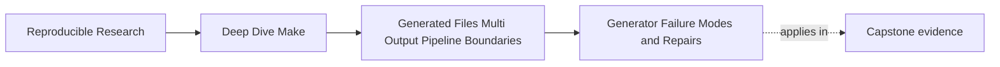
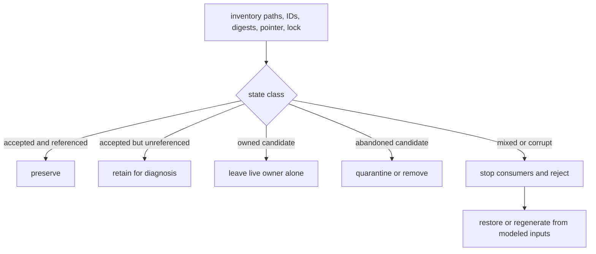

# Generator Failure Modes and Repairs


<!-- page-maps:start -->
## Page Maps




<!-- page-maps:end -->

By the time a team reaches generator trouble in a real repository, the failure rarely looks
clean.

It sounds more like this:

- "the header is there, but the code still looks stale"
- "it only breaks under `-j`"
- "the manifest changes every run"
- "the generator failed, but some outputs survived"
- "nobody knows which file the next stage is supposed to trust"

Those are not unrelated mysteries. They are recurring failure shapes.

This page is about naming those shapes and giving you a repair loop that stays
calm under pressure.

## The sentence to keep

When generation misbehaves, ask:

> is the problem in selection, candidate isolation, validation, publication, continuing
> integrity, consumer edges, or recovery?

That question narrows the repair space fast.

## Stale generated output

Symptom:

- a source schema changed
- the generated file did not rebuild
- or the generated file rebuilt but consumers did not

Usual root cause:

- the generator rule is missing a semantic input
- or a consumer depends on the wrong thing

Example:

```make
build/include/config.h: scripts/gen_config.py
	python3 scripts/gen_config.py data/config.yml > '$@'
```

If `data/config.yml` changes and the header does not rebuild, the graph is lying.

Repair:

- add the missing semantic input to the generator target
- make consumers depend on the generated header they actually read

This is the simplest generator bug and still one of the most common.

## Duplicate execution under `-j`

Symptom:

- one generator prints twice
- or coupled outputs get rebuilt inconsistently under parallel execution

Usual root cause:

- a multi-output generation event was modeled too loosely

Example:

```make
api.h api.json: schema/api.yml scripts/gen_api.py
	python3 scripts/gen_api.py
```

Repair:

- use grouped targets if available
- or use a completion boundary with an explicit peer-integrity policy

The important point is not "parallel builds are tricky." The important point is that the
graph failed to name the single publication event clearly enough.

## Unstable manifest or stamp

Symptom:

- `make -q all` keeps returning `1`
- the manifest rewrites itself every run
- the build never settles even though no semantic input changed

Usual root cause:

- the boundary file records unstable data such as timestamps or host-specific noise

Example:

```make
build/api.manifest:
	@date > $@
```

Repair:

- record only semantic facts
- compare candidate content with the existing file
- publish only when the represented meaning changed

This is usually a convergence bug disguised as provenance.

## Partial publication after failure

Symptom:

- the generator fails
- some final outputs are still present
- downstream work may now consume half-trusted files

Usual root cause:

- the rule published into final output paths before the whole generation pipeline succeeded

Repair:

- generate in a target- and process-local candidate workspace
- validate before publication
- rename one file for single-path publication
- publish an immutable directory through one pointer for set-level consistency

This is where publication discipline matters most.

## Confused consumer edges

Symptom:

- a downstream target depends on the generator script or a stamp
- but the real consumed content is a generated file

Usual root cause:

- producer logic and consumer logic were mixed together

Example:

```make
main.o: main.c gen_api.py
	$(CC) -Ibuild/include -c $< -o $@
```

If the compilation really consumes `build/include/api.h`, then the object file should
depend on the header. A stamp or script dependency may complement that boundary elsewhere,
but it should not replace the direct content edge.

Repair:

- restore the direct output dependency for actual consumers
- keep stamps and manifests only where they represent a real boundary fact

## Fresh completion record with missing or corrupt outputs

Symptom:

- a stamp is newer than every producer input
- one peer output is missing or has been edited
- Make reports the completion target is current

Usual root cause:

- the design treats event completion as continuing output integrity

Repair:

- grouped targets can rerun when a peer is missing
- a stamp fallback must fail closed or reconcile the complete peer set
- an accepted-result manifest must verify immutable output paths and digests

Do not touch the missing file merely to satisfy Make. That invents completion evidence
without recreating accepted content.

## Mixed generation visible to readers

Symptom:

- each file is individually complete
- related files contain different generation identifiers
- the Make build may still have exited successfully

Usual root cause:

- the producer replaced several stable paths sequentially
- readers opened those paths independently during publication

Repair:

- write the generation identifier into every output and accepted manifest
- publish immutable generation directories
- replace one pointer after whole-set validation
- require readers to resolve that pointer once

This failure is invisible to a test that reads files only after the recipe finishes. Inject
a reader between publication events or stop the process after the first rename.

## Competing publishers and abandoned candidates

Symptom:

- two independent Make processes attempt to publish the same final path
- candidate directories accumulate after interruption
- a stale lock prevents recovery or an unsafe cleanup removes another publisher’s work

Usual root cause:

- unique candidate names were mistaken for final-publication ownership
- the lock protocol has no owner identity or stale-owner policy

Repair:

- define one publisher for each final path or pointer
- acquire the publication lock only for adoption and pointer switching
- remove only candidates owned by the current process
- classify old unreferenced candidates before garbage collection
- make stale-lock recovery an explicit administrative contract

Unique candidates prevent unfinished-work collision. They do not authorize several
processes to race over accepted state.

## Inventory state before repairing it

Do not begin an incident by deleting the build directory. First classify every relevant
path:

| State | Meaning | Safe default |
| --- | --- | --- |
| pointer-referenced immutable generation | currently accepted set | preserve |
| unreferenced validated generation | possible completed publication not selected | preserve for diagnosis |
| process-owned candidate | unfinished work from a live producer | do not touch |
| abandoned candidate | unfinished work with no live owner | quarantine or remove after evidence capture |
| completion stamp without peers | insufficient completion claim | invalidate through owned repair route |
| mutable peers with different generation IDs | mixed and untrusted set | stop consumers; restore last accepted set |
| accepted manifest with digest mismatch | corruption or unauthorized mutation | reject and regenerate from modeled inputs |

Capture paths, digests, generation IDs, pointer target, lock owner, and process liveness.
That evidence tells you whether recovery should preserve, reject, regenerate, or republish.



## The repair loop that keeps working

When you hit a generator incident, use the same sequence every time:

1. reproduce it with the smallest command that still shows the failure
2. inventory the on-disk publication state before cleanup
3. run `gmake --trace` to see what Make believed
4. identify the failure boundary and trusted last-known-good state
5. repair the graph, integrity check, publication protocol, or consumer route
6. rerun convergence, deletion recovery, interruption, and relevant concurrency checks

This loop matters because generator incidents often tempt teams into random shell edits.
The loop keeps the investigation anchored in graph truth.

## A small incident walkthrough

Suppose you see:

```sh
gmake -j2 all
```

and the log prints:

```text
running api generator
running api generator
```

The clean diagnosis is not "parallelism is broken." It is:

- one logical generation event ran twice
- the likely failure class is duplicate execution under `-j`
- the repair should focus on grouped targets or a stamp boundary

That level of diagnosis is what this page is trying to teach.

## Why `--trace` is necessary but insufficient

Generator incidents often trigger emotional debugging:

- re-run
- delete files manually
- add sleeps
- force serial mode
- blame shell timing

`--trace` pushes the investigation back to the graph. It helps you ask:

- which target was considered stale
- which prerequisite edge triggered the rebuild
- which rule location Make used

That does not solve every generator problem by itself, but it prevents the repair from
drifting into folklore.

It cannot tell you whether two files share a generation ID, whether an external reader
observed a mixed set, or whether a lock belongs to a live process. Pair the trace with the
state inventory and reader-visible evidence.

## Parallel and convergence checks are the finishing tests

A generator fix is not finished just because one command succeeded once.

You usually want at least these checks:

```sh
gmake all
gmake -q all; echo $?
gmake -j2 all
gmake -q all; echo $?
```

Why these matter:

- the first pair checks convergence
- the parallel run checks that publication and coupling stay honest under pressure
- the final query checks that the repaired model still settles

Add the checks selected by the contract:

```sh
gmake delete-one-peer-check
gmake failed-publication-check
gmake interrupted-publication-check
gmake competing-publisher-check
```

These names represent repository-owned proof routes, not commands Make provides
automatically. Each route should create an isolated specimen under `artifacts/`, inject
one fault, and assert the expected trusted state.

This is the same standard the earlier modules built. Module 06 is just applying it to
generation.

## Failure signatures worth recognizing quickly

### "The repair works only after deleting all build state"

That often means the incremental graph is still lying.

### "Serial works, parallel flakes"

That often points to coupled publication or early visibility of partial outputs.

### "The manifest proves nothing but still changes every run"

That means the boundary file is unstable noise.

### "Consumers rebuilt, but for the wrong reason"

That usually means the graph is wired through producer internals instead of published
artifacts.

## A review question that improves generator repairs

Take one broken generator incident and ask:

1. which failure class fits best
2. what target or boundary file is mis-modeled
3. which on-disk state is still trusted
4. what `--trace` line and reader observation prove the current behavior
5. what graph or publication change repairs the owning boundary
6. which fault injections prove convergence, recovery, and concurrency safety

If those answers are strong, the repair is usually on the right path.

## What to practice from this page

Pick one generator failure mode and write a short incident note:

1. the symptom
2. the likely failure class
3. the evidence command
4. the state inventory and last-known-good selection
5. the graph or publication repair
6. the verification commands after the repair

If you can do that without drifting into vague blame, you have learned the real lesson of
this page.

## End-of-page checkpoint

Before leaving this lesson, make sure you can explain:

- the generator failure classes on this page
- why duplicate execution is a publication-model bug, not just a parallelism annoyance
- why unstable manifests are convergence bugs
- why consumer edges must still point at the content actually read
- why a completion record is not continuing integrity proof
- how to distinguish an abandoned candidate from another process’s live work
- why state inventory comes before cleanup
- why a generator repair is incomplete until convergence and pressure checks pass
