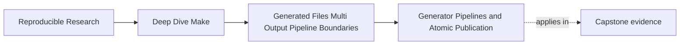
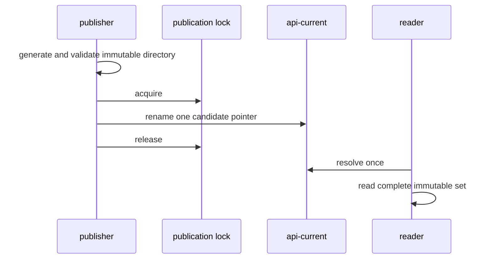

# Generator Pipelines and Atomic Publication


<!-- page-maps:start -->
## Page Maps




<!-- page-maps:end -->

Generated outputs become much riskier once the generator stops being one clean command and
starts becoming a pipeline:

- generate intermediate data
- transform it
- validate it
- write several final outputs
- maybe update a manifest too

At that point the most important question is no longer "did the script run?" It is:

> when are downstream targets allowed to trust the result?

This page teaches that answer.

## The sentence to keep

For a generator pipeline, ask:

> where is the publication boundary, and what must be true before any downstream target can
> treat the outputs as complete?

That is the heart of pipeline design.

## Pipelines fail differently from simple generators

A simple single-output rule often fails in obvious ways: the file is there or it is not.

Pipelines fail more subtly:

- one stage succeeds, another fails
- partial outputs remain on disk
- one output is fresh, another is stale
- validation should have rejected the result, but publication happened too early

This is why pipelines need an explicit publication contract rather than a casual "the
script writes files" understanding.

## Publication should happen after success, not during hope

Suppose a generator pipeline does:

1. render a header
2. render a JSON schema
3. validate the pair
4. move them into the trusted output directory

That means the publication event is step 4, not step 1.

If the build lets downstream targets see the header before validation completed, the graph
is already trusting partial work.

That is the core lesson: generation and publication are not always the same moment.

## Candidate workspaces are part of safe publication

One healthy pattern is:

```make
build/api.h build/api.json &: schema/api.yml scripts/gen_api.py | build/
	@set -eu; \
	workspace='build/api.candidate.$$$$'; \
	trap 'rm -rf "$$workspace"' EXIT HUP INT TERM; \
	mkdir "$$workspace"; \
	python3 scripts/gen_api.py --out-dir "$$workspace"; \
	python3 scripts/validate_api.py \
	  "$$workspace/api.h" "$$workspace/api.json"; \
	mv -f "$$workspace/api.h" build/api.h; \
	mv -f "$$workspace/api.json" build/api.json; \
	trap - EXIT HUP INT TERM; \
	rmdir "$$workspace"
```

This pattern provides **scheduler-level completion** for dependent targets in this Make
invocation:

- incomplete work stays outside the trusted output paths
- validation happens before final publication
- dependent recipes do not start until the grouped recipe succeeds
- concurrent processes do not share a candidate workspace

It does not provide set-level atomicity. If the process stops after the first `mv`, an
external reader can observe a new header beside old JSON. The example is honest only when
that limitation is acceptable.

## Atomic publication is about trust

When the module says "atomic publication," always finish the sentence:

> atomic for which observer, over which paths, and at which event?

Use this decision table:

| Required promise | Publication shape |
| --- | --- |
| one file never exposes partial bytes | candidate beside final path, validate, rename |
| Make dependents wait for one coupled producer | grouped targets |
| external readers see one coherent multi-file generation | immutable directory plus one pointer switch |
| two independent publishers must not race | one owning process or an explicit publication lock |

The strongest requirement determines the protocol. Do not use the word atomic as a
substitute for choosing one.

## A useful single-file example

Single-file generation can still benefit from publication discipline:

```make
build/include/config.h: schema/config.yml scripts/gen_config.py | build/include/
	@set -eu; \
	candidate='$@.candidate.$$$$'; \
	trap 'rm -f "$$candidate"' EXIT HUP INT TERM; \
	python3 scripts/gen_config.py schema/config.yml > "$$candidate"; \
	python3 scripts/validate_header.py "$$candidate"; \
	mv -f "$$candidate" '$@'; \
	trap - EXIT HUP INT TERM
```

This rule is easier to trust because:

- an invalid header never becomes the published header
- the published path changes only after validation
- the consumer edge still points at one clean output path
- candidate and final path share a parent, so the rename does not cross filesystems

That same pattern scales to larger pipelines.

## Multi-output publication needs one reader-visible finishing point

For coupled outputs, the question becomes:

which step marks the set as complete?

One answer is grouped targets with staged files:

```make
api.h api.json &: schema/api.yml scripts/gen_api.py | build/
	@set -eu; \
	workspace='build/api.candidate.$$$$'; \
	trap 'rm -rf "$$workspace"' EXIT HUP INT TERM; \
	mkdir "$$workspace"; \
	python3 scripts/gen_api.py --out-dir "$$workspace"; \
	python3 scripts/validate_api.py \
	  "$$workspace/api.h" "$$workspace/api.json"; \
	mv -f "$$workspace/api.h" api.h; \
	mv -f "$$workspace/api.json" api.json; \
	trap - EXIT HUP INT TERM; \
	rmdir "$$workspace"
```

Another answer is a stamp or manifest that is touched or published only after both final
outputs are in place.

Both answers can coordinate Make’s own dependent recipes. Neither makes two final renames
one filesystem transaction for independent readers.

## Publish a coherent set through one pointer

When readers require all files from one generation, make the set immutable and publish one
pointer:

```make
.PHONY: publish-api
publish-api: schema/api.yml scripts/gen_api.py scripts/validate_api.py | build/
	@set -eu; \
	generation="$$(python3 scripts/api_generation_key.py \
	  schema/api.yml scripts/gen_api.py)"; \
	release="build/api-generations/$$generation"; \
	workspace="$$release.candidate.$$$$"; \
	pointer_candidate="build/api-current.candidate.$$$$"; \
	lock='build/api-publication.lock'; \
	trap 'rm -rf "$$workspace"; rm -f "$$pointer_candidate"' EXIT HUP INT TERM; \
	mkdir -p build/api-generations; \
	mkdir "$$workspace"; \
	python3 scripts/gen_api.py --out-dir "$$workspace"; \
	python3 scripts/validate_api.py \
	  "$$workspace/api.h" "$$workspace/api.json"; \
	python3 scripts/write_accepted_manifest.py "$$workspace"; \
	if ! mkdir "$$lock"; then \
	  printf '%s\n' 'another API publisher owns the publication lock' >&2; \
	  exit 1; \
	fi; \
	trap 'rm -rf "$$workspace"; rm -f "$$pointer_candidate"; rmdir "$$lock" 2>/dev/null || :' \
	  EXIT HUP INT TERM; \
	if test -d "$$release"; then \
	  python3 scripts/compare_generation.py "$$workspace" "$$release"; \
	  rm -rf "$$workspace"; \
	else \
	  mv "$$workspace" "$$release"; \
	fi; \
	if test -e build/api-current && ! test -L build/api-current; then \
	  printf '%s\n' 'api-current exists but is not the owned publication link' >&2; \
	  exit 1; \
	fi; \
	if test "$$(readlink build/api-current 2>/dev/null || :)" != \
	  "api-generations/$$generation"; then \
	  ln -s "api-generations/$$generation" "$$pointer_candidate"; \
	  mv -f "$$pointer_candidate" build/api-current; \
	fi; \
	rmdir "$$lock"; \
	trap - EXIT HUP INT TERM
```

Read this protocol in order:

1. derive a deterministic generation identity from modeled inputs
2. generate and validate in a process-local workspace
3. acquire one publication lock before adopting or selecting final state
4. adopt the immutable directory, or verify an existing identical generation
5. create a candidate link and rename it over the public pointer
6. release the lock and cleanup trap

The lock fails closed rather than letting independent Make processes compete for one
public pointer. A production repository may use a supported lock utility with waiting and
stale-owner recovery, but it still needs one documented owner.

Readers resolve `build/api-current` once and read both files beneath that resolved
directory. Re-resolving the pointer separately for each file can still mix generations.



## Cleanup on failure matters

Pipelines that fail mid-run need one more discipline:

- remove candidate artifacts that are not trustworthy
- do not leave behind final outputs that were only partially updated

That usually means the recipe should fail before moving candidate outputs into their final
paths, or publish one immutable set through a single pointer.

The standard here is not cosmetic tidiness. It is preventing the next build step from
treating garbage as truth.

## A simple pattern with explicit cleanup

```make
build/report.json: data/input.csv scripts/gen_report.py | build/
	@set -eu; \
	candidate='$@.candidate.$$$$'; \
	trap 'rm -f "$$candidate"' EXIT HUP INT TERM; \
	python3 scripts/gen_report.py data/input.csv > "$$candidate"; \
	python3 scripts/check_report.py "$$candidate"; \
	mv -f "$$candidate" '$@'; \
	trap - EXIT HUP INT TERM
```

In a real shell recipe you may want clearer trap handling, but the design point is
constant:

- invalid or incomplete content should die in candidate space
- the final target path should remain the trustworthy boundary

The trap covers generator failure, validator failure, rename failure, and common
interruptions. It cannot repair a storage system that violates the assumed rename
semantics, and a forced process kill may leave candidate debris. Recovery must treat
unreferenced candidates as untrusted and removable.

## Test the interruption windows

Inject failure at each boundary:

| Stop point | Single-file final | Multi-file direct paths | Pointer-selected set |
| --- | --- | --- | --- |
| before validation | previous accepted file | previous accepted pair | previous pointer |
| after validation, before publication | previous accepted file | previous accepted pair | previous pointer |
| after first final rename | not applicable | mixed pair possible | previous pointer |
| after immutable directory adoption | not applicable | not applicable | previous pointer; unreferenced generation allowed |
| after pointer switch | new accepted file | new pair if both renames completed | new accepted generation |

The matrix tells you which failure injection distinguishes the protocols. A success-only
demo cannot establish publication behavior.

## Pipelines create stage boundaries on purpose

Some pipelines legitimately need multiple trusted stages:

- raw generated output
- normalized generated output
- packaged generated bundle

That is fine, but each stage must still answer:

- what file or boundary represents completion here
- who consumes this stage
- what validates it before the next stage trusts it

In other words, a pipeline may have several boundaries, but each one still needs the same
honest publication logic.

## Failure signatures worth recognizing

### "The generated file exists, but it was only half-written when the consumer saw it"

That means publication happened too early.

### "Validation failed, but the final output path still changed"

That means the final path stopped being a trustworthy boundary.

### "The pipeline leaves a mix of old and new outputs after failure"

That means coupled publication is being modeled too loosely.

### "Candidate outputs keep leaking into later stages"

That usually means candidate space and trusted space were not separated clearly enough.

## A review question that improves pipeline design

Take one generator pipeline and ask:

1. which step first creates intermediate content
2. which step validates the content
3. which step publishes the trusted outputs
4. what happens on failure before publication
5. which files or boundary nodes downstream targets are allowed to depend on
6. whether readers resolve one pointer or several mutable paths
7. how competing publishers and abandoned candidates are handled

If those answers are weak, the pipeline contract is weak too.

## What to practice from this page

Choose one multi-stage generator in the capstone or your own build and write down:

1. the candidate paths
2. the validation step
3. the publication step
4. the cleanup behavior on failure
5. the exact output path or boundary file consumers should trust
6. the interruption window that could expose mixed state
7. the one process or lock that owns final publication

If you can explain those without hand-waving, the pipeline has a real publication contract.

## End-of-page checkpoint

Before leaving this lesson, make sure you can explain:

- why pipeline generation and publication are not automatically the same moment
- why process-local candidate paths keep partial work out of trusted output paths
- why an atomic claim must name its observer and publication unit
- why validation should happen before downstream trust
- how to tell whether a pipeline leaves behind untrustworthy partial outputs
- when immutable generation directories and one pointer are necessary
- why unique candidate paths do not replace final-publication ownership
