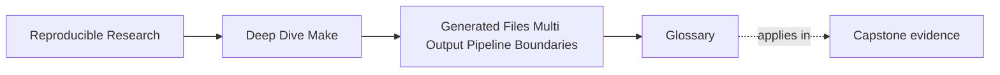
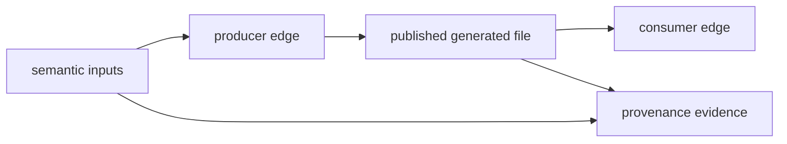
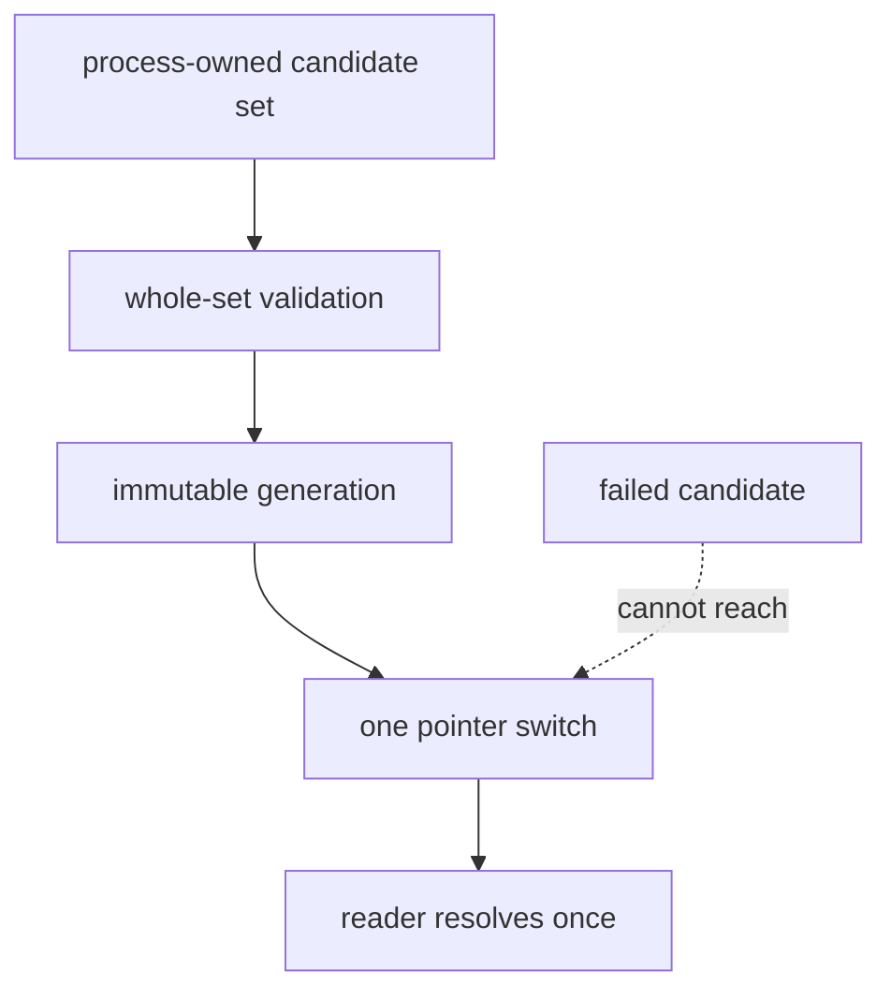
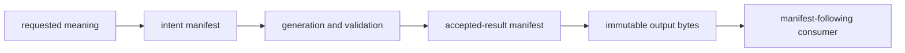
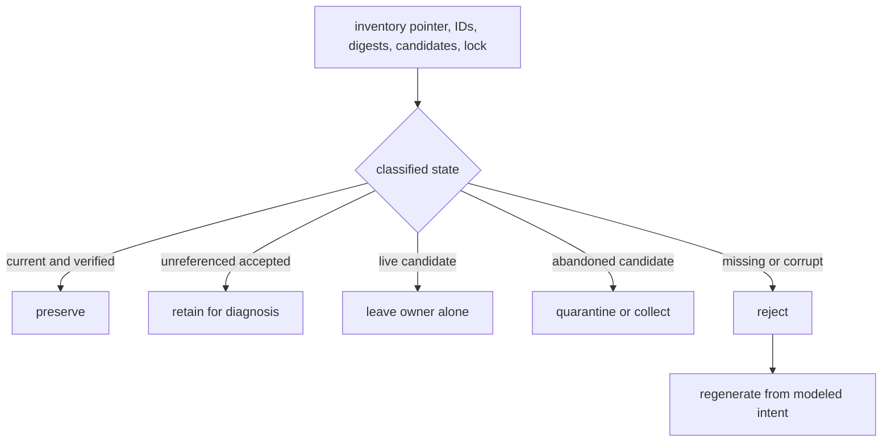

# Glossary

<!-- page-maps:start -->
## Page Maps

<!-- page-maps:end -->

Use this glossary to keep the language of Module 06 stable while you move between the core
lessons, worked example, and exercises.

The goal is not more jargon. The goal is to make sure the same generator fact keeps the
same name whenever you explain staleness, publication, or pipeline trust.

## How to use this glossary

If a discussion starts sliding into vague phrases like "the generator refreshed things" or
"the pipeline mostly finished," stop and look up the term doing the most work in the
argument. Module 06 becomes much clearer once the team agrees on the right nouns.

## Graph and artifact identity

| Term | Meaning in this module | Evidence |
| --- | --- | --- |
| generated file | A normal Make target whose bytes are produced rather than directly authored. | target rule, prerequisites, published bytes |
| semantic input | A file or modeled fact whose value can change generated meaning. | input ledger and changed-input run |
| producer edge | A dependency from semantic input to generated output. | `--trace` path and producer start |
| consumer edge | A dependency from a downstream target to the published content it actually reads. | dependency data and consumer rebuild |
| selection | Make’s decision that a producer is eligible to run. | trace and database |
| output meaning | The source, tool, option, and environment facts that determine generated bytes. | semantic-input ledger |
| provenance | Evidence identifying the facts and digests behind accepted bytes. It explains identity but does not replace graph edges. | accepted manifest |
| coupled outputs | Files that one producer promises as one logical generation. | declared peer set and generation ID |
| multi-output producer | One command or pipeline that owns a coupled output set. | producer-start count |
| generated peer | One member of a coupled set. Losing one peer can invalidate the set contract. | peer inventory |
| stale generated output | Output whose meaning changed without a correct producer run, or whose consumer did not follow changed published content. | mutation with unchanged behavior |
| order-only prerequisite | Setup or reconciliation work that must precede a target but does not itself make that target stale by timestamp. | rule database and no-op run |
| content convergence | Unchanged semantic meaning preserves accepted bytes and publication identity. | repeated build with stable digests and pointer |

### Do not confuse these

| Pair | Distinction |
| --- | --- |
| selection / provenance | Selection determines whether Make runs; provenance identifies what produced accepted bytes. |
| producer edge / consumer edge | The first updates generated content; the second carries that content change downstream. |
| mentioned in recipe / semantic input | A directory or candidate path may be mentioned without changing output meaning. |
| stable timestamp / content convergence | Timestamp stability is one observation; stable meaning and digest establish the stronger claim. |

## Publication scopes

| Term | Meaning in this module | Evidence |
| --- | --- | --- |
| publication event | The act that makes a result trustworthy for a named observer. | trace plus reader observation |
| completion point | The graph node or storage switch after which the promised observer may consume the result. | dependency or pointer boundary |
| scheduler-level completion | Make dependents wait until one producer recipe finishes. | grouped-target trace |
| single-path publication | One final path changes from old complete bytes to new complete bytes through same-filesystem rename. | interruption check and final digest |
| set-level publication | Readers select either one complete multi-file generation or another. | resolve-once reader trace |
| atomic publication | An incomplete phrase unless it names observer, path set, and event. In this module it refers only to the explicitly stated scope. | scope table and injected stop point |
| grouped targets | GNU Make 4.3+ `&:` syntax declaring several peers as outputs of one recipe dispatch. | version contract and producer count |
| trigger member | The grouped peer stored in `$@` for the current invocation. It is not the stable identity of the set. | recipe diagnostic |
| candidate file | A target- and process-local unpublished file used for one-path generation and validation. | candidate trace |
| candidate workspace | A process-owned directory holding an unpublished coupled set. | ownership record and cleanup result |
| same-filesystem rename | A rename whose candidate and final path share a filesystem, required for the assumed one-path replacement semantics. | path placement check |
| immutable generation | A validated directory whose files never change after adoption. | accepted manifest and permission or policy check |
| generation ID | A deterministic identity derived from modeled meaning or accepted content. | intent and accepted records |
| publication pointer | One symlink or pointer selecting the currently accepted immutable generation. | `readlink` and pointer-switch trace |
| resolve once | A reader resolves the publication pointer once, then opens every peer beneath that selected directory. | reader trace |
| mixed generation | A set containing peers from different generation IDs. | embedded IDs or digest comparison |
| partial publication | A final path or pointer exposes work before its promised validation and completion boundary. | injected failure state |

### Do not confuse these

| Pair | Distinction |
| --- | --- |
| grouped targets / set-level publication | Grouped targets coordinate Make recipes; they do not make several filesystem paths one transaction. |
| unique candidate / single publisher | Unique working paths prevent candidate collision; final accepted state still needs one owner. |
| two successful renames / one set switch | Two renames leave an interruption window; one pointer chooses a complete immutable set. |
| pointer read / resolve-once read | Re-reading a moving pointer for every peer can still mix generations. |

## Boundary records

| Term | Meaning in this module | Evidence |
| --- | --- | --- |
| boundary file | A file that represents a precise pipeline fact or completion event that direct output edges do not express well. | schema and named consumers |
| stamp | A modest completion fact: one producer event finished. It does not prove continuing output presence or integrity. | stamp rule and deletion test |
| intent manifest | A canonical record of requested meaning: format, source and generator digests, supported options, and relevant toolchain identity. | convergent content |
| accepted-result manifest | A record written after validation that binds an immutable generation to output paths and digests. | digest verification |
| manifest schema | The documented fields, ordering, normalization, and format identity of a manifest. | fixture and parser test |
| canonical serialization | Stable field ordering and normalized values that make equal meaning produce equal bytes. | repeated generation comparison |
| unstable manifest | A record that changes because it contains clocks, hostnames, unordered traversal, or other non-semantic noise. | no-op diff |
| completion integrity gap | The condition where a fresh stamp survives while an output is missing or corrupt. | peer deletion or corruption probe |
| direct content edge | A dependency on the generated file a consumer actually opens. A manifest does not erase it. | consumer rule or dependency file |

### Do not confuse these

| Pair | Distinction |
| --- | --- |
| stamp / accepted-result manifest | A stamp records completion; an accepted record identifies continuing immutable bytes. |
| intent / accepted result | Intent requests a generation; accepted result commits validated output identity. |
| manifest / direct output | A compiler that opens a header still needs the header edge. |
| format version / clock time | A format identifier defines interpretation; a clock usually injects noise. |

## Failure and recovery

| Term | Meaning in this module | Safe default |
| --- | --- | --- |
| last-known-good generation | The currently pointer-selected set whose accepted manifest still verifies. | preserve |
| live candidate | Unpublished work owned by a running producer. | leave untouched |
| abandoned candidate | Unpublished work with no live owner after interruption. | capture evidence, then quarantine or remove |
| unreferenced accepted generation | A validated immutable set not selected by the pointer, possibly left after interruption. | retain until classified |
| corrupted generation | A set whose output digest disagrees with its accepted manifest. | reject |
| missing-peer state | A coupled generation lacking one promised output. | reject or regenerate complete set |
| publication lock | Exclusive ownership of immutable adoption and pointer switching. | acquire before accepted-state mutation |
| lock owner | The process or job identity that acquired the publication lock. | verify liveness before recovery |
| stale lock | A lock whose recorded owner is no longer live. | use documented stale-owner recovery |
| fail closed | Reject uncertain state rather than manufacturing evidence or silently consuming it. | nonzero status and preserved pointer |
| reconciliation | Compare requested intent, peer presence, digests, and accepted state; regenerate or reselect when they disagree. | isolated proof route |
| recovery | Restore a state whose pointer, immutable bytes, and acceptance evidence agree. | verification after mutation |
| cleanup | Remove untrusted or obsolete debris. Cleanup alone does not restore accepted state. | ownership-aware removal |
| deletion recovery | Behavior after one peer disappears: grouped regeneration, explicit reconciliation, or clear rejection. | deleted-peer test |
| corruption rejection | Refusal to consume output whose digest no longer matches accepted evidence. | mutated-byte test |
| competing publisher | A second process seeking the same final publication boundary. | wait or reject without stealing ownership |

### Do not confuse these

| Pair | Distinction |
| --- | --- |
| cleanup / recovery | Cleanup removes debris; recovery restores coherent accepted state. |
| abandoned / live candidate | Age alone is insufficient; determine owner liveness. |
| unreferenced / invalid generation | A validated set may be unselected yet useful; verify before collection. |
| stale lock / lock you failed to acquire | A failed acquisition does not authorize removing another owner’s lock. |

## The vocabulary standard for this module

Prefer statements that name the observer, failed boundary, and evidence:

- “The grouped rule dispatches once for Make dependents, but external readers still need
  one pointer-selected generation.”
- “The stamp records completion but cannot detect the deleted JSON peer.”
- “The intent manifest changed because `MODE` changed; the accepted manifest binds the new
  immutable generation to validated digests.”
- “The publisher stopped after immutable adoption, so the previous pointer remains trusted
  and the unreferenced generation is retained for diagnosis.”
- “The second process did not acquire the publication lock and removed only its own
  candidate.”

Avoid “the generator is weird,” “the pipeline is atomic,” or “the manifest looks right.”
Those phrases do not say what Make selected, what readers observed, or which state remains
safe to consume.
