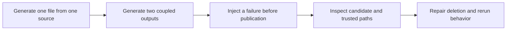
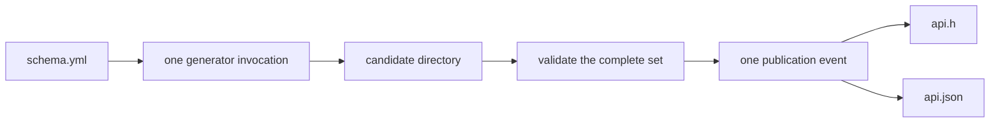
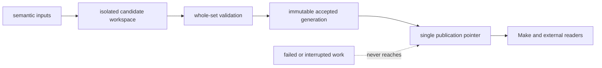
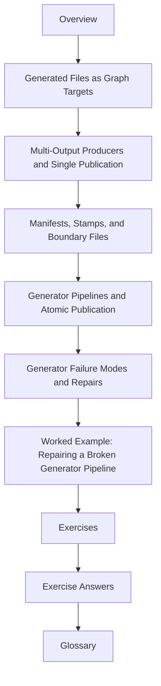

# Module 06: Generated Files, Multi-Output Rules, and Pipeline Boundaries
Modules 01 to 05 teach graph truth, parallel safety, determinism, semantics, and build
hardening. Module 06 turns that discipline toward one of the easiest places for a build to
start lying:

> code generation and multi-stage publication.

This module is about treating generated outputs like real graph citizens instead of magical
side effects that "just appear" when the build feels ready.

## Why this day matters

Generation is where many otherwise careful builds become vague. Outputs appear, manifests
get added without a real boundary, and partial files leak into trusted locations.

The word **atomic** causes particular trouble. It can refer to three different promises:

| Promise | Observer | What must be indivisible |
| --- | --- | --- |
| recipe execution | targets in one Make invocation | one producer runs once before dependent recipes start |
| single-path publication | a reader opening one final path | incomplete bytes never replace the last accepted file |
| set-level publication | a reader opening several related files | every file belongs to the same accepted generation |

Grouped targets can provide the first promise. A candidate file followed by a same-filesystem
rename can provide the second. Neither automatically provides the third. Set-level
publication usually needs immutable generation directories and one atomic pointer or
manifest switch.

Keep those promises separate throughout the module. Saying “the generator is atomic”
without naming the observer and unit is not an architecture claim.

## Entry diagnostic

Before reading the lessons, answer these questions for one generator you know:

1. If one output disappears, what exact command recreates the complete set?
2. Can two Make processes use the same unfinished-work path?
3. If the process stops between two final renames, what can an external reader observe?
4. Does a manifest prove output identity, or only that some command once finished?
5. Which source, tool, option, and environment facts can change the bytes?

Keep the answers even when they are uncertain. Revisit them after the worked example. The
comparison is a better measure of learning than recognizing syntax on the page.

## Plan for the day

| Time | Activity | Evidence you keep |
| --- | --- | --- |
| 45 minutes | Generate one file from one source | a visible source-to-output edge |
| 75 minutes | Compare independent and grouped outputs | a one-invocation trace under `-j` |
| 60 minutes | Design a meaningful manifest | stable content across a no-op rebuild |
| 75 minutes | Inject a generator failure | proof that untrusted output was not published |
| 75 minutes | Repair the worked pipeline | a convergence and deletion-recovery record |
| 90 minutes | Complete the ten exercises | commands, outputs, and graph explanations |

The first lab needs only `printf` and Make. Do it even if you already maintain code
generators: a one-input, one-output graph gives you a clean baseline before grouped
targets, manifests, and publication protocols add complexity.

## What this module is for

By the end of Module 06, you should be able to explain five things clearly:

- how one generated file becomes stale and why
- how one command can publish several coupled outputs without duplicate execution
- when a stamp or manifest is a truthful boundary and when it is a shortcut hiding missing edges
- how generator pipelines publish complete results instead of partial trust
- how to repair broken generation behavior without blaming Make for a graph defect

## The live demo for this module

Use one tiny generated header and one coupled-output generator as the anchors for the day:



That sequence keeps the lesson grounded in observable publication events.

## Draw the publication event, not only the files

A generator that creates `api.h` and `api.json` does not necessarily represent two
independent build events. Ask whether consumers trust the pair only when both are from
the same generator run.



If the generator fails after writing one candidate, neither final output should claim the
new state. If one final output is deleted, the graph must know how to recover the set
without launching duplicate generators.

Before choosing grouped targets, a stamp, or a manifest, write:

- the complete output set
- the event that makes the set trustworthy
- the consumers of each output
- the leftovers allowed after failure
- the recovery behavior after one output disappears

The Make syntax comes after this contract.

## Build one publication packet

Use one evidence packet across the day:

| Evidence | Question it answers |
| --- | --- |
| semantic-input ledger | what can change generated meaning? |
| producer-start log | did the coupled generator run exactly once? |
| candidate-path trace | can concurrent producers collide before publication? |
| accepted-set manifest | which exact output digests belong together? |
| failure-state inventory | what remains after validation failure or interruption? |
| reader observation | can a reader see a mixed generation? |
| deletion-recovery trace | does loss of one peer recreate an honest set? |
| no-op trace | does unchanged meaning converge? |

Do not substitute modification times for this packet. Timestamps help Make decide whether
to run; they do not identify producer starts, content generations, or reader-visible
consistency.



## The question to keep asking

Whenever you see generated output, ask:

> What is the single event after which downstream consumers are allowed to trust this result?

If you cannot answer that, the graph is probably hiding an important boundary.

## Study route



Read the module in that order the first time. Later, return directly to the page that
matches the generator or pipeline problem you are facing.

## The ten files in this module

1. Overview (`index.md`)
2. [Generated Files as Graph Targets](generated-files-as-graph-targets.md)
3. [Multi-Output Producers and Single Publication](multi-output-producers-and-single-publication.md)
4. [Manifests, Stamps, and Boundary Files](manifests-stamps-and-boundary-files.md)
5. [Generator Pipelines and Atomic Publication](generator-pipelines-and-atomic-publication.md)
6. [Generator Failure Modes and Repairs](generator-failure-modes-and-repairs.md)
7. [Worked Example: Repairing a Broken Generator Pipeline](worked-example-repairing-a-broken-generator-pipeline.md)
8. [Exercises](exercises.md)
9. [Exercise Answers](exercise-answers.md)
10. [Glossary](glossary.md)

## How to use the file set

| If you need to... | Start here |
| --- | --- |
| model one generated file honestly | [Generated Files as Graph Targets](generated-files-as-graph-targets.md) |
| stop one generator from running twice for a coupled output set | [Multi-Output Producers and Single Publication](multi-output-producers-and-single-publication.md) |
| decide whether a stamp or manifest is the right boundary | [Manifests, Stamps, and Boundary Files](manifests-stamps-and-boundary-files.md) |
| publish generated outputs only when the whole pipeline succeeded | [Generator Pipelines and Atomic Publication](generator-pipelines-and-atomic-publication.md) |
| distinguish Make scheduling from external-reader consistency | [Generator Pipelines and Atomic Publication](generator-pipelines-and-atomic-publication.md) |
| recover when a peer output or completion record disappears | [Generator Failure Modes and Repairs](generator-failure-modes-and-repairs.md) |
| diagnose stale outputs, duplicate execution, or partial publication | [Generator Failure Modes and Repairs](generator-failure-modes-and-repairs.md) |
| see the whole module in one realistic incident | [Worked Example: Repairing a Broken Generator Pipeline](worked-example-repairing-a-broken-generator-pipeline.md) |
| test your own understanding | [Exercises](exercises.md) |
| compare your answers against a reference | [Exercise Answers](exercise-answers.md) |
| stabilize the module vocabulary | [Glossary](glossary.md) |

## The running question

Carry this question through every page:

> what is the truthful publication event for this generated output, and where is that event
> represented in the graph?

Good Module 06 answers usually mention one or more of these:

- a generated file with a missing semantic input
- a multi-output producer modeled as if each output were independent
- a stamp or manifest that names a real boundary
- a pipeline that publishes too early
- a failure mode caused by treating generator behavior like ambient magic

## What a strong Module 06 day looks like

By the end of the day, you should have:

- modeled one generated file with explicit semantic inputs
- designed one honest coupled-output publication event
- justified one manifest or stamp instead of adding it automatically
- demonstrated one failed generation that does not poison trusted outputs
- recovered cleanly from one deleted generated artifact
- stated whether your publication promise covers one path, one Make invocation, or an
  externally read multi-file set
- proved that concurrent producers cannot share an unfinished-work path

## Commands to keep close

These commands form the evidence loop for Module 06:

```sh
make --trace all
make -j2 all
make all && make -q all
make -n all
make clean && make -j2 all
make --trace first-goal second-goal
```

You do not need every one on every incident. You do need the habit of using them to prove
when a generator should run and when it should stay still.

## Learning outcomes

By the end of this module, you should be able to:

- model generated outputs as ordinary build targets with explicit inputs
- choose grouped targets, stamps, or manifests according to truthful publication semantics
- define where a generation pipeline becomes trustworthy to downstream consumers
- keep generated outputs convergent under serial and parallel execution
- distinguish scheduler-level completion, single-path rename, and set-level publication
- preserve a last-known-good generation through failure and interruption
- explain a generator failure as a graph or publication defect instead of "generator weirdness"

## Exit standard

Do not move on until all of these are true:

- you can point to one generated file and list every declared semantic input
- you can model one coupled output set so it runs exactly once per logical change
- you can justify one manifest or stamp as a real boundary file
- you can explain where a pipeline publishes and why partial outputs are not trusted
- you can explain why two sequential renames do not publish a multi-file set atomically
- you can prove that candidate paths are isolated across concurrent producer processes
- you can name the recovery rule for a missing peer, missing pointer, and abandoned
  candidate workspace
- you can repair one broken generator incident with `--trace`, convergence, and a graph change
- you can complete all ten exercises, including a deliberate failure and recovery

When those feel ordinary, Module 06 has done its job.
