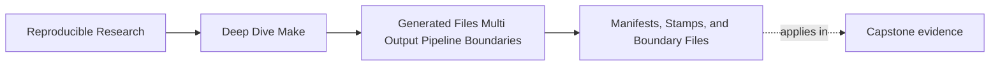

# Manifests, Stamps, and Boundary Files


<!-- page-maps:start -->
## Page Maps




<!-- page-maps:end -->

Once a team learns that stamps and manifests can help with generation, a new problem often
appears:

they start using boundary files everywhere, including places where the real issue is simply
a missing edge.

This page is about drawing that line carefully.

A good boundary file makes the build easier to explain. A bad one gives the build another
filename without making the truth any clearer.

## The sentence to keep

Before adding a stamp or manifest, ask:

> what semantic boundary does this file represent that the graph cannot already express
> directly through a normal published output?

If you cannot answer that, you probably do not need the file.

## What a boundary file is for

Boundary files usually serve one of three honest roles:

1. they represent completion of a multi-output generation event
2. they capture a semantic input that has no natural downstream file of its own
3. they declare a contract between one stage of a pipeline and the next

These are real jobs. They are not excuses to avoid modeling content dependencies.

## What a boundary file is not for

Boundary files are a poor fit when they are being used to:

- hide a missing prerequisite on a real source or generated output
- avoid naming the actual file a consumer reads
- make a vague process feel more structured without improving the graph

For example, this is often a smell:

```make
compile.stamp: gen_header.py
	touch $@

main.o: compile.stamp
	$(CC) -Ibuild/include -c main.c -o main.o
```

If `main.o` actually consumes `build/include/config.h`, then the object file should depend
on the header. A stamp here would obscure the real consumer edge.

## The difference between direct content and boundary truth

Use a direct content edge when a target truly reads a file.

Use a boundary file when the target depends on a build event or contract that is not well
represented by one ordinary file.

That distinction sounds abstract until you compare two examples.

### Direct content edge

```make
main.o: main.c build/include/config.h
	$(CC) -Ibuild/include -c $< -o $@
```

This is correct because the compiler really reads the header.

### Boundary file edge

```make
API_GEN_MANIFEST := build/api.manifest

$(API_GEN_MANIFEST): schema/api.yml scripts/gen_api.py | build/
	python3 scripts/gen_api.py
	printf 'schema=api.yml\n' > $@

docs/api-summary.txt: $(API_GEN_MANIFEST)
	python3 scripts/summarize_api.py $< > $@
```

This is plausible if the next stage cares about the completion contract or metadata of the
generation event rather than one single generated file.

## Stamps and manifests are not interchangeable names

The names are close, but the roles often differ:

| File kind | Typical role | Healthy use |
| --- | --- | --- |
| stamp | completion fact | "this generator finished successfully" |
| manifest | descriptive boundary file | "these outputs correspond to this schema, mode, or fingerprint" |

You do not need rigid purity here, but the distinction helps you think more clearly:

- stamps usually emphasize event completion
- manifests usually emphasize inspectable build meaning

Neither name guarantees truth. A stamp can survive after an output is deleted. A manifest
can accurately describe inputs while saying nothing about the bytes that were published.
Define the schema and recovery rule, not just the suffix.

## Distinguish intent from accepted results

Two manifest roles are both useful, but they answer different questions:

| Boundary record | Written from | Question answered |
| --- | --- | --- |
| generation intent | source digests, tool identity, supported options | should the producer run for this requested meaning? |
| accepted result | immutable output paths and output digests | which exact generated set passed validation? |

An intent manifest is a modeled semantic input to the producer. An accepted-result
manifest is a publication record written only after validation.


Do not use one ambiguous `build.manifest` for both roles. A reviewer should know whether a
record requests work or commits accepted work.

## Convergence still matters

A boundary file should converge just like any other generated artifact.

This is unhealthy:

```make
build/api.manifest:
	@date > $@
```

This is healthier:

```make
build/:
	mkdir -p '$@'

.PHONY: FORCE
FORCE:

build/api-intent.manifest: FORCE schema/api.yml scripts/gen_api.py | build/
	@set -eu; \
	candidate='$@.candidate.$$$$'; \
	trap 'rm -f "$$candidate"' EXIT HUP INT TERM; \
	python3 scripts/write_api_intent.py \
	  --schema schema/api.yml \
	  --generator scripts/gen_api.py \
	  --mode '$(MODE)' > "$$candidate"; \
	if test -r '$@' && cmp -s "$$candidate" '$@'; then \
	  rm -f "$$candidate"; \
	else \
	  mv -f "$$candidate" '$@'; \
	fi; \
	trap - EXIT HUP INT TERM
```

The difference is simple:

- the first file records entropy
- the second file records canonical semantic facts and changes only when those facts change

That is exactly the standard boundary files should meet.

`write_api_intent.py` is repository-owned so digest behavior and field ordering do not vary
between host utilities. Its output should contain a format version, normalized mode,
schema digest, generator digest, and relevant toolchain identity. It should not contain a
clock time, hostname, candidate pathname, or unordered filesystem traversal.

## A useful manifest example

Suppose one generator emits:

- `api.h`
- `api.json`
- `api-types.txt`

and the next pipeline stage needs to know exactly which schema and mode produced that set.

A manifest can make that boundary explicit:

```make
API_INTENT := build/api-intent.manifest

$(API_INTENT): FORCE schema/api.yml scripts/gen_api.py | build/
	@set -eu; \
	candidate='$@.candidate.$$$$'; \
	trap 'rm -f "$$candidate"' EXIT HUP INT TERM; \
	python3 scripts/write_api_intent.py \
	  --schema schema/api.yml \
	  --generator scripts/gen_api.py \
	  --mode '$(MODE)' > "$$candidate"; \
	if test -r '$@' && cmp -s "$$candidate" '$@'; then \
	  rm -f "$$candidate"; \
	else \
	  mv -f "$$candidate" '$@'; \
	fi; \
	trap - EXIT HUP INT TERM
```

Now the manifest is doing real work:

- it names the boundary facts
- it gives the producer one inspectable requested-meaning file
- it can rebuild honestly when those facts change

It does not yet prove which output bytes passed validation. For that, publish a separate
accepted-result manifest:

```text
format=1
generation=8f2c9a...
api.h.sha256=3b5d...
api.json.sha256=11a0...
api-types.txt.sha256=6f74...
```

The generation key selects an immutable directory. A reader verifies the listed digests or
relies on a validation gate that did so before the manifest became visible.

## Why this still requires direct output edges

Even with a manifest, do not forget the direct output relationships where they matter.

If a C compilation step reads `api.h`, keep that direct edge:

```make
main.o: main.c api.h
```

The manifest does not replace the header. It complements the generation boundary where that
boundary matters.

If the accepted-result manifest points to immutable generation paths, a consumer may
depend on that manifest and then open files named inside it. If a consumer opens the stable
path `api.h` directly, keep the direct edge. The record cannot protect a reader that
ignores it.

This is the subtle lesson of the page: boundary files add clarity only when they sit beside
real output relationships, not when they erase them.

## A stamp example that is justified

Suppose a generator publishes several files atomically and downstream work only needs to
know that generation completed successfully:

```make
GEN_STAMP := build/codegen.stamp

$(GEN_STAMP): schema/api.yml scripts/gen_api.py | build/
	python3 scripts/gen_api.py
	touch $@

tests/generated-contract.txt: $(GEN_STAMP)
	python3 scripts/check_codegen.py > $@
```

This is defensible if `tests/generated-contract.txt` is validating the generation event
itself, not reading one specific generated file directly.

Again, the important thing is that the boundary file represents a truth that would
otherwise be awkward to name.

## Test deletion and corruption, not only normal rebuilds

A fresh stamp does not notice that `api.json` disappeared. An input-only manifest does not
notice that `api.h` was edited by hand. Add an integrity matrix:

| Mutation | Completion stamp | Intent manifest | Accepted-result manifest |
| --- | --- | --- | --- |
| source schema changes | producer should rerun | changes | replaced after validation |
| one output is deleted | may remain falsely fresh | unchanged | listed path or digest fails |
| one output is corrupted | cannot detect content | unchanged | digest verification fails |
| supported mode changes | only if explicitly modeled | changes | replaced after validation |
| candidate workspace remains | should not matter | should not record it | must not reference it |

The table exposes why a completion stamp is a modest claim. It says an event finished; it
does not establish continuing output integrity.

## Publish accepted records against immutable bytes

Consider overwriting `api.h`, then `api.json`, then the accepted manifest. Before the
manifest changes, the old manifest can point at paths whose bytes have already changed.
The manifest is not a commit record in that layout.

Use immutable generation directories:

```text
build/api-generations/8f2c9a/api.h
build/api-generations/8f2c9a/api.json
build/api-generations/8f2c9a/accepted.manifest
build/api-current -> api-generations/8f2c9a
```

Validate the directory, write its accepted manifest, then atomically replace
`api-current`. Old readers retain the old immutable directory; new readers resolve the new
one. Garbage collection is a separate policy and must not remove a generation still in
use.

## Failure signatures worth recognizing

### "We added a stamp and the build still feels mysterious"

That often means the file does not represent a clear semantic boundary.

### "Consumers depend on a stamp, but they really read a generated file"

That usually means the direct content edge has been replaced with something less truthful.

### "The manifest changes every run"

That means the boundary file records unstable data instead of stable build meaning.

### "Nobody can say what this stamp stands for"

That is enough reason to distrust it.

## A review question that improves boundary-file design

Take any stamp or manifest and ask:

1. what exact fact or event does this file represent
2. why can that fact not be expressed better by an ordinary output dependency
3. which targets should depend on this file
4. which targets should still depend on direct generated outputs
5. does the file converge when the represented fact stays the same
6. what detects a deleted or corrupted output
7. whether the record points to immutable bytes

If those answers are weak, the boundary file is weak too.

## What to practice from this page

Choose one stamp or manifest in the capstone or your own build and explain:

1. whether it represents completion, meaning, or both
2. why it exists
3. which targets should depend on it
4. which targets should not depend on it
5. how you would tell if it is hiding a missing edge
6. whether it records requested meaning or accepted results
7. how deletion, corruption, and concurrent readers are handled

If you can do that cleanly, you understand the value of boundary files much better than a
team that merely "uses stamps."

## End-of-page checkpoint

Before leaving this lesson, make sure you can explain:

- when a stamp or manifest is justified
- why direct content edges still matter
- how a boundary file can clarify a generation stage
- why convergence is a requirement for boundary files too
- how to spot a stamp that is hiding a real dependency
- why intent and accepted-result manifests should not be conflated
- why a completion stamp cannot prove continuing output integrity
- why an accepted manifest becomes a commit record only when it names immutable bytes
