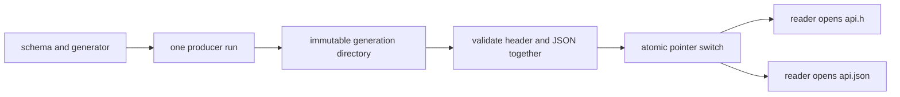

# Multi-Output Producers and Single Publication


<!-- page-maps:start -->
## Page Maps


<!-- page-maps:end -->

Single-output generation is the easy case. One target, one rule, one published file.

The first serious complication arrives when one command produces several outputs that belong
together:

- a header and a source file
- a report and an index file
- a generated API description and a code stub
- a manifest and the data file it describes

This is where many builds become dishonest. They still list multiple outputs, but they do
not model the real publication event clearly enough.

This page is about fixing that.

## The sentence to keep

When one command creates several files, ask:

> what is the single logical publication event, and how does the graph guarantee that event
> happens once per real change?

That is the core question.

## Why naive multi-target rules are risky

A common first attempt looks like this:

```make
api.h api.json: schema/api.yml scripts/gen_api.py
	python3 scripts/gen_api.py
```

The intention is understandable. One script produces both files, so list both files.

The trouble is that the build still needs a truthful model of how those outputs become
real. Under incremental and parallel execution, this naive shape can produce:

- duplicate generator invocations
- one file updated while the other remains stale
- confusion about which output actually drove the rebuild
- fragile behavior that looks fine until `-j` is introduced

The problem is not that Make "does not like multiple outputs." The problem is that the
publication unit has not been modeled sharply enough.

## Publication unit is the important idea

The wrong question is:

> how do I list several output names on the left side?

The right question is:

> what single event should downstream targets be allowed to trust?

Sometimes the answer is the coupled outputs themselves. Sometimes the answer is a stamp or
manifest representing successful completion. The important thing is that the graph names the
truthful unit of completion.

## Grouped targets are the cleanest answer when available

GNU Make gives you a better model for genuine multi-output publication:

```make
api.h api.json &: schema/api.yml scripts/gen_api.py
	python3 scripts/gen_api.py
```

Grouped targets with `&:` tell Make that the outputs belong to one logical recipe
execution.

This is usually the best choice when:

- one invocation really does publish all outputs together
- the supported Make contract requires GNU Make 4.3 or newer
- the team can explain the feature clearly

Grouped targets are not better because they are advanced. They are better because they
match the real event more closely.

Record the version requirement in setup and verify it before the lab:

```sh
gmake --version | sed -n '1p'
```

Do not silently fall back to an ordinary multi-target rule on an older Make. The syntax
may look similar while expressing a different producer contract.

### Know what grouped targets guarantee

For one Make invocation, grouped targets provide these graph semantics:

- Make treats the recipe as the producer for the whole peer set
- requesting several peers does not dispatch several producer recipes
- a missing peer makes the grouped producer eligible to run again
- dependent recipes wait for the grouped recipe to finish

They do **not** guarantee:

- a transaction across several final filesystem paths
- isolation from a second independent Make process
- a coherent snapshot for readers that bypass Make
- rollback after the process stops between two final renames

This distinction prevents a scheduler guarantee from being presented as a storage
guarantee.

### Do not use `$@` as the identity of the set

Inside a grouped recipe, `$@` is the member that caused Make to consider the group. It is
not a stable name for the coupled set:

```make
build/api.h build/api.json &: schema/api.yml scripts/gen_api.py | build/
	@printf 'trigger=%s\n' '$@'
	@python3 scripts/gen_api.py --header build/api.h --json build/api.json
```

The trigger can differ when one peer is deleted. Use explicit output variables for the set:

```make
API_HEADER := build/api.h
API_SCHEMA := build/api.json

$(API_HEADER) $(API_SCHEMA) &: schema/api.yml scripts/gen_api.py | build/
	@python3 scripts/publish_api_bundle.py \
	  --header '$(API_HEADER)' \
	  --json '$(API_SCHEMA)'
```

Automatic variables remain useful for diagnostics, but one peer name should not control
where the complete set is published. The publication helper owns isolated candidates,
whole-set validation, and final-path replacement; the grouped rule owns one Make dispatch.

## A stamp fallback has a recovery cost

Sometimes grouped targets are not available or do not fit the consumer boundary well. In
that case, a stamp can represent the successful generation event:

```make
API_GEN_STAMP := build/api.stamp

$(API_GEN_STAMP): schema/api.yml scripts/gen_api.py | build/
	python3 scripts/gen_api.py
	touch $@

api.h api.json: $(API_GEN_STAMP)
```

This says:

- one recipe owns the generation event
- the outputs are downstream of that event
- the stamp records that one generation completed

It does **not** fully model peer recovery. If `api.json` is deleted while the newer stamp
remains, Make can consider the producer complete. A rule with no recipe cannot recreate
the peer. A proxy recipe that only checks the file can fail clearly, but it still needs an
explicit repair route.

An honest fallback therefore documents one of these policies:

| Policy | Public contract | Cost |
| --- | --- | --- |
| fail on missing peer | `api-bundle` verifies every output and instructs the caller to regenerate | recovery is explicit, not automatic |
| reconcile on every public invocation | a bundle target checks the input fingerprint and peer set before consumers run | query and no-op behavior need extra proof |
| publish one immutable directory | a stamp or pointer names the directory containing the whole set | consumers must read through that boundary |

Do not call the simple stamp rule equivalent to grouped targets. It represents completion,
but missing-peer detection is additional work.

### A fail-closed stamp route

This portable shape makes the limitation visible:

```make
API_GEN_STAMP := build/api.stamp
API_OUTPUTS := build/api.h build/api.json

$(API_GEN_STAMP): schema/api.yml scripts/publish_api_bundle.py | build/
	@python3 scripts/publish_api_bundle.py \
	  --header build/api.h \
	  --json build/api.json
	@touch '$@'

$(API_OUTPUTS): | $(API_GEN_STAMP)
	@test -r '$@' || { \
	  printf '%s\n' 'missing coupled output $@; regenerate the API bundle' >&2; \
	  exit 1; \
	}

.PHONY: api-bundle
api-bundle: $(API_OUTPUTS)
```

The route fails instead of pretending a missing target was remade. A repository that
requires automatic recovery should implement and test a reconciliation protocol or require
grouped targets.

## When separate rules are actually correct

Not every pair of generated files belongs in one coupled publication unit.

If the truth is really:

- one command generates `client.h`
- a different command generates `client.md`

then forcing them into one combined rule is worse, not better.

Use separate rules when the outputs are semantically independent. Use grouped or stamp-based
publication when the outputs are coupled.

That distinction matters more than the desire to reduce line count.

## A small comparison

Consider these two models.

### Coupled output model

```make
config.h config.c &: config.yml scripts/gen_config.py
	python3 scripts/gen_config.py
```

This is correct if the generator invocation always produces both files as one unit.

### Independent output model

```make
docs/schema.md: schema.yml scripts/gen_docs.py
	python3 scripts/gen_docs.py > $@

config.h: schema.yml scripts/gen_header.py
	python3 scripts/gen_header.py > $@
```

This is correct if the documentation and header are different publication events.

The lesson is simple: coupled outputs deserve coupled publication semantics.

## Consumers still depend on what they actually read

Even when outputs are coupled, consumers should depend on the artifact they consume.

For example:

```make
build/main.o: src/main.c api.h
	$(CC) -I. -c $< -o $@
```

The object file depends on `api.h`, not on `api.json` just because the two were published
together.

This is an important nuance:

- publication may be coupled
- consumption may still be selective

The graph should reflect both truths.

If external readers require a coherent pair, direct paths are not a sufficient public
interface. Publish an immutable generation directory and switch one pointer only after the
pair validates:

```text
build/api-generations/8f2c.../api.h
build/api-generations/8f2c.../api.json
build/api-current -> api-generations/8f2c...
```

Make consumers can still name the specific file under the selected generation. External
readers resolve `api-current` once and read both files from that immutable directory.
Sequentially renaming `api.h` and `api.json` cannot provide the same set-level promise.



## Parallelism is where dishonest modeling gets exposed

Many multi-output mistakes look harmless until the build runs under `-j`.

That is because parallel execution stresses the missing assumption:

- should the generator run once or more than once
- are partial outputs visible too early
- does one target see a file that another target assumes is still being written

This is why the Module 06 evidence loop always includes a parallel run. It is not a
performance exercise. It is a truth exercise.

## A minimal repro worth practicing

Use a toy generator that prints a line to prove invocation count:

```make
.PHONY: clean

bundle.a bundle.b: scripts/gen_bundle.py
	@printf 'running generator\n'
	@python3 scripts/gen_bundle.py

clean:
	rm -f bundle.a bundle.b
```

Run:

```sh
gmake clean
gmake -j2 bundle.a bundle.b
```

The goal is not to catch Make misbehaving. The goal is to make the publication ambiguity
visible enough that the repair feels necessary.

## Choosing grouped targets versus a stamp

Use this decision guide:

| Situation | Better first choice | Why |
| --- | --- | --- |
| one invocation truly owns all outputs and supported Make includes `&:` | grouped targets | closest match to reality |
| older Make must be supported and explicit regeneration is acceptable | fail-closed stamp route | names completion and exposes peer loss |
| readers need one coherent multi-file snapshot | immutable directory plus one pointer | one publication switch selects the set |
| outputs are not actually coupled | separate rules | avoids fake coupling |

This table is useful because it turns a syntactic preference into a design choice.

## Failure signatures worth recognizing

### "Only one generated file updated"

That usually means the build modeled coupled outputs too loosely.

### "The generator ran twice under `-j`"

That usually means the graph did not represent the single publication event clearly enough.

### "We had to make consumers depend on both files to get things working"

That often means publication and consumption boundaries were mixed together.

### "The rule is short, but nobody can explain why it is safe"

That is already a warning sign.

## A review question that improves multi-output design

Take one multi-output generator and ask:

1. how many times should this recipe run per logical change
2. which files are published together as one event
3. which downstream targets consume which specific outputs
4. whether a missing peer is repaired or rejected
5. what happens under `-j` and under a second Make process
6. whether external readers require set-level consistency

If those answers are weak, the rule is weak too.

## What to practice from this page

Take one coupled output set in the capstone or your own build and write down:

1. the outputs that belong together
2. the single publication event
3. whether grouped targets or a stamp expresses it better
4. which consumers depend on each output
5. how you would prove single invocation under `-j`
6. how one deleted peer is detected and recovered
7. whether a reader can observe outputs from different generations

If you can do that without hand-waving, you understand the real lesson of this page.

## End-of-page checkpoint

Before leaving this lesson, make sure you can explain:

- why naive multi-target rules often become dishonest under pressure
- what a publication unit is
- when grouped targets are the best fit
- why a stamp needs an explicit missing-peer policy
- why coupled publication does not mean every consumer depends on every coupled output
- why grouped scheduling does not imply a multi-file filesystem transaction
- when an immutable generation directory and one pointer are required
