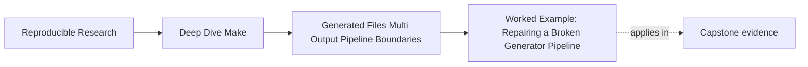
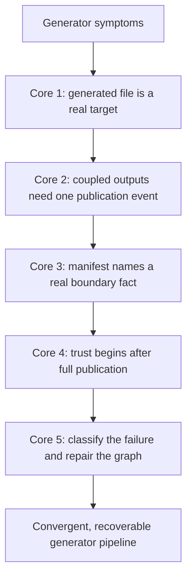

# Worked Example: Repairing a Broken Generator Pipeline


<!-- page-maps:start -->
## Page Maps




<!-- page-maps:end -->

The five core lessons in Module 06 are easiest to trust when they all show up inside one
generator incident that feels real.

## Generate one file before building a pipeline

Create `message.txt` containing one line of text and this `Makefile`:

```make
.PHONY: all clean

all: build/message.h

build/message.h: message.txt | build/
	@set -eu; \
	candidate='$@.candidate.$$$$'; \
	trap 'rm -f "$$candidate"' EXIT HUP INT TERM; \
	printf '#define MESSAGE "%s"\n' "$$(cat '$<')" > "$$candidate"; \
	mv -f "$$candidate" '$@'; \
	trap - EXIT HUP INT TERM

build/:
	mkdir -p $@

clean:
	rm -rf build
```

Run:

```sh
gmake --trace
gmake --trace
printf 'revised\n' > message.txt
gmake --trace
```

The first run creates the header, the second does nothing, and the source edit rebuilds
exactly one output. That observable cycle is the foundation for every more complicated
generator in this module.

Now force the candidate command to fail before `mv`. The final `build/message.h` should
remain absent or retain its previous known-good contents. Inspect the final path and the
process-specific candidate trace, then restore the command and rerun.

Record the result:

| Moment | Final output | Candidate output | Is the final path trustworthy? |
| --- | --- | --- | --- |
| before generation |  |  |  |
| after success |  |  |  |
| after injected failure |  |  |  |
| after recovery |  |  |  |

This table turns “atomic publication” into something visible. The final path is a trust
boundary; the candidate path is disposable work.

This example starts with a build that "mostly works":

- it generates files locally
- it sometimes duplicates work under `-j`
- it leaves confusing manifests behind
- and when it fails, the team is no longer sure which files are trustworthy

That is the exact moment where code generation stops feeling like a convenience and starts
feeling like a correctness problem.

## The incident

Assume you inherit a small pipeline that produces:

- `build/include/api.h`
- `build/api.json`
- `build/api.manifest`

from:

- `schema/api.yml`
- `scripts/gen_api.py`
- the build mode `MODE`

The team reports four symptoms:

1. a schema edit sometimes leaves the header stale
2. `gmake -j2 all` occasionally prints the generator log twice
3. the manifest changes every run
4. a failed generation sometimes leaves one final output updated and another stale
5. an external documentation process occasionally reads a header and JSON file from
   different generations

That is enough to begin. No guessing yet.

## The starting build sketch

The inherited Makefile looks like this:

```make
MODE ?= release

api.h api.json: schema/api.yml scripts/gen_api.py
	@python3 scripts/gen_api.py schema/api.yml

api.manifest:
	@date > $@

main.o: src/main.c scripts/gen_api.py
	$(CC) -Ibuild/include -c $< -o $@

all: api.h api.json api.manifest main.o
```

Every line here is plausible. That is why the example is useful.

## Identify the first graph lie

Look at the consumer edge:

```make
main.o: src/main.c scripts/gen_api.py
```

This tells Make that the compile step cares directly about the generator script. In reality
the compile step cares about the published header.

That is the first repair:

```make
main.o: src/main.c build/include/api.h
	$(CC) -Ibuild/include -c $< -o $@
```

This is Core 1 in action:

- the generated header is a real graph target
- the object file depends on what it actually reads
- producer internals and consumer content are separated again

## Reproduce the first graph lie before repairing it

The inherited sketch hides two ideas inside one suspicious line:

```make
main.o: src/main.c scripts/gen_api.py
```

The direct script prerequisite may cause some recompilation, but it still does not state
that `main.o` consumes `build/include/api.h`. A future schema change could regenerate the
header without changing the script, leaving `main.o` stale.

Use the capstone's controlled laboratory to observe the same edge class without modifying
this larger example:

```sh
cd programs/reproducible-research/deep-dive-make/capstone
gmake incremental-fault-audit
```

Read the `authored-header` rows in `summary.tsv` first:

| Model | Input changed | Changed outputs | Binary output | Meaning |
| --- | --- | --- | --- | --- |
| missing edge | `config.h` | none | `before` | the consumer does not name the content it reads |
| declared edge | `config.h` | `app` | `after` | the header-to-consumer path is complete |

The missing-edge trace reports no selected work. That successful Make invocation is the
failure: the graph claims the old binary is current even though its semantic input changed.
The declared-edge trace names the header as the cause.

Map the specimen back to the inherited build:

| Laboratory role | Inherited pipeline role |
| --- | --- |
| `config.h` | `build/include/api.h` |
| `app` | `main.o` |
| missing `app: config.h` | missing `main.o: build/include/api.h` |

Do not copy the specimen's direct header list into a large C project and call the problem
finished. Use compiler-generated dependency files for discovered includes. The durable
claim is that `main.o` has an edge to every header it consumed, whether that edge was
written by hand or loaded from dependency data.

The generated-producer rows answer a separate question. They prove that changing
`scripts/gen_api.py` must first refresh the generated outputs and only then refresh
consumers. The inherited generator rule already names the script, so those rows are a
control for the producer boundary, not evidence that the consumer line is correct.

## Explain the duplicate execution

The multi-output rule is:

```make
api.h api.json: schema/api.yml scripts/gen_api.py
	@python3 scripts/gen_api.py schema/api.yml
```

That is the classic loose model of one coupled generation event.

Under `-j`, the team sees:

```text
running api generator
running api generator
```

The repair is not to blame parallelism. The repair is to name the single publication unit.

When GNU Make 4.3 or newer is part of the portability contract, grouped targets state the
relationship directly:

```make
build/include/api.h build/api.json &: schema/api.yml scripts/gen_api.py | build/ build/include/
	@set -eu; \
	workspace='build/api.candidate.$$$$'; \
	trap 'rm -rf "$$workspace"' EXIT HUP INT TERM; \
	mkdir "$$workspace"; \
	python3 scripts/gen_api.py schema/api.yml --out-dir "$$workspace"; \
	python3 scripts/validate_api.py \
	  "$$workspace/api.h" "$$workspace/api.json"; \
	mv -f "$$workspace/api.h" build/include/api.h; \
	mv -f "$$workspace/api.json" build/api.json; \
	trap - EXIT HUP INT TERM; \
	rmdir "$$workspace"
```

This is Core 2:

- one event owns both outputs
- the graph now has one recipe for the coupled output set
- duplicate execution is no longer left to chance

This repair covers one GNU Make invocation. The process-specific workspace prevents
candidate collision, but two final renames still permit a mixed pair after interruption.
The external-reader symptom therefore remains open.

## Repair the manifest boundary

The old manifest rule is:

```make
api.manifest:
	@date > $@
```

That file does not represent build meaning. It represents clock noise.

A healthier intent manifest records the facts that define the requested generation:

```make
.PHONY: FORCE
FORCE:

build/api-intent.manifest: FORCE schema/api.yml scripts/gen_api.py | build/
	@set -eu; \
	candidate='$@.candidate.$$$$'; \
	trap 'rm -f "$$candidate"' EXIT HUP INT TERM; \
	python3 scripts/write_api_intent.py \
	  --schema schema/api.yml \
	  --generator scripts/gen_api.py \
	  --mode '$(MODE)' > "$$candidate"; \
	if test -r '$@' && cmp -s "$$candidate" '$@'; then \
	  rm -f "$$candidate"; \
	else \
	  mv -f "$$candidate" '$@'; \
	fi; \
	trap - EXIT HUP INT TERM
```

Now the file has a real role:

- it describes requested generator meaning
- it changes only when the boundary meaning changes
- it can participate honestly in convergence
- it refreshes command-line `MODE` through `FORCE` instead of freezing the first value

This is Core 3:

- manifests should represent a boundary fact
- they should converge
- they should not replace direct content edges where those edges are still needed

An accepted-result manifest is different. It belongs inside an immutable generation
directory and records the digests of the validated header and JSON. The intent manifest
selects work; the accepted manifest identifies trusted results.

## Define what atomic publication means

The original generator wrote directly into final paths. That makes partial failure
dangerous.

Candidate isolation and validation make the common failure path safer:

```make
build/include/api.h build/api.json &: schema/api.yml scripts/gen_api.py | build/ build/include/
	@set -eu; \
	workspace='build/api.candidate.$$$$'; \
	trap 'rm -rf "$$workspace"' EXIT HUP INT TERM; \
	mkdir "$$workspace"; \
	python3 scripts/gen_api.py schema/api.yml --out-dir "$$workspace"; \
	python3 scripts/validate_api.py \
	  "$$workspace/api.h" "$$workspace/api.json"; \
	mv -f "$$workspace/api.h" build/include/api.h; \
	mv -f "$$workspace/api.json" build/api.json; \
	trap - EXIT HUP INT TERM; \
	rmdir "$$workspace"
```

This is much stronger because:

- validation happens before final publication
- candidate work stays outside trusted output paths
- final paths are untouched when generation or validation fails

This is Core 4:

- publication happens after success
- downstream trust begins at a named boundary
- partial outputs stop pretending to be finished work

Be precise about the guarantee: two `mv` commands are two filesystem operations, not one
transaction. A process interruption between them can still expose a mixed pair. When the
output set must change atomically, publish an immutable versioned directory and replace
one `current` symlink or pointer with an atomic rename. The unit of publication must then
be that pointer, not each file separately.

For this incident, the external documentation reader makes set-level consistency a real
requirement. The durable layout is:

```text
build/api-generations/<generation-id>/api.h
build/api-generations/<generation-id>/api.json
build/api-generations/<generation-id>/accepted.manifest
build/api-current -> api-generations/<generation-id>
```

The producer derives the generation ID from the intent manifest, validates a
process-specific candidate directory, adopts it as immutable, and switches
`build/api-current` once. The documentation reader resolves that link once. The compiler
reads `build/api-current/api.h`.

## Run the failure-mode loop

Now take the original four symptoms and classify them:

1. stale header after schema edit
   likely class: missing semantic input or wrong consumer edge
2. duplicate generator log under `-j`
   likely class: dishonest multi-output publication unit
3. manifest changes every run
   likely class: unstable boundary file
4. one output updated after failure
   likely class: early publication bug
5. mixed header and JSON observed by an external reader
   likely class: sequential-path publication used where set-level consistency was required

This is why Core 5 exists. The classifications stop the repair from turning into random
shell edits.

## The repaired sketch

After the hardening pass, the build is closer to this:

```make
MODE ?= release

build/:
	mkdir -p $@

build/include/:
	mkdir -p $@

.PHONY: FORCE
FORCE:

build/api-intent.manifest: FORCE schema/api.yml scripts/gen_api.py | build/
	@set -eu; \
	candidate='$@.candidate.$$$$'; \
	trap 'rm -f "$$candidate"' EXIT HUP INT TERM; \
	python3 scripts/write_api_intent.py \
	  --schema schema/api.yml \
	  --generator scripts/gen_api.py \
	  --mode '$(MODE)' > "$$candidate"; \
	if test -r '$@' && cmp -s "$$candidate" '$@'; then \
	  rm -f "$$candidate"; \
	else \
	  mv -f "$$candidate" '$@'; \
	fi; \
	trap - EXIT HUP INT TERM

.PHONY: publish-api
publish-api: build/api-intent.manifest scripts/validate_api.py | build/
	@python3 scripts/publish_api_generation.py \
	  --intent build/api-intent.manifest \
	  --generations build/api-generations \
	  --pointer build/api-current \
	  --lock build/api-publication.lock

build/api-current/api.h build/api-current/api.json: | publish-api
	@test -r '$@'

main.o: src/main.c build/api-current/api.h
	$(CC) -MMD -MP -MF build/main.d -Ibuild/api-current -c '$<' -o '$@'

-include build/main.d

.PHONY: all
all: build/api-current/api.json main.o
```

`publish_api_generation.py` owns the protocol already developed in the core lesson:
process-specific candidate directory, whole-set validation, accepted-result manifest,
publication lock, immutable generation adoption, and convergent pointer switch. Keeping
that protocol in a tested helper makes the Make graph readable.

The order-only `publish-api` edge reconciles the pointer before each proxy path is checked.
The proxy recipe fails if publication claims success without the promised file.
Compiler-generated dependency data records the generated header as a content edge; the
publication edge does not replace it.

## Verify the repaired graph with input-specific predictions

Do not accept the repaired sketch merely because a clean build succeeds. Converge it, then
change one input at a time and predict the path before running Make:

| Changed input | Generated outputs that should rebuild | Downstream work | Work that should remain unchanged |
| --- | --- | --- | --- |
| `schema/api.yml` | intent and new immutable generation | `main.o` through the header | unrelated objects |
| `scripts/gen_api.py` | intent and new immutable generation | `main.o` through the header | unrelated objects |
| `MODE` through the intent boundary | intent and new immutable generation | `main.o` through the header | unrelated objects |
| `src/main.c` | none | `main.o` | manifest and generated outputs |

For each row:

1. establish a converged build
2. record governed output hashes or modification times
3. change exactly one input
4. run `gmake --trace all`
5. compare selected work with the predicted path
6. run the product-facing behavior check
7. restore the input and reconverge before the next row

The schema row is especially important. It distinguishes the truthful header consumer edge
from the inherited direct script dependency: the script did not change, but `main.o` must.
The generator row distinguishes the producer boundary: the script changed, so both
generated outputs must refresh before the consumer.

If a row selects no work while behavior remains old, you reproduced a missing edge. If it
selects unrelated work, you found an overbroad edge. If selected work matches but behavior
is still wrong, move the investigation into the recipe or publication boundary rather than
adding more prerequisites blindly.

## Verify interruption and recovery predictions

Start from accepted generation `A`, request generation `B`, and inject one stop point at a
time:

| Injection | Pointer after failure | Reader-visible set | Allowed leftover |
| --- | --- | --- | --- |
| generator exits while writing candidate | `A` | complete `A` | process-owned or abandoned candidate |
| validation rejects candidate | `A` | complete `A` | rejected candidate evidence |
| process stops after immutable `B` is adopted | `A` | complete `A` | unreferenced, validated `B` |
| process stops after pointer switch | `B` | complete `B` | immutable `A` retained by policy |
| second publisher cannot acquire lock | unchanged | complete current generation | its own candidate only |

After each injection:

1. record the pointer target once
2. hash every file beneath that resolved directory
3. compare those hashes with its accepted-result manifest
4. inventory lock and candidate ownership
5. rerun the same requested intent and require convergence to one accepted generation

Then delete `api.json` from a disposable copy of an accepted generation. The integrity
route must reject the copy; it must not rewrite the accepted manifest to bless the missing
file. Regeneration should create or reselect a complete immutable generation from modeled
inputs.

This test distinguishes recovery from cleanup. Cleanup merely removes debris. Recovery
restores a state whose identity and acceptance evidence agree.

## What each core contributed



This is why the module is organized into five cores and then one worked example. The
example is where the module becomes operational.

## What you should say at the end

A strong summary sounds like this:

> The pipeline was broken in four different ways: the consumer edge skipped the generated
> header, the coupled outputs lacked one clear publication event, the manifest recorded
> unstable noise, and final outputs were published before validation completed. We repaired
> the graph by restoring direct consumer edges, introducing one generation boundary,
> separating intent from accepted results, and switching one pointer only after an
> immutable generation passed whole-set validation. Interruption and peer-loss tests now
> preserve or restore the last accepted generation.

That summary is much stronger than "the generator was flaky."

## What to practice after this example

Take one real generator incident and retell it in the same order:

1. state the symptoms precisely
2. identify the first graph lie
3. name the publication unit
4. decide whether any stamp or manifest is justified
5. state where trust begins
6. execute the input-specific rebuild table
7. inject interruption before and after pointer switching
8. delete or corrupt one accepted peer and run the integrity route
9. rerun convergence, parallel, and competing-publisher checks

If you can do that cleanly, Module 06 has started to change how you think about generation.

Run the deletion question for real. Delete each coupled output separately, one run at a
time, and capture which recipe executes. A design that works only after deleting the
entire output set has not yet defined honest recovery.
