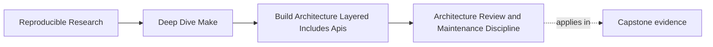
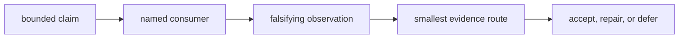
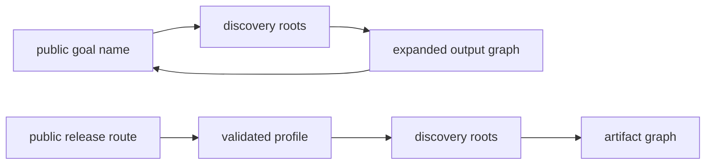
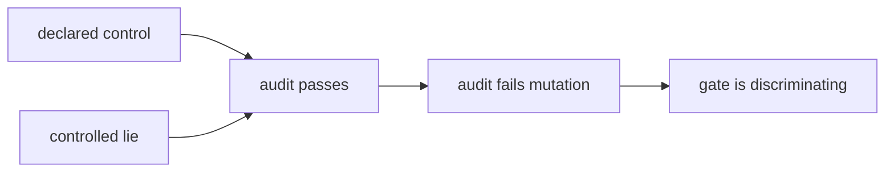

# Architecture Review and Maintenance Discipline


<!-- page-maps:start -->
## Page Maps




<!-- page-maps:end -->

Architecture review is not a meeting where maintainers describe how the Makefiles feel.
It is a bounded investigation that connects one architecture claim to evidence capable of
disproving it.

Module 07 now provides two complementary packets:

```sh
gmake architecture-contract-audit
gmake abstraction-contract-audit
```

Together they cover public callers, include-policy scope, output ownership, explicit rules,
bounded generation, and opaque macro side effects.

This page adds the review question those packets do not answer by themselves: **does each
layer depend only on layers that are allowed to provide meaning to it?** A build can expose
the right targets today while carrying a reverse dependency that makes the next change
unsafe.

## Begin with a reviewable claim

Weak claim:

> The build architecture is modular and maintainable.

Reviewable claim:

> Automation calls only declared targets; release flags reach only release artifacts;
> each selected source has one owner-identifiable output; the publication macro generates
> only the target/source pairs listed at its call site.

The second claim can fail in specific ways. That makes it useful.

## Build a claim-to-evidence matrix

Before opening source files, write the review packet’s index:

| Claim | Consumer | Failure observation | Evidence route |
| --- | --- | --- | --- |
| automation uses the declared build API | CI or script | caller invokes hidden helper or misses verification | help, caller trace, artifacts |
| release policy stays scoped | ordinary and release targets | ordinary artifact contains release flag | policy assignments and both artifacts |
| output paths preserve ownership | downstream artifact consumer | source count exceeds unique output count | mapping trace and owner contents |
| macro preserves explicit rule contract | Make graph and maintainer | prerequisite map differs or hidden target appears | call domain, database, artifacts |

This matrix prevents a review from becoming an unbounded repository tour.



## Read defect and control together

An isolated good example can demonstrate a pattern. It cannot prove that the review route
detects the corresponding defect.

The architecture packet therefore pairs:

- private caller with declared caller
- global release mutation with target-scoped policy
- flat output collapse with namespaced ownership

The abstraction packet adds:

- explicit baseline
- bounded macro control
- opaque macro defect

Read each defect beside its control. Ask which one observation distinguishes them. For
example:

```text
global mutation:
  default.txt = flags=-O2 -DRELEASE

target-scoped policy:
  default.txt = flags=-O2
```

The include filenames are identical. The ordinary artifact is the distinguishing evidence.

## Separate architecture layers from evidence layers

Architecture ownership and review evidence are not the same thing:

| Architecture surface | Typical owner | Useful evidence |
| --- | --- | --- |
| public target meaning | top-level interface | help and external caller |
| shared policy | policy include | evaluated assignment and target artifact |
| graph mapping | discovery/rule layer | source-to-output map |
| macro generation | macro plus call sites | evaluated database |
| publication | artifact recipe | trace and final contents |
| review gate | tests and audit runner | controlled rejection result |

A well-named owner still needs evidence. A strong test should not become the owner of
production meaning.

## Define dependency direction before reviewing files

For this course architecture, an arrow means “the layer on the left consumes meaning from
the layer on the right”:

```mermaid
flowchart RL
  interface["public interface"] --> graph["artifact graph"]
  graph --> discovery["source discovery"]
  graph --> policy["shared policy"]
  discovery --> policy
  review["review and verification"] --> interface
  review --> graph
  review --> discovery
  review --> policy
```

The arrows are deliberately one-way:

- policy owns defaults, supported parameter values, and shared tool settings
- discovery owns which logical inputs exist
- graph ownership maps those inputs to outputs and recipes
- interface ownership names supported caller routes and promised evidence
- review ownership observes and challenges every production layer

The review layer may know the production architecture. Production must not import test
fixtures or read review results to decide what to build.

This is an ownership rule, not merely include order. A file can be parsed earlier yet still
reach backward by assigning a variable owned by a later layer. Conversely, a public
interface can be textually included first and still depend honestly on graph targets that
are declared later in the parse.

## Build a dependency ledger

Do not infer architecture from directory names. Record what each include actually consumes
and owns:

| Include | Consumes | Assigns or declares | Allowed? |
| --- | --- | --- | --- |
| `mk/policy.mk` | command-line and environment inputs | defaults and value validation | yes |
| `mk/discovery.mk` | `SOURCE_ROOTS` from policy | `SOURCES`, logical owner keys | yes |
| `mk/graph.mk` | sources, owners, tool policy | file targets and publication recipes | yes |
| `mk/interface.mk` | named graph targets | `all`, `verify`, `help` | yes |
| `mk/review.mk` | public routes and selected graph facts | audit targets only | yes |

Now compare two lines that may both “work”:

```make
# Honest: graph consumes discovery.
OUTPUTS := $(SOURCES:src/%.csv=build/%.parquet)

# Reverse ownership: discovery changes interface meaning.
verify: DISCOVERY_MODE := exhaustive
```

The second line puts public-route policy in the discovery layer. Moving include order may
change its behavior, and a discovery maintainer must now understand an interface contract.
The defect is misplaced ownership even if the current artifact bytes happen to match.

Capture the ledger before moving files. It distinguishes a structural repair from a
directory reshuffle.

## Audit imports, assignments, and declarations separately

An include statement reveals only one kind of dependency. Review three surfaces:

```sh
rg -n '^(include|-include|sinclude)[[:space:]]' Makefile mk/
rg -n '^[A-Za-z_][A-Za-z0-9_]*[[:space:]]*[:+?]?=' Makefile mk/
rg -n '^[^.#%[:space:]][^=]*:' Makefile mk/
```

Classify each result in the ledger:

1. **Import edge:** which file asks Make to parse another file?
2. **Meaning edge:** which layer reads or assigns a variable owned elsewhere?
3. **Graph edge:** which layer declares a target or prerequisite?

The regular expressions are candidate finders, not proof. Multiline assignments,
`define` blocks, generated includes, and rules emitted through `eval` require database and
trace evidence as well.

For a disputed variable, make its origin observable in a diagnostic route:

```make
.PHONY: show-policy-origin
show-policy-origin:
	@printf 'MODE origin=%s value=%s\n' '$(origin MODE)' '$(MODE)'
```

`origin` identifies command-line, environment, file, override, or default ownership. It
does not identify the assigning filename, so pair it with the assignment search rather
than treating it as a complete provenance system.

## Detect cycles that text inclusion hides

Make rejects a direct include loop eventually, but architectural cycles are often semantic:

```make
# mk/discovery.mk
SOURCE_ROOTS += $(if $(filter release,$(MAKECMDGOALS)),release-data)

# mk/interface.mk
release: SOURCE_ROOTS += partner-data
release: $(OUTPUTS)
```

Discovery now reads a public goal while the public goal mutates discovery input. The result
depends on parse-time goal inspection, target-specific inheritance, and when `OUTPUTS` is
expanded. There may be no literal include loop, yet neither layer can be understood alone.

Repair the ownership boundary:

```make
# mk/policy.mk
PROFILE ?= ordinary
SUPPORTED_PROFILES := ordinary release

# mk/discovery.mk
SOURCE_ROOTS := data/$(PROFILE)

# mk/interface.mk
.PHONY: release
release:
	+$(MAKE) --no-print-directory PROFILE=release all
```

Policy names the supported choice, discovery consumes that choice, and the interface
forwards it through an explicit recursive boundary. The child Make parses one coherent
graph instead of relying on a goal-name feedback loop.



The lower route has a caller decision, not an ownership cycle: the public route starts a
new invocation with a supported parameter, and the child architecture flows in one
direction.

## Review the change cone

For every proposed edit, identify its downstream cone before choosing tests:

| Changed owner | Direct consumers | Evidence that must move with it |
| --- | --- | --- |
| supported `PROFILE` values | discovery, graph recipes, public help | rejection case, help output, ordinary/release artifacts |
| source-root semantics | discovery mapping, graph cardinality | source manifest, reverse map, output set |
| output namespace | graph consumers, public evidence paths | injectivity proof, callers, stale-path check |
| public target promise | CI, scripts, learners | help, caller traces, compatibility decision |
| generated-rule template | graph database and artifacts | expansion ledger, prerequisite map, concurrency case |

A layer-local edit can have a wide cone. “Only one include changed” is not a review
argument.

Record the cone in the decision packet so a later maintainer can see why particular
evidence was required. This also prevents indiscriminate full-suite testing from replacing
the smaller tests that explain the contract.

## Review a proposed macro change

Suppose a change replaces two explicit publication rules with:

```make
$(foreach owner,$(OWNERS),$(eval $(call define_component,$(owner))))
```

Do not begin with whether the diff is shorter. Use this sequence:

1. Record the explicit target, prerequisite, policy, and artifact contract.
2. Identify the macro’s declared responsibility.
3. List its owner arguments and generated domain.
4. Inspect the evaluated target/prerequisite map.
5. Compare help with every newly generated callable target.
6. Compare artifact modes, sources, and owners.
7. Run a rejection test that injects one hidden side effect.

The abstraction audit performs this sequence for the course specimens.

## Create a compact review packet

The generated abstraction bundle already has a useful shape:

```text
route.txt
ABSTRACTION_CONTRACT_AUDIT_GUIDE.md
summary.tsv
report.json
traces/
specimens/
workspace/
manifest.json
```

For one review, preserve only what answers the claim:

1. the claim-to-evidence matrix
2. summary findings
3. exact before/after observations
4. relevant source and evaluated-rule excerpts
5. artifact or caller evidence
6. rejection-test result
7. decision and remaining risk

Do not paste the entire Make database into a review comment. Preserve it in the bundle and
quote the target entries that support the decision.

## Write observations before conclusions

Observation:

> The bounded model’s evaluated database contains two publication targets with the same
> prerequisites as the explicit model. It contains no `publish-*` targets. Both artifacts
> record `mode=ordinary`.

Conclusion:

> The macro preserves the reviewed publication contract.

Limit:

> The audit does not cover secondary expansion or generated include files.

Keeping those three statements separate makes later review possible. A future maintainer
can challenge the conclusion without reconstructing the observations.

## Classify architecture changes by contract impact

| Proposed change | Review required |
| --- | --- |
| add owner to an existing bounded macro | call domain, generated mapping, new artifact |
| add a new public target | help, callers, promised evidence, compatibility |
| append a global policy value | ordinary and specialized target artifacts |
| add a source root | source/output cardinality and namespace ownership |
| add another responsibility to a macro | explicit baseline, hidden targets, policy side effects |
| rename an internal generated rule | public caller search and evaluated graph |

The size of the diff does not determine review depth. A one-line global assignment can
change every target.

Add dependency direction to the classification:

| Proposed structural change | Direction question | Required rejection mutation |
| --- | --- | --- |
| discovery starts reading a public goal | does a provider now depend on its consumer? | vary goal order and require identical discovery for one profile |
| graph include assigns a policy default | did meaning move away from its owner? | override the parameter and require one validated effective value |
| production includes an audit fixture | does production now depend on review? | remove review artifacts and require the build graph to remain parseable |
| interface generates file rules | did the caller surface absorb graph ownership? | enumerate public targets and require artifact rules to remain internal |

## Use rejection tests as review calibration

An audit that passes only its current repository state may be ceremonial. Inject a
controlled lie:

- make a private caller use the public route
- remove a defect model’s policy leak
- collapse a control’s namespace
- add a hidden target to a bounded macro
- remove call-domain evidence
- make discovery inspect a public goal name
- make a production include read an audit-generated file

The relevant case must fail. The course’s architecture and abstraction self-tests preserve
these mutations in disposable copies.



## Record a bounded decision

Use one of three outcomes:

### Accept

The reviewed contract is preserved, the evidence route is rerunnable, and remaining limits
are stated.

### Repair

The observations show a contract violation. Name the owner that must change and the
evidence that will prove the repair.

### Defer

The risk is real but outside the current change. Record the trigger, owner, and required
future evidence. “Consider later” is not a bounded deferral.

Example:

| Field | Decision record |
| --- | --- |
| decision | accept bounded publication macro |
| basis | prerequisite maps and artifacts match explicit baseline |
| gate | `gmake abstraction-contract-selftest` |
| limit | generated includes not covered |
| trigger | macro begins generating another rule family |
| future evidence | add that family’s explicit baseline and rejection mutation |

For a dependency-direction decision, add two fields:

| Field | Example |
| --- | --- |
| allowed incoming edges | graph may consume discovery and policy |
| forbidden edge checked | discovery must not inspect public goal names |

This prevents “layered” from meaning only “stored in several files.”

## Review on pressure, not ceremony

Run a focused architecture review when:

- automation changes the target it invokes
- a public target changes meaning or evidence
- an include starts assigning a value owned elsewhere
- a source root or output namespace is added
- a macro begins generating a new family of rules
- a local override can change artifact semantics

These events alter ownership or consumers. A calendar reminder alone does not identify a
claim.

## Practice: review one controlled drift

Use a disposable copy of `bounded-macro`.

1. Add a `publish-gamma` target inside the macro without adding it to help.
2. Run the build and record why exit zero is insufficient.
3. Inspect the generated database entry.
4. Add the finding to a claim-to-evidence matrix.
5. Run the abstraction audit and preserve the rejected case.
6. Write a repair decision that keeps publication-rule generation bounded.
7. Add an interface-to-discovery feedback edge and show which ledger row exposes it.
8. Repair that edge with a validated parameter and an explicit invocation boundary.
9. Record the repair’s change cone and the smallest rejection mutation that proves the
   forbidden direction stays absent.

Your packet is complete when another learner can reproduce the observation and understand
why the proposed repair addresses the owner rather than the symptom.

## End-of-page checkpoint

You are ready to continue when you can:

- turn a broad maintainability claim into falsifiable contract statements
- choose the smallest evidence route for each statement
- distinguish observations, conclusions, and limits
- explain why defect/control pairs and rejection tests calibrate a review gate
- write an accept, repair, or defer record with a future trigger
- distinguish import, meaning, and graph dependencies
- expose a semantic layer cycle even when Make has no literal include loop
- connect a changed owner to its downstream evidence cone
