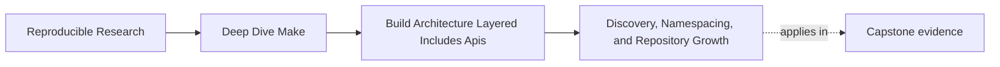
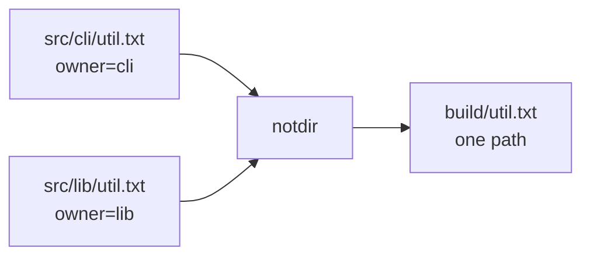
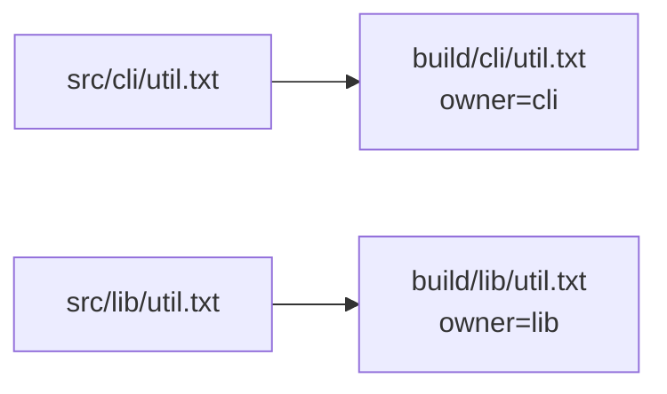

# Discovery, Namespacing, and Repository Growth


<!-- page-maps:start -->
## Page Maps




<!-- page-maps:end -->

A flat output directory can appear correct until a second subsystem introduces a familiar
basename such as `util`, `config`, or `summary`. At that point, successful execution is a
weak signal: Make may have built one file while the mapping silently discarded another
owner.

This lesson uses two source roots that deliberately collide:

```text
src/
  cli/util.txt    owner=cli
  lib/util.txt    owner=lib
```

The central architecture invariant is:

> Every selected source that promises its own artifact must map to one distinct,
> owner-identifiable output path.

## Run the collision audit

From `programs/reproducible-research/deep-dive-make/capstone/`, run:

```sh
gmake architecture-contract-audit
```

Open these two rows in the generated `summary.tsv`:

```text
output-ownership	flat-output	...	FLAT_OUTPUT_OWNERSHIP_COLLAPSED	PASS
output-ownership	namespaced-output	...	SUBSYSTEM_OUTPUT_OWNERSHIP_PRESERVED	PASS
```

The first row passes because the audit successfully reproduced a defect. Read the finding,
not just the result column.

## Broken model: erase ownership before building

The flat specimen starts with two sources:

```make
SOURCES := src/cli/util.txt src/lib/util.txt
```

It then discards their parent paths:

```make
OUTPUTS := $(sort $(addprefix build/,$(notdir $(SOURCES))))
```

Evaluate that expression from the inside:

1. `$(notdir ...)` turns both sources into `util.txt util.txt`.
2. `$(addprefix ...)` turns both into `build/util.txt build/util.txt`.
3. `$(sort ...)` removes the duplicate.

Two selected sources have become one target before any recipe runs.



The rule makes the loss visible:

```make
build/util.txt: $(SOURCES) | build/
	{ printf 'selected=%s\n' '$<'; cat '$<'; } > $@
```

`$<` is the first prerequisite, so the output records the CLI source. The library source
is listed as a prerequisite, but it never receives an artifact of its own. Make exits zero
because the graph asked for exactly one target and that target was created.

Inspect the evaluated mapping and surviving file:

```sh
cat artifacts/audit/reproducible-research/deep-dive-make/architecture-contracts/traces/output-ownership-flat-output-map.log
cat artifacts/audit/reproducible-research/deep-dive-make/architecture-contracts/workspace/output-ownership/flat-output/build/util.txt
```

The evidence should establish all three facts:

- source count is two
- unique output count is one
- the surviving artifact says `owner=cli`

That is stronger than saying “flat paths might collide.”

## Control model: preserve the source namespace

The control changes one mapping:

```make
OUTPUTS := $(patsubst src/%,build/%,$(SOURCES))
```

The relative path below `src/` survives below `build/`:

| Source | Output |
| --- | --- |
| `src/cli/util.txt` | `build/cli/util.txt` |
| `src/lib/util.txt` | `build/lib/util.txt` |

Separate pattern rules keep each prerequisite binding explicit:

```make
build/cli/%.txt: src/cli/%.txt | build/cli/
	{ printf 'selected=%s\n' '$<'; cat '$<'; } > $@

build/lib/%.txt: src/lib/%.txt | build/lib/
	{ printf 'selected=%s\n' '$<'; cat '$<'; } > $@
```



Now source count and unique output count are both two, and each file records the expected
owner. The output path itself also communicates which subsystem owns the artifact.

## Check cardinality before recipe correctness

When each source is supposed to produce one output, review the mapping as a function:

```text
source path -> output path
```

For the selected domain, ask:

1. **Totality:** does every source map to an output?
2. **Uniqueness:** do different sources map to different outputs?
3. **Ownership:** can a reviewer recover the source owner from the output path?
4. **Stability:** does adding an unrelated source leave existing mappings unchanged?

A recipe can be perfectly written and still operate on a graph that failed the second
question.

For a small list, Make can expose a useful diagnostic surface:

```make
show-map:
	@printf 'sources=%s\n' '$(SOURCES)'
	@printf 'outputs=%s\n' '$(OUTPUTS)'
```

For a larger repository, publish a machine-readable source-to-output manifest and reject
duplicate output keys before recipes execute.

## Root discovery in declared ownership domains

Namespacing answers where outputs belong. Rooted discovery answers which inputs belong to
the build:

```make
CLI_SOURCES := $(sort $(wildcard src/cli/*.c))
LIB_SOURCES := $(sort $(wildcard src/lib/*.c))
SOURCES := $(CLI_SOURCES) $(LIB_SOURCES)
```

The explicit roots make the ownership domains reviewable. `$(sort ...)` stabilizes the
order used by manifests, link commands, and publication lists.

Do not confuse sorting with collision prevention. Sorting made the broken specimen’s
duplicate disappear predictably; it did not make the mapping injective. Deterministic loss
is still loss.

## Decide whether one DAG still expresses the truth

Colliding basenames do not automatically justify recursive builds such as:

```sh
gmake -C cli
gmake -C lib
```

First ask whether the subsystems share a real dependency graph, tool policy, or final
artifact. If they do, preserving ownership within one DAG keeps cross-subsystem
dependencies visible.

Use separate invocations when the boundary is operationally real and their contracts are
explicit. Do not use them merely to hide a path-model failure that
`build/cli/...` and `build/lib/...` would solve.

## Growth review table

| Review surface | Evidence | Failure signal |
| --- | --- | --- |
| discovery roots | sorted source list or manifest | files join through an unbounded search |
| mapping cardinality | source and unique-output counts | fewer outputs than promised sources |
| path ownership | output-to-subsystem mapping | owner cannot be inferred |
| extension behavior | add one colliding basename | an existing output changes owner |
| graph coherence | dry run or graph view | cross-subsystem dependency is hidden in recursion |

Use this table before a repository adds its next subsystem, not after an artifact has been
silently overwritten.

## Practice: add a third owner

Work in a disposable copy of the namespaced specimen.

1. Add `src/plugin/util.txt` containing `owner=plugin`.
2. Predict the flat model’s source count, output count, and surviving owner.
3. Extend the namespaced model so it publishes `build/plugin/util.txt`.
4. Run `show-map` and `all`.
5. Prove that all three outputs exist and each records its matching owner.
6. Explain why sorting the flat `OUTPUTS` list cannot satisfy the uniqueness invariant.

A complete result contains the mapping, the three artifact paths, and their contents. A
directory sketch without executable evidence is not complete.

## End-of-page checkpoint

You are ready to continue when you can explain:

- exactly where the flat model turns two source paths into one output
- why exit status zero does not establish one-output-per-source behavior
- how `patsubst src/%,build/%` preserves subsystem ownership
- why rooted, sorted discovery and collision-free mapping solve different problems
- which evidence supports `SUBSYSTEM_OUTPUT_OWNERSHIP_PRESERVED`
