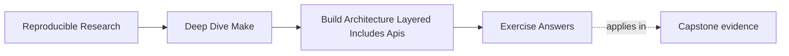

# Exercise Answers


<!-- page-maps:start -->
## Page Maps




<!-- page-maps:end -->

Use this after you have written your own answers. The point is comparison, not copying.

## How to use the answer page well

Do not read a model answer first and then reshape your architecture packet to sound
similar.

A better rhythm is:

1. finish the exercise with your own ownership maps, caller audit, and notes
2. write one plain-language explanation of the boundary you are protecting
3. compare that explanation with the model answer
4. revise where the model answer exposes weak interface meaning, blurred ownership, or
   unjustified cleverness

Strong Module 07 answers do not just propose a prettier file layout. They usually do four
things:

- they explain what interface or responsibility boundary is being protected
- they point to the evidence that made the problem visible
- they justify the refactor in terms of growth or reviewability
- they leave the build easier to inspect later

The strongest self-study packets also leave behind six concrete artifacts:

- one public target contract list
- one include-layer ownership map
- one justified macro decision
- one growth-safe naming redesign
- one automation audit
- one architecture review note

If your answers rely only on "the Makefiles need cleanup," the reasoning is still too
thin.

## Exercise 1: Define a public target surface

The specimen's help output declares `help` and `verify`; it does not declare
`internal-build`. A defensible classification is:

| Target | Status | Reason |
| --- | --- | --- |
| `help` | public | it is declared and explains the supported interface |
| `verify` | public | it is declared and promises build plus verification |
| `internal-build` | private but reachable | `verify` uses it, but callers are not promised its name or partial behavior |

`automation-private.sh` exits zero and creates `build/application.txt`. It does not create
`build/verification.txt`. Those observations support
`PRIVATE_TARGET_DEPENDENCE_REPRODUCED`: the caller reached an implementation target but
bypassed part of the declared contract.

The narrow repair is to change the caller from `gmake internal-build` to `gmake verify`.
Adding `internal-build` to help would enlarge the compatibility surface while preserving
the caller's incomplete behavior.

## Exercise 2: Split one Makefile into layers

Both specimens have this include order:

```make
include mk/policy.mk
include mk/release.mk
include mk/artifacts.mk
```

Their evidence differs:

| Model | Ordinary artifact | Release artifact |
| --- | --- | --- |
| global mutation | `flags=-O2 -DRELEASE` | `flags=-O2 -DRELEASE` |
| target-scoped policy | `flags=-O2` | `flags=-O2 -DRELEASE` |

The broken assignment, `CFLAGS += -DRELEASE`, changes the global value while Make parses
the release include. The control, `release: CFLAGS += -DRELEASE`, specializes one target
branch and its prerequisites.

A proposed layer table should still name policy, discovery, and artifact ownership, but
the executable check is decisive: from clean state, build the ordinary target and reject
any release-only flag in its artifact. Include order determines evaluation order; variable
scope determines which targets inherit a value.

## Exercise 3: Decide whether a macro is justified

A strong answer says a macro is justified when it protects one repeated invariant, such as
atomic publication or one repeated compile shape, and remains easy to audit with
`make -p`.

A strong reason to keep explicit rules instead is:

> The repeated rules are still few, and the macro would make the call sites less readable
> than the duplication it replaces.

That is a very healthy answer. Module 07 does not reward abstraction for its own sake.

The macro becomes too expensive when a reader must mentally expand a private language just
to understand one ordinary target.

## Exercise 4: Prepare the repository for growth

The flat model evaluates:

```text
sources=src/cli/util.txt src/lib/util.txt
outputs=build/util.txt
```

`notdir` discards both source-owner directories, and `sort` removes the duplicate output
string. The one artifact records `selected=src/cli/util.txt` and `owner=cli`.

The namespaced model evaluates:

```text
sources=src/cli/util.txt src/lib/util.txt
outputs=build/cli/util.txt build/lib/util.txt
```

Its two artifacts record `owner=cli` and `owner=lib`. The essential mapping is:

```make
OUTPUTS := $(patsubst src/%,build/%,$(SOURCES))
```

Adding `src/plugin/util.txt` should add `build/plugin/util.txt` without changing either
existing mapping. A robust pre-build check rejects the graph whenever:

```text
source count != unique output count
```

That assertion is appropriate when the contract promises one output per selected source.

## Exercise 5: Review a build architecture before it rots

A strong answer names concrete risks, such as:

- public API risk:
  - CI relies on an undocumented helper target
- layer-boundary risk:
  - `mk/release.mk` mutates core compile flags
- reuse risk:
  - one macro owns too much behavior to review comfortably
- naming risk:
  - output paths will collide when a new component lands

The strongest answers also recommend one preventive change now rather than waiting for a
later breakage.

Architecture review is credible when it predicts where future change will become hard to
reason about, not just when it praises the current build for working today.

## Exercise 6: Publish a useful `help` target

An explicit implementation remains easy to review:

```make
PUBLIC_TARGETS := all test selftest clean help

.PHONY: $(PUBLIC_TARGETS)
help:
	@printf '%-12s %s\n' \
	  'all'      'build the default product' \
	  'test'     'run product tests' \
	  'selftest' 'verify build-system invariants' \
	  'clean'    'remove generated state' \
	  'help'     'show this public interface'
```

The answer is incomplete until an external caller can choose the intended target from
those descriptions and prove its result. For example, a build-invariant caller should
select `selftest`, exit zero, and leave the evidence that target documents. A check such
as this protects the private boundary:

```sh
! gmake help | grep -q '^internal-build'
```

An internal target may remain reachable because public targets need implementation nodes.
Its absence from help means callers are not promised its name or partial outcome.

The key explanation is:

> `help` should describe contracts, not implementation steps, because callers need to know
> what evidence a target promises rather than how it happens to work today.

Renaming `selftest` after publication requires a compatibility decision for scripts and
humans that rely on it. Renaming `internal-build` does not, provided declared targets keep
their behavior.

## Exercise 7: Audit automation against the public API

A useful search begins broadly:

```sh
rg -n '(g?make)([[:space:]]|$)' .github scripts Makefile mk
```

The specimen establishes the comparison standard:

| Caller | Invoked target | Declared? | Application | Verification | Finding |
| --- | --- | --- | --- | --- | --- |
| `automation-private.sh` | `internal-build` | no | present | absent | `PRIVATE_TARGET_DEPENDENCE_REPRODUCED` |
| `automation-declared.sh` | `verify` | yes | present | present | `PUBLIC_TARGET_CONTRACT_HONORED` |

The repository table should add the evidence each public target promises. If CI calls
`build-objects`, change it to a suitable declared target and compare both the command and
its artifacts. Promoting the helper solely to silence the mismatch would enlarge the API
without deciding whether its partial behavior deserves compatibility guarantees.

The important explanation is:

> Silent interface sprawl is risky because automation can convert private helpers into
> durable contracts before anyone notices, while still bypassing evidence produced by the
> supported route.

## Exercise 8: Make variable ownership inspectable

The inherited mutation is global:

```make
CFLAGS += -DRELEASE
```

It makes both artifacts contain `-O2 -DRELEASE`. The narrow repair is:

```make
release: CFLAGS += -DRELEASE
```

After a clean build, the ordinary artifact must contain only `-O2`, while the release
artifact contains both flags. `gmake -p` can show the target-specific assignment, and the
artifact pair proves its propagation.

For a repository-owned variable, a useful diagnostic remains:

```make
explain-flags:
	@printf 'CFLAGS origin=%s flavor=%s value=%s\n' \
	  '$(origin CFLAGS)' '$(flavor CFLAGS)' '$(value CFLAGS)'
```

Use `?=` when command-line policy is intentionally supported. Use validation, rather than
a casual `override`, when an input must satisfy a hard invariant. If overriding is truly
required, document and test why command-line input may not erase that value.

The key explanation is:

> Variable ownership is architectural because it determines which layer is allowed to set
> policy, which target branches may specialize it, and which artifacts must prove that
> scope.

## Exercise 9: Inspect a macro instead of trusting it

A bounded macro can own one compile shape:

```make
define compile_object
$1: $2 | $$(@D)/
	$$(CC) $$(CPPFLAGS) $$(CFLAGS) -c $$< -o $$@
endef

$(eval $(call compile_object,build/app/main.o,src/app/main.c))
$(eval $(call compile_object,build/lib/math.o,src/lib/math.c))
```

Use `make -np` and search for both object targets. Keep the macro only if the expanded
rules are predictable and the shared invariant matters. Two short rules may be clearer
than `call` and `eval`; removing an unjustified macro is a successful answer.

The strongest answers show that inspection, not elegance, decides whether the macro earns
its place.

## Exercise 10: Refactor a growing build

A strong result starts with observations, not a tree:

| Boundary | Before | After |
| --- | --- | --- |
| caller | private target; verification absent | declared target; verification present |
| policy | release flag in both artifacts | release flag only in release artifact |
| outputs | two sources collapse to one path | each source has an owner-identifiable path |

The public target must appear in help and match the command used by automation. The policy
proof must compare ordinary and release artifact contents. The mapping proof must show
equal source and unique-output counts, not merely two output directories.

Rejection tests complete the result. Mutating the repaired caller back to the private
target, removing target scope, or collapsing the namespace should make the audit fail.
Then run from clean state and repeat once without changes to establish convergence.

The remaining-risk note matters. Architecture review is not credible when it claims a
growing build has no unresolved pressure. A useful note names the next likely owner,
consumer, and evidence route rather than saying only that the architecture may grow.

## What mastery-level answers sound like

A mastery-level answer set in this module does three things well:

- it treats the Makefile as an interface, not just a script
- it treats include files as responsibility boundaries, not just text fragments
- it treats reuse and naming decisions as architecture choices with long-term costs

That is the standard Module 07 is trying to build.
