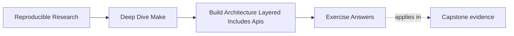

# Exercise Answers


<!-- page-maps:start -->
## Page Maps




<!-- page-maps:end -->

Use this after you have written your own answers. The point is comparison, not copying.

## How to use the answer page well

Do not read a model answer first and then reshape your architecture packet to sound
similar.

A better rhythm is:

1. finish the exercise with your own ownership maps, caller audit, and notes
2. write one plain-language explanation of the boundary you are protecting
3. compare that explanation with the model answer
4. revise where the model answer exposes weak interface meaning, blurred ownership, or
   unjustified cleverness

Strong Module 07 answers do not just propose a prettier file layout. They usually do four
things:

- they explain what interface or responsibility boundary is being protected
- they point to the evidence that made the problem visible
- they justify the refactor in terms of growth or reviewability
- they leave the build easier to inspect later

The strongest self-study packets also leave behind six concrete artifacts:

- one public target contract list
- one include-layer ownership map
- one justified macro decision
- one growth-safe naming redesign
- one automation audit
- one architecture review note

If your answers rely only on "the Makefiles need cleanup," the reasoning is still too
thin.

## Exercise 1: Define a public target surface

A strong answer keeps the public surface small and stable. It often includes targets such
as:

- `all`
- `test`
- `selftest`
- `clean`
- `help`

The strongest answers also explain what each name promises. For example:

> `selftest` is for build-system invariants, not ordinary product tests.

A good demotion candidate is often a helper such as `build-objects` or
`verify-contract` when that target exists only to support internal orchestration rather
than to serve users or CI directly.

The key explanation is:

> Public means callers may rely on the name and meaning staying stable; internal means the
> implementation may reorganize it freely.

## Exercise 2: Split one Makefile into layers

A strong answer usually separates at least:

- shared policy and tools
- discovery and mapping
- core graph targets
- optional release or local overrides

For example:

```make
include mk/common.mk
include mk/objects.mk
include mk/targets.mk
-include mk/local.mk
```

The important part is not the filenames themselves. The important part is that you can say
what each layer owns and why that ownership makes later mutation easier to review.

The include order matters because later layers often consume or refine facts established
earlier. If policy, discovery, and artifact ownership are not ordered deliberately,
mutation sites become harder to trace.

## Exercise 3: Decide whether a macro is justified

A strong answer says a macro is justified when it protects one repeated invariant, such as
atomic publication or one repeated compile shape, and remains easy to audit with
`make -p`.

A strong reason to keep explicit rules instead is:

> The repeated rules are still few, and the macro would make the call sites less readable
> than the duplication it replaces.

That is a very healthy answer. Module 07 does not reward abstraction for its own sake.

The macro becomes too expensive when a reader must mentally expand a private language just
to understand one ordinary target.

## Exercise 4: Prepare the repository for growth

A strong answer redesigns both discovery and output naming.

For example:

```make
APP_SRCS := $(sort $(wildcard src/app/*.c))
LIB_SRCS := $(sort $(wildcard src/lib/*.c))

APP_OBJS := $(patsubst src/app/%.c,build/app/%.o,$(APP_SRCS))
LIB_OBJS := $(patsubst src/lib/%.c,build/lib/%.o,$(LIB_SRCS))
```

This is strong because it prevents the future ambiguity that a flat `src/*.c` plus
`build/%.o` model would create once more than one subsystem exists.

The key explanation is:

> Flat naming ages badly because new subsystems turn once-unique filenames into collisions
> and make object ownership ambiguous.

## Exercise 5: Review a build architecture before it rots

A strong answer names concrete risks, such as:

- public API risk:
  - CI relies on an undocumented helper target
- layer-boundary risk:
  - `mk/release.mk` mutates core compile flags
- reuse risk:
  - one macro owns too much behavior to review comfortably
- naming risk:
  - output paths will collide when a new component lands

The strongest answers also recommend one preventive change now rather than waiting for a
later breakage.

Architecture review is credible when it predicts where future change will become hard to
reason about, not just when it praises the current build for working today.

## Exercise 6: Publish a useful `help` target

An explicit implementation is easy to review:

```make
PUBLIC_TARGETS := all test selftest clean help

.PHONY: $(PUBLIC_TARGETS)
help:
	@printf '%-12s %s\n' \
	  'all'      'build the default product' \
	  'test'     'run product tests' \
	  'selftest' 'verify build-system invariants' \
	  'clean'    'remove generated state' \
	  'help'     'show this public interface'
```

An internal target such as `build-objects` should not appear. Its name and behavior may
change without breaking callers because automation and learners use the public contract.

The key explanation is:

> `help` should describe contracts, not implementation steps, because callers need to know
> what a target promises rather than how it happens to work today.

## Exercise 7: Audit automation against the public API

A useful search begins broadly:

```sh
rg -n '(g?make)([[:space:]]|$)' .github scripts Makefile mk
```

The resulting table should identify each caller and target. If CI calls `build-objects`,
either change it to a public target such as `all` or deliberately promote and document
that contract. Merely adding the helper to `help` to silence the mismatch would enlarge
the API without deciding ownership.

The important explanation is:

> Silent interface sprawl is risky because automation can convert private helpers into
> durable contracts before anyone notices.

## Exercise 8: Make variable ownership inspectable

Suppose `mk/common.mk` owns defaults for `CFLAGS`:

```make
CFLAGS ?= -O2
override CPPFLAGS += -Iinclude

.PHONY: explain-flags
explain-flags:
	@printf 'CFLAGS origin=%s flavor=%s value=%s\n' \
	  '$(origin CFLAGS)' '$(flavor CFLAGS)' '$(value CFLAGS)'
```

This example distinguishes an overridable user policy from a required include path.
Strong answers avoid casual `override`; they use it only for an invariant that
command-line input must not erase. The inspection output should prove command-line and
environment behavior.

The key explanation is:

> Variable ownership is architectural because it determines which layer is allowed to set
> policy and which layers may only consume it.

## Exercise 9: Inspect a macro instead of trusting it

A bounded macro can own one compile shape:

```make
define compile_object
$1: $2 | $$(@D)/
	$$(CC) $$(CPPFLAGS) $$(CFLAGS) -c $$< -o $$@
endef

$(eval $(call compile_object,build/app/main.o,src/app/main.c))
$(eval $(call compile_object,build/lib/math.o,src/lib/math.c))
```

Use `make -np` and search for both object targets. Keep the macro only if the expanded
rules are predictable and the shared invariant matters. Two short rules may be clearer
than `call` and `eval`; removing an unjustified macro is a successful answer.

The strongest answers show that inspection, not elegance, decides whether the macro earns
its place.

## Exercise 10: Refactor a growing build

A strong result has a shallow, explainable entrypoint:

```make
include mk/policy.mk
include mk/discovery.mk
include mk/artifacts.mk
-include mk/local.mk
```

`policy.mk` owns tools and shell behavior, `discovery.mk` owns sorted rooted source lists
and output mapping, and `artifacts.mk` owns product edges. Public targets remain in the
top-level file or one clearly named interface layer.

Evidence should show that:

- `make -n all` reaches the intended graph
- a second `make all` is a no-op
- both source roots map to separate output namespaces
- `selftest` verifies the interface and architecture invariants
- CI invokes only declared public targets

The remaining-risk note matters. Architecture review is not credible when it claims a
growing build has no unresolved pressure.

## What mastery-level answers sound like

A mastery-level answer set in this module does three things well:

- it treats the Makefile as an interface, not just a script
- it treats include files as responsibility boundaries, not just text fragments
- it treats reuse and naming decisions as architecture choices with long-term costs

That is the standard Module 07 is trying to build.
