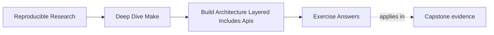

# Exercise Answers


<!-- page-maps:start -->
## Page Maps




<!-- page-maps:end -->

Use this after you have written your own answers. The point is comparison, not copying.

Strong Module 07 answers do not just propose a prettier file layout. They explain:

- what interface or responsibility boundary is being protected
- what evidence made the problem visible
- why the refactor would make the build easier to evolve or review

## Exercise 1: Define a public target surface

A strong answer keeps the public surface small and stable. It usually includes targets such
as:

- `all`
- `test`
- `selftest`
- `clean`
- `help`

The strongest answers also explain what each name promises. For example:

> `selftest` is for build-system invariants, not ordinary product tests.

A good demotion candidate is often a helper such as `build-objects` or `verify-contract`
when that target exists only to support internal orchestration rather than to serve users or
CI directly.

## Exercise 2: Split one Makefile into layers

A strong answer usually separates at least:

- shared policy and tools
- discovery and mapping
- core graph targets
- optional release or local overrides

For example:

```make
include mk/common.mk
include mk/objects.mk
include mk/targets.mk
-include mk/local.mk
```

The important part is not the filenames themselves. The important part is that you can say
what each layer owns and why that ownership makes later mutation easier to review.

## Exercise 3: Decide whether a macro is justified

A strong answer says a macro is justified when it protects one repeated invariant, such as
atomic publication or a repeated compile shape, and remains easy to audit with `make -p`.

A strong reason to keep explicit rules instead is:

> the repeated rules are still few, and the macro would make the call sites less readable
> than the duplication it replaces.

That is a very healthy answer. Module 07 does not reward abstraction for its own sake.

## Exercise 4: Prepare the repository for growth

A strong answer redesigns both discovery and output naming.

For example:

```make
APP_SRCS := $(sort $(wildcard src/app/*.c))
LIB_SRCS := $(sort $(wildcard src/lib/*.c))

APP_OBJS := $(patsubst src/app/%.c,build/app/%.o,$(APP_SRCS))
LIB_OBJS := $(patsubst src/lib/%.c,build/lib/%.o,$(LIB_SRCS))
```

This is strong because it prevents the future ambiguity that a flat `src/*.c` plus
`build/%.o` model would create once more than one subsystem exists.

## Exercise 5: Review a build architecture before it rots

A strong answer names concrete risks, such as:

- public API risk: CI relies on an undocumented helper target
- layer-boundary risk: `mk/release.mk` mutates core compile flags
- reuse risk: one macro owns too much behavior to review comfortably
- naming risk: output paths will collide when a new component lands

The strongest answers also recommend one preventive change now rather than waiting for a
later breakage.

## Exercise 6: Publish a useful help target

An explicit implementation is easy to review:

```make
PUBLIC_TARGETS := all test selftest clean help

.PHONY: $(PUBLIC_TARGETS)
help:
	@printf '%-12s %s\n' \
	  'all'      'build the default product' \
	  'test'     'run product tests' \
	  'selftest' 'verify build-system invariants' \
	  'clean'    'remove generated state' \
	  'help'     'show this public interface'
```

An internal target such as `build-objects` should not appear. Its name and behavior may
change without breaking callers because automation and learners use the public contract.

## Exercise 7: Audit automation against the public API

A useful search begins broadly:

```sh
rg -n '(g?make)([[:space:]]|$)' .github scripts Makefile mk
```

The resulting table should identify each caller and target. If CI calls
`build-objects`, either change it to a public target such as `all` or deliberately promote
and document that contract. Merely adding the helper to `help` to silence the mismatch
would enlarge the API without deciding ownership.

## Exercise 8: Make variable ownership inspectable

Suppose `mk/common.mk` owns defaults for `CFLAGS`:

```make
CFLAGS ?= -O2
override CPPFLAGS += -Iinclude

.PHONY: explain-flags
explain-flags:
	@printf 'CFLAGS origin=%s flavor=%s value=%s\n' \
	  '$(origin CFLAGS)' '$(flavor CFLAGS)' '$(value CFLAGS)'
```

This example distinguishes an overridable user policy from a required include path.
Strong answers avoid casual `override`; they use it only for an invariant that command-line
input must not erase. The inspection output should prove command-line and environment
behavior.

## Exercise 9: Inspect a macro instead of trusting it

A bounded macro can own one compile shape:

```make
define compile_object
$1: $2 | $$(@D)/
	$$(CC) $$(CPPFLAGS) $$(CFLAGS) -c $$< -o $$@
endef

$(eval $(call compile_object,build/app/main.o,src/app/main.c))
$(eval $(call compile_object,build/lib/math.o,src/lib/math.c))
```

Use `make -np` and search for both object targets. Keep the macro only if the expanded
rules are predictable and the shared invariant matters. Two short rules may be clearer
than `call` and `eval`; removing an unjustified macro is a successful answer.

## Exercise 10: Refactor a growing build

A strong result has a shallow, explainable entrypoint:

```make
include mk/policy.mk
include mk/discovery.mk
include mk/artifacts.mk
-include mk/local.mk
```

`policy.mk` owns tools and shell behavior, `discovery.mk` owns sorted rooted source lists
and output mapping, and `artifacts.mk` owns product edges. Public targets remain in the
top-level file or one clearly named interface layer. Evidence should show that:

- `make -n all` reaches the intended graph
- a second `make all` is a no-op
- both source roots map to separate output namespaces
- `selftest` verifies the interface and architecture invariants
- CI invokes only declared public targets

The remaining-risk note matters. Architecture review is not credible when it claims a
growing build has no unresolved pressure.

## What mastery-level answers sound like

A mastery-level answer set in this module does three things well:

- it treats the Makefile as an interface, not just a script
- it treats include files as responsibility boundaries, not just text fragments
- it treats reuse and naming decisions as architecture choices with long-term costs

That is the standard Module 07 is trying to build.
