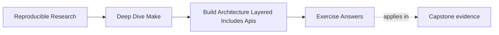

# Exercise Answers


<!-- page-maps:start -->
## Page Maps




<!-- page-maps:end -->

Use this after you have written your own answers. The point is comparison, not copying.

## How to use the answer page well

Do not read a model answer first and then reshape your architecture packet to sound
similar.

A better rhythm is:

1. finish the exercise with your own ownership maps, caller audit, and notes
2. write one plain-language explanation of the boundary you are protecting
3. compare that explanation with the model answer
4. revise where the model answer exposes weak interface meaning, blurred ownership, or
   unjustified cleverness

Strong Module 07 answers do not just propose a prettier file layout. They usually do four
things:

- they explain what interface or responsibility boundary is being protected
- they point to the evidence that made the problem visible
- they justify the refactor in terms of growth or reviewability
- they leave the build easier to inspect later

The strongest self-study packets also leave behind eight concrete artifacts:

- one public target contract list
- one parameter and failure contract
- one include-layer ownership map
- one dependency-direction ledger
- one justified macro decision
- one forward and reverse mapping proof
- one automation audit
- one architecture review note

If your answers rely only on "the Makefiles need cleanup," the reasoning is still too
thin.

## Exercise 1: Define a public target surface

The specimen's help output declares `help` and `verify`; it does not declare
`internal-build`. A defensible classification is:

| Target | Status | Reason |
| --- | --- | --- |
| `help` | public | it is declared and explains the supported interface |
| `verify` | public | it is declared and promises build plus verification |
| `internal-build` | private but reachable | `verify` uses it, but callers are not promised its name or partial behavior |

`automation-private.sh` exits zero and creates `build/application.txt`. It does not create
`build/verification.txt`. Those observations support
`PRIVATE_TARGET_DEPENDENCE_REPRODUCED`: the caller reached an implementation target but
bypassed part of the declared contract.

The narrow repair is to change the caller from `gmake internal-build` to `gmake verify`.
Adding `internal-build` to help would enlarge the compatibility surface while preserving
the caller's incomplete behavior.

The extended API should be recorded as a contract, not just a variable assignment:

| Field | Model answer |
| --- | --- |
| invocation | `gmake verify PROFILE=ordinary` or `PROFILE=strict` |
| supported parameter | exactly `ordinary` and `strict` |
| results | application and verification artifacts |
| side effects | no release publication |
| failure | unsupported value fails before either result is updated |

For `PROFILE=strict`, `build/verification.txt` should contain both `profile=strict` and
`verified=yes`. A call such as `PROFILE=strcit` must fail and leave the previous artifact
untouched or absent after clean state. That rejected spelling matters: it proves the build
does not silently reinterpret a caller mistake as an ordinary build.

## Exercise 2: Split one Makefile into layers

Both specimens have this include order:

```make
include mk/policy.mk
include mk/release.mk
include mk/artifacts.mk
```

Their evidence differs:

| Model | Ordinary artifact | Release artifact |
| --- | --- | --- |
| global mutation | `flags=-O2 -DRELEASE` | `flags=-O2 -DRELEASE` |
| target-scoped policy | `flags=-O2` | `flags=-O2 -DRELEASE` |

The broken assignment, `CFLAGS += -DRELEASE`, changes the global value while Make parses
the release include. The control, `release: CFLAGS += -DRELEASE`, specializes one target
branch and its prerequisites.

A proposed layer table should still name policy, discovery, and artifact ownership, but
the executable check is decisive: from clean state, build the ordinary target and reject
any release-only flag in its artifact. Include order determines evaluation order; variable
scope determines which targets inherit a value.

The target-scoped repair becomes ambiguous if both branches share `build/shared.o`.
Compare all three invocations:

```sh
gmake clean && gmake all release
gmake clean && gmake release all
gmake clean && gmake -j2 all release
```

If the artifact’s identity includes flags, the model repair uses distinct paths:

```make
all: build/ordinary/shared.o
release: build/release/shared.o
```

If its bytes genuinely do not depend on release policy, remove that policy from its recipe
and keep one policy-neutral path. A `private` target-specific variable is appropriate only
when the child must not inherit the value and that non-inheritance is part of the contract.

A defensible dependency ledger says graph rules consume policy, while policy never reads
public goals. Injecting `$(if $(filter release,$(MAKECMDGOALS)),...)` into discovery must be
rejected because a provider now depends on its interface consumer.

## Exercise 3: Decide whether a macro is justified

The explicit contract is:

| Target | Source | Mode | Publication | Owner |
| --- | --- | --- | --- | --- |
| `build/alpha.txt` | `data/alpha.txt` | ordinary | process-local candidate, then rename | alpha |
| `build/beta.txt` | `data/beta.txt` | ordinary | process-local candidate, then rename | beta |

The bounded model exposes:

```text
macro-calls=publish_owned_file:alpha publish_owned_file:beta
```

Its evaluated database must preserve:

```text
build/alpha.txt: data/alpha.txt | build/
build/beta.txt: data/beta.txt | build/
```

Both artifact pairs must record the same mode, source, and owner. If those observations
match, keeping the macro is defensible because it centralizes atomic publication while
leaving the generated domain visible.

Keeping the explicit rules is also defensible when two short rules are cheaper to read than
the two-stage `eval` expansion. A required limit belongs in the answer: this evidence does
not establish behavior for generated includes, secondary expansion, or a new rule family.

One correct expansion ledger is:

| Intent | Macro source | Parsed recipe | Shell input |
| --- | --- | --- | --- |
| target | `$$@` | `$@` | concrete target |
| first prerequisite | `$$<` | `$<` | concrete source |
| shell process ID | `$$$$$$$$` | `$$$$` | `$$` |
| shell `candidate` variable | `$$$$candidate` | `$$candidate` | `$candidate` |

The candidate name should combine the target and shell process ID, be created beside the
final path, be removed after producer failure, and be renamed only after success. After an
interruption, the final path must not contain partial bytes and no process may reuse
another publisher’s candidate.

Search the macro and its ordinary parse route for `$(shell ...)` and `$(file ...)`. A
diagnostic may use them behind an explicit goal guard; the production parse must not write
or discover hidden state.

## Exercise 4: Prepare the repository for growth

The flat model evaluates:

```text
sources=src/cli/util.txt src/lib/util.txt
outputs=build/util.txt
```

`notdir` discards both source-owner directories, and `sort` removes the duplicate output
string. The one artifact records `selected=src/cli/util.txt` and `owner=cli`.

The namespaced model evaluates:

```text
sources=src/cli/util.txt src/lib/util.txt
outputs=build/cli/util.txt build/lib/util.txt
```

Its two artifacts record `owner=cli` and `owner=lib`. The essential mapping is:

```make
OUTPUTS := $(patsubst src/%,build/%,$(SOURCES))
```

Adding `src/plugin/util.txt` should add `build/plugin/util.txt` without changing either
existing mapping. A robust pre-build check rejects the graph whenever:

```text
source count != unique output count
```

That assertion is appropriate when the contract promises one output per selected source.

It proves injectivity only when every supported source was selected. A complete model
answer records:

| Property | Evidence |
| --- | --- |
| totality | supported-source manifest equals the forward-map source column |
| injectivity | output count equals unique-output count |
| reversibility | reverse transformation reproduces every source byte-for-byte |
| stability | adding `src/plugin/deep/util.txt` leaves the CLI and library paths unchanged |

For example, a documented `.txt` and `.csv` domain may preserve extensions under
`build/<owner>/...`; `.bin` should be rejected until its mapping is specified. A symlink
policy should either reject links or map their logical repository paths consistently.
Generated sources must live outside discovery roots or enter through a declared manifest,
otherwise build output can be rediscovered as input.

## Exercise 5: Review a build architecture before it rots

A bounded macro review might begin:

| Field | Entry |
| --- | --- |
| claim | publication macro generates only listed owner-to-artifact rules |
| owner | macro definition and explicit owner list |
| consumer | artifact graph and maintainers extending the owner set |
| falsifying observation | hidden target, changed policy, or mismatched prerequisite |
| evidence | call domain, `gmake -npRr all`, help, artifact contents |

The controlled comparison can inject `publish-alpha` into the bounded macro. The ordinary
build still succeeds, but the database gains a target that the call site and help do not
declare. The rejection test should fail the control.

A complete decision record could say:

> Repair. Remove publication-target generation from the artifact macro and keep policy in
> its owning layer. Accept only after the evaluated prerequisite map matches the explicit
> baseline and the abstraction rejection suite passes. Generated includes remain outside
> this review; adding one is the trigger for another contract case.

This answer is stronger than a list of possible risks because it names the claim,
observation, evidence, decision, limit, and rerun trigger.

For the required direction claim, a model ledger is:

| Consumer | Provider | Meaning consumed | Direction |
| --- | --- | --- | --- |
| discovery | policy | supported source roots | allowed |
| graph | discovery | selected sources and owner keys | allowed |
| interface | graph | named artifact targets | allowed |
| discovery | interface | current public goal name | forbidden |

The feedback mutation makes discovery vary with `MAKECMDGOALS`. The rejection route builds
the same profile through differently ordered public goals and requires the discovery
manifest to remain identical. The repair moves the choice to a validated `PROFILE`
parameter and starts a child Make with that value. Discovery consumes policy; it no longer
interprets caller syntax.

The change cone includes discovery manifests, output mapping, public help, accepted profile
calls, and rejected profile values. Recording that cone explains why those pieces of
evidence belong in the decision packet.

## Exercise 6: Publish a useful `help` target

An explicit implementation remains easy to review:

```make
PUBLIC_TARGETS := all test selftest clean help contract

.PHONY: $(PUBLIC_TARGETS)
help:
	@printf '%-12s %s\n' \
	  'all'      'build the default product' \
	  'test'     'run product tests' \
	  'selftest' 'verify build-system invariants' \
	  'clean'    'remove generated state' \
	  'help'     'show this public interface' \
	  'contract' 'show the machine-readable interface'

.PHONY: contract
contract:
	@printf '%s\t%s\t%s\t%s\n' \
	  'target' 'parameters' 'result' 'failure'; \
	printf '%s\t%s\t%s\t%s\n' \
	  'selftest' 'PROFILE=ordinary|strict' \
	  'build/selftest.json' 'nonzero; no new evidence'
```

The answer is incomplete until an external caller can choose the intended target from
those descriptions and prove its result. For example, a build-invariant caller should
select `selftest`, exit zero, and leave the evidence that target documents. A check such
as this protects the private boundary:

```sh
! gmake help | grep -q '^internal-build'
```

An internal target may remain reachable because public targets need implementation nodes.
Its absence from help means callers are not promised its name or partial outcome.

The machine caller reads `contract`, checks for the exact `selftest` row, supplies a
supported profile, and verifies `build/selftest.json`. It does not scrape the human
description. `PROFILE=unknown` must fail before updating the evidence file. That separates
interface discovery from interface prose while keeping both views owned by the same
explicit contract data.

The key explanation is:

> `help` should describe contracts, not implementation steps, because callers need to know
> what evidence a target promises rather than how it happens to work today.

Renaming `selftest` after publication requires a compatibility decision for scripts and
humans that rely on it. Renaming `internal-build` does not, provided declared targets keep
their behavior.

## Exercise 7: Audit automation against the public API

A useful search begins broadly:

```sh
rg -n '(g?make)([[:space:]]|$)' .github scripts Makefile mk
```

The specimen establishes the comparison standard:

| Caller | Invoked target | Declared? | Application | Verification | Finding |
| --- | --- | --- | --- | --- | --- |
| `automation-private.sh` | `internal-build` | no | present | absent | `PRIVATE_TARGET_DEPENDENCE_REPRODUCED` |
| `automation-declared.sh` | `verify` | yes | present | present | `PUBLIC_TARGET_CONTRACT_HONORED` |

The repository table should add the evidence each public target promises. If CI calls
`build-objects`, change it to a suitable declared target and compare both the command and
its artifacts. Promoting the helper solely to silence the mismatch would enlarge the API
without deciding whether its partial behavior deserves compatibility guarantees.

Recursive calls need the same audit:

```make
verify:
	+$(MAKE) --no-print-directory PROFILE='$(PROFILE)' internal-verify
```

The parent trace and child artifact should report the same validated profile. Do not depend
on `export PROFILE` or an ambient environment value unless environment inheritance is a
documented API. A rejection case starts the parent with an unrelated environment value
and requires the child to use the documented default or reject it according to policy.

The important explanation is:

> Silent interface sprawl is risky because automation can convert private helpers into
> durable contracts before anyone notices, while still bypassing evidence produced by the
> supported route.

## Exercise 8: Make variable ownership inspectable

The inherited mutation is global:

```make
CFLAGS += -DRELEASE
```

It makes both artifacts contain `-O2 -DRELEASE`. The narrow repair is:

```make
release: CFLAGS += -DRELEASE
```

After a clean build, the ordinary artifact must contain only `-O2`, while the release
artifact contains both flags. `gmake -p` can show the target-specific assignment, and the
artifact pair proves its propagation.

For a repository-owned variable, a useful diagnostic remains:

```make
explain-flags:
	@printf 'CFLAGS origin=%s flavor=%s value=%s\n' \
	  '$(origin CFLAGS)' '$(flavor CFLAGS)' '$(value CFLAGS)'
```

Use `?=` when command-line policy is intentionally supported. Use validation, rather than
a casual `override`, when an input must satisfy a hard invariant. If overriding is truly
required, document and test why command-line input may not erase that value.

The key explanation is:

> Variable ownership is architectural because it determines which layer is allowed to set
> policy, which target branches may specialize it, and which artifacts must prove that
> scope.

Now add the shared-prerequisite result. If `all` and `release` both update
`build/shared.o`, target-specific propagation makes the effective flags depend on which
branch reaches it first. Separate goal invocations are not enough evidence. Capture both
goal orders and `-j2`.

A model repair for policy-dependent bytes is:

```make
build/ordinary/shared.o: CFLAGS := -O2
build/release/shared.o: CFLAGS := -O2 -DRELEASE
```

Distinct semantics receive distinct identities. For policy-neutral bytes, remove `CFLAGS`
from the shared recipe instead. The answer must connect path identity to byte identity,
not select a technique by preference.

## Exercise 9: Inspect a macro instead of trusting it

Adding `gamma` to the owner list should generate exactly:

```text
build/gamma.txt: data/gamma.txt | build/
```

and an artifact containing:

```text
mode=ordinary
source=data/gamma.txt
owner=gamma
```

If the macro also adds `publish-gamma`, the database trace exposes that target even when
`all` never dispatches it. If it assigns `MODE := release`, all three artifacts expose the
policy side effect. Help should be compared with the generated callable target list so an
undocumented surface is not mistaken for a public promise.

`gmake abstraction-contract-selftest` is the reference rejection route. The repair is not
to add every generated helper to help. Remove publication-target generation and policy
assignment from the artifact-rule macro, then give those decisions explicit owners.

The five requested views answer different questions:

1. raw definition: what responsibilities and escapes are visible?
2. call-expanded text: what concrete owner-specific rule is proposed?
3. parsed database: what graph did Make accept?
4. recipe trace: what automatic and Make variables were substituted?
5. shell trace: what candidate path and command actually ran?

If `$$@` is mistakenly written `$@` in the macro source, it expands before a generated
target context exists and the target path disappears. If a shell variable is under-escaped,
Make may consume `$c` as a Make variable reference and pass only the remainder of the name.
The learner’s prediction should name the expansion boundary, not merely say “escaping
breaks.”

Two controlled publisher processes should show distinct target-and-process-local candidate
paths. The rejection test should fail if those paths are replaced by one fixed
target-derived scratch name, even if a serial build still succeeds.

## Exercise 10: Refactor a growing build

A strong result starts with observations, not a tree:

| Boundary | Before | After |
| --- | --- | --- |
| caller | private target; verification absent | declared target; verification present |
| parameters | implicit or silently accepted | validated, documented, and forwarded |
| policy | release flag in both artifacts | release flag only in release artifact |
| shared prerequisite | first visitor determines policy | neutral bytes or policy-specific path |
| outputs | two sources collapse to one path | total, injective, reversible stable mapping |
| publication | shared candidate or direct write | process-local candidate and atomic rename |
| layers | provider inspects consumer goal | dependency direction remains one-way |

The public target must appear in help and match the command used by automation. The policy
proof must compare ordinary and release artifact contents. The mapping proof must compare
the supported-source manifest, forward map, unique outputs, and reconstructed reverse map.
Count equality alone can hide an omitted source paired with an unrelated extra output.

Rejection tests complete the result. Mutating the repaired caller back to the private
target, accepting an unsupported parameter, restoring a shared policy-sensitive path,
collapsing the namespace, weakening candidate uniqueness, or adding a reverse dependency
should make the relevant gate fail. Then run from clean state, in parallel, with both
public goal orders, and once without changes to establish convergence.

The remaining-risk note matters. Architecture review is not credible when it claims a
growing build has no unresolved pressure. A useful note names the next likely owner,
consumer, and evidence route rather than saying only that the architecture may grow.

## What mastery-level answers sound like

A mastery-level answer set in this module does three things well:

- it treats the Makefile as an interface, not just a script
- it treats include files as responsibility boundaries, not just text fragments
- it treats reuse and naming decisions as architecture choices with long-term costs
- it proves why a dishonest variation is rejected

That is the standard Module 07 is trying to build.
