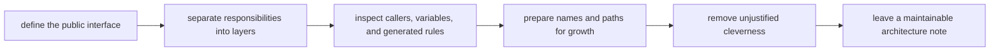

# Exercises

Use these after reading the five core lessons and the worked example. The goal is not to
show off Make cleverness. The goal is to make your architecture reasoning visible through
interfaces, ownership, and growth-safe structure.

## How to work through this set

Treat the ten exercises as one full lab day on build architecture review.

Before each answer:

1. name the interface or responsibility boundary you are testing
2. choose the inspection path that would make that boundary visible
3. state what structural decision would follow if the evidence confirms your concern

If you skip the boundary question, architecture work collapses into vague cleanup talk.
This module is about making the Makefile itself reviewable as an interface.

Do the exercises in order. The day is one progression:

- Exercises 1-3 define the public target surface, include layers, and abstraction limits
- Exercises 4-6 prepare the build for growth and document the interface for contributors
- Exercises 7-9 audit automation, variable ownership, and macro inspection honestly
- Exercise 10 turns those ideas into one real refactor of a mixed-responsibility build

Keep one architecture packet as you go. By the end of the day it should contain:

- one public target contract list
- one include-layer ownership map
- one abstraction decision you can defend either way
- one namespace redesign for future growth
- one automation audit against the public API
- one short architecture review naming a remaining risk

If those six artifacts are missing, you are probably editing layout without improving the
build’s long-term interpretability.

## Recommended working layout

If you want one lab tree that can support the whole day, use something like:

```text
module07-lab/
├── Makefile
├── mk/
├── src/
│   ├── app/
│   └── lib/
├── scripts/
├── .github/
├── notes/
└── artifacts/
```

Use this ownership map in every architecture answer:

| Responsibility | Owning file | Public consumer | Evidence that the boundary holds |
| --- | --- | --- | --- |

A file list without responsibilities is not an architecture explanation.

Also keep one caller map:

| Caller | Target invoked | Public or internal | Why that status is justified |
| --- | --- | --- | --- |

That second table matters because automation often becomes the real consumer of your build
interface long before humans read `help`.



Use that route on purpose. It keeps the day centered on ownership and interface clarity
instead of on cosmetic reshuffling.

## Exercise 1: Define a public target surface

Take a Make-based repository with several top-level targets and decide which ones should
be public and which ones should stay internal.

What to hand in:

- the public target list
- one sentence of contract meaning for each public target
- one target that should be demoted to internal and why
- one sentence explaining who the main consumers of the public interface are

Study note:
Public means callers may rely on the name and meaning staying stable. Internal means the
name can change as the architecture evolves.

## Exercise 2: Split one Makefile into layers

You inherit a single large Makefile that mixes shell policy, source discovery, artifact
rules, and release logic.

Sketch a layered `mk/*.mk` design that separates those responsibilities.

What to hand in:

- the top-level include order
- one sentence describing the job of each layer
- one example of a mutation or override that the new structure should make easier to
  review
- one sentence explaining why include order matters in this design

Study note:
Layering is not just about more files. It is about making ownership visible and mutation
paths legible.

## Exercise 3: Decide whether a macro is justified

A teammate wants to replace three similar explicit rules with one macro plus `call` and
`eval`.

Explain how you would decide whether that abstraction improves the build or turns it into
a private language.

What to hand in:

- the invariant the macro would protect
- one reason to keep the explicit rules instead
- one inspection command or technique you would use after the refactor
- one sentence explaining what would make the macro too expensive cognitively

Study note:
This course does not reward abstraction for its own sake. Reuse has to justify the
inspection cost it introduces.

## Exercise 4: Prepare the repository for growth

A second subsystem is about to be added under `src/lib/`, but the current build assumes a
flat `src/*.c` layout and flat output names.

Describe how you would redesign discovery and naming so the graph stays stable and
ownership stays legible.

What to hand in:

- the new discovery roots
- the new output naming or namespacing pattern
- one concrete collision or ambiguity the redesign prevents
- one sentence explaining why flat naming would age badly here

Study note:
Module 07 is where you stop treating path design as a minor detail. Paths are part of the
build architecture.

## Exercise 5: Review a build architecture before it rots

Take an existing Make architecture and write a short review note focused on future risk
rather than current success.

What to hand in:

- one public API risk
- one layer-boundary risk
- one reuse or naming risk
- one recommendation that should be made before the next growth step lands

Study note:
Architecture review is not just bug finding. It is prediction about where future work
will become harder to reason about.

## Midday self-check

Before you move into interface publishing, automation audits, and macro inspection, make
sure your packet can already answer these questions cleanly:

- which targets are truly public and why
- which include layer owns policy, discovery, and artifact edges respectively
- which abstraction you would reject even if it reduced duplication
- which path collision or naming ambiguity your future growth redesign prevents

If you cannot answer those four questions in plain language, return to Exercises 1-5 and
make the packet more explicit before continuing.

## Exercise 6: Publish a useful `help` target

Create a `help` target for five public targets. The output must explain the contract of
each target in language a new contributor can act on.

What to hand in:

- the explicit public-target list
- the `help` recipe and output
- one helper target intentionally excluded from the interface
- one sentence explaining why `help` should describe contracts, not implementation steps

Study note:
If the help output only repeats target names, it is not yet serving the interface.

## Exercise 7: Audit automation against the public API

Search a repository's CI, release, and developer scripts for Make invocations. Compare
every invoked target with the public target list.

What to hand in:

- the search command
- a table of caller, target, and public or internal status
- one repair for automation that calls an internal target
- one sentence explaining why silent interface sprawl is risky

Study note:
Automation is often the strictest consumer of the interface because it turns undocumented
helper targets into accidental contracts.

## Exercise 8: Make variable ownership inspectable

Choose a variable that several include files currently mutate. Assign one layer as its
owner and define where command-line overrides are allowed.

What to hand in:

- the old mutation sites
- the new ownership rule
- output from `$(origin ...)`, `$(flavor ...)`, or `make -p` that proves the behavior
- one sentence explaining when `override` would be justified and when it would not

Study note:
Variable ownership is architecture. If multiple layers casually mutate one value, the
include tree stops being interpretable.

## Exercise 9: Inspect a macro instead of trusting it

Write or choose a bounded rule-generating macro. Inspect its expanded rules and compare
them with equivalent explicit rules.

What to hand in:

- the invariant the macro protects
- the macro and two call sites
- the inspection output
- a decision to keep or remove the macro, with reasoning

Study note:
This is where you prove that abstraction is reviewable rather than merely compact.

## Exercise 10: Refactor a growing build

Take a Makefile that mixes at least three responsibilities. Define its public API, split
ownership into include layers, namespace discovery for two source roots, and keep CI on
public targets.

What to hand in:

- before-and-after tree and include order
- public target contracts
- a source-to-object mapping for both roots
- dry-run, no-op, and selftest evidence
- a short architecture review naming one remaining risk

Study note:
The goal is not to create many files. The goal is to leave behind a build another
maintainer can evolve without guessing who owns what.

## Before you read the answers

Do not open `exercise-answers.md` until you can already point to:

- one clear public target contract
- one include layer with a single responsibility
- one macro you kept or rejected for a reason you can defend
- one future-growth risk you can already see
- one automation caller that forced you to clarify the interface

If you do not yet have those five things, the answer page will sound stronger than it can
teach.

## Mastery standard for this exercise set

Across all ten answers, the module wants the same habits:

- you name the architectural boundary being tested
- you choose inspection and evidence before proposing the cleanup
- you explain the cleanup in terms of API clarity, responsibility, reuse discipline, or
  growth safety

If an answer says only "the Makefiles need cleanup," keep going.
