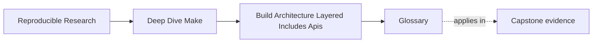
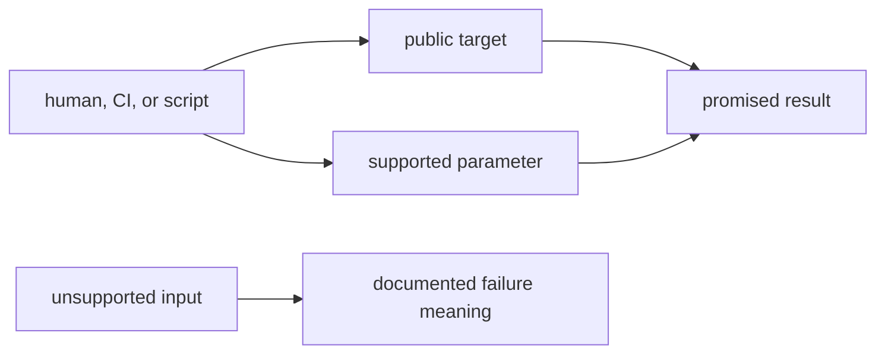
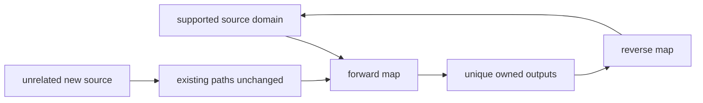

# Glossary


<!-- page-maps:start -->
## Page Maps




<!-- page-maps:end -->

Use this glossary to keep the language of Module 07 stable while you move between the core
lessons, worked example, and exercises.

The goal is not more jargon. The goal is to make sure the same architectural fact keeps the
same name whenever you explain a public target, an include boundary, or a macro reuse
decision.

## How to use this glossary

If a build-architecture discussion starts drifting into vague phrases like "the Makefiles
are kind of modular" or "this target is sort of public," stop and look up the term doing
the most work in the argument. Module 07 becomes much clearer when the team agrees on the
right nouns.

## Interface and caller contracts

| Term | Meaning in this module | Evidence that makes it real |
| --- | --- | --- |
| build API | The intentionally supported combination of public targets, parameters, results, side effects, and failure meaning. It is larger than a target-name list. | human help, machine-readable contract, accepted and rejected calls |
| public target | A stable invocation route promised to humans or automation. Reachability alone does not make a target public. | declared interface plus caller and result evidence |
| implementation target | A graph node used behind a public route without a compatibility promise to external callers. | absent from interface views; reached through a public target |
| target contract | The promise for one public target: invocation, supported inputs, results, side effects, and failure behavior. | a contract row and tests for every field |
| parameter API | A documented variable or argument that callers may set, including its accepted values and default. | validation, help, parent/child trace, rejection case |
| promised result | The artifact, report, or verified state a successful public invocation commits to produce. | path and content assertion |
| failure meaning | What nonzero status guarantees about final artifacts and evidence. “The recipe stopped” is not enough. | rejected input or failed producer with state inspection |
| callable surface | Every target an external caller can name, including accidental generated targets. It can be larger than the supported API. | parsed database compared with public contract |
| interface drift | An unreviewed change in target names, parameters, results, or failure meaning. | caller audit and before/after contract |
| recursive boundary | A new Make invocation that must receive supported parameters explicitly and parse one coherent graph. | parent command trace and child evidence |
| ambient input | An environment or inherited value that affects a build without being declared as a supported parameter. | origin trace and environment rejection case |



### Do not confuse these

| Pair | Distinction |
| --- | --- |
| reachable target / public target | Make can dispatch both; only one carries a compatibility promise. |
| help text / target contract | Help presents the contract; it is not proof that the target fulfills it. |
| parameter / ambient input | A parameter is named, validated, and supported; ambient input changes behavior without that promise. |
| successful command / satisfied contract | Exit zero is one observation; promised artifacts and side-effect limits must also hold. |

## Layers, variables, and dependency direction

| Term | Meaning in this module | Evidence that makes it real |
| --- | --- | --- |
| responsibility boundary | The declared owner of one kind of meaning, such as policy values, discovery, graph edges, or public routes. | ownership table plus assignment and rule search |
| include layer | A file with one bounded responsibility. A separate filename does not establish a layer by itself. | dependency ledger and evaluated behavior |
| policy layer | The owner of defaults, supported values, tools, and shared execution settings. | assignment locations, `origin`, validation |
| discovery layer | The owner of the supported input set and logical owner keys. | source manifest and domain policy |
| graph layer | The owner of source-to-target mapping, prerequisites, and publication rules. | database and forward map |
| interface layer | The owner of public targets and caller-facing contract views. | help, contract output, caller traces |
| review layer | Tests and audits that observe and challenge production contracts without defining them. | controlled rejection results |
| dependency direction | The rule that a consumer may read meaning from an allowed provider while the provider does not reach back into the consumer. | ledger of import, meaning, and graph edges |
| import edge | A textual `include`, `-include`, or `sinclude` relationship. | source search |
| meaning edge | A variable read, assignment, or goal inspection that lets one layer affect another. | assignment search and origin/value trace |
| graph edge | A target or prerequisite declaration owned by a layer. | parsed database |
| semantic cycle | A feedback loop in meaning even when there is no literal include loop, such as discovery reading a public goal that mutates discovery. | goal-order mutation and repaired parameter route |
| hidden mutation | A value or rule change whose owner and propagation domain are not visible at the use site. | defect/control artifact comparison |
| target-specific variable | A value attached to a target and inherited by its prerequisites unless propagation is made private. | database and branch artifact |
| shared-prerequisite ambiguity | One prerequisite reached through target branches that demand different inherited values. The first updating branch may determine its recipe context. | reversed goal order and parallel combined-goal trace |
| policy-neutral prerequisite | A shared target whose byte identity genuinely does not depend on branch policy. | identical contract and artifact under every caller |
| policy-specific path | A distinct artifact identity for each policy-dependent byte sequence. | separate paths and content assertions |
| `private` target-specific variable | A target value intentionally prevented from propagating to prerequisites. | child trace proving non-inheritance |
| override hazard | A command-line, environment, include-order, or `override` interaction that silently changes an owned value. | origin, flavor, accepted override, rejection invariant |

```mermaid
flowchart RL
  interface["interface"] --> graph["graph"]
  graph --> discovery["discovery"]
  graph --> policy["policy"]
  discovery --> policy
  review["review"] --> interface
  review --> graph
  review --> discovery
  review --> policy
```

### Do not confuse these

| Pair | Distinction |
| --- | --- |
| include order / dependency direction | Order says when text is parsed; direction says which owner may provide meaning to which consumer. |
| target-specific value / isolated value | Target-specific values normally propagate to prerequisites; `private` changes that behavior. |
| shared path / shared semantics | Two branches naming one path is safe only when both promise identical bytes. |
| review owner / production owner | A test observes production meaning; it must not become the source of that meaning. |

## Discovery and mapping proofs

| Term | Meaning in this module | Evidence that makes it real |
| --- | --- | --- |
| discovery root | A declared directory inside the supported input domain. | root list and source manifest |
| rooted discovery | Enumeration restricted to declared roots rather than the whole repository. | discovery command and exclusion proof |
| logical owner key | A stable repository-relative identity used to preserve ownership even when physical roots are deeper or externally mounted. | source manifest column and mapping rule |
| component namespace | An output prefix such as `build/cli/` that preserves a logical owner. | owner-identifiable paths and artifacts |
| mapping domain | The exact source roots, extensions, file types, symlink behavior, and generated-source policy the mapper supports. | domain table and rejected input |
| total mapping | Every supported source has an output. | supported-source manifest equals forward-map source column |
| injective mapping | Distinct supported sources never map to the same output. | output count equals unique-output count |
| reversible mapping | An output identity is sufficient to reconstruct its exact source without repository search. | reverse map round trip |
| stable mapping | Adding an unrelated supported source does not rename existing outputs. | before/after map comparison |
| lossy transformation | A mapping operation such as `notdir` that removes identity required to distinguish sources. | collision specimen |
| collision masking | Deduplicating output strings after ownership has already been lost. `sort` can make the result deterministic without making it correct. | pre-deduplication map and rejected count |
| symlink policy | The declared choice to reject links, preserve logical link paths, or resolve physical targets consistently. | link specimen and manifest |
| generated-source boundary | The rule that prevents build output from being rediscovered as input, usually by root separation or a declared manifest. | clean rediscovery test |



### Do not confuse these

| Pair | Distinction |
| --- | --- |
| source count equals output count / total and injective | Equal counts can hide one omitted source and one unrelated extra output. Compare identities. |
| namespaced / reversible | A path can look namespaced yet still discard extension, root, or owner information needed for reversal. |
| deterministic / ownership-preserving | Stable collision selection is still collision. |
| physical path / logical owner | A mount or symlink location may change while the repository’s logical ownership contract stays stable. |

## Macros and publication

| Term | Meaning in this module | Evidence that makes it real |
| --- | --- | --- |
| reuse invariant | The one repeated correctness rule a macro owns, such as owner-preserving publication. | explicit baseline and macro responsibility statement |
| call site | The visible list of data-only arguments used to instantiate a bounded macro. | call-domain trace |
| call domain | The complete supported argument set for a macro. It should be inspectable without executing recipes. | owner manifest and generated mapping |
| private language | An abstraction whose arguments embed policy, prerequisite fragments, recipes, or hidden conventions that require historical knowledge. | call-site review and side-effect inventory |
| raw definition | The unexpanded `define` body. | `$(value macro_name)` in an explicit diagnostic |
| call-expanded text | Concrete Makefile text produced for one argument before `eval` parses it. | guarded diagnostic artifact |
| parsed rule | The target, prerequisites, and stored recipe Make accepted after evaluation. | `gmake -npRr` excerpt |
| recipe-time expansion | Make’s substitution of automatic variables and recipe-visible Make variables immediately before shell execution. | recipe trace |
| shell expansion | The shell’s interpretation of process IDs, shell variables, quoting, and commands. | shell trace |
| expansion ledger | A table that follows each important dollar expression through raw macro, parsed recipe, and shell input. | recorded transformations |
| parse-time I/O | A `$(shell ...)` or `$(file ...)` effect that runs while Make reads or expands build text rather than through a declared target. | parse trace and ordinary-route absence check |
| publication candidate | A target- and process-local path that receives incomplete bytes before final rename. | candidate trace and interruption case |
| atomic publication | Replacing the final path by rename only after the producer completes successfully. | failure-state and final-content check |
| one owning producer | The architectural rule that one target contract owns a final path. Unique candidates do not legitimize competing final writers. | database ownership check |

```mermaid
flowchart LR
  raw["raw definition"] --> call["call-expanded text"]
  call --> parsed["parsed rule"]
  parsed --> recipe["recipe-time expansion"]
  recipe --> shell["shell expansion"]
  shell --> candidate["process-local candidate"]
  candidate --> final["atomic final path"]
```

### Do not confuse these

| Pair | Distinction |
| --- | --- |
| macro source / parsed rule | Dollar escaping and `eval` can make them materially different. |
| candidate uniqueness / producer ownership | Unique working paths prevent collision; the final artifact still needs one owner. |
| parse-time diagnostic / production target | A guarded inspection may write evidence; ordinary parsing must not hide required work. |
| reduced duplication / justified abstraction | A macro is justified by a preserved invariant and inspectable domain, not line count. |

## Review vocabulary

| Term | Meaning in this module |
| --- | --- |
| falsifiable claim | A bounded architecture statement paired with an observation that can prove it false. |
| claim-to-evidence matrix | A table linking a claim, consumer, failure observation, and smallest evidence route. |
| defect/control pair | Two controlled models separated by the behavior the audit is meant to detect. |
| rejection mutation | A deliberate lie that the review gate must fail. |
| change cone | The downstream consumers and evidence affected when one owner changes. |
| observation | A recorded source, graph, trace, or artifact fact without interpretation. |
| conclusion | The decision supported by observations. |
| limit | A contract surface the evidence did not cover. |
| review packet | The bounded collection of claim, evidence, rejection result, decision, and remaining risk. |
| architecture decision | An accept, repair, or defer outcome with owner, gate, limit, and future trigger. |

## The vocabulary standard for this module

Prefer statements that name both ownership and proof:

- “CI calls the private `internal-build` target and misses verification evidence.”
- “Discovery consumes policy-owned roots; it must not interpret public goal names.”
- “The forward map is injective but not yet proved total because unsupported extensions
  were never enumerated.”
- “The macro preserves the explicit prerequisite map, but its parse-time writer crosses
  the publication boundary.”
- “The shared prerequisite has policy-dependent bytes, so release needs a distinct output
  identity.”

Avoid conclusions such as “the Makefiles are messy,” “the macro is advanced,” or “the
folders look modular.” They do not identify an owner, a violated promise, or evidence
capable of changing the decision.
