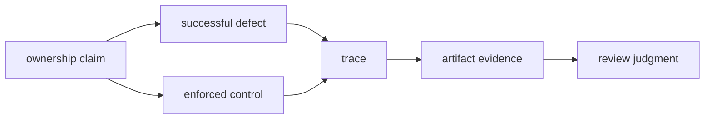

# Module 07: Build Architecture, Layered Includes, and Build APIs
Architecture defects are often successful builds. A private helper creates the main
artifact but omits verification. A release include changes ordinary compilation. Two
sources collapse into one output, and Make faithfully builds the one target it was given.

Module 07 teaches you to review those failures as ownership contracts:

- external callers depend on declared targets
- policy values propagate only through their owned target branches
- output paths preserve source ownership as the repository grows
- macros remain inside boundaries that can be inspected and tested

The standard is not “the Makefiles are organized.” It is:

> A maintainer can name each owner, follow each consumer, and inspect evidence that the
> boundary holds.

## Begin with the executable audits

From the repository root:

```sh
cd programs/reproducible-research/deep-dive-make/capstone
gmake architecture-contract-audit
gmake abstraction-contract-audit
```

The bundles are written under the repository’s `artifacts/` directory:

```text
artifacts/audit/reproducible-research/deep-dive-make/architecture-contracts/
artifacts/audit/reproducible-research/deep-dive-make/abstraction-contracts/
```

Read each bundle in this order:

1. `route.txt`
2. its named audit guide
3. `summary.tsv`
4. one case in `report.json`
5. that case’s trace
6. its specimen and generated workspace

The architecture audit contains six cases:

| Boundary | Defect model | Control model |
| --- | --- | --- |
| build API | private caller bypasses verification | declared caller receives full evidence |
| include ownership | release include mutates global flags | release target scopes its policy |
| output ownership | two sources collapse to one path | source namespaces survive in outputs |

An aggregate `PASS` includes three deliberately reproduced defects. Always quote the
finding and observation, not only the result column.

The abstraction audit then asks a narrower question: what changed when repeated explicit
rules became a macro?

| Model | Required observation |
| --- | --- |
| explicit rules | target, prerequisite, policy, and publication contracts are visible |
| bounded macro | the same contract survives and the call domain remains explicit |
| opaque macro | hidden targets and parse-time policy mutation are reproduced |

This bundle has three `PASS` rows, including the opaque counterexample. A passing
counterexample means the audit observed the promised defect; it does not approve that
design.



## One serious-session route

Allow about six hours if you are studying independently.

| Time | Work | Evidence to keep |
| --- | --- | --- |
| 45 minutes | run both audits and interpret all nine rows | annotated summaries |
| 50 minutes | trace private and declared callers | help, caller, and artifact comparison |
| 60 minutes | compare global and target-scoped policy | four flag artifact values |
| 55 minutes | derive both source-to-output mappings | source/output counts and owner files |
| 55 minutes | compare explicit, bounded, and opaque generation | database map and side-effect table |
| 65 minutes | execute the tangled-layout refactor | before/after contract table |
| 70 minutes | complete the ten exercises | reproducible review packet |
| 30 minutes | run both self-tests and write the review | rejection results and remaining risk |

If you have only one hour, run the audit, read `summary.tsv`, and follow one family from
specimen to trace to artifact. Do not skim every page and omit the evidence.

## Follow four contracts through the build

```mermaid
flowchart TD
  caller["external caller"] --> public["declared target"]
  public --> graph["owned graph"]
  base["base policy"] --> graph
  release["release specialization"] --> release_branch["release branch"]
  sources["rooted sources"] --> map["namespace-preserving map"]
  map --> graph
  explicit["explicit rule contract"] --> bounded["bounded macro"]
  bounded --> graph
  graph --> evidence["verification and owned artifacts"]
```

For every arrow, name:

1. the file or target that owns the decision
2. the consumer that relies on it
3. the evidence that would change if the boundary leaked

Do this before moving files. A new include layout is not evidence that ownership improved.

## Study route

Read the pages in this order on the first pass:

1. [Public Targets and Build API Design](public-targets-and-build-api-design.md)
2. [Layered Includes and Responsibility Boundaries](layered-includes-and-responsibility-boundaries.md)
3. [Discovery, Namespacing, and Repository Growth](discovery-namespacing-and-repository-growth.md)
4. [Macros, call, and Reuse Without Opaqueness](macros-call-and-reuse-without-opaqueness.md)
5. [Architecture Review and Maintenance Discipline](architecture-review-and-maintenance-discipline.md)
6. [Worked Example: Refactoring a Tangled Build Layout](worked-example-refactoring-a-tangled-build-layout.md)
7. [Exercises](exercises.md)
8. [Exercise Answers](exercise-answers.md)
9. [Glossary](glossary.md)

The first three pages share the architecture audit bundle. The macro lesson uses the
abstraction audit to compare explicit, bounded, and opaque rule generation. The review
lesson and worked example combine both evidence families into one acceptance decision.

## The ten files in this module

1. Overview (`index.md`)
2. [Public Targets and Build API Design](public-targets-and-build-api-design.md)
3. [Layered Includes and Responsibility Boundaries](layered-includes-and-responsibility-boundaries.md)
4. [Macros, call, and Reuse Without Opaqueness](macros-call-and-reuse-without-opaqueness.md)
5. [Discovery, Namespacing, and Repository Growth](discovery-namespacing-and-repository-growth.md)
6. [Architecture Review and Maintenance Discipline](architecture-review-and-maintenance-discipline.md)
7. [Worked Example: Refactoring a Tangled Build Layout](worked-example-refactoring-a-tangled-build-layout.md)
8. [Exercises](exercises.md)
9. [Exercise Answers](exercise-answers.md)
10. [Glossary](glossary.md)

## How to use the file set

| If you need to... | Start here |
| --- | --- |
| define which targets humans and automation may rely on | [Public Targets and Build API Design](public-targets-and-build-api-design.md) |
| split a large build into `mk/*.mk` layers without hidden mutation | [Layered Includes and Responsibility Boundaries](layered-includes-and-responsibility-boundaries.md) |
| reduce duplication without turning the build into a macro puzzle | [Macros, call, and Reuse Without Opaqueness](macros-call-and-reuse-without-opaqueness.md) |
| keep source discovery and target names stable as the repository grows | [Discovery, Namespacing, and Repository Growth](discovery-namespacing-and-repository-growth.md) |
| review a build layout before it becomes institutional folklore | [Architecture Review and Maintenance Discipline](architecture-review-and-maintenance-discipline.md) |
| see the whole module in one realistic refactor story | [Worked Example: Refactoring a Tangled Build Layout](worked-example-refactoring-a-tangled-build-layout.md) |
| test your own understanding | [Exercises](exercises.md) |
| compare your reasoning against a reference | [Exercise Answers](exercise-answers.md) |
| stabilize the module vocabulary | [Glossary](glossary.md) |

## Commands to keep close

Run these from `capstone/` unless a lesson says otherwise:

```sh
gmake architecture-contract-audit
gmake architecture-contract-selftest
gmake abstraction-contract-audit
gmake abstraction-contract-selftest
gmake --trace verify
gmake -pRrq -f Makefile
gmake -n all
```

The self-tests matter because they mutate disposable controls and require both audits to
reject dishonest evidence.

## Learning outcomes

By the end of this module, you should be able to:

- distinguish a reachable target from a declared public promise
- prove that external callers receive every artifact promised by their target
- explain how include parsing and target-specific variables produce different policy scope
- detect output collisions by mapping cardinality and artifact owner identity
- compare an explicit rule contract with bounded and opaque generation
- keep macros only when expanded rules, policy, and public surfaces preserve that contract
- write a reproducible architecture review that cites findings, mutations, limits, and risk

## Exit standard

Do not move on until all of these are true:

- you can explain why `PRIVATE_TARGET_DEPENDENCE_REPRODUCED` is a defect despite exit zero
- you can identify the artifact proving `CROSS_LAYER_POLICY_LEAK_REPRODUCED`
- you can derive where the flat mapping loses one source owner
- you can show equal source and unique-output counts in the namespaced control
- you can prove that a bounded macro preserves the explicit prerequisite and policy contract
- you can identify the hidden target and policy side effect in the opaque counterexample
- you have completed all ten exercises without relying on an instructor
- `gmake architecture-contract-selftest` passes
- `gmake abstraction-contract-selftest` passes
- your review packet names a claim, observation, conclusion, limit, controlled mutation,
  and at least one unresolved risk
