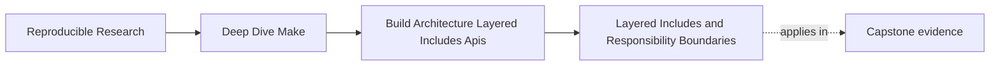
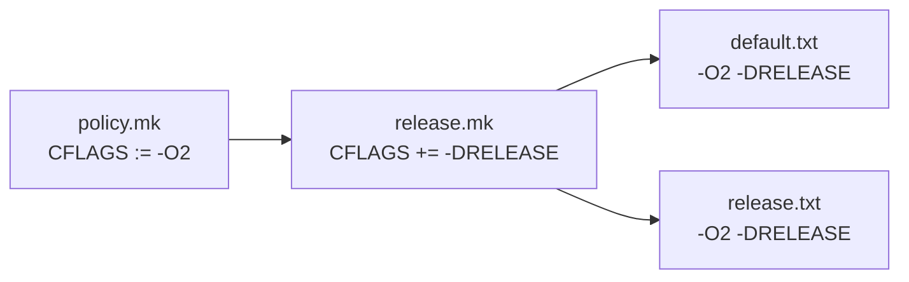
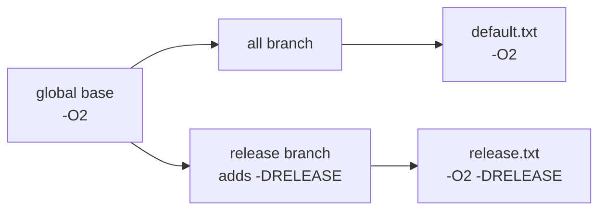
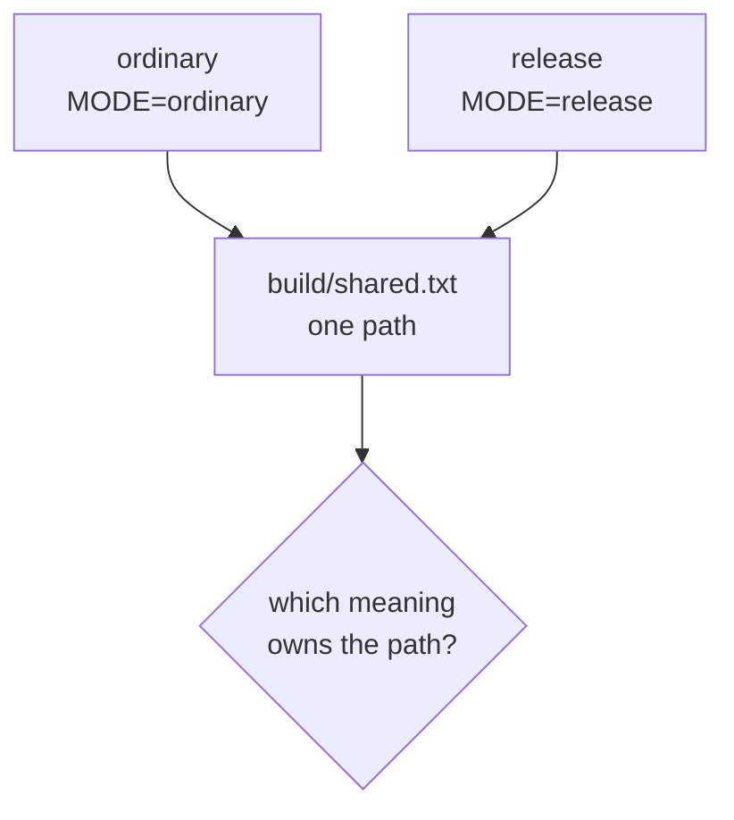

# Layered Includes and Responsibility Boundaries


<!-- page-maps:start -->
## Page Maps




<!-- page-maps:end -->

Splitting a large Makefile into `mk/*.mk` files changes where text lives. It does not, by
itself, establish who owns a decision. A release include can still mutate ordinary builds,
and every command can still exit zero while that policy leak goes unnoticed.

This lesson uses a paired specimen to answer a stricter question:

> Does a policy value reach exactly the targets that are supposed to inherit it?

## Start with a prediction

From `programs/reproducible-research/deep-dive-make/capstone/`, run:

```sh
gmake architecture-contract-audit
```

The audit writes its bundle to:

```text
artifacts/audit/reproducible-research/deep-dive-make/architecture-contracts/
```

Before opening the results, predict the four flag values below.

| Model | Ordinary artifact | Release artifact |
| --- | --- | --- |
| global mutation | ? | ? |
| target-scoped policy | ? | ? |

Then inspect these rows in `summary.tsv`:

```text
include-ownership	global-mutation	...	CROSS_LAYER_POLICY_LEAK_REPRODUCED	PASS
include-ownership	target-scoped-policy	...	TARGET_SCOPED_POLICY_PRESERVED	PASS
```

`PASS` does not mean the first design is safe. It means the deliberately broken model
reproduced the leak the audit promised to expose.

## The two models have the same file split

Both specimens use this layout:

```text
Makefile
mk/
  policy.mk
  release.mk
  artifacts.mk
```

Both top-level Makefiles include those files in that order. The filenames look sensible:

- `policy.mk` declares shared compilation policy.
- `release.mk` owns release-specific policy.
- `artifacts.mk` declares the output graph.

Yet one model violates those boundaries. File organization is therefore only an
architectural claim. Artifact behavior is the evidence.

## Broken model: parsing a layer changes every target

In `global-mutation/mk/policy.mk`, the base policy is:

```make
CFLAGS := -O2
```

The later `release.mk` contains:

```make
CFLAGS += -DRELEASE
```

Make reads included files before deciding which target to update. Appending to the global
variable while parsing `release.mk` does not wait for someone to request `release`.
Consequently, both recipes see the same final value:

```text
flags=-O2 -DRELEASE
```

The ordinary target succeeds, but it is no longer ordinary. The defect is a scope error,
not a command failure.



Inspect the proof rather than inferring it from the source:

```sh
cat artifacts/audit/reproducible-research/deep-dive-make/architecture-contracts/workspace/include-ownership/global-mutation/build/default.txt
cat artifacts/audit/reproducible-research/deep-dive-make/architecture-contracts/workspace/include-ownership/global-mutation/build/release.txt
```

The matching trace records which recipes ran. The files record the values those recipes
actually received.

## Control model: policy follows one target branch

The control keeps `CFLAGS := -O2` in `policy.mk`, but `release.mk` changes the scope:

```make
release: CFLAGS += -DRELEASE
```

This is a target-specific variable value. When Make updates `release`, that value is also
visible to prerequisites built for that target. It does not become the global value for
an unrelated invocation of `all`.

The outputs now differ:

```text
default.txt: flags=-O2
release.txt: flags=-O2 -DRELEASE
```



This does not mean target-specific variables are always the best solution. It means the
scope now matches the claim: release policy travels through the release branch.

## The shared-prerequisite trap

Target-specific values propagate to prerequisites. That is useful only when one
prerequisite is not asked to represent conflicting meanings.

Consider:

```make
.PHONY: ordinary release clean

ordinary: MODE := ordinary
release: MODE := release

ordinary release: build/shared.txt

build/shared.txt: | build/
	@candidate=$@.candidate.$$$$; \
	printf 'mode=%s\n' '$(MODE)' > "$$candidate" && \
	mv -f "$$candidate" $@ || { rm -f "$$candidate"; exit 1; }

build/:
	mkdir -p $@

clean:
	rm -rf build
```

In one invocation, Make builds `build/shared.txt` at most once. If both goals are
requested, the shared prerequisite inherits the target-specific value from the branch
that causes it to be built first. Goal order can therefore select the artifact meaning:

```sh
gmake ordinary release
gmake clean
gmake release ordinary
```

If the artifact bytes differ between those requests, the architecture is ambiguous.
Target-specific syntax narrowed policy scope but did not create two valid artifact
identities.



This defect may remain hidden when ordinary and release goals are always run in separate
workspaces. A combined-goal challenge exposes whether the graph itself has one stable
answer.

## Choose one of three honest repairs

### Keep the shared prerequisite policy-neutral

If both branches truly consume identical bytes, do not pass branch policy into the shared
producer:

```make
ordinary release: build/shared.txt

build/shared.txt: MODE := common
```

Specialize only downstream artifacts that have distinct meanings.

### Give distinct meanings distinct paths

If policy changes artifact meaning, encode the distinction in target identity:

```make
ordinary: build/ordinary/shared.txt
release: build/release/shared.txt

build/ordinary/shared.txt: MODE := ordinary
build/release/shared.txt: MODE := release
```

The graph now contains two owned contracts rather than one path selected by traversal.

### Stop specialization from reaching prerequisites

GNU Make's `private` modifier keeps a target-specific value on the target itself:

```make
release: private RELEASE_LABEL := approved
release: build/shared.txt
	@printf '%s\n' '$(RELEASE_LABEL)' > build/release-label.txt
```

Use this only when the value affects the `release` recipe but not `build/shared.txt`.
`private` is not a way to hide a real semantic input from a prerequisite.

## Prove combined-goal stability

For every target-specific policy that reaches prerequisites, test:

| Challenge | Required evidence |
| --- | --- |
| ordinary goal alone | ordinary artifact identity and policy record |
| specialized goal alone | specialized artifact identity and policy record |
| both goals in each command-line order | identical contract result for both orders |
| parallel combined goals | no competing writer or traversal-dependent artifact |
| unchanged rerun | convergence for every produced identity |

If distinct goal orders intentionally produce distinct artifacts, those artifacts need
distinct target paths or isolated build roots. A shared final path cannot carry both
contracts honestly.

## Why include order still matters

Include order determines the sequence in which Make evaluates assignments and rules:

```make
include mk/policy.mk
include mk/release.mk
include mk/artifacts.mk
```

That order can support a readable design:

1. declare shared policy
2. declare a narrow release specialization
3. declare the artifact graph

It cannot rescue an assignment with the wrong scope. Moving the global
`CFLAGS += -DRELEASE` to another well-named file still leaves it global. Reordering it may
change which assignment wins, but that is a precedence trick, not an ownership repair.

Use `gmake -pRrq -f Makefile` when you need to inspect the final variable and rule
database. Then use an artifact or recipe trace to establish what a target actually
inherited. The first explains Make's evaluated world; the second proves the behavior under
review.

## Separate policy from graph shape

The distinction becomes useful during review:

| Concern | Examples | Evidence to inspect |
| --- | --- | --- |
| policy | compiler, shell flags, release definitions | evaluated variables and recipe inputs |
| graph shape | discovery, path mapping, prerequisites | database, dry run, graph or trace |
| public interface | supported entry targets | help output and external callers |

A file may legitimately contribute to more than one concern, but the reviewer should be
able to state which decisions it owns. Names such as `common.mk`, `helpers.mk`, and
`shared.mk` do not establish that boundary.

Add one more review column:

| Layer | Declares | May depend on | Must not decide |
| --- | --- | --- | --- |
| base policy | tool commands and repository defaults | platform contract | public target membership |
| discovery | selected inputs and logical owners | base policy only when discovery needs a tool | release specialization |
| graph | targets and prerequisite mapping | policy and discovery | external caller compatibility |
| interface | public targets and parameter validation | graph contracts | private output mapping |
| publication | final artifacts and evidence | graph-owned inputs | source discovery |

This is a dependency direction, not a required filename layout. A repository may combine
small responsibilities in one file, but it should still reject a publication layer that
silently changes discovery or a policy layer that expands the public API.

## Optional includes require a stronger test

An optional include is commonly written as:

```make
-include mk/local.mk
```

The leading `-` only says that a missing file is not a parse error. It does not prove that
the build is correct without the file. To call the layer optional, verify both worlds:

1. run the supported target with the file absent
2. run it with a documented override present
3. compare the promised artifacts and policy values

If the default build requires an undocumented value from `local.mk`, the layer is
operationally required even though its syntax says otherwise.

## Review a layer through consequences

For each included file, record:

| Review question | Weak answer | Reviewable answer |
| --- | --- | --- |
| What does it own? | “shared settings” | base compiler and shell policy |
| Where may its values flow? | “the build” | every compile target |
| What may specialize them? | “later includes” | the `release` target branch |
| How is that checked? | “the build passes” | ordinary and release artifacts record distinct flags |

This turns a diagram of files into a falsifiable contract.

## Practice: prove a policy boundary

Work from the generated audit bundle.

1. Read both `mk/release.mk` files without running Make and predict all four artifact
   values.
2. Compare the prediction with the four files under
   `workspace/include-ownership/`.
3. Use the corresponding traces to show that successful recipes ran in both models.
4. Explain why moving the global append into `artifacts.mk` would not repair the leak.
5. Modify a disposable copy so `release` has a prerequisite. Confirm that the
   target-specific value reaches that prerequisite but not a separate `all` invocation.
6. Make ordinary and release goals share that prerequisite, request the goals in both
   orders, and decide whether the path must become policy-neutral or namespaced.

A complete answer cites the finding, the relevant assignment, and the artifact contents.
“The scoped version is cleaner” is not evidence.

## End-of-page checkpoint

You are ready to continue when you can explain:

- why identical file layouts can enforce different ownership contracts
- why parsing a release include can affect an ordinary target
- how target-specific values travel to prerequisites
- why include order and variable scope are separate concerns
- which artifact proves `CROSS_LAYER_POLICY_LEAK_REPRODUCED`
- why target-specific policy can still be ambiguous for a shared prerequisite
- when `private`, policy-neutral prerequisites, or distinct output paths are appropriate
