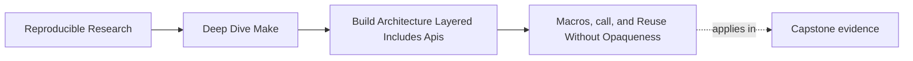
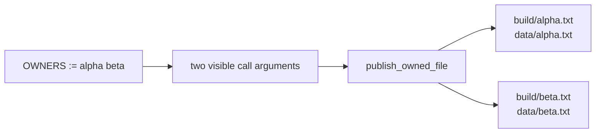

# Macros, call, and Reuse Without Opaqueness


<!-- page-maps:start -->
## Page Maps




<!-- page-maps:end -->

A shorter Makefile is not automatically a simpler build. `define`, `call`, and `eval` can
remove repeated text while silently adding targets, changing global policy, or making the
generated domain impossible to review.

This lesson uses three executable models:

- explicit rules that establish the contract
- a bounded macro that preserves it
- an opaque macro that changes more architecture than its call site reveals

The question is not “should Make use macros?” It is:

> Which graph and artifact contract must remain true after rule generation?

## Run the abstraction audit

From `programs/reproducible-research/deep-dive-make/capstone/`:

```sh
gmake abstraction-contract-audit
```

Open the generated `summary.tsv`:

```text
explicit-rules  PASS  EXPLICIT_RULE_CONTRACT_CAPTURED
bounded-macro   PASS  BOUNDED_MACRO_CONTRACT_PRESERVED
opaque-macro    PASS  OPAQUE_MACRO_SIDE_EFFECTS_REPRODUCED
```

The third row is a successful defect reproduction. It is not approval of the opaque
design.

## Establish the contract before abstracting

The explicit model contains two publication rules:

```make
build/alpha.txt: data/alpha.txt | build/
	{ printf 'mode=%s\nsource=%s\n' '$(MODE)' '$<'; cat '$<'; } > '$@.tmp'
	mv '$@.tmp' '$@'

build/beta.txt: data/beta.txt | build/
	{ printf 'mode=%s\nsource=%s\n' '$(MODE)' '$<'; cat '$<'; } > '$@.tmp'
	mv '$@.tmp' '$@'
```

Before discussing duplication, write down what these rules promise:

| Contract field | Alpha | Beta |
| --- | --- | --- |
| target | `build/alpha.txt` | `build/beta.txt` |
| source prerequisite | `data/alpha.txt` | `data/beta.txt` |
| policy | `ordinary` | `ordinary` |
| publication | write temporary file, then rename | write temporary file, then rename |
| owner evidence | `owner=alpha` | `owner=beta` |

This table is the baseline. An abstraction must preserve it unless the change deliberately
proposes a new contract.

## A bounded macro protects one invariant

The control macro owns one repeated publication shape:

```make
define publish_owned_file
build/$1.txt: data/$1.txt | build/
	{ printf 'mode=%s\nsource=%s\n' '$$(MODE)' '$$<'; cat '$$<'; } > '$$@.tmp'
	mv '$$@.tmp' '$$@'
endef
```

Its generated domain remains visible:

```make
OWNERS := alpha beta
$(foreach owner,$(OWNERS),$(eval $(call publish_owned_file,$(owner))))
```

The macro does not decide which mode to use, publish new top-level actions, or discover
owners elsewhere. It maps each explicit owner argument to one target/source pair.



The audit requires the evaluated prerequisite map and artifact contents to equal the
explicit baseline. Reduced duplication is only a secondary benefit.

## Why the doubled dollar signs matter

`eval` expands its argument, then Make parses the expanded result. Text in the macro may
therefore pass through more than one expansion.

In the macro:

```make
'$$(MODE)' '$$<' '$$@'
```

The doubled dollar sign preserves the reference for the generated rule. After `eval`
expands the macro, the parsed recipe still contains:

```make
'$(MODE)' '$<' '$@'
```

The automatic variables then receive values when the generated recipe runs.

If you write `$@` directly inside the macro invocation context, it may expand before a
recipe has a target and become empty. This is not a reason to avoid `eval`; it is a reason
to inspect the generated rule instead of trusting the source template.

## The opaque macro crosses responsibility boundaries

The defect model uses a broad name, `define_component`, and appears to generate one
component rule. Its body also contains:

```make
MODE := release

.PHONY: publish-$1
publish-$1: build/$1.txt
	@printf 'published=%s\n' '$1'
```

Each call now performs three unrelated jobs:

1. generate an artifact rule
2. mutate global policy
3. generate another callable target

The ordinary `all` route exits zero. Both artifacts contain `mode=release`, and
`publish-alpha` plus `publish-beta` appear in the evaluated database while remaining
absent from help.

```mermaid
flowchart TD
  call["define_component(alpha)"]
  call --> rule["artifact rule"]
  call --> mutation["MODE := release"]
  call --> target["publish-alpha"]
  target -.not declared in.-> help["help"]
```

The problem is not hidden implementation alone. Public targets routinely depend on private
rules. The problem is that the macro’s apparent interface does not reveal the policy and
target-surface decisions it owns.

## Inspect evaluated rules without reading everything

The audit runs:

```sh
gmake -npRr all
```

- `-n` avoids executing recipes.
- `-p` prints the evaluated database.
- `-Rr` removes built-in variables and rules from the view.

Search the saved database trace for:

```text
build/alpha.txt:
build/beta.txt:
publish-alpha:
publish-beta:
```

The explicit and bounded models must contain:

```text
build/alpha.txt: data/alpha.txt | build/
build/beta.txt: data/beta.txt | build/
```

Only the opaque model should contain the two `publish-*` targets.

`make -p` is not the first explanation of ordinary intent. The macro name, owner list, and
call site should supply that. The database is the confirmation route that catches an
incorrect or incomplete explanation.

## Compare all relevant views

No single view proves the whole abstraction contract:

| View | Proves | Does not prove |
| --- | --- | --- |
| explicit rules | intended baseline shape | generated equivalence |
| macro and calls | apparent template and domain | final parsed graph |
| evaluated database | targets and prerequisites | artifact bytes |
| build trace | selected recipes | undispatched hidden targets |
| artifacts | source, owner, and policy received | full target surface |
| help | declared public promises | every reachable target |

A defensible review chooses the views that could falsify the claim.

## Test the evidence gate

Run:

```sh
gmake abstraction-contract-selftest
```

The seven tests include five controlled mutations. They reject a bounded macro that:

- gains a hidden publication target
- changes ordinary policy to release
- stops exposing its call domain

They also reject an opaque specimen that no longer reproduces either promised side effect.
An audit must fail when control evidence becomes dishonest and when a defect model stops
exhibiting its documented defect.

## Decide whether the macro earns its place

Use this decision table:

| Evidence | Decision |
| --- | --- |
| repeated rules do not yet share a clear contract | keep them explicit |
| one invariant repeats and call arguments expose the domain | test a bounded macro |
| evaluated prerequisites differ from the baseline | reject or redesign |
| artifact bytes match but hidden targets appear | split target generation from publication |
| macro mutates global policy | move policy to its owning layer or target scope |
| only two short rules repeat | explicit rules may still be cheaper |
| rejection tests cover likely side effects | macro has a maintainable proof route |

The correct answer can be “do not abstract.” This lesson rewards an inspectable contract,
not macro usage.

## Practice: add a third owner

Work in a disposable copy of the abstraction specimens.

1. Add `data/gamma.txt` with `owner=gamma`.
2. Add an explicit `build/gamma.txt` rule and record the expanded contract table.
3. Extend the bounded owner list and confirm one new target/source pair appears.
4. Extend the opaque owner list and identify every additional side effect.
5. Compare the three database traces and artifact modes.
6. Add a rejection test that catches one dishonest gamma mapping.

A complete answer contains the call domain, evaluated prerequisite map, artifacts, and
test result. A line-count comparison is not enough.

## End-of-page checkpoint

You are ready to continue when you can explain:

- why explicit rules establish a baseline without being automatically preferable
- which evidence makes the bounded macro contract-equivalent
- why `$$@` and `$$<` survive generation differently from `$@` and `$<`
- how the opaque macro changes policy and callable target surface
- why database, help, trace, and artifact evidence answer different review questions
