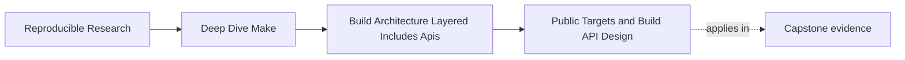
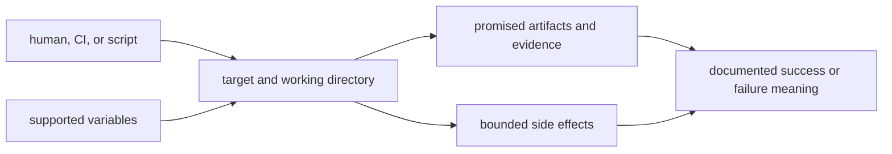
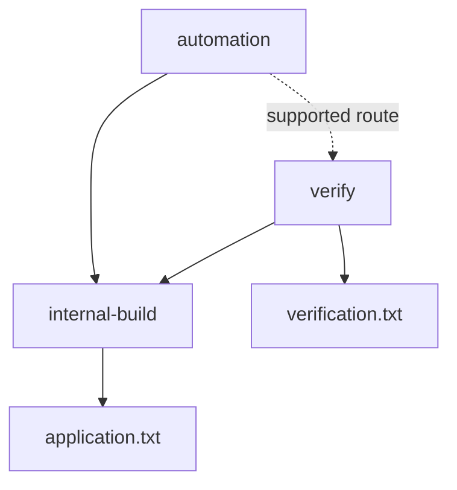

# Public Targets and Build API Design


<!-- page-maps:start -->
## Page Maps




<!-- page-maps:end -->

As soon as a Make build becomes useful, people start calling it from more places:

- developers run it locally
- CI calls it in pipelines
- release scripts invoke it
- one-off maintenance commands get added by whoever needed them last

Without discipline, the top-level `Makefile` turns into an accidental API:

- internal helper targets become public by habit
- CI starts depending on private target names
- local convenience commands quietly become part of the release path
- nobody can say which targets may change safely and which ones are contractual

This page is about replacing that drift with a build API you can actually defend.

## The sentence to keep

When you look at a top-level `Makefile`, ask:

> which targets are promises to other humans or tools, and which targets are only internal
> implementation detail?

That is the core separation.

## A public target contract is more than a name

For each public target, define five fields:

| Contract field | Question |
| --- | --- |
| invocation | What target and working directory may callers use? |
| supported parameters | Which command-line variables or environment inputs may callers set? |
| promised results | Which files, reports, or observable checks exist after success? |
| side-effect boundary | Which local or external state may the target change? |
| failure meaning | What does nonzero mean, and can trusted prior results remain? |

Example:

| Target | Supported parameters | Promised results | Side effects | Failure meaning |
| --- | --- | --- | --- | --- |
| `all` | `MODE=ordinary|diagnostic` | application artifact | repository-local build outputs | requested artifact contract was not fulfilled |
| `test` | `TEST_FILTER=<expression>` | test report and exit status | test workspace only | at least one selected test or harness check failed |
| `selftest` | none | convergence and architecture audit evidence | isolated audit workspaces | build-system invariant or rejection test failed |
| `clean` | none | governed generated paths absent | deletes only documented generated state | at least one governed path could not be removed |

A target name without the other four fields forces callers to learn the real API from
recipe internals.



## A build API is still an API

The word "API" can sound too formal for a Makefile. It is still the right word.

If other humans, scripts, or CI systems depend on:

- `make all`
- `make test`
- `make selftest`
- `make clean`
- `make release`

then those names form a contract. Changing them casually is not just refactoring. It is a
breaking interface change.

This matters because many Make repositories behave as if every target is equally public.
That is usually false.

## Public targets should be few and stable

Healthy public target surfaces are small.

Typical public targets might include:

- `all`
- `test`
- `selftest`
- `clean`
- `help`
- one or two clearly named audit or release targets

That is enough for most users.

The build often contains many other targets, but they should remain implementation detail
unless there is a real reason to promote them.

The point is not minimalism for its own sake. The point is that a small target surface is
easier to document, easier to support, and safer to evolve.

## Parameters are part of the API

This public target accepts a caller-owned mode:

```make
MODE ?= ordinary
SUPPORTED_MODES := ordinary diagnostic

.PHONY: all
all:
	@case ' $(SUPPORTED_MODES) ' in \
	  *' $(MODE) '*) ;; \
	  *) printf 'unsupported MODE=%s; choose: %s\n' \
	       '$(MODE)' '$(SUPPORTED_MODES)' >&2; exit 2 ;; \
	esac
	+$(MAKE) build/application.txt MODE='$(MODE)'
```

The contract is:

- absence selects `ordinary`
- the command line may select `ordinary` or `diagnostic`
- any other value fails before artifact publication
- recursive Make receives the effective value explicitly

Using `?=` documents caller override better than silently accepting every environment
value. Validation still matters: support is a bounded set, not every string Make can
expand.

Inspect ownership:

```make
.PHONY: explain-api
explain-api:
	@printf 'MODE origin=%s flavor=%s value=%s\n' \
	  '$(origin MODE)' '$(flavor MODE)' '$(value MODE)'
```

Do not expose secrets, credentials, or arbitrary host state through a diagnostic target.

## Preserve parameters across recursive boundaries

Recursive Make has its own API boundary. Prefer `$(MAKE)`, not a literal `make`, so job
server and Make flags propagate. Pass responsibility-owned parameters explicitly:

```make
TEST_FILTER ?= all

.PHONY: test
test:
	+$(MAKE) -C tests run TEST_FILTER='$(TEST_FILTER)'
```

Review three questions:

1. Is `TEST_FILTER` a supported public input to top-level `test`?
2. Does the child `run` contract interpret the same value?
3. Are unrelated parent variables intentionally excluded?

Exporting the entire environment is not simpler. It widens the parameter API until the
child can depend on values the parent never promised. Passing an undeclared empty value
can also erase a child default, so the top-level contract defines `all` explicitly.

## Internal helper targets are not shameful

Some teams act as if internal helper targets are a problem. They are not. They are useful.

The problem is when the build never says which targets are helpers and which ones are public
entrypoints.

For example:

```make
.PHONY: all test clean help package verify-contract build-objects
```

There may be nothing wrong with all of those existing. The architectural question is:

- which of them should another human rely on
- which of them may change name or shape freely as long as the public surface still works

That is why target lists need design, not just accumulation.

## Help output should reinforce the public surface

A good `help` target does more than print every name it can find. It teaches the user which
entrypoints are for them.

For example:

```make
.PHONY: help

help:
	@printf '%s\n' \
	  'all        Build the default artifact set' \
	  'test       Run project tests' \
	  'selftest   Verify build-system convergence and invariants' \
	  'clean      Remove generated build outputs'
```

This is stronger than dumping dozens of helper names. It makes the public surface visible.

That also means `help` should not pretend internal implementation targets are first-class
commands unless they truly are.

Descriptions should include supported parameters and evidence:

```text
all MODE=ordinary|diagnostic
    build application.txt using the selected supported mode
test TEST_FILTER=<expression>
    run selected tests and publish the test report
selftest
    verify convergence, architecture controls, and rejection tests
```

If humans read formatted help and automation needs a stable list, publish a separate
machine-readable contract rather than parsing aligned prose.

## CI should depend on public targets, not archaeology

One of the clearest signs of build architecture drift is this:

CI starts calling whatever target happened to exist when someone needed a shortcut.

Examples:

- `verify-contract`
- `build-objects`
- `dist-raw`
- `ci-compile-cache`

Those names may be useful internally, but CI should usually call a documented public target
such as `test`, `selftest`, or `release-check`.

Why? Because CI is a contract consumer. If it depends on internals, architectural cleanup
becomes much more dangerous.

## Prove the difference between reachable and public

Run the architecture contract audit from the repository root:

```sh
gmake -C programs/reproducible-research/deep-dive-make \
  capstone-architecture-contract-audit
```

Open:

```text
artifacts/audit/reproducible-research/deep-dive-make/architecture-contracts/
```

The public-API pair uses the same documented help surface:

```text
help    show the supported build interface
verify  build and verify the application
```

It also contains an internal target named `internal-build`. The two automation scripts
differ only in the target they call:

| Caller | Target | Exit | Published evidence |
| --- | --- | --- | --- |
| private caller | `internal-build` | zero | application only |
| declared caller | `verify` | zero | application and verification |

The expected findings are:

```text
PRIVATE_TARGET_DEPENDENCE_REPRODUCED
PUBLIC_TARGET_CONTRACT_HONORED
```

Both commands succeed. That is the point. Exit status cannot tell you whether automation
used the supported interface or bypassed part of its meaning.



Read the help trace and caller trace together. The help trace establishes the promise;
the caller trace establishes the dependency. The output files establish the consequence.

## Prove parameter and evidence behavior

For each public target, keep acceptance and rejection cases:

| Challenge | Acceptance | Rejection |
| --- | --- | --- |
| default invocation | promised artifact contains `mode=ordinary` | no diagnostic-only artifact appears |
| supported override | artifact contains `mode=diagnostic` | unrelated target policy does not change |
| unsupported override | exit status is documented nonzero | no final artifact is replaced |
| private helper call | helper may be reachable | contract audit rejects it as an external caller |
| public verification call | product and verification evidence exist | missing evidence fails the contract |

This is an API test suite, not merely a Make syntax test.

## Do not repair interface drift by documenting everything

When an audit finds automation calling a private helper, two repairs are possible:

1. change the caller to use an existing public target
2. deliberately promote a new public target with stable meaning

The first is usually narrower. Adding every discovered helper to `help` may silence the
mismatch while turning implementation details into permanent promises.

Use this promotion test:

| Question | If no |
| --- | --- |
| does the target express a user-facing outcome? | keep it internal |
| can callers verify the promised outcome? | define evidence before promotion |
| is the name independent of current implementation? | rename by durable intent |
| will maintainers support the meaning across refactors? | repair callers instead |

Public API review is therefore a caller review, not only a Makefile inventory.

## Treat aliases as compatibility contracts

Two public names for one route can be legitimate when their promised results are
identical:

```make
.PHONY: check test
check: test
```

If both names are documented, both are contracts. Removing `check` requires a caller
inventory and compatibility decision even though its recipe is empty.

Do not use aliases to hide different meanings:

```make
# Misleading: "check" sounds equivalent but skips build invariants.
check: unit-tests
selftest: unit-tests build-invariants
```

An alias is safe because contracts are equivalent, not because dependency syntax is
short.

## Public targets should say what they mean

Target naming matters. A good public target name says what a user is allowed to expect.

For example:

- `test` means tests the repository promises to run in normal validation
- `selftest` means build-system or repository invariants beyond ordinary product tests
- `release-check` means release-readiness checks, not "whatever this maintainer runs before tagging"

This is why vague names such as `run-all-things` or `final-check` age badly. They do not
communicate a stable promise.

## A small example of a healthy public surface

Top-level `Makefile`:

```make
.PHONY: all test selftest clean help

all: app

test:
	+$(MAKE) -C tests run

selftest:
	+$(MAKE) -C tests build-invariants

clean:
	rm -rf build dist app

help:
	@printf '%s\n' \
	  'all        Build the application' \
	  'test       Run product tests' \
	  'selftest   Run build-system invariants' \
	  'clean      Remove generated outputs'
```

This does not mean no internal targets exist. It means the public promises are clear.

The child targets are implementation dependencies unless the repository deliberately
publishes them. The top-level contract owns translation between the stable public name
and the current internal layout.

## Internal targets can still be documented locally

Inside `mk/` files or a maintainer guide, you may still document helper targets such as:

- `build-objects`
- `render-assets`
- `refresh-manifest`

That is useful for maintainers. The important point is that the repository should not force
every user to treat those names as stable public contracts.

This is similar to public versus private functions in code. Private implementation details
can still be explained without becoming part of the external API.

## Public target drift is a real architectural smell

Watch for these symptoms:

- nobody can list the public targets from memory
- CI depends on target names that do not appear in user-facing docs or `help`
- targets exist only because some old script once depended on them
- supported variables are accepted implicitly and never validated
- recursive calls leak environment state the top-level contract does not mention
- new features always add top-level targets, even when they are not meant for general use

Those are not documentation issues only. They are interface-design issues.

## A practical promotion test

Before making a target public, ask:

1. will humans or automation rely on this regularly
2. can you explain its meaning in one sentence
3. is the name stable enough to keep
4. does it belong at the top level rather than inside a maintainer-only layer
5. are you willing to treat changes to it as interface changes
6. can supported parameters and promised evidence be tested

If the answer to the last question is no, the target probably should not be public.

## Why this page comes before include layering

Teams often start with include refactors first. That is usually backwards.

If you do not know which targets are public, you cannot make good layering decisions. The
top-level API is one of the main reasons layers exist in the first place.

That is why Module 07 begins here.

## Failure signatures worth recognizing

### "Our CI broke after a harmless refactor"

That often means CI was depending on a private target.

### "CI passes, but the verification file is missing"

Automation may be calling a reachable helper that bypasses the public verification
contract. Compare caller traces with `help` before adding another dependency edge.

### "We have `help`, but it prints thirty targets and nobody knows which ones matter"

That means the public surface is not actually curated.

### "No one can tell whether `verify` and `selftest` are different"

That means target names or contracts are too vague.

### "Every new script gets its own top-level target"

That usually means the API is expanding by habit rather than design.

## A review question that improves build APIs

Take a top-level Makefile and ask:

1. which targets are public
2. how does a newcomer learn that
3. which of those targets are used by CI or scripts
4. which top-level targets should really be private helpers
5. which names are too vague to survive long-term
6. which variables, working-directory assumptions, and side effects callers rely on

If those answers are weak, the build API is weak too.

## What to practice from this page

Run the architecture contract audit, then choose one Make-based repository and write its
public target list in plain language:

1. the public target names
2. one sentence of contract meaning for each
3. every automation caller and the target it actually invokes
4. one caller that should move to a public target
5. one helper you refuse to promote, with the reason
6. one supported parameter with accepted and rejected values
7. the artifact and failure evidence promised by each target

Keep three forms of evidence:

- the declared surface from `help`
- the observed caller from search or trace
- the promised output or verification evidence

If you can do that cleanly, you are treating the Makefile as an interface rather than a
bucket of commands.

## End-of-page checkpoint

Before leaving this lesson, make sure you can explain:

- why a Makefile can and should have a public API
- why public target sets should be small and stable
- why CI should call documented public targets rather than private helpers
- how `help` can reinforce the API instead of obscuring it
- how to decide whether a target deserves promotion to the public surface
- why a successful private caller can still violate the build API
- why supported variables, recursive forwarding, side effects, and failure meaning are
  part of the public contract
