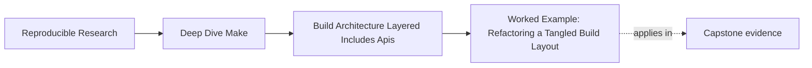
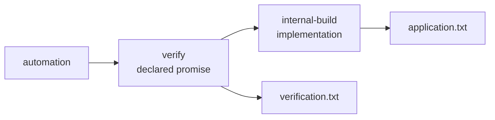

# Worked Example: Refactoring a Tangled Build Layout


<!-- page-maps:start -->
## Page Maps




<!-- page-maps:end -->

This worked example begins with a build that exits zero in every scenario. Its architecture
is still dishonest in three ways:

- automation depends on a target the help interface does not promise
- a release include changes an ordinary artifact
- two subsystem sources collapse into one output

The goal is not to make the files look modular. The goal is to replace each hidden
dependency with a contract another maintainer can verify.

## Establish the baseline before editing

From `programs/reproducible-research/deep-dive-make/capstone/`, run:

```sh
gmake architecture-contract-audit
```

Copy these six rows from `summary.tsv` into the review note:

| Boundary | Inherited behavior | Control behavior |
| --- | --- | --- |
| caller to build API | `PRIVATE_TARGET_DEPENDENCE_REPRODUCED` | `PUBLIC_TARGET_CONTRACT_HONORED` |
| release to shared policy | `CROSS_LAYER_POLICY_LEAK_REPRODUCED` | `TARGET_SCOPED_POLICY_PRESERVED` |
| source to output | `FLAT_OUTPUT_OWNERSHIP_COLLAPSED` | `SUBSYSTEM_OUTPUT_OWNERSHIP_PRESERVED` |

Do not start by renaming files. First preserve the observations that the refactor must
change:

```text
private caller: application.txt exists; verification.txt absent
global mutation: default.txt and release.txt both contain -DRELEASE
flat output: two sources; one output; owner=cli survives
```

These are the baseline assertions. They prevent a structural rewrite from hiding a
behavioral regression.

## Repair the caller boundary

The inherited Makefile contains both targets:

```make
.PHONY: internal-build verify

internal-build: build/application.txt

verify: internal-build
	@printf 'verified\n' > build/verification.txt
```

Its help output promises only:

```text
help    show the supported build interface
verify  build and verify the application
```

The automation script nevertheless runs:

```sh
gmake internal-build
```

That command is reachable and successful. It is not a supported interface, and it bypasses
the evidence created by `verify`.

Change the caller, not the visibility of every helper:

```sh
gmake verify
```

Then rerun the caller and require both files:

```text
build/application.txt
build/verification.txt
```

Why not add `internal-build` to help? Because that would convert an implementation detail
into a promise merely to avoid repairing one caller. Public API growth is a compatibility
decision, not a documentation shortcut.



The acceptance evidence is:

- help declares `verify`
- the external caller invokes `verify`
- both promised artifacts exist
- the finding is `PUBLIC_TARGET_CONTRACT_HONORED`

### Record the whole public contract

The target name alone is not the API. Suppose automation may select a supported validation
profile:

```make
PROFILE ?= ordinary
SUPPORTED_PROFILES := ordinary strict

ifeq ($(filter $(PROFILE),$(SUPPORTED_PROFILES)),)
$(error unsupported PROFILE '$(PROFILE)'; choose $(SUPPORTED_PROFILES))
endif

.PHONY: verify
verify: internal-build
	@printf 'profile=%s\nverified=yes\n' '$(PROFILE)' \
	  > build/verification.txt
```

The review note now records:

| Contract field | Promise |
| --- | --- |
| invocation | `gmake verify [PROFILE=ordinary|strict]` |
| result | application and verification artifacts |
| evidence | verification records the effective profile and `verified=yes` |
| side effects | no release publication |
| rejection | unsupported profile fails before artifact work |

Run both an accepted and rejected call. A help line that says only “verify the application”
would leave the parameter and failure contract hidden.

## Repair the policy boundary

The inherited include order is readable:

```make
include mk/policy.mk
include mk/release.mk
include mk/artifacts.mk
```

The ownership is not. `policy.mk` establishes:

```make
CFLAGS := -O2
```

Then `release.mk` performs a global mutation:

```make
CFLAGS += -DRELEASE
```

Because includes are parsed before Make updates a goal, merely loading the release layer
changes the value seen by `all`.

Keep the file split and narrow the assignment:

```make
release: CFLAGS += -DRELEASE
```

Now run `all` and `release` independently. Accept the repair only if the artifacts say:

```text
build/default.txt: flags=-O2
build/release.txt: flags=-O2 -DRELEASE
```

Renaming `release.mk` or moving the global append to another include would not satisfy this
test. The repair is about the value’s propagation domain.

### Challenge the repair with a shared prerequisite

Target-specific variables propagate to prerequisites. That is useful only while the
prerequisite belongs unambiguously to that target branch:

```make
all: build/shared.o build/default.txt
release: CFLAGS += -DRELEASE
release: build/shared.o build/release.txt
```

`build/shared.o` is shared by branches that demand different flag semantics. In
`gmake all release`, whichever branch first updates the shared target can determine the
inherited value. Reversing the goal order or adding `-j2` can expose the ambiguity.

There are only two honest outcomes:

- make `build/shared.o` policy-neutral, so both callers truly want identical bytes
- give each policy a distinct path, such as `build/ordinary/shared.o` and
  `build/release/shared.o`

Do not accept a target-specific assignment merely because separate `all` and `release`
invocations look correct. The combined-goal test is part of the boundary proof.

## Repair the output boundary

The repository now has two legitimate owners for the basename `util.txt`:

```text
src/cli/util.txt
src/lib/util.txt
```

The inherited mapping strips both ownership directories:

```make
OUTPUTS := $(sort $(addprefix build/,$(notdir $(SOURCES))))
```

Evaluate the graph before inspecting the recipe:

```text
2 source paths -> 2 duplicate output strings -> 1 unique target
```

Replace the lossy transformation with:

```make
OUTPUTS := $(patsubst src/%,build/%,$(SOURCES))
```

Then use pattern rules whose prerequisite roots match the output namespaces:

```make
build/cli/%.txt: src/cli/%.txt | build/cli/
	{ printf 'selected=%s\n' '$<'; cat '$<'; } > $@

build/lib/%.txt: src/lib/%.txt | build/lib/
	{ printf 'selected=%s\n' '$<'; cat '$<'; } > $@
```

Accept the repair only when the map has equal source and unique-output counts and both
artifacts preserve their owners:

```text
build/cli/util.txt: owner=cli
build/lib/util.txt: owner=lib
```

Cardinality is necessary but incomplete. Preserve a reverse map:

```text
src/cli/util.txt  -> build/cli/util.txt  -> src/cli/util.txt
src/lib/util.txt  -> build/lib/util.txt  -> src/lib/util.txt
```

Then challenge four properties:

| Property | Rejection case |
| --- | --- |
| totality | add a supported source and require one output |
| injectivity | add another `util.txt` owner and require a distinct output |
| reversibility | derive the exact source from each output without searching |
| stability | add a supported extension or deeper owner and require the documented mapping |

The mapping policy must also state whether symlinks and generated sources are inside its
domain. Silently following a link or rediscovering generated output can defeat all four
properties while counts still happen to match.

## Keep abstraction inside the proved boundary

After the three repairs, repeated rules may invite a macro. Before extracting it, preserve
the explicit rule contract:

| Owner | Target pattern | Source pattern | Policy owner | Publication |
| --- | --- | --- | --- | --- |
| CLI | `build/cli/%.txt` | `src/cli/%.txt` | caller’s target branch | process-local candidate, then rename |
| library | `build/lib/%.txt` | `src/lib/%.txt` | caller’s target branch | process-local candidate, then rename |

Extract only the publication and owner-mapping invariant:

```make
define publish_owned_source
build/$(1)/%.txt: src/$(1)/%.txt | build/$(1)/
	@candidate='$$@.candidate.$$$$$$$$'; \
	{ printf 'selected=%s\n' '$$<'; cat '$$<'; } \
	  > "$$$$candidate" && \
	mv -f "$$$$candidate" '$$@' || { rm -f "$$$$candidate"; exit 1; }
endef

OWNERS := cli lib
$(foreach owner,$(OWNERS),$(eval $(call publish_owned_source,$(owner))))
```

The macro has one responsibility: preserve the same owner on both sides of the mapping.
Its call sites still expose the owner set. It does not choose public targets, mutate
policy, or generate unrelated release rules.

Trace the candidate expression through both Make expansion stages:

```text
macro source       $$@.candidate.$$$$$$$$
parsed recipe      $@.candidate.$$$$
shell input        build/cli/util.txt.candidate.$$
runtime path       build/cli/util.txt.candidate.<process-id>
```

The final rename publishes only complete bytes. Failure removes that process’s candidate,
and concurrent Make processes do not share a candidate path. The final target still has
one owning rule; unique candidates are not permission for multiple producers.

Inspect the expanded rules:

```sh
gmake -npRr all
```

Require the two target/source patterns, compare every generated callable target with help,
and rebuild the owner artifacts. Reduced line count and matching artifact bytes are not
enough if the macro also changed policy or generated another surface.

The course’s parallel comparison is:

```sh
gmake abstraction-contract-audit
gmake abstraction-contract-selftest
```

Use `explicit-rules` as the baseline, `bounded-macro` as the control, and `opaque-macro` as
the side-effect counterexample.

## Repair dependency direction

File splitting is not complete until each layer consumes meaning in one direction. Build
the ledger for the repaired layout:

| Layer | May consume | Must not own |
| --- | --- | --- |
| policy | caller parameters and documented defaults | source enumeration or public targets |
| discovery | policy-owned roots | public-goal behavior |
| graph | discovery and policy | public help |
| interface | graph targets | source mapping or publication recipes |
| review | every production contract | production defaults |

The inherited layout contains a semantic feedback loop if `release.mk` both mutates flags
and changes discovery based on `MAKECMDGOALS`. Replace goal inspection with the validated
profile parameter, let discovery consume that parameter, and let a public route invoke a
child Make with one explicit profile.

Reject the refactor if any of these searches finds a reverse owner:

```sh
rg -n 'MAKECMDGOALS|SOURCE_ROOTS|PROFILE|CFLAGS' Makefile mk/
rg -n '^(include|-include|sinclude)[[:space:]]' Makefile mk/
rg -n '^[^.#%[:space:]][^=]*:' Makefile mk/
```

The searches locate candidates. The ledger, parsed database, and accepted/rejected calls
establish whether the dependency is legitimate.

## Review the combined architecture

The repaired ownership flow is:

```mermaid
flowchart TD
  caller["external caller"] --> api["declared target"]
  api --> graph["artifact graph"]
  base["shared policy"] --> graph
  release["release target scope"] --> release_graph["release branch"]
  sources["rooted source owners"] --> mapping["namespace-preserving mapping"]
  mapping --> graph
  graph --> evidence["owned artifacts and verification"]
  review["review layer"] -. observes .-> api
  review -. observes .-> graph
```

Record each boundary in one table:

| Contract | Owner | Consumer | Evidence |
| --- | --- | --- | --- |
| supported build action | top-level help and target | automation | help trace and caller trace |
| base flags | `policy.mk` | ordinary and release graph | `default.txt` |
| release specialization | `release` target | release prerequisites | `release.txt` |
| source-to-output mapping | discovery/mapping layer | artifact rules | map trace and owned files |
| generated publication rules | macro and explicit owner list | artifact graph | database map, call domain, artifacts |
| supported profile values | policy layer | discovery, recipes, callers | help, accepted calls, rejected value |
| layer direction | dependency ledger | future include changes | assignment search and feedback-loop rejection |
| architecture review gate | audit runner and rejection tests | future maintainers | controlled mutation results |

If the “Owner” cell says “several includes,” the refactor is not yet reviewable.

## Run the acceptance sequence

Use this order so a later check cannot conceal an earlier contract failure:

1. Run `gmake help` and identify the supported automation target.
2. Run the external caller and require both application and verification evidence.
3. Build ordinary and release artifacts separately and compare their flags.
4. Print the source-to-output map and compare its cardinality.
5. Reverse every output to its exact source and challenge one unsupported path.
6. Read both namespaced artifacts and compare their recorded owners.
7. Inspect generated rules and reject hidden targets, policy mutation, or parse-time I/O.
8. Run `all release`, `release all`, and a parallel combined-goal invocation; compare the
   shared-prerequisite evidence.
9. Interrupt one publisher and require no shared candidate or partial final artifact.
10. Inspect the dependency ledger and reject a discovery-to-interface feedback edge.
11. Clean, rerun the same checks, and confirm the observations do not depend on stale
    state.

For the course specimens, the automated equivalent is:

```sh
gmake architecture-contract-selftest
gmake abstraction-contract-selftest
```

The self-tests mutate disposable copies of the models and confirm that dishonest caller,
policy, output, and abstraction evidence is rejected. That matters because an audit that
always reports success is only a demonstration script.

## Write the review conclusion

A defensible conclusion names changed evidence:

> Automation now calls the declared `verify` target and receives both application and
> verification artifacts. Release flags reach only the release target branch. Two sources
> with the same basename map to two owner-identifiable outputs. The bounded macro preserves
> the explicit prerequisite map without generating hidden targets or policy. Supported
> profile values, layer direction, combined-goal behavior, and process-local publication
> are explicit and falsifiable. Both audit families reject dishonest controls.

Avoid “the Makefiles are cleaner.” It does not identify a contract, an observation, or a
remaining risk.

## Your turn: refactor without losing the baseline

Use a disposable copy of the three broken specimens.

1. Record the inherited finding and artifact evidence for each defect.
2. Apply the caller repair and rerun only the public-API cases.
3. Apply the target-scoped policy repair and compare the two flag artifacts.
4. Apply the namespace-preserving mapping and add a third colliding owner.
5. Establish explicit publication rules, then introduce only the bounded macro.
6. Add a shared prerequisite and decide whether it is policy-neutral or needs distinct
   output paths.
7. Extend the mapping proof with reverse-map and stability challenges.
8. Rerun both audits and their rejection tests.
9. Write a dependency ledger and remove one deliberate reverse ownership edge.
10. Write a review table naming each owner, consumer, evidence path, and remaining limit.

The work is complete only when target, parameter, policy, mapping, publication, and
dependency-direction contracts are independently observable. A new directory layout or
shorter Makefile without those observations is still a proposal.
