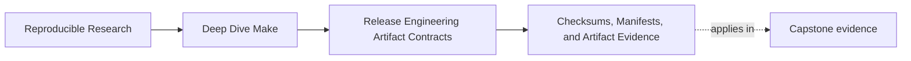
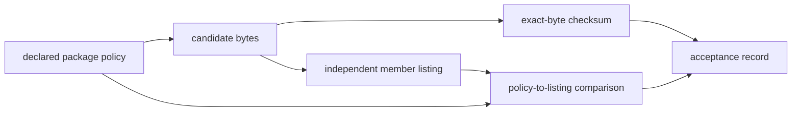

# Checksums, Manifests, and Artifact Evidence


<!-- page-maps:start -->
## Page Maps




<!-- page-maps:end -->

Release engineering becomes confusing very quickly when teams mix several different
claims:

- what the artifact is
- which exact bytes were received
- whether those bytes contain the declared package
- how those bytes were produced
- who authorized publication

At first this sounds abstract. In practice it causes very ordinary problems:

- bundles that rebuild every run because timestamps were embedded inside them
- release manifests that mean three different things at once
- host diagnostics getting mistaken for artifact identity
- checksums that no longer match because the bundle includes unstable proof files

This page is about keeping those truths separate enough that both remain useful.

## The sentence to keep

When you add release metadata, ask:

> Which claim does this file support, who produced it, and can the consumer verify that
> claim independently?

That question prevents a lot of unstable release design.

## Identity and evidence are not the same thing

Artifact identity usually means:

- the bundle contents
- the files consumers are meant to receive
- the checksums or manifests that define or verify that bundle according to policy

Supporting evidence usually means:

- toolchain attestation
- host details
- timing reports
- local diagnostic traces
- auxiliary proof artifacts used in validation

Some repositories choose to package more evidence inside the published bundle. That can be
valid. The point is that the choice must be explicit.

Without that explicit choice, release artifacts often become unstable by accident.

## Use one evidence role per file

| Evidence | Question answered | What it does not prove |
| --- | --- | --- |
| archive checksum | are these the same exact archive bytes? | correct package members or trusted origin |
| package-policy manifest | what members should the candidate contain? | what the received archive actually contains |
| archive listing | what paths, types, modes, and links does this candidate contain? | whether those members were intended |
| provenance attestation | what declared environment or process produced the candidate? | that the artifact is safe or policy-compliant |
| signature | did a holder of the trusted key authorize these bytes? | that the signer reviewed the correct package contract |
| acceptance record | which gates passed for this candidate identity? | facts outside the gates it names |

Evidence becomes useful when the consumer can compose these claims without pretending one
file proves all of them.

## Checksums usually describe identity

Checksums are most useful when they answer:

> which exact bytes make up the published artifact?

That is why checksum files often belong with the released artifact or immediately beside it.

For example:

```make
artifacts/module08-release/candidate/app.tar.gz.sha256: \
		artifacts/module08-release/candidate/app.tar.gz
	@shasum -a 256 "$<" > "$@.candidate"
	@mv "$@.candidate" "$@"
```

This is a clean relationship:

- the archive is the identity
- the checksum is a verification description of that identity

The command shown is available on macOS. GNU/Linux environments commonly use
`sha256sum`. A release tool contract should select one supported implementation and verify
its output format rather than assume every host exposes the same command.

The trouble starts when:

- unstable files were placed inside the archive identity
- the sidecar names a mutable or ambiguous path
- verification silently rebuilds the archive before checking it
- archive and checksum are fetched from an untrusted source with no separate trust anchor

A checksum detects byte mismatch against the sidecar. If an attacker can replace both
files, checksum verification alone does not establish origin.

## Manifests need a narrower job than "metadata"

"Manifest" is one of those words that can mean almost anything unless you narrow it.

A strong manifest has one clear role, such as:

- listing bundle contents
- recording release version and declared package members
- describing checksums for each payload

A weak manifest is a dumping ground for:

- file list
- build time
- host name
- tool versions
- local user name
- maybe anything else that was easy to print

That kind of manifest quickly stops being trustworthy because nobody can tell which facts
are actually part of the contract.

Give manifests role-specific names where ambiguity would matter:

- `package-members.txt`: declared member contract
- `archive-contents.txt`: observed archive listing
- `payload-checksums.txt`: checksums for named payloads
- `build-provenance.json`: declared production context

The extension does not create trust. The narrow schema and verification route do.

## A small bundle-manifest example

Suppose the release policy says the bundle should contain:

- `app-1.0/bin/app`
- `app-1.0/LICENSE`
- `app-1.0/share/doc/README.md`

Then a good manifest might say exactly that:

```make
packaging/package-members.txt:
	@printf '%s\n' \
	  'app-1.0/LICENSE' \
	  'app-1.0/bin/app' \
	  'app-1.0/share/doc/README.md' > "$@.candidate"
	@mv "$@.candidate" "$@"
```

This is useful because it records the package policy in a stable, inspectable way.

It does not try to become a whole-machine diary.

Do not derive this expected list from the candidate archive and then compare it with the
same archive. That proves the extraction command can repeat its own observation. The
expected manifest must come from package policy; the observed listing must come from the
candidate.

## Verify as a consumer without rebuilding

Copy or receive one candidate packet, then verify those exact bytes:

```sh
shasum -a 256 -c \
  artifacts/module08-release/candidate/app.tar.gz.sha256
tar -tzf artifacts/module08-release/candidate/app.tar.gz \
  | sed '/\/$/d' | LC_ALL=C sort \
  > artifacts/module08-release/candidate/archive-files.txt
cmp packaging/package-members.txt \
  artifacts/module08-release/candidate/archive-files.txt
```

Adjust paths to the packet layout you actually use. The crucial rule is that consumer
verification does not run `make dist` first. Rebuilding could replace the candidate whose
failure you need to explain.

## Attestation is often better beside the artifact than inside it

Teams often want extra proof about a release:

- compiler version
- platform details
- selected build mode
- validation report

Those may be valuable, but they do not automatically belong inside the artifact's identity.

A healthier pattern is often:

- publish the artifact
- publish checksums and a bundle manifest
- publish attestations beside the artifact or in a verification directory

That way the release remains stable while the proof surface still exists.

## Why timestamps are so dangerous here

Timestamps are one of the fastest ways to confuse identity and evidence.

If you put:

```text
build_time=...
```

inside a manifest that is packaged into the release bundle, then every build creates a new
artifact identity even when nothing semantically changed.

That may be the intended policy. Usually it is not.

This is why Module 08 keeps asking:

- what is identity
- what is evidence
- where should each live

The answers determine whether release artifacts remain stable.

## A sidecar-attestation example

Suppose you want to record compiler and host information for a release:

```make
dist/app.attest.txt: dist/app.tar.gz | dist/
	@printf 'compiler=%s\nhost=%s\n' '$(CC)' "$$(uname -s)" > $@
```

This can be healthy if the attestation file is treated as adjacent evidence rather than as
part of the archive's core identity.

The archive checksum can still describe the artifact itself.

The attestation file can still help operators understand how that artifact was produced.

Those are different jobs, and keeping them separate is usually cleaner.

## Reproducible bytes are an observed release property

Two archives with the same files can still differ because of:

- member order
- modification times
- uid, gid, user, or group names
- file modes
- gzip header timestamps or filenames
- archive producer and version

A reproducibility claim therefore needs:

1. equivalent declared inputs
2. a declared archive producer and normalization policy
3. two independently produced candidates
4. checksum comparison
5. member inspection when checksums differ

Do not update the expected checksum merely because a new build produced a different one.
First classify whether the candidate content, metadata policy, or producer changed.

## Provenance needs a schema and a consumer

An attestation is useful only when someone knows what to verify. A bounded provenance file
might record:

```text
artifact_sha256=<exact candidate digest>
source_revision=<repository revision>
archive_producer=<tool and version>
package_policy=<manifest identity>
```

Host name and wall-clock time may help an investigation, but they should not be added by
habit. Every field needs a consumer question and a stability policy.

The attestation should bind itself to the candidate digest. Otherwise it is only a nearby
file with no explicit relationship to the bytes.

## Signatures add authorization, not package correctness

When release policy requires signing, define:

- which bytes are signed
- which key identity is trusted
- how keys are rotated or revoked
- what verifier command and policy are used
- whether checksum and signature files are themselves inside or outside the signed object

Signing the wrong bundle authorizes the wrong bundle. Signature verification complements
member-contract and extraction-safety checks; it does not replace them.

## Evidence still needs stability where possible

Even when evidence lives beside the artifact, it should still be as stable and meaningful as
possible.

Good evidence files usually:

- record facts people actually use
- avoid redundant noise
- change only when the represented evidence changes

Poor evidence files:

- dump everything available
- include unstable local trivia
- force teams to ignore the file because it changes on every run without teaching anything

This is the same lesson you learned earlier with manifests and stamps. Release proof should
be useful, not merely abundant.

## Failure signatures worth recognizing

### "The release bundle changes every run even when nothing important changed"

That often means evidence was packaged as identity without a clear policy.

### "We have a manifest, but nobody can say what it is for"

That usually means the manifest job is too broad.

### "Checksums do not match because the bundle includes unstable metadata"

That means identity and proof have been mixed carelessly.

### "We lost useful provenance because we were afraid to include anything"

That may mean the repository needs adjacent attestation rather than less evidence overall.

## A review question that improves release evidence design

Take one manifest, checksum set, or attestation file and ask:

1. what exact question the file answers
2. who produced it and from which inputs
3. whether it is identity, integrity, content, provenance, authorization, or acceptance evidence
4. whether it belongs inside the candidate or beside it
5. whether its contents are stable enough for that role
6. whether verification inspects existing bytes without rebuilding
7. what trust anchor or independent source prevents circular verification
8. what the evidence cannot prove

If those answers are weak, the release evidence model is weak too.

## What to practice from this page

Choose one release artifact and list:

1. the files that define its identity
2. the exact-byte checksum and verifier route
3. the package-policy manifest and independently observed archive listing
4. one provenance attestation bound to the candidate digest
5. one unstable diagnostic that should stay out entirely
6. one claim each file cannot establish

If you can do that cleanly, you are treating release evidence as design rather than
afterthought.

## End-of-page checkpoint

Before leaving this lesson, make sure you can explain:

- why artifact identity and supporting evidence are different
- why checksums prove equality against a sidecar, not package correctness or origin
- how manifests become weak when they try to mean everything
- why expected package policy must be independent from observed archive contents
- why sidecar attestations are often healthier than stuffing diagnostics into the bundle
- how provenance binds to candidate identity
- why signatures do not replace package inspection
- how unstable metadata can accidentally redefine a release artifact
