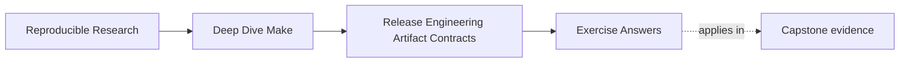
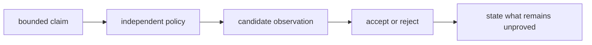

# Exercise Answers

Use these answers after producing your own packet. They show one defensible route, not the
only valid implementation. Compare the reasoning and rejection conditions, not merely the
command spelling.

<!-- page-maps:start -->
## Page Maps




<!-- page-maps:end -->

## How to compare your packet

For each exercise, ask:

1. did I identify one exact candidate where identity matters?
2. did declared policy exist independently of observed output?
3. does the evidence test the claim rather than repeat it?
4. does failure stop the next trust transition?
5. did I state what the evidence cannot establish?

A packet with many logs can still be weak if no reviewer knows which claim each log
supports.

## Exercise 1: Define the candidate and target contracts

A defensible `contracts.md` begins with narrow meanings:

| Target | Creates or observes | Excluded behavior |
| --- | --- | --- |
| `dist` | creates one local candidate from declared payloads | install, remote publish, approval |
| `verify-dist` | observes one existing candidate and writes evidence | rebuild or candidate replacement |
| `release-check` | composes local tests and acceptance gates | remote side effects |
| `install-rehearsal` | maps accepted payload below the packet root | host-system writes |
| `publish` | unimplemented remote boundary | implicit invocation from `dist` |

The internal-transfer scope can read:

> The candidate transfers the capstone application and generated runtime payloads between
> controlled course environments; it is not a public installer.

The critical distinction is that `verify-dist` consumes bytes. If it depends on `dist`,
consumer verification may replace the failed candidate before inspection. A producer-side
`release-check` may build and then verify, but the consumer entry point remains
rebuild-free.

**Insufficient answer:** "`dist` builds the release and does all checks." This hides target
callers, remote boundaries, and whether verification observes or regenerates bytes.

## Exercise 2: Declare the package member contract

One model policy is:

```text
app	regular	executable	no-links	main application
build/bin/dyn1	regular	executable	no-links	generated-header demonstration
build/bin/dyn2	regular	executable	no-links	generated-header demonstration
build/include/dynamic.h	regular	readable-data	no-links	generated interface consumed by dyn1 and dyn2
```

The matching path manifest is:

```text
app
build/bin/dyn1
build/bin/dyn2
build/include/dynamic.h
```

The policy excludes `build/bin/dyn1.d` and `build/bin/dyn2.d`. Those files help Make track
compiler dependencies; a consumer does not execute or include them. Archiving the whole
`build/bin` directory confuses build state with release payload.

Exact numeric modes can vary with source policy, so `executable` and `readable-data` may be
more durable than assuming one host's umask. If the release requires exact modes, record
and enforce them explicitly.

**Insufficient answer:** generate `package-members.txt` by listing the candidate. That
turns expected policy into a copy of observed output.

## Exercise 3: Produce and identify one candidate

The producer command can be:

```sh
gmake -C "$CAPSTONE" clean all
(
  cd "$CAPSTONE"
  python3 scripts/mkdist.py \
    "$OLDPWD/$PACKET/candidate/capstone.tar.gz" \
    app \
    build/bin/dyn1 \
    build/bin/dyn2 \
    build/include/dynamic.h
)
```

Identity evidence on macOS:

```sh
shasum -a 256 "$PACKET/candidate/capstone.tar.gz" \
  > "$PACKET/evidence/capstone.sha256"
```

Tool and source evidence belongs beside the candidate:

```sh
gmake --version | sed -n '1p' > "$PACKET/evidence/make-version.txt"
python3 --version > "$PACKET/evidence/python-version.txt" 2>&1
git rev-parse HEAD > "$PACKET/evidence/source-revision.txt"
```

The sidecar answers "which exact bytes?" The source revision and tool versions help explain
production. None of them proves that archive members satisfy package policy.

**Insufficient answer:** write a checksum, then run `gmake dist` before checking it. The
sidecar may now describe a different production event.

## Exercise 4: Prove repeat production through one publication path

Both observations must use:

```text
candidate/capstone.tar.gz
```

Preserve the bytes after each clean production:

```sh
cp "$PACKET/candidate/capstone.tar.gz" \
  "$PACKET/evidence/capstone-first.tar.gz"
# clean, rebuild, and produce again through candidate/capstone.tar.gz
cp "$PACKET/candidate/capstone.tar.gz" \
  "$PACKET/evidence/capstone-second.tar.gz"
cmp \
  "$PACKET/evidence/capstone-first.tar.gz" \
  "$PACKET/evidence/capstone-second.tar.gz"
```

Why the same path? `mkdist.py` passes its output pathname to `gzip.GzipFile`. Gzip records a
filename field even though the script fixes the gzip modification time. Different output
basenames therefore produce different bytes for equivalent payloads.

That contrast is useful evidence about the producer contract, not proof of payload drift.
Inspect uncompressed members before blaming the build.

**Insufficient answer:** produce `first.tar.gz` and `second.tar.gz`, observe different
digests, and conclude that normalization failed. The experiment changed an undeclared
input: output basename.

## Exercise 5: Compare declared and observed archive members

First retain a verbose view for type and mode review:

```sh
tar -tvzf "$PACKET/candidate/capstone.tar.gz" \
  > "$PACKET/evidence/archive-listing.txt"
```

Then compare regular-file paths:

```sh
tar -tzf "$PACKET/candidate/capstone.tar.gz" \
  | sed '/\/$/d' \
  | LC_ALL=C sort \
  > "$PACKET/evidence/archive-members.txt"

cmp \
  "$PACKET/evidence/package-members.txt" \
  "$PACKET/evidence/archive-members.txt"
```

The path comparison is one gate. A model answer also checks the verbose listing or uses
Python's `tarfile` member predicates to establish:

- all payloads are regular files
- no member is a symbolic or hard link
- executable policy holds for the three binaries
- readable-data policy holds for the header

A terse archive listing does not reliably establish member type. The answer keeps path and
type claims separate.

**Insufficient answer:** "`tar -tzf` looked right." Review requires an expected list,
observed list, comparison result, and type policy.

## Exercise 6: Reject unsafe extraction before unpacking

The worked example's `PurePosixPath` and `tarfile` check is a suitable model. Its important
ordering is:

1. open the archive for inspection
2. reject absolute and traversal paths
3. reject links and unsupported member types
4. return success only after every member passes
5. extract only in the next exercise

The deliberate `../escape.txt` archive must return nonzero. Capture it without allowing the
expected failure to stop your evidence wrapper:

```sh
if python3 path/to/verifier.py "$PACKET/failures/unsafe.tar.gz" \
  > "$PACKET/failures/unsafe-extraction.txt" 2>&1
then
  printf '%s\n' "unsafe archive unexpectedly passed" \
    >> "$PACKET/failures/unsafe-extraction.txt"
  exit 1
else
  printf '%s\n' "PASS: unsafe archive rejected" \
    >> "$PACKET/failures/unsafe-extraction.txt"
fi
```

The nonzero status is expected evidence. Extracting first and checking afterward is not:
the unsafe write may already have happened.

**Insufficient answer:** rely on the extraction tool to sanitize names silently. Silent
rewriting changes package meaning and makes the accepted member contract ambiguous.

## Exercise 7: Extract and verify the consumer view

After the safety gate:

```sh
mkdir -p "$PACKET/consumer/extracted"
tar -xzf "$PACKET/candidate/capstone.tar.gz" \
  -C "$PACKET/consumer/extracted"

find "$PACKET/consumer/extracted" -type f -print \
  | sed "s#^$PACKET/consumer/extracted/##" \
  | LC_ALL=C sort \
  > "$PACKET/evidence/extracted-members.txt"

cmp \
  "$PACKET/evidence/package-members.txt" \
  "$PACKET/evidence/extracted-members.txt"
```

Checksums of extracted files give the consumer a stable payload view. They can help explain
whether a later install mismatch began during extraction or destination mapping.

The pre-extraction gate proves the candidate was eligible to unpack. The post-extraction
gate proves the resulting regular-file paths match policy. Neither claim subsumes the
other.

**Insufficient answer:** list only the extraction directory. That does not establish
whether a write escaped it.

## Exercise 8: Prove install containment and convergence

The composed destination is:

```text
artifacts/module08-release-lab/consumer/install-root/usr/local/bin/make-capstone
```

`/usr/local` is the logical prefix inside the rehearsal root; it is not a host write.

A model preflight rejects a destination ancestor that is a symbolic link or wrong type.
After the first install, record paths, checksum, and mode. Repeat the same install and
record the same observations again. All comparisons must pass.

Repository status before and after catches tracked-tree mutation:

```sh
git status --short > "$PACKET/evidence/status-before-install.txt"
# install and rerun
git status --short > "$PACKET/evidence/status-after-install.txt"
cmp \
  "$PACKET/evidence/status-before-install.txt" \
  "$PACKET/evidence/status-after-install.txt"
```

In a dirty worktree, identical status files prove only that the rehearsal did not change
the observed status, not that the repository was initially clean.

The one-file rehearsal does not prove transactional upgrades, rollback, or removal. Those
remain outside its bounded claim.

**Insufficient answer:** both install commands returned zero. A recipe can append duplicate
state twice and still succeed.

## Exercise 9: Preserve and classify two failed candidates

The appended-byte copy fails the **identity boundary** first because its digest no longer
matches the accepted sidecar. Even if an archive reader tolerates trailing bytes, the
candidate identity changed.

The undeclared-member archive fails the **assembly boundary** first because observed
members differ from independent policy. Its checksum can be internally consistent and it
must still be rejected.

A useful failure note reads:

```text
candidate_digest=<computed digest>
first_failed_boundary=assembly
declared_truth=exact four-member package policy
observed_evidence=archive contains undeclared debug.log
blocked_action=extraction and acceptance
repair=correct package selection and produce a new candidate
```

Use digest-named directories so two failures cannot overwrite each other. Keep each failed
candidate; do not add the unexpected bytes to policy merely to make comparison pass.

**Insufficient answer:** regenerate until the failure disappears. That loses the rejected
bytes and prevents a reviewer from testing the diagnosis.

## Exercise 10: Write a bounded acceptance handoff

A model record is:

```text
candidate=capstone.tar.gz
sha256=<computed candidate digest>
scope=internal transfer between controlled course environments
repeat_production=PASS
member_policy=PASS
extraction_safety=PASS
contained_extraction=PASS
install_convergence=PASS
controlled_failure_rejection=PASS
publication=NOT_ATTEMPTED
```

Before accepting it, recompute the candidate digest and compare it with both
`capstone.sha256` and `acceptance.txt`. A record naming different bytes is a handoff
failure.

The consumer route must inspect existing bytes. It should not call `gmake`, the compiler,
or `mkdist.py`.

This packet supports claims about:

- two observed same-path productions
- exact candidate identity
- declared members, types, modes, and link policy
- extraction eligibility and contained consumer view
- one bounded install mapping and rerun
- two controlled rejection routes

It does not support claims about:

- public package completeness
- source authenticity without an independent trust anchor
- signature authorization
- transactional host installation
- remote registry behavior
- universal reproducibility across undeclared platforms and tool versions

**Insufficient answer:** "release accepted." Acceptance without identity, gate results,
scope, and exclusions is not a reviewable decision.

## Mastery check

A complete answer packet has a chain of reasoning:

```text
declared contract
  -> exact candidate
  -> independent observations
  -> gate decisions
  -> preserved rejections
  -> digest-bound acceptance
```

If one arrow is missing, identify the earliest unproved transition. Adding more later logs
does not repair an earlier circular or destructive check.
