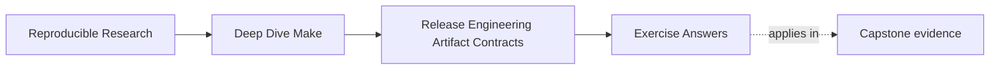

# Exercise Answers


<!-- page-maps:start -->
## Page Maps




<!-- page-maps:end -->

Use this after you have written your own answers. The point is comparison, not copying.

Strong Module 08 answers do not just name files or commands. They explain:

- what release promise is being made
- what evidence would prove that promise
- why the chosen boundary makes publication safer and easier to trust

## Exercise 1: Write a clear `dist` contract

A strong answer explains `dist` in one narrow sentence, such as:

> `dist` produces the publishable release archive and its declared verification files under
> `dist/`.

The strongest answers also say what `dist` does not promise. For example:

- it does not install onto the local machine
- it does not deploy
- it does not silently run unrelated cleanup

That negative clarity matters because narrow targets are easier to trust.

## Exercise 2: Design a publishable bundle tree

A strong answer models the bundle as a deliberate tree, for example:

```text
bundle/
  bin/app
  LICENSE
  share/doc/README.md
  manifest.txt
```

The answer is strongest when it also names something that should stay outside, such as:

- host diagnostics
- build logs
- timing traces

The key idea is that package layout is a contract, not a side effect of copying files from
whatever directory already exists.

## Exercise 3: Separate identity from evidence

A strong answer says something like:

- artifact identity: `app.tar.gz` plus its checksum or bundle manifest
- adjacent evidence: `app.attest.txt` with compiler or host details

The reasoning should sound like:

> if unstable host or timestamp details are packaged into the archive itself, then the
> artifact identity changes even when the release content did not.

That is the central release-engineering lesson of this module.

## Exercise 4: Make `install` safe to rerun

A strong answer introduces an explicit destination boundary, often with `DESTDIR` or a
staging root:

```make
PREFIX ?= /usr/local
INSTALL_ROOT := $(DESTDIR)$(PREFIX)
```

The answer is stronger if it states one idempotence expectation clearly, such as:

> running `make install DESTDIR=/tmp/release-check` twice should produce the same intended
> file tree under that root.

And it should include an inspection command like:

```sh
find /tmp/release-check -type f | sort
```

That turns install from a blind side effect into something reviewable.

## Exercise 5: Diagnose one release failure

A strong answer starts by classifying the failed boundary:

- build truth
- package truth
- publish truth

Then it chooses an evidence command that matches that boundary.

For example:

- wrong bundle contents
  first evidence: `tar -tzf dist/app.tar.gz`
- checksum mismatch
  first evidence: inspect the bundle inputs and the checksum target relationship
- unsafe install behavior
  first evidence: rerun install under a temporary destination root and compare the tree

The strongest answers do not jump straight to "rerun `dist`." They first decide what
boundary likely lied.

## Exercise 6: Inspect an archive as a contract

A strong answer stages only declared content under a dedicated directory:

```make
dist/app.tar.gz: app LICENSE | dist/
	@rm -rf dist/stage
	@mkdir -p dist/stage/bin
	@cp app dist/stage/bin/app
	@cp LICENSE dist/stage/LICENSE
	@tar -czf $@ -C dist/stage .
```

`tar -tzf dist/app.tar.gz | sort` should match the declared tree. A stray file under
`dist/` remains outside because the archive root is `dist/stage`, not a directory shared
with sidecars and old outputs.

## Exercise 7: Reproduce an archive byte for byte

With GNU tar and gzip explicitly required, a defensible rule normalizes common sources of
byte drift:

```make
SOURCE_DATE_EPOCH ?= 0

dist/app.tar.gz: app LICENSE | dist/
	@rm -rf dist/stage
	@mkdir -p dist/stage/bin
	@cp app dist/stage/bin/app
	@cp LICENSE dist/stage/LICENSE
	@tar --sort=name --mtime="@$(SOURCE_DATE_EPOCH)" \
	  --owner=0 --group=0 --numeric-owner \
	  -cf - -C dist/stage . | gzip -n > $@.candidate
	@mv $@.candidate $@
```

The submission should state GNU tar and gzip versions because those flags are not a
universal `tar` contract. Two clean builds should have identical checksums. Repeating the
experiment without normalized timestamps or `gzip -n` demonstrates why stable content
alone does not guarantee stable archive bytes.

## Exercise 8: Verify checksum evidence

For GNU coreutils:

```sh
sha256sum dist/app.tar.gz > dist/app.tar.gz.sha256
sha256sum --check dist/app.tar.gz.sha256
printf x >> dist/app.tar.gz
sha256sum --check dist/app.tar.gz.sha256
```

The first verification exits `0`; the altered archive verification exits nonzero. On
another platform, declare and use its equivalent tool consistently. A checksum proves
byte identity against the sidecar. It does not prove that the archive contains the right
files, so the package listing and manifest remain necessary.

## Exercise 9: Prove installation stays inside its destination

A strong install rule roots every destination:

```make
PREFIX ?= /usr/local
INSTALL_ROOT := $(DESTDIR)$(PREFIX)

.PHONY: install
install: app LICENSE
	@install -d $(INSTALL_ROOT)/bin $(INSTALL_ROOT)/share/licenses/app
	@install -m 0755 app $(INSTALL_ROOT)/bin/app
	@install -m 0644 LICENSE $(INSTALL_ROOT)/share/licenses/app/LICENSE
```

Run it twice under a repository-owned test root and compare sorted paths plus checksums.
An audit such as `rg -n '(/usr|/opt|/bin)/' Makefile mk` should reveal undeclared absolute
destinations. The answer must also state whether installation overwrites declared files
and whether uninstall is supported; silence is not a safe policy.

## Exercise 10: Rehearse a complete release

A complete answer separates composition from side effects:

- `dist` creates the declared archive and checksum
- `release-check` depends on tests, selftests, archive inspection, and checksum verification
- `install` writes only below `DESTDIR`
- deployment, credentials, approval, and remote publication remain outside the local
  artifact graph unless their ownership is explicitly designed

The successful transcript should include archive listing, checksum verification, and two
identical clean-build checksums. A packaging failure must prevent the final archive from
being replaced. A verification failure must return nonzero before publication. Strong
answers identify which boundary stopped each failure instead of reporting only that the
command failed.

## What mastery-level answers sound like

A mastery-level answer set in this module does three things well:

- it treats release targets as interfaces with stable meaning
- it treats bundle layout as a modeled publication boundary
- it separates artifact identity from the surrounding evidence surface

That is the standard Module 08 is trying to build.
