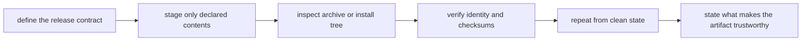

# Exercises

Use these after reading the five core lessons and the worked example. The goal is not to
show off packaging commands. The goal is to make your release-boundary reasoning visible
through contracts, bundle trees, and verification evidence.

## How to work through this set

Treat the ten exercises as one full lab day on release rehearsal.

Before each answer:

1. name the release promise or truth boundary you are testing
2. choose the inspection path that would prove the promise
3. state what belongs inside the artifact and what must stay outside it

If you skip the boundary question, release work turns into command sequences with no clear
publication contract.

Do the exercises in order. The day is one progression:

- Exercises 1-3 define `dist`, bundle layout, and the difference between artifact identity
  and adjacent evidence
- Exercises 4-6 make installation and archive boundaries explicit
- Exercises 7-9 prove repeatability, verification, and destination safety
- Exercise 10 combines the whole route into one bounded release rehearsal

Submit a consumer evidence packet for Exercises 6-10:

| Artifact | Sorted contents | Identity check | Empty-destination result | Repeatability result |
| --- | --- | --- | --- | --- |

The packet must be understandable without the command history that produced the release.

Keep one release packet as you go. By the end of the day it should contain:

- one narrow `dist` contract
- one deliberate bundle tree
- one identity or evidence separation decision
- one safe install route under a declared destination root
- one reproducible archive proof
- one full release rehearsal with both success and failure boundaries

If those six artifacts are missing, you are probably packaging files without defining the
release contract they are meant to serve.

## Recommended working layout

If you want one lab tree that can support the whole day, use something like:

```text
module08-lab/
├── Makefile
├── build/
├── dist/
├── release/
├── notes/
└── artifacts/
```

Keep one bundle table while you work:

| Bundle path | Why it belongs inside | Consumer that needs it | Evidence that it is correct |
| --- | --- | --- | --- |

Also keep one adjacent-evidence table:

| File or sidecar | Inside artifact or beside it | Why |
| --- | --- | --- |

That second table matters because Module 08 is where learners often start stuffing
diagnostics and provenance into the artifact itself even when that destabilizes identity.



Use that route on purpose. It keeps the day centered on consumer trust rather than on
packaging motion alone.

## Exercise 1: Write a clear `dist` contract

Choose one repository and define what `dist` should promise in one sentence.

What to hand in:

- the target meaning
- the declared inputs to that target
- one thing the target should deliberately not do
- one sentence explaining why narrow targets are easier to trust

Study note:
The best `dist` target says exactly what publishable artifact surface it creates and what
it refuses to do.

## Exercise 2: Design a publishable bundle tree

A project needs to ship:

- one binary
- one license
- one README
- one bundle manifest

Design the release tree and explain why each file belongs inside it.

What to hand in:

- the intended bundle layout
- one file that should stay outside the bundle
- the publication step after which the artifact becomes trustworthy
- one sentence explaining why bundle layout is part of the contract

Study note:
Bundle trees are not just copies of whatever happened to be nearby in the workspace.

## Exercise 3: Separate identity from evidence

A teammate wants to package host information and build timestamps directly into the
release bundle because "more provenance is better."

Explain how you would separate artifact identity from supporting evidence.

What to hand in:

- one file that should count as artifact identity
- one file that should live beside the artifact instead
- one sentence explaining why mixing them would destabilize releases
- one sentence explaining what a consumer needs to verify first

Study note:
If unstable host or time details enter the archive itself, artifact identity changes even
when release meaning did not.

## Exercise 4: Make `install` safe to rerun

You inherit an `install` target that writes straight into a real destination and behaves
unpredictably on rerun.

Describe how you would redesign it to make the destination contract explicit and safer to
test.

What to hand in:

- the destination-root variable or staging approach
- one idempotence expectation
- one command you would run to inspect the installed tree safely
- one sentence explaining what should never happen outside the declared root

Study note:
Installation should be inspectable as a tree, not treated as an irreversible side effect.

## Exercise 5: Diagnose one release failure

Pick one of these symptoms:

- wrong bundle contents
- checksum mismatch
- unstable release identity
- unsafe install behavior
- drift in release-target meaning

Write the debugging path you would use to identify the failed truth boundary and repair
it.

What to hand in:

- the likely failed boundary
- the first evidence command
- the likely contract or publication repair
- one sentence explaining why that evidence comes before rerunning everything

Study note:
This is a boundary-diagnosis exercise, not a reflexive rebuild exercise.

## Midday self-check

Before you move into archive repeatability, checksum evidence, and install auditing, make
sure your packet can already answer these questions cleanly:

- what `dist` promises and what it refuses to do
- which files belong inside the bundle and which belong beside it
- what point in your route marks the start of release trust
- which destination root contract makes installation safe to inspect

If you cannot answer those four questions in plain language, return to Exercises 1-5 and
make the packet more explicit before continuing.

## Exercise 6: Inspect an archive as a contract

Build a small archive, list its entries, and compare the listing with a declared package
tree. Add one stray file to the staging parent and prove it does not enter the archive.

What to hand in:

- the declared tree
- the sorted archive listing
- the staging rule that excludes unrelated files
- one sentence explaining why the archive root matters

Study note:
Archive contents should follow the declared package tree, not whatever files happened to
share a parent directory.

## Exercise 7: Reproduce an archive byte for byte

Build the same archive twice from clean staging directories. Normalize entry order,
timestamps, ownership, and gzip metadata using a declared release toolchain.

What to hand in:

- the archive rule and tool versions
- both checksums
- one experiment showing that removing a normalization control can cause drift
- one sentence explaining why stable content alone is not enough

Study note:
Release repeatability is where many learners first notice that semantic equality and byte
equality are related but different goals.

## Exercise 8: Verify checksum evidence

Create a checksum sidecar, verify it successfully, alter one byte of the archive, and
verify that the check fails.

What to hand in:

- checksum generation and verification commands
- successful and failing exit statuses
- an explanation of why the checksum is evidence about the archive, not a replacement for
  its package contract
- one sentence explaining what the checksum cannot tell you

Study note:
Checksums prove byte identity. They do not prove that you packed the right files.

## Exercise 9: Prove installation stays inside its destination

Install under a fresh `DESTDIR`, run the installation again, and compare sorted file
manifests and checksums. Audit the recipe for any absolute write that escapes the root.

What to hand in:

- the install rule
- both destination manifests
- the escape-audit command and result
- one explicit policy for overwrite or removal behavior

Study note:
Release installation should be safe to rehearse repeatedly without touching the real
system root.

## Exercise 10: Rehearse a complete release

Create a release route that builds, tests, stages, archives, checksums, verifies, and
installs into a temporary root. Inject one packaging failure and one verification failure.

What to hand in:

- the public release-target contracts
- the package tree and adjacent evidence files
- a transcript of the successful rehearsal
- both failure transcripts and the boundary each one protects
- a statement of what remains deliberately outside Make

Study note:
The goal is not to make release engineering magical. The goal is to make every trust
boundary explicit enough that another maintainer can rerun the route with confidence.

## Before you read the answers

Do not open `exercise-answers.md` until you can already point to:

- one release target with a clear contract
- one bundle boundary you can defend
- one checksum or manifest that supports, but does not redefine, artifact identity
- one installation route that stays inside its declared destination
- one failure transcript whose boundary you can explain precisely

If you do not yet have those five things, the answer page will sound stronger than it can
teach.

## Mastery standard for this exercise set

Across all ten answers, the module wants the same habits:

- you name the release promise or truth boundary being tested
- you choose inspection and evidence before proposing the fix
- you explain the fix in terms of contract, package boundary, evidence policy, or publish
  safety

If an answer says only "release engineering is important," keep going.
