# Exercises

These ten exercises are one cumulative release-acceptance lab. Use the Make capstone as the
producer and keep one packet under `artifacts/module08-release-lab/`. Each exercise creates
evidence required by the next one.

Do not substitute prose for a command result. A release claim is complete only when another
reader can identify the candidate, declared policy, observed evidence, and rejection
condition.

## Lab contract

Run from the `bijux-masterclass` repository root with GNU Make 4.3 or newer:

```sh
CAPSTONE=programs/reproducible-research/deep-dive-make/capstone
PACKET=artifacts/module08-release-lab
```

Start only if the packet path is absent:

```sh
test ! -e "$PACKET" || {
  printf '%s\n' "Refusing to replace existing evidence: $PACKET" >&2
  exit 2
}
mkdir -p \
  "$PACKET/candidate" \
  "$PACKET/evidence" \
  "$PACKET/consumer" \
  "$PACKET/failures"
```

Do not write to `/usr/local`, a home-directory bin path, or another live install
destination. Do not publish remotely. Deliberate failures belong below
`"$PACKET/failures"`.

```mermaid
flowchart LR
  contract["target and member policy"] --> produce["candidate production"]
  produce --> identity["identity and repeatability"]
  identity --> contents["member comparison"]
  contents --> safety["extraction safety"]
  safety --> install["contained install rerun"]
  install --> failures["controlled rejection"]
  failures --> handoff["digest-bound acceptance"]
```



## Exercise 1: Define the candidate and target contracts

Write `"$PACKET/evidence/contracts.md"` before building anything.

It must define:

- `dist`: producer responsibility and output
- `verify-dist`: consumer responsibility and existing-byte input
- `release-check`: local composition and required gates
- `install-rehearsal`: accepted payload, logical prefix, and repository-owned root
- `publish`: deliberately unimplemented remote action

For every target, name callers, outputs, excluded side effects, retry behavior, and failure
evidence.

Then state the candidate scope in one sentence. Choose either an internal transfer bundle
or a public end-user package and keep later policy consistent with that choice.

**Acceptance test:** another reader can tell which targets may create candidate bytes and
which targets must only inspect existing bytes.

## Exercise 2: Declare the package member contract

Create `"$PACKET/evidence/package-policy.tsv"` independently of the archive. Give each
member five fields:

```text
path    type    mode-policy    link-policy    consumer-purpose
```

For the current internal-transfer candidate, include:

- `app`
- `build/bin/dyn1`
- `build/bin/dyn2`
- `build/include/dynamic.h`

Also create `"$PACKET/evidence/package-members.txt"` containing only the sorted paths.

Explain in `contracts.md` why dependency files from `build/bin` are excluded even though
the capstone's broad `dist` target currently archives them.

**Acceptance test:** the policy is readable before any candidate exists and every member
has a consumer purpose.

## Exercise 3: Produce and identify one candidate

Build the capstone payloads, then invoke `scripts/mkdist.py` with only the four declared
inputs. Publish to:

```text
artifacts/module08-release-lab/candidate/capstone.tar.gz
```

Record:

- the SHA-256 digest in `evidence/capstone.sha256`
- the first line of `gmake --version`
- the Python version
- the source revision from `git rev-parse HEAD`
- the exact producer command

Do not put wall-clock time, host name, or the evidence files inside the candidate.

**Acceptance test:** the digest sidecar names the existing candidate, and rerunning
verification would not invoke `gmake` or `mkdist.py`.

## Exercise 4: Prove repeat production through one publication path

Preserve the current candidate as `evidence/capstone-first.tar.gz`. Rebuild the payloads
from a clean capstone state, produce again through the same candidate pathname, and
preserve that observation as `evidence/capstone-second.tar.gz`.

Compare the two byte for byte and write the command plus status to
`evidence/repeat-production.txt`.

Then perform one controlled contrast: produce equivalent payloads under a different output
basename and compare that archive with the candidate. Explain why `mkdist.py` clears the
gzip filename field and why output location should not redefine candidate identity. Keep
the contrast archive as supporting evidence.

**Acceptance test:** the two same-path candidates are identical; the explanation does not
assume basename neutrality without connecting it to the producer implementation.

## Exercise 5: Compare declared and observed archive members

Inspect the candidate without extracting it.

Create:

- `evidence/archive-listing.txt`: verbose member listing
- `evidence/archive-members.txt`: sorted regular-file paths
- `evidence/member-comparison.txt`: comparison command and status

Compare the observed paths with `package-members.txt`. Also inspect member types and modes
against `package-policy.tsv`; a path-only comparison is not sufficient.

**Acceptance test:** expected policy and observed archive data come from independent
origins, and all four declared members match by path, type, mode policy, and link policy.

## Exercise 6: Reject unsafe extraction before unpacking

Write or reuse a verifier that rejects:

- absolute member paths
- `..` path components
- symbolic and hard links
- device nodes, FIFOs, and other unsupported types

Run it against the candidate and store the result in
`evidence/extraction-safety.txt`.

Create a deliberate archive with `../escape.txt` below `failures/`. Run the same verifier
against it and store the nonzero result in `failures/unsafe-extraction.txt`. Do not extract
the unsafe archive.

**Acceptance test:** the valid candidate passes, the unsafe candidate fails, and no
`escape.txt` appears outside the packet.

## Exercise 7: Extract and verify the consumer view

After Exercise 6 passes, extract the candidate below:

```text
artifacts/module08-release-lab/consumer/extracted/
```

Create:

- `evidence/extracted-members.txt`
- `evidence/extracted-checksums.txt`
- `evidence/extraction-comparison.txt`

Compare the extracted regular-file paths with package policy. Explain why post-extraction
comparison complements but does not replace pre-extraction inspection.

**Acceptance test:** every extracted file is below the consumer root and the extracted
paths match the declared member contract exactly.

## Exercise 8: Prove install containment and convergence

Define this narrow consumer mapping:

```text
app -> /usr/local/bin/make-capstone, mode 0755
```

Apply it below:

```text
artifacts/module08-release-lab/consumer/install-root/
```

Before writing, check composed destination paths and ancestor types. Then install twice
into the same root.

Record first-run and rerun:

- relative file paths
- file checksums
- file modes
- repository status

Create a conflicting directory or symbolic-link ancestor in a separate root below
`failures/` and prove preflight rejects it before copying.

**Acceptance test:** first-run and rerun evidence match, no source or tracked file changes,
and the conflict case fails before destination mutation.

## Exercise 9: Preserve and classify two failed candidates

Create two failures without modifying the accepted candidate:

1. append bytes to a copy after recording the accepted digest
2. create an archive with one undeclared regular-file member

For each failure, create a directory named by its computed digest below `failures/` and
retain:

- failed candidate
- computed digest
- failed command and exit status
- declared policy
- observed evidence
- first failed boundary
- blocked action

Do not repair either candidate in place. State whether the first failed boundary is
identity, assembly, extraction, installation, or handoff.

**Acceptance test:** both failures remain reviewable after the lab, and neither receives an
acceptance record.

## Exercise 10: Write a bounded acceptance handoff

Review all prior evidence and create `evidence/acceptance.txt` containing:

- candidate filename
- candidate SHA-256 digest
- package scope
- result for repeat production
- result for member policy
- result for extraction safety
- result for contained extraction
- result for install convergence
- result for controlled failure rejection
- `publication=NOT_ATTEMPTED`

Create `evidence/consumer-route.md` with the minimum commands a new consumer needs to:

1. verify candidate identity
2. inspect members and types
3. run extraction-safety policy
4. extract below a new root
5. confirm acceptance refers to the same digest

End with two explicit lists:

- claims this packet supports
- claims this packet does not support

**Acceptance test:** a reader can audit the candidate without rebuilding it, and no wording
suggests that the internal-transfer packet is a signed public release.

## Before reading the answers

Your packet should now contain one connected proof route, not ten unrelated notes. Check:

- one candidate identity appears consistently in sidecar and acceptance record
- package policy existed independently of the observed archive listing
- same-path repeat production was tested
- unsafe archives were rejected before extraction
- install evidence compares first run with rerun
- failed candidates remain preserved under their own identities
- remote publication was never attempted

If any item is missing, return to the first exercise that should have produced it. Later
success cannot compensate for an earlier unproven gate.
