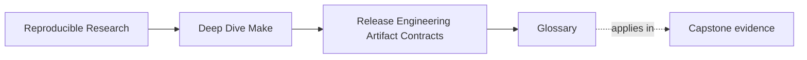
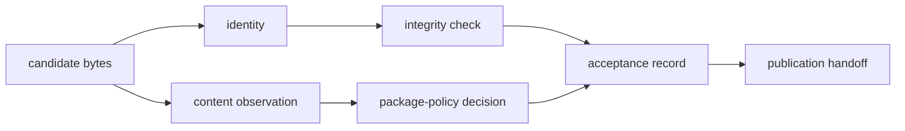

# Glossary

Use this glossary when a release argument becomes vague. Each definition names a bounded
claim, the evidence that can support it, and a nearby term it must not replace.

<!-- page-maps:start -->
## Page Maps




<!-- page-maps:end -->

## Release objects and boundaries

### Accepted candidate

A release candidate whose exact identity passed every gate required by a named scope.
Acceptance is not transferable to different bytes, even if the filename and version label
are unchanged.

Evidence: acceptance record plus the candidate digest.

Do not confuse with: **published release**. Acceptance may deliberately stop before any
remote action.

### Acceptance gate

One explicit decision that either admits or rejects a candidate at a trust boundary.
Examples include exact-byte verification, package-member comparison, extraction-safety
inspection, and install-convergence comparison.

Evidence: command, observed input identity, output, exit status, and decision.

Do not confuse with: a command that always returns success after rewriting the candidate.

### Acceptance record

A bounded statement that names one candidate digest, required gates, their results, scope,
and any action not attempted.

Evidence: the record can be checked against the existing candidate and each gate's retained
evidence.

Do not confuse with: a cryptographic signature. A local text record does not establish
authorization or origin by itself.

### Candidate assembly tree

An isolated filesystem tree containing exactly the members intended for one candidate
before archive creation. It exposes package layout for inspection and keeps sidecars and
older candidates outside the archive root.

Evidence: declared member policy and observed tree listing.

Do not confuse with: a shared build directory containing compiler intermediates.

### Distribution target

A public build interface, commonly `dist`, whose narrow responsibility is to make the
declared local candidate current.

Evidence: target contract, prerequisite graph, and produced candidate.

Do not confuse with: `release-check`, installation, approval, or remote publication.

### Publication boundary

The exact transition after which another consumer is allowed to rely on an object. For a
local candidate, this may be the atomic rename that replaces the candidate pathname. For a
remote registry, it may be an authenticated upload or pointer update.

Evidence: boundary-specific success plus the identity that crossed it.

Do not confuse with: candidate assembly, which remains untrusted until validation and
publication complete.

### Publication handoff

The check that the candidate offered to a remote action is the same exact candidate named
by local acceptance, checksum, provenance, and signature policy where applicable.

Evidence: identity comparison immediately before the remote boundary.

Do not confuse with: rebuilding by version name and assuming equivalent bytes.

### Published release

A candidate that crossed the repository's declared remote publication boundary. The term
says nothing by itself about package quality; that depends on the acceptance and
authorization policies that preceded handoff.

Evidence: remote identity, immutable locator, and publication result.

Do not confuse with: any file placed in a local `dist/` directory.

### Release candidate

Immutable bytes proposed for acceptance. A candidate has an exact identity even before it
passes any gate.

Evidence: candidate file plus computed digest.

Do not confuse with: a mutable pathname. Replacing `app.tar.gz` creates a new candidate even
if the name stays constant.

### Release contract

The stable promise made to a named consumer: target meanings, candidate scope, package
members, evidence, gates, retry behavior, and excluded side effects.

Evidence: documentation aligned with executable verification.

Do not confuse with: a list of commands lacking acceptance criteria.

### Release surface

The small public interface through which humans and automation produce, verify, accept,
install, or publish candidates.

Evidence: named targets and their contracts.

Do not confuse with: every internal helper used by release recipes.

## Identity, contents, and trust

### Artifact identity

The exact bytes of one artifact, normally represented by a cryptographic digest. Identity
answers "is this the same byte sequence?"

Evidence: digest computed from the existing artifact.

Do not confuse with: package correctness. Wrong contents still have a precise identity.

### Authorization

Permission from a trusted principal to publish or accept named bytes. A digital signature
can support authorization when key trust and verification policy are defined.

Evidence: valid signature, trusted key identity, and policy decision.

Do not confuse with: package-member verification. A trusted signer can authorize the wrong
package.

### Checksum

A digest sidecar or recorded digest used to compare exact bytes. Its strength depends on
the algorithm, sidecar format, and independent trust source.

Evidence: successful recomputation and comparison.

Do not confuse with: origin. If an attacker can replace candidate and sidecar together, the
checksum alone does not establish who produced them.

### Content correctness

The decision that observed candidate members satisfy declared package policy by path, type,
mode, and link rules.

Evidence: independent policy manifest, archive observation, and comparison result.

Do not confuse with: checksum success. Exact wrong bytes remain wrong.

### Integrity

The property that candidate bytes have not changed relative to a trusted recorded
identity.

Evidence: digest or signature verification against an independently trusted value.

Do not confuse with: reproducibility. One intact candidate may differ from another valid
production.

### Observed archive listing

Evidence produced by inspecting one candidate's actual members, types, modes, ownership,
and links.

Evidence: verbose archive inspection retained with candidate identity.

Do not confuse with: package-policy manifest. Observation says what is present; policy says
what should be present.

### Package-policy manifest

An independent declaration of allowed or required members and their relevant properties.
It exists before or outside observation of the candidate under review.

Evidence: version-controlled or otherwise governed policy source.

Do not confuse with: a member list generated from the same candidate and labeled
"expected."

### Provenance

Structured evidence connecting candidate identity to declared source revision, producer,
toolchain, and process facts.

Evidence: attestation bound to the candidate digest and verified under a defined schema.

Do not confuse with: authorization, content correctness, or a dump of the whole host
environment.

### Reproducible candidate

A candidate for which two defined production attempts from equivalent declared inputs
produced identical bytes under the declared tool and path contract.

Evidence: retained observations and byte comparison.

Do not confuse with: a universal guarantee across undeclared platforms, output filenames,
or tool versions.

### Sidecar evidence

Evidence stored beside candidate bytes rather than embedded in their identity. Examples
include a checksum file, provenance attestation, signature, or acceptance record.

Evidence: explicit binding to the candidate digest.

Do not confuse with: unrelated nearby logs. Proximity without identity binding is weak.

## Extraction and installation

### Contained extraction

Unpacking an eligible candidate so every filesystem effect remains below one new consumer
root.

Evidence: pre-extraction path/type audit, extraction command, and observed resulting tree.

Do not confuse with: extracting first and checking paths afterward.

### Destination contract

The install policy defining logical paths, staging root, modes, overwrite behavior,
unrelated-file ownership, rerun expectations, and partial-failure recovery.

Evidence: declared mapping plus first-run, rerun, and rejection observations.

Do not confuse with: "`cp` returned zero."

### `DESTDIR`

A root prepended during package-building or installation rehearsal so logical install paths
are materialized below a controlled tree.

Example:

```text
DESTDIR=artifacts/module08-release/install-root
PREFIX=/usr/local
result=artifacts/module08-release/install-root/usr/local/bin/app
```

Do not confuse with: `PREFIX`. `DESTDIR` changes where this invocation writes; it does not
change the package's logical destination.

### Extraction eligibility

The decision that every archive member path, type, and link satisfies policy before any
member is unpacked.

Evidence: complete member inspection and zero exit status.

Do not confuse with: contained extraction. Eligibility precedes the filesystem mutation.

### Idempotent install

An install route whose repeated application to the same starting destination and accepted
payload converges on the same policy-relevant tree.

Evidence: comparison of paths, contents, modes, and other declared properties after first
run and rerun.

Do not confuse with: two successful exit statuses.

### Install root

The concrete filesystem boundary below which an installation rehearsal may write. It is
often the composition of `DESTDIR` and `PREFIX`.

Evidence: resolved destination paths, ancestor preflight, and resulting-tree observation.

Do not confuse with: a live system root used casually for testing.

### `PREFIX`

The logical location where a package belongs on the eventual target system, such as
`/usr/local` or `/opt/example`.

Do not confuse with: a safe rehearsal root. Setting only `PREFIX` does not prove writes are
contained below a repository artifact directory.

### Install convergence

The observed equality of policy-relevant destination state after first install and rerun.

Evidence: stable relative paths, checksums, modes, and repository status.

Do not confuse with: transactional rollback or uninstall support.

## Failure and recovery

### First failed boundary

The earliest release boundary whose declared truth differs from observed evidence. Later
failures may be consequences and should not be repaired first.

Evidence: ordered gate results and preserved candidate state.

Do not confuse with: the last command that printed an error.

### Failure packet

Preserved evidence for one rejected candidate identity: bytes, sidecars, command, exit
status, policy, observations, failed boundary, and blocked action.

Evidence: digest-named directory whose contents are not overwritten by another incident.

Do not confuse with: an unbounded environment dump containing secrets or unrelated data.

### Recovery contract

The declared route after interruption or rejection: preserve evidence, discard a dedicated
rehearsal root, repair a producer or verifier, restore prior package-manager state, or
produce a new candidate.

Evidence: repeatable recovery procedure and post-recovery verification.

Do not confuse with: rerun until success.

### Rejected candidate

Exact bytes that failed a required acceptance gate. Rejection blocks the next trust
transition but does not erase the candidate's diagnostic value.

Evidence: failure packet tied to the rejected digest.

Do not confuse with: a candidate to repair in place. A changed file is a new candidate.

## Contrast table

| Question | Correct term | Typical evidence |
| --- | --- | --- |
| Are these the same bytes? | artifact identity | cryptographic digest |
| Did the bytes change relative to a trusted value? | integrity | checksum or signature verification |
| Does the archive contain the intended package? | content correctness | policy-to-observation comparison |
| How were these bytes produced? | provenance | digest-bound attestation |
| Did a trusted principal approve these bytes? | authorization | signature and key policy |
| May this archive be unpacked? | extraction eligibility | member path/type/link audit |
| Did unpacking remain below one root? | contained extraction | resulting-tree and boundary evidence |
| Did install settle on the same tree? | install convergence | first-run and rerun comparison |
| Did all required local gates pass? | accepted candidate | digest-bound acceptance record |
| Did the accepted identity cross the remote boundary? | publication handoff | pre-handoff identity comparison |

## Vocabulary review

Replace vague statements with bounded ones:

| Vague statement | Reviewable statement |
| --- | --- |
| "The checksum proves the release is good." | "The checksum matches these candidate bytes; member policy is a separate gate." |
| "The archive is reproducible." | "Two clean productions through the declared pathname yielded identical bytes with this toolchain." |
| "Install is safe." | "The rehearsal wrote only below this root and first-run and rerun evidence matched." |
| "The release failed." | "This digest was rejected at the extraction-eligibility gate because it contained `../escape.txt`." |
| "The artifact was published." | "The remotely stored digest matches the locally accepted candidate digest." |

Precise vocabulary does not add ceremony. It prevents one kind of evidence from being used
to support a claim it cannot prove.
