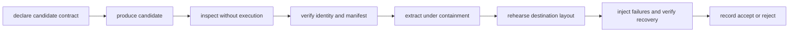
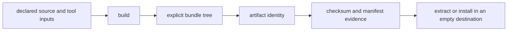
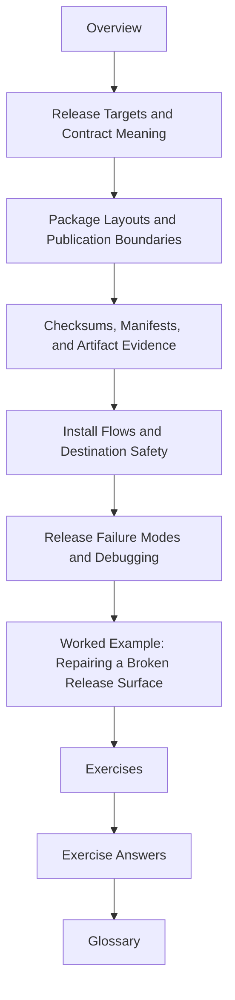

# Module 08: Release Engineering and Artifact Contracts
Building something locally is not the same as delivering it. Module 08 is about the point
where a build becomes a release contract:

- which files belong in a publishable artifact
- which targets are allowed to create that artifact
- which evidence travels with it
- and which publication steps other humans and systems are allowed to trust

This module turns "the build finished" into:

> A consumer can identify, inspect, verify, extract, and rehearse installation of this
> exact release candidate without access to the producer's shell history.

That is a stronger claim than "an archive exists."

## Why this day matters

Release work is where a build crosses an ownership boundary. A vague local artifact may
still help its producer, but it is not yet a trustworthy contract for another human,
machine, packaging system, or later audit.

Release mistakes are expensive because several truths can diverge:

- the build produced the right executable
- the archive contains the wrong files
- the checksum correctly identifies the wrong archive
- extraction writes outside the expected tree
- installation escapes its rehearsal root
- a retry combines residue from two candidates

Each statement can be true while another fails. Module 08 teaches separate proof for each
boundary.

## Three states that must not share one name

| State | Meaning | Who may trust it |
| --- | --- | --- |
| build output | a producer-owned file used as release input | build graph and local validation |
| release candidate | an immutable artifact plus declared sidecar evidence awaiting acceptance | reviewers and release automation |
| published release | an accepted candidate made available through a controlled publication system | consumers under the publication policy |

`dist` should normally create a release candidate. It should not silently turn that
candidate into a published release. Remote upload, approval, signing services, and
credentialed publication often belong to another owner.

## Plan for the day

| Time | Activity | Evidence you keep |
| --- | --- | --- |
| 40 minutes | Define candidate and publication target contracts | contract table |
| 60 minutes | Inspect the capstone archive as a consumer | accepted/rejected layout review |
| 75 minutes | Build twice from equivalent inputs | identity comparison and tool contract |
| 60 minutes | Verify checksum and manifest agreement | candidate evidence record |
| 60 minutes | Rehearse extraction and installation under repository-owned roots | containment proof |
| 75 minutes | Inject package and verification failures | recovery evidence |
| 90 minutes | Complete the ten exercises | release acceptance packet |

Do not publish anything during this module. Every command writes generated evidence under
the repository's `artifacts/` directory or the capstone's governed output paths. No
exercise needs elevated privileges or a host installation path.

## What this module is for

By the end of Module 08, you should be able to explain five things clearly:

- what a release-oriented target such as `dist` or `install` actually promises
- how to define a package layout as a contract instead of a shell ritual
- how to keep checksums, manifests, and attestations useful without polluting artifact identity
- how to make install and publication steps safe and repeatable
- how to diagnose whether a broken release came from build truth, package truth, or publish truth

## Build one release acceptance packet

Keep one packet through the module:

```text
artifacts/module08-release/
├── contract.md
├── producer/
├── candidate/
│   ├── dist.tar.gz
│   ├── dist.tar.gz.sha256
│   └── contents.txt
├── consumer/
│   ├── extracted/
│   ├── extraction-manifest.txt
│   └── acceptance.md
├── install-root/
├── install-manifest.txt
├── failures/
└── rehearsal.md
```

The packet separates producer evidence from what the consumer can independently inspect.
Build it in this order:



The final result is not automatically "accepted." Rejection with precise evidence is a
successful release rehearsal.

## Review the release as its consumer

The producer knows which command ran. The consumer receives files. Review from that side:



For a candidate release, answer:

1. Can I list its contents without executing it?
2. Does every member stay inside one declared package root?
3. Are file types, paths, modes, and links acceptable?
4. Can I verify exact bytes before extraction?
5. Does the manifest describe the candidate I actually received?
6. Can I extract and install under empty repository-owned roots?
7. Can I repeat construction and explain any byte difference?
8. Does failure leave the last accepted candidate intact?

A green `make dist` answers none of these by itself. The module is successful when the
artifact is understandable without access to the producer’s terminal history.

## Use an acceptance gate

Record each candidate against this gate:

| Gate | Evidence | Result |
| --- | --- | --- |
| target contract | declared outputs and excluded side effects | |
| archive layout | sorted member listing and file-type review | |
| exact identity | checksum generated and independently verified | |
| repeatability | two equivalent candidate hashes | |
| extraction safety | all members remain under the consumer root | |
| install containment | repeated destination manifests under one root | |
| failure recovery | rejected candidate does not replace accepted bytes | |

Checksums answer only the exact-identity row. A release candidate needs the whole gate.

## The question to keep asking

Whenever you add a release step, ask:

> What exact promise does this step make to the consumer?

If the promise is unclear, the release surface is unclear too.

## Study route



Read the module in that order the first time. Later, return directly to the page that
matches the release or publication problem you are facing.

## The ten files in this module

1. Overview (`index.md`)
2. [Release Targets and Contract Meaning](release-targets-and-contract-meaning.md)
3. [Package Layouts and Publication Boundaries](package-layouts-and-publication-boundaries.md)
4. [Checksums, Manifests, and Artifact Evidence](checksums-manifests-and-artifact-evidence.md)
5. [Install Flows and Destination Safety](install-flows-and-destination-safety.md)
6. [Release Failure Modes and Debugging](release-failure-modes-and-debugging.md)
7. [Worked Example: Repairing a Broken Release Surface](worked-example-repairing-a-broken-release-surface.md)
8. [Exercises](exercises.md)
9. [Exercise Answers](exercise-answers.md)
10. [Glossary](glossary.md)

## How to use the file set

| If you need to... | Start here |
| --- | --- |
| define what `dist`, `install`, or another release target actually means | [Release Targets and Contract Meaning](release-targets-and-contract-meaning.md) |
| decide what belongs inside a published bundle | [Package Layouts and Publication Boundaries](package-layouts-and-publication-boundaries.md) |
| separate artifact identity from supporting evidence | [Checksums, Manifests, and Artifact Evidence](checksums-manifests-and-artifact-evidence.md) |
| make installation steps safe, idempotent, and inspectable | [Install Flows and Destination Safety](install-flows-and-destination-safety.md) |
| debug a broken release without guessing which truth boundary failed | [Release Failure Modes and Debugging](release-failure-modes-and-debugging.md) |
| see the whole module in one realistic release incident | [Worked Example: Repairing a Broken Release Surface](worked-example-repairing-a-broken-release-surface.md) |
| test your own understanding | [Exercises](exercises.md) |
| compare your reasoning against a reference | [Exercise Answers](exercise-answers.md) |
| stabilize the module vocabulary | [Glossary](glossary.md) |

## The running question

Carry this question through every page:

> what exact promise does this release step make, and which files or side effects are part
> of that promise?

Good Module 08 answers usually mention one or more of these:

- a release target with a stable meaning
- a package boundary that includes the right files and excludes the wrong ones
- evidence that travels with the release without redefining it
- an install step that treats the destination as a contract
- a failure classified by the truth boundary it violated

## What a strong Module 08 day looks like

By the end of the day, you should have:

- defined one release target in plain language
- staged one bundle tree you can explain file by file
- verified one artifact without re-running the build
- installed once into an empty root and repeated the installation safely
- classified one release defect by the boundary it violated

## Commands to keep close

These commands form the evidence loop for Module 08:

```sh
gmake -C programs/reproducible-research/deep-dive-make/capstone dist
tar -tzf artifacts/release/reproducible-research/deep-dive-make/candidate/deep-dive-make-capstone.tar.gz
gmake -C programs/reproducible-research/deep-dive-make/capstone -q dist
gmake -C programs/reproducible-research/deep-dive-make/capstone --trace -n dist
```

The point is not to produce artifacts once. The point is to make publication behavior
legible and repeatable.

## Learning outcomes

By the end of this module, you should be able to:

- publish release-oriented targets with explicit, stable contract meaning
- model release bundle layout as a declared graph and publication boundary
- generate checksums and manifests that help verification without destabilizing identity
- make install behavior safe to rerun and easy to inspect
- diagnose release defects by separating build truth, package truth, and publish truth

## Exit standard

Do not move on until all of these are true:

- you can say what `dist` promises in one sentence
- you can justify why each file belongs inside or outside a release bundle
- you can explain which evidence is part of artifact identity and which is only adjacent proof
- you can reject unsafe archive paths before extraction
- you can run an install rehearsal twice under a repository-owned root without unexpected drift
- you can classify one broken release by the exact truth boundary that failed
- you can prove a failed candidate did not replace the last accepted bytes
- you can complete all ten exercises and hand another learner a reviewable acceptance packet

When those feel ordinary, Module 08 has done its job.
