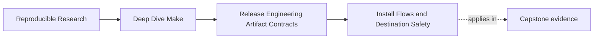
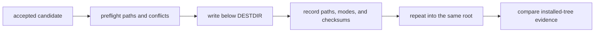

# Install Flows and Destination Safety


<!-- page-maps:start -->
## Page Maps




<!-- page-maps:end -->

Many repositories treat `install` as a small appendix to the build: copy a binary, create a
directory, and hope a second run is harmless. That description hides the important part.
Installation mutates a destination owned by someone other than the build.

An install target therefore needs a stricter contract than "the files were copied." A
reviewer must be able to answer:

- which accepted payload was installed
- how logical install paths were mapped into the rehearsal root
- which existing paths could be replaced
- whether every write stayed inside the declared root
- whether a second run converged on the same installed tree
- what remained after an interrupted or rejected install

This page builds an install rehearsal that answers those questions without writing to the
host system.

## The sentence to keep

When you define `install`, ask:

> Given this accepted candidate, what exact tree may the install route create or replace,
> and what evidence proves that every write stayed there?

The candidate identity matters. Installing ambient build residue while verifying an
archive tests two different payloads.

## Separate the logical prefix from the staging root

`PREFIX` and `DESTDIR` answer different questions:

| Variable | Contract question | Typical value |
| --- | --- | --- |
| `PREFIX` | where should the package live on the eventual system? | `/usr/local` |
| `DESTDIR` | below which rehearsal or packaging root must this invocation write? | `artifacts/module08-release/install-root` |

The composed path is:

```text
$(DESTDIR)$(PREFIX)/bin/app
```

With the values above, the rehearsal writes:

```text
artifacts/module08-release/install-root/usr/local/bin/app
```

`DESTDIR` is not a replacement for `PREFIX`. Setting `PREFIX` to an artifact directory
changes the package's logical destination and often produces the wrong archive layout.

## Declare the installed tree before writing it

For a small application, the contract might be:

```text
/usr/local/bin/app                         mode 0755
/usr/local/share/licenses/app/LICENSE      mode 0644
```

This list is install policy, not an observation generated from the result. After the
install, an independent listing can be compared with it.

The contract should also say whether:

- undeclared existing files are preserved
- declared files are replaced
- conflicting directories or symbolic links cause rejection
- ownership is preserved, normalized, or delegated to a package manager
- removal of files from a later version is handled by `install`, `uninstall`, or an
  external package manager

Without these decisions, two successful copy commands can still implement different
installation policies.

## Model concrete installed files

Let real file targets carry the destination mapping and let `install` be the alias:

```make
PREFIX ?= /usr/local
DESTDIR ?=
INSTALL ?= install
INSTALL_ROOT := $(DESTDIR)$(PREFIX)

INSTALLED_APP := $(INSTALL_ROOT)/bin/app
INSTALLED_LICENSE := $(INSTALL_ROOT)/share/licenses/app/LICENSE

.PHONY: install

install: $(INSTALLED_APP) $(INSTALLED_LICENSE)

$(INSTALLED_APP): accepted/app
	@$(INSTALL) -d "$(@D)"
	@$(INSTALL) -m 0755 "$<" "$@"

$(INSTALLED_LICENSE): accepted/LICENSE
	@$(INSTALL) -d "$(@D)"
	@$(INSTALL) -m 0644 "$<" "$@"
```

This shape exposes the files Make is responsible for and gives modes an explicit policy.
The `accepted/` directory represents payload bytes already admitted by the release gates.
In a real repository it could be a validated extraction root.

Quoting protects whitespace in path values, but quoting does not prove containment. That
requires validation before the recipes run.

## Reject unsafe destination composition

A rehearsal should reject:

- an empty `DESTDIR`
- a relative `DESTDIR`
- `..` components that escape the declared root
- a destination ancestor that is a symbolic link
- a `PREFIX` whose composition does not remain below `DESTDIR`

Shell string-prefix checks are not sufficient because `/safe/root-other` begins with
`/safe/root`. Resolve the parent paths that already exist, reject symbolic-link ancestors,
and compare path components rather than raw string prefixes.

For the module packet, invoke the route with an absolute repository-owned root:

```sh
repo_root=$(pwd -P)
install_root="$repo_root/artifacts/module08-release/install-root"
gmake -C path/to/project install \
  DESTDIR="$install_root" \
  PREFIX=/usr/local
```

Run this only from the repository root. Afterward, verify that no tracked file changed and
that all new paths are descendants of `install_root`.

## Preflight before the first mutation

Before creating directories, inspect:

- every source payload and its checksum
- every composed destination path
- every existing destination ancestor
- every declared overwrite
- required free space and permissions when those constraints matter

A preflight cannot make a multi-file copy atomic, but it can reject predictable failures
before the destination is half changed.

For complex system installation, a package manager may provide the ownership database,
transaction, removal, and rollback semantics that a Make recipe cannot safely reproduce.
Know where the Make contract ends.

## Prove containment from the resulting tree

Record an installed-tree manifest after the rehearsal:

```sh
install_root="$PWD/artifacts/module08-release/install-root"

find "$install_root" -type f -print \
  | sed "s#^$install_root##" \
  | LC_ALL=C sort \
  > artifacts/module08-release/evidence/installed-files.txt

find "$install_root" -type f -exec shasum -a 256 {} \; \
  | sed "s#  $install_root#  #" \
  | LC_ALL=C sort \
  > artifacts/module08-release/evidence/installed-checksums.txt
```

Also record modes. `find` formatting differs across platforms, so the course verification
route should choose and document either BSD `stat`, GNU `stat`, or a small Python reader.
Portable evidence requires a declared tool contract just as archive production does.

The absence of paths outside `install_root` is not established by listing only that root.
Pair the listing with repository status and, where practical, an isolated filesystem or
container. The repository rehearsal provides strong local evidence, not a proof about every
host path.

## Test convergence, not merely two zero exit codes

An idempotence test should compare tree evidence:

1. start from an empty rehearsal root
2. install the accepted candidate
3. record paths, modes, and checksums
4. install the same candidate into the same root again
5. record the same evidence
6. compare the two records

Two successful invocations are not enough. A recipe that appends a registration line can
succeed twice while corrupting the destination.

Decide whether modification times are part of the comparison. Content and mode stability
usually matter; timestamp preservation depends on package policy.

## Make overwrite policy observable

Exercise at least these cases:

| Destination state | Expected decision |
| --- | --- |
| declared file absent | create it with the declared mode |
| declared file has identical content | leave or replace according to policy, with same final evidence |
| declared file has conflicting content | replace or reject explicitly |
| destination path is a directory | reject before mutation |
| destination ancestor is a symbolic link | reject as a containment risk |
| unrelated file exists below the root | preserve unless package policy owns it |

Do not use `rm -rf "$(DESTDIR)"` inside a general install target. A caller may point
`DESTDIR` at a tree containing other packages.

## Understand the partial-failure boundary

The concrete-file targets above can still fail after installing one file and before
installing another. Make does not turn a sequence of filesystem mutations into a
transaction.

Choose an explicit recovery contract:

- a dedicated rehearsal root may be discarded and recreated
- a package-manager-owned transaction may roll back
- a direct host install may require repair from an installed-file manifest
- an interrupted upgrade may be rejected until the prior package state is restored

The release packet should retain the candidate identity, command, pre-install observation,
and resulting partial tree. Cleaning first destroys the evidence needed to explain what was
written.

## Keep package assembly and installation distinct

These targets have related inputs but different consumers:

| Target | Product | Primary consumer |
| --- | --- | --- |
| `dist` | portable candidate bytes | release verifier |
| `verify-dist` | acceptance evidence | release reviewer |
| `install` | destination-tree mutation | operator or package builder |
| `verify-install` | containment and convergence evidence | install reviewer |

An install rehearsal should consume the accepted archive extraction or exactly the same
declared payload. It should not quietly rebuild a new binary after the archive was
accepted.

## Review a destination contract

For one install route, write down:

1. accepted candidate identity
2. logical prefix
3. rehearsal root
4. complete installed-path and mode policy
5. overwrite and unrelated-file policy
6. symbolic-link and traversal rejection policy
7. first-run and rerun evidence
8. partial-failure recovery route

If any answer is missing, a successful install is not yet reviewable.

## What to practice from this page

Build an install rehearsal under:

```text
artifacts/module08-release/install-root/
```

Then produce:

- the declared installed-path manifest
- the observed first-run manifest
- the observed rerun manifest
- a checksum and mode comparison
- one rejected symbolic-link or path-conflict case
- a short recovery note for an interrupted install

Do not point the exercise at `/usr/local`, a home-directory bin path, or any other live host
destination.

## End-of-page checkpoint

Before leaving this lesson, make sure you can explain:

- why `PREFIX` and `DESTDIR` are not interchangeable
- why accepted candidate identity belongs in the install evidence
- why quoting paths is necessary but insufficient for containment
- how to compare first-run and rerun tree evidence
- why Make recipes do not provide transactional installation
- when a package manager should own rollback and removal semantics
