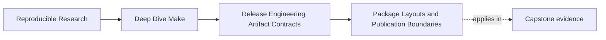
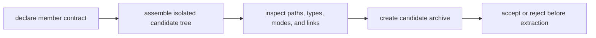

# Package Layouts and Publication Boundaries


<!-- page-maps:start -->
## Page Maps




<!-- page-maps:end -->

Once a release target has a clear name, the next question is obvious:

> what exactly belongs in the published artifact?

This is where teams often start improvising:

- copy the binary
- maybe add docs
- maybe add a license
- maybe add generated metadata
- maybe leave diagnostics in because they seem useful

That approach works until someone asks which of those files are actually part of the
artifact contract.

This page is about answering that question deliberately.

## The sentence to keep

When you design a bundle, ask:

> which files define the published artifact, and where is the moment that this assembled
> tree becomes trustworthy to another system?

That is the core of release modeling.

## Package layout is part of the contract

A release bundle is not just "whatever was convenient to archive." It is a public shape.

If another system, user, or environment is expected to consume:

- `app-1.0/bin/app`
- `app-1.0/LICENSE`
- `app-1.0/share/doc/README.md`
- `app-1.0/manifest.txt`

then that layout is part of the artifact contract.

This means the layout should be:

- intentional
- stable
- explainable

Not merely the side effect of a shell script that copies files in some order.

One top-level package root gives the consumer a containment boundary. Extracting the
archive creates `app-1.0/` rather than scattering `bin/`, `LICENSE`, and `share/` directly
into the chosen directory.

## Ask what belongs inside the bundle

The strongest package decisions start with a simple separation:

| Category | Typical examples | Should it be inside the published bundle? |
| --- | --- | --- |
| core artifact content | binaries, libraries, required configs, license | usually yes |
| consumer-facing metadata | checksums, manifest of bundle contents | often yes, depending on policy |
| operator diagnostics | host details, timing logs, local paths | usually no |
| build-only intermediates | object files, temp manifests, scratch outputs | no |

The point is not to memorize a table. The point is to stop treating every nearby file as
equally bundle-worthy.

## Write a member contract, not just a tree sketch

A path list is necessary but incomplete:

| Member | Type | Mode policy | Link policy | Consumer purpose |
| --- | --- | --- | --- | --- |
| `app-1.0/bin/app` | regular file | executable | no links | command-line program |
| `app-1.0/LICENSE` | regular file | read-only data | no links | licensing terms |
| `app-1.0/share/doc/README.md` | regular file | read-only data | no links | consumer instructions |
| `app-1.0/manifest.txt` | regular file | read-only data | no links | declared package members |

Archive formats can carry directories, regular files, symbolic links, hard links, device
nodes, ownership, and modes. A consumer contract should say which types are allowed.

## Bundles need an isolated assembly boundary

One healthy pattern is assembling the package under a dedicated candidate tree before
publishing the archive.

For example:

```make
PACKAGE_ROOT := app-1.0
CANDIDATE_TREE := artifacts/module08-release/producer/$(PACKAGE_ROOT)

artifacts/module08-release/candidate/app-1.0.tar.gz: \
		app LICENSE README.md packaging/manifest.txt
	@rm -rf "$(CANDIDATE_TREE)"
	@install -d "$(CANDIDATE_TREE)/bin" "$(CANDIDATE_TREE)/share/doc"
	@install -m 0755 app "$(CANDIDATE_TREE)/bin/app"
	@install -m 0644 LICENSE "$(CANDIDATE_TREE)/LICENSE"
	@install -m 0644 README.md "$(CANDIDATE_TREE)/share/doc/README.md"
	@install -m 0644 packaging/manifest.txt "$(CANDIDATE_TREE)/manifest.txt"
	@tar -czf "$@.candidate" \
	  -C artifacts/module08-release/producer "$(PACKAGE_ROOT)"
	@mv "$@.candidate" "$@"
```

This is healthier than archiving files from several unrelated locations directly because:

- the bundle shape becomes visible in one place
- the tree can be inspected before publication
- the archive is produced from one staged boundary
- sidecar evidence and old candidates are outside the archive root

The fixed candidate filename is still unsafe under concurrent invocations. Production code
needs unique assembly ownership or serialization at the publication target, plus cleanup
that removes incomplete candidates without deleting the last accepted archive. The lesson
is the boundary, not blind copying of the recipe.

## Publication boundary matters here too

Earlier modules taught publication discipline for generated artifacts. The same logic
applies to release bundles.

The question is:

when may another system trust the release artifact?

Usually the answer is not:

- while files are still being copied
- while the staging tree is still incomplete
- while the manifest is still being rewritten

Usually the answer is:

- after the staging tree is complete
- after the candidate archive is assembled at a non-public path
- after member inspection and verification pass
- after one rename or equivalent operation publishes accepted bytes

That is the publication boundary.

## Inspect before extracting

Do not make extraction the first way you discover archive contents:

```sh
tar -tvzf artifacts/module08-release/candidate/app-1.0.tar.gz \
  > artifacts/module08-release/candidate/contents.txt
```

Review at least:

- every member starts with the declared top-level root
- no member is absolute
- no member contains a `..` path component
- only allowed file types appear
- executable mode is limited to intended programs
- symbolic or hard links are absent unless policy explicitly allows and validates them

A sorted name listing is useful for membership comparison, but verbose listing is needed
to review types and modes.

## Path traversal is a package-contract failure

An archive member such as:

```text
app-1.0/../../outside.txt
```

can escape the intended extraction root in an unsafe extractor. Absolute paths and links
can create similar boundary violations.

The release process should reject unsafe members before extraction. "Our usual `tar`
seemed fine" is not an acceptance policy. The consumer must know which validator or
extractor semantics it trusts.

## A package layout should be easy to explain

A strong bundle explanation sounds like this:

> The release archive contains the binary under `bin/`, the license at the root, one README
> under `share/doc/`, and a bundle manifest, all below `app-1.0/`. Only directories and
> regular files are allowed. Build logs and host attestations are produced beside the
> bundle, not inside it.

That is a good explanation because a consumer can act on it.

A weak explanation sounds like:

> `dist` copies what we usually need.

That is not a contract.

## Derived metadata still needs a policy

Package layout questions are not only about "real files versus fake files." Derived
metadata often matters:

- checksums
- bundle manifests
- version files
- compatibility notes

The architectural question is:

- is this metadata part of the published bundle
- or is it adjacent release evidence

That distinction becomes more explicit in the next core, but you should already start
asking it here whenever you place metadata into a staged release tree.

## A small package-tree example

Suppose the release contract is:

```text
app-1.0/
├── bin/
│   └── app
├── LICENSE
├── manifest.txt
└── share/
    └── doc/
        └── README.md
```

The package policy should own that list. Do not generate the expected manifest by listing
whatever happened to enter the candidate tree; that would make residue look legitimate.

```make
PACKAGE_MEMBERS := \
	app-1.0/LICENSE \
	app-1.0/bin/app \
	app-1.0/manifest.txt \
	app-1.0/share/doc/README.md

packaging/manifest.txt:
	@printf '%s\n' $(PACKAGE_MEMBERS) > "$@.candidate"
	@mv "$@.candidate" "$@"
```

The important part is that the layout is no longer implicit.

## Compare declared, assembled, and archived views

Keep three views:

| View | Evidence | Detects |
| --- | --- | --- |
| declared | package policy manifest | missing or unjustified contract members |
| assembled | sorted candidate-tree listing | stale or omitted assembly files |
| archived | archive member/type listing | producer path, type, mode, or link errors |

All three should agree under the normalization policy. Comparing only the assembled tree
with the archive can miss the fact that both contain the same unjustified residue.

## What should stay outside the bundle

Teams often overstuff bundles with files that are only useful during local debugging:

- host information
- local tool versions
- benchmark logs
- full build traces

Those files may be valuable. That does not automatically make them part of artifact
identity or bundle content.

A healthier pattern is often:

- keep the bundle clean and stable
- publish diagnostics beside it when needed

This keeps release shape understandable.

## Failure signatures worth recognizing

### "The bundle contains files nobody can justify"

That usually means package layout is being assembled by convenience instead of contract.

### "We changed one script and now the archive layout drifted"

That often means the release tree was never modeled explicitly enough.

### "Consumers use files from inside the bundle that are not documented anywhere"

That means the bundle contract is under-specified.

### "We cannot tell whether the staged tree or the final archive is the trusted boundary"

That means publication is not modeled clearly enough.

## A review question that improves package design

Take one release bundle and ask:

1. which member paths, types, modes, and links are allowed
2. why each member belongs there
3. which files are kept outside and why
4. whether every path remains under one top-level root
5. how the declared, assembled, and archived views are compared
6. what exact event publishes accepted bytes
7. how failed or concurrent production protects the last accepted candidate

If those answers are weak, the release boundary is weak too.

## What to practice from this page

Choose one release archive in a repository and write down:

1. the intended directory tree and allowed member types
2. the required modes and link policy
3. one file currently inside the bundle that should move outside
4. the declared, assembled, and archived listings
5. one unsafe member path that acceptance must reject
6. the publication event after which the archive becomes trustworthy

If you can do that cleanly, you are treating bundle layout as a contract instead of a copy
script.

## End-of-page checkpoint

Before leaving this lesson, make sure you can explain:

- why package layout is part of artifact contract design
- why one top-level package root improves extraction containment
- why member types, modes, and links belong in the contract
- why isolated assembly trees improve release clarity
- why archives must be inspected before extraction
- how to distinguish bundle content from adjacent diagnostics
- why publication boundary matters for archives too
- how three-view comparison detects unjustified files
