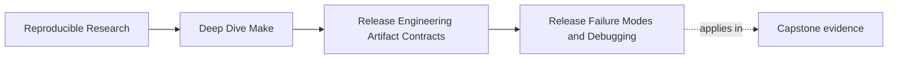
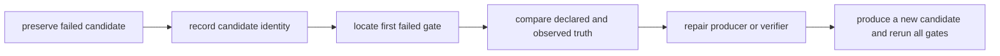

# Release Failure Modes and Debugging


<!-- page-maps:start -->
## Page Maps




<!-- page-maps:end -->

When a release fails, "rerun it" is a dangerous first response. A new build can replace the
candidate, repair a race by accident, or erase the partial destination tree. The next run
may pass while the original defect remains unexplained.

Release debugging starts by preserving one failed candidate and locating the first trust
boundary that rejected it.

## The sentence to keep

> Keep the failed bytes, identify the first failed gate, and explain the mismatch before
> producing another candidate.

A later failure may be a consequence of an earlier one. If an archive contains the wrong
binary, an install rehearsal can faithfully install the wrong binary. Repair the first
lying boundary.

## Six boundaries can fail

| Boundary | Declared truth | Observed evidence |
| --- | --- | --- |
| build | named source inputs produce the intended payload | tests, dependency trace, payload checksums |
| assembly | candidate contains exactly the package policy | declared manifest, observed archive listing |
| identity | sidecars name the exact accepted bytes | archive digest, sidecar verification |
| extraction | candidate can be inspected and unpacked safely | member type/path audit, contained extraction |
| installation | accepted payload maps to the declared destination tree | installed paths, modes, checksums, rerun comparison |
| publication handoff | only an accepted candidate is eligible for remote action | acceptance record bound to candidate digest |

These boundaries are narrower than "the release failed." They tell you which producer,
policy, or verifier to inspect first.

## Preserve a failure packet

Before cleaning or rebuilding, retain evidence under:

```text
artifacts/module08-release/failures/<candidate-digest>/
```

Use the full digest when practical. The directory should contain:

- the exact candidate and received sidecars
- the computed digest
- the failed command and exit status
- standard output and standard error
- declared package and install policies
- observed archive or destination-tree listings
- tool versions needed to interpret the evidence
- a short statement naming the first failed gate

Do not call the directory `latest` or reuse it for another candidate. A failure report that
can silently change identity is not reviewable.

Secrets, signing keys, credentials, and private environment data do not belong in the
packet. Preserve relevant evidence, not the entire process environment.

## Capture commands without rebuilding

The exact commands depend on the release contract. A local packet might begin with:

```sh
packet="$PWD/artifacts/module08-release"
candidate="$packet/candidate/app.tar.gz"

shasum -a 256 "$candidate"
tar -tvzf "$candidate" > "$packet/evidence/archive-listing.txt"
git status --short > "$packet/evidence/repository-status.txt"
gmake --version | sed -n '1p' > "$packet/evidence/make-version.txt"
tar --version 2>&1 | sed -n '1p' > "$packet/evidence/tar-version.txt"
```

These commands inspect existing state. Do not put `gmake dist` in a consumer verification
target: it could replace the candidate before the mismatch is recorded.

## Diagnose assembly mismatch

**Symptom:** the archive exists, but a required member is absent or an unexpected member
appears.

Compare three views:

1. declared package-policy manifest
2. assembled candidate tree before archiving, if preserved
3. observed archive listing

Interpret the first divergence:

| Comparison | Likely defect |
| --- | --- |
| policy differs from assembled tree | selection or assembly rule |
| assembled tree differs from archive | archive producer or wrong input root |
| policy and archive agree, consumer expectation differs | contract communication or version-selection error |

Do not generate the expected manifest from the failed archive. That makes both sides of the
comparison repeat the same observation.

## Diagnose checksum mismatch

**Symptom:** sidecar verification rejects the received archive.

First compute the digest of the preserved candidate. Then ask:

- does the sidecar name the same path and algorithm?
- were candidate and sidecar transferred as one immutable packet?
- was the sidecar computed before the final archive move?
- can both candidate and sidecar be replaced by the same untrusted actor?

A mismatch establishes that the candidate bytes differ from those named by the sidecar. It
does not tell you which file is correct. Preserve both, retrieve an independently trusted
identity, and reject remote handoff until the discrepancy is resolved.

Never repair this incident by computing a new sidecar from unexplained candidate bytes.

## Diagnose reproducibility drift

**Symptom:** two candidates built from equivalent declared inputs have different digests.

Work from the outside inward:

1. compare uncompressed archive member listings
2. compare member paths and file types
3. compare payload checksums
4. compare modes, uid, gid, names, and modification times
5. compare member order
6. compare compression headers and producer versions

If payloads differ, investigate build or assembly truth. If only archive metadata differs,
investigate normalization and producer policy.

The correct response is not automatically to normalize more fields. A mode change may be a
real release change. Decide which metadata belongs to package identity before suppressing
it.

## Diagnose extraction rejection

**Symptom:** member inspection finds an absolute path, traversal component, unsafe link, or
unsupported member type.

Reject before extraction. Record the offending member and type. Do not "clean" member names
while extracting because that changes the package silently.

Trace the member back to:

- the package-policy manifest
- candidate assembly
- archive producer arguments
- source-tree symlink handling

If the unsafe member was declared by policy, the policy is wrong. If it was not declared,
the assembly or archive boundary admitted unintended input.

## Diagnose install escape or conflict

**Symptom:** the rehearsal attempts to write outside `DESTDIR`, follows a symbolic-link
ancestor, encounters an undeclared conflict, or produces different evidence on rerun.

Preserve:

- composed destination paths
- existing ancestor types
- first-run installed-tree evidence
- rerun evidence
- repository status
- the partial root after failure

Classify the defect:

| Observation | Likely defect |
| --- | --- |
| composed path leaves `DESTDIR` | path validation or prefix policy |
| write follows a symbolic-link ancestor | containment preflight |
| second run appends or duplicates state | non-convergent recipe |
| unrelated file is removed | ownership boundary |
| one file updated before later failure | non-transactional mutation and recovery contract |

Do not erase the partial root until the failure packet contains enough evidence to explain
which paths changed.

## Diagnose acceptance-record mismatch

**Symptom:** an acceptance record names a digest different from the candidate offered for
publication.

This is a publication-handoff rejection, even if both candidates passed their own tests.
Acceptance belongs to exact bytes, not to a mutable filename such as `app.tar.gz`.

Require the handoff to compare:

- candidate digest
- checksum sidecar identity
- acceptance-record digest
- optional provenance and signature bindings

Only one identity may cross the remote-action boundary.

## Use a gate-oriented debugging loop

1. freeze the failed candidate and all received sidecars
2. compute and record its identity
3. preserve the command, exit status, and observed state
4. locate the first failed gate
5. compare declared truth with observed evidence at that gate
6. repair the producer, policy, or verifier that allowed the mismatch
7. produce a new candidate with a new identity
8. run every gate, not only the gate that previously failed
9. retain the old failure packet for comparison

A repair can alter later behavior. Passing one formerly failing command is not enough to
accept the replacement candidate.

## Choose recovery by boundary

| First failed boundary | Safe immediate action | Evidence to retain |
| --- | --- | --- |
| build | reject candidate and repair payload production | test output, dependency trace, payload digest |
| assembly | reject candidate and repair selection/layout | policy, candidate tree, archive listing |
| identity | quarantine candidate and sidecar | both files, computed digest, trust source |
| extraction | reject without unpacking | verbose member listing, offending path/type |
| installation | stop writes and preserve partial root | path plan, before/after evidence, exit status |
| handoff | block remote action | candidate and acceptance identities |

The table distinguishes rejection from repair. A failed candidate is not repaired in place
and then published under the same identity.

## Avoid five destructive debugging habits

- `clean` before preserving the failed state
- regenerate the candidate to see whether the problem disappears
- update a checksum to match unexplained bytes
- extract an unsafe archive to learn what it contains
- publish manually because the automated handoff rejected it

Each habit removes or bypasses a trust boundary.

## Write an incident note another reader can audit

A useful note is short but exact:

```text
Candidate:
Observed digest:
First failed gate:
Declared truth:
Observed evidence:
Rejected action:
Likely producer, policy, or verifier defect:
Repair:
Replacement-candidate verification:
Preserved packet:
```

Avoid "the release was flaky." Name the candidate, gate, mismatch, and rejected action.

## What to practice from this page

Choose one controlled failure:

- add an unexpected archive member
- alter one byte after checksum creation
- produce an archive with a traversal path
- create a symbolic-link ancestor in the install root
- alter the candidate after its acceptance record is written

Then:

1. preserve the failed candidate without rebuilding
2. create a failure packet
3. identify the first failed gate
4. compare declared and observed truth
5. state which action was correctly blocked
6. repair the responsible boundary
7. prove a new candidate through every acceptance gate

## End-of-page checkpoint

Before leaving this lesson, make sure you can explain:

- why a failed candidate must be preserved before a rerun
- how the six release boundaries differ
- why expected and observed manifests need independent origins
- how to investigate reproducibility drift from payloads outward
- why a checksum mismatch cannot be repaired by rewriting the sidecar
- why acceptance and publication handoff must bind to exact candidate bytes
