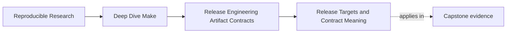

# Release Targets and Contract Meaning


<!-- page-maps:start -->
## Page Maps




<!-- page-maps:end -->

Release-oriented targets often start life as convenience commands:

- "bundle the outputs"
- "copy things to `dist/`"
- "do whatever we need before publishing"

That may work for one maintainer. It does not scale well to a team or to automation.

The problem is not that the targets exist. The problem is that they often mean too many
things at once:

- build if needed
- maybe run tests
- maybe package docs
- maybe checksum
- maybe deploy

At that point the target name stops being a contract and starts being a ritual.

This page is about replacing that ritual with targets that say what they mean.

## The sentence to keep

When you define a release-oriented target, ask:

> What may the caller trust after this target succeeds, and what responsibility remains
> outside the target?

That question keeps target meaning stable.

## Release targets are interfaces, not shortcuts

By Module 08, the build already has public targets such as:

- `all`
- `test`
- `selftest`
- `clean`

Release targets belong in the same category of interface design. If users or CI call:

- `dist`
- `install`
- `release-check`
- `package`

then those names are contracts. Changing their meaning carelessly is a breaking change.

That is why release engineering belongs in the course-book arc. It is not "extra shell
work after the build." It is another API boundary.

## Target meaning should be narrow enough to explain

A strong release target can be explained in one sentence.

Examples:

- `dist`: produce the publishable distribution bundle under `dist/`
- `verify-dist`: inspect and verify one already produced candidate
- `install`: lay out declared files under the requested destination root
- `release-check`: compose local validation required before publication
- `publish`: hand an accepted candidate to a separately owned remote boundary

That is much better than targets that quietly do five unrelated jobs.

For example, a target named `dist` should not unpredictably:

- rebuild half the tree in a special mode
- run network publication
- install onto the local machine
- clean unrelated outputs

If those jobs are needed, they should usually have their own clearly named targets or be
composed intentionally by a higher-level target.

## Write a target contract before its recipe

Use a table like this:

| Field | `dist` example |
| --- | --- |
| callers | maintainers and CI |
| success promise | one complete local release candidate exists |
| declared outputs | archive, checksum sidecar, contents listing |
| semantic inputs | built payloads, license, package policy, archive producer |
| excluded side effects | host install, remote upload, credential use, unrelated cleanup |
| retry behavior | same inputs reproduce the same candidate identity |
| failure behavior | last accepted candidate remains intact; incomplete candidate is rejected |
| acceptance evidence | listing, checksum verification, repeatability comparison |

This table is reviewable before anyone debates shell syntax. It also exposes hidden
questions: does `dist` include verification, or does `verify-dist` own it? Does success
mean "bytes were written" or "candidate passed local acceptance"?

## Boring release targets are a good sign

This is one of the few places in the course where "boring" is praise.

A healthy release target:

- has explicit inputs
- publishes to a declared location
- can be rerun without smearing old outputs into new outputs
- does not rely on the caller's current directory luck or shell history
- does not use credentials or mutate remote state unless its name and owner say so
- leaves the previous accepted candidate intact when production fails

The target should feel almost disappointingly clear. That is what makes it safe to trust.

## Model the artifact as a real target

Suppose the project ships:

- one binary
- a license
- one manifest

A healthy target might look like:

```make
DIST_ARCHIVE := artifacts/module08-release/candidate/app.tar.gz

.PHONY: dist
dist: $(DIST_ARCHIVE)

$(DIST_ARCHIVE): app LICENSE packaging/manifest.txt scripts/package.py
	@python3 scripts/package.py --output "$@.candidate" \
	  app LICENSE packaging/manifest.txt
	@mv "$@.candidate" "$@"
```

`dist` is a phony public alias. The archive is a real target with declared inputs. A
successful producer writes a distinct candidate path and renames it into place only after
completion.

The snippet is a contract sketch, not a complete failure-safe recipe: a production rule
also removes abandoned candidate files on failure and ensures concurrent invocations
cannot publish through the same candidate path.

The caller can now say:

> `make dist` means "make the declared local candidate current."

That is a contract.

## A release target should declare its inputs

Teams often speak about release targets as if they just "collect whatever the build made."
That is too vague.

A release contract should answer:

- which files must exist before packaging starts
- which metadata is part of the bundle
- which directory is the publication root

For example, the archive may depend on:

- `app`
- `LICENSE`
- `packaging/manifest.txt`
- the archive producer itself

The producer script and package policy are semantic inputs because changing either can
change archive bytes or layout. "Collect whatever the build made" hides both.

## Separate production from acceptance

Candidate production and candidate acceptance answer different questions:


A local target surface can make that split visible:

```make
.PHONY: dist verify-dist release-check

dist: $(DIST_ARCHIVE) $(DIST_ARCHIVE).sha256

verify-dist: dist
	@python3 scripts/verify_release.py \
	  --archive "$(DIST_ARCHIVE)" \
	  --checksum "$(DIST_ARCHIVE).sha256"

release-check: test selftest verify-dist
```

Whether `verify-dist` depends on `dist` is a repository policy choice. A consumer-only
verification route may instead require an existing candidate and never rebuild it. Name
the chosen behavior because rebuilding during verification can erase the evidence of a bad
candidate.

## Higher-level orchestration should stay visible

Sometimes a repository really does need a composed target:

- `release-check`
- `publish-prep`
- `hardened`

That is fine. The important architectural move is to keep the composition visible:

```make
.PHONY: release-check

release-check: test selftest verify-dist
```

This is healthy because:

- the target name has one clear purpose
- the sub-targets remain inspectable
- the contract is visible in the prerequisites

That is very different from a shell recipe that performs a long sequence of hidden actions.

## `install` is not just "copy files somewhere"

One reason Module 08 splits release topics carefully is that `install` often gets treated
as a casual side effect.

It is not casual.

`install` should answer:

- what tree is being installed
- where it is being laid out
- what overwrite or idempotence behavior is expected
- whether it installs from build outputs or from the accepted candidate
- what stale-file and removal policy applies

That means `install` deserves the same contract discipline as `dist`, not less.

We will go deeper on that in a later core, but it is important to name it here.

## A weak release target smells like this

Be suspicious when a release target:

- changes directories several times without declaring why
- mixes validation, packaging, install, and deploy in one recipe
- depends on the operator's shell state or random environment files
- leaves different outputs behind depending on what happened in previous runs
- verifies by rebuilding the candidate it was asked to inspect
- uploads or signs with credentials under a name that sounds local
- reports success while stale files from an older candidate remain in the release root

## Treat remote publication as a handoff

Make can own local file production well. Remote publication often includes:

- credentials
- retries and rate limits
- approvals
- mutable remote state
- rollback or revocation

Those responsibilities may belong in a release service or workflow system. If Make keeps
a convenience `publish` target, define the handoff object and owner:

| Handoff field | Example |
| --- | --- |
| candidate | exact archive path and checksum |
| precondition | local acceptance gate passed |
| sender responsibility | immutable bytes and evidence are complete |
| receiver responsibility | authenticate, upload, confirm remote identity |
| returned evidence | remote object identifier or receipt |

The target must not rebuild the candidate after approval. Publication should consume the
accepted identity, not silently create a new one.

Those are not only implementation issues. They are contract failures.

## A practical naming check

Before you add or keep a release target, ask:

1. can I explain this target in one sentence
2. does the name match that sentence
3. could another human call it without reading shell scripts first
4. if CI called it, would that be a stable decision
5. does it publish to one declared location or boundary
6. does failure preserve the previous accepted candidate
7. can verification inspect existing bytes without replacing them
8. does any remote side effect have an explicit handoff and owner

If the answers are weak, the target meaning is weak too.

## Why this page comes before package layout

Teams often jump directly into bundle contents. That is premature if the target names
themselves are unstable.

You need to know what `dist` or `install` promises before you can reason about what those
targets should package or publish.

That is why Module 08 starts here.

## Failure signatures worth recognizing

### "`dist` does different things depending on who runs it"

That often means the contract depends on ambient shell or directory state.

### "We cannot tell whether `release-check` includes packaging or only validation"

That means the target naming or dependency structure is too vague.

### "CI calls a release helper target directly"

That usually means the release API surface is not designed clearly enough.

### "Rerunning `make dist` leaves a different result because old outputs leaked through"

That means the target is not publishing through a stable boundary.

## A review question that improves release targets

Take one release-oriented target and ask:

1. who calls it
2. what exact artifact or side effect success promises
3. where the result appears and which inputs determine it
4. what it deliberately excludes
5. how retries and failures affect the previous accepted candidate
6. which evidence makes the result acceptable
7. whether local and remote responsibilities are separated

If those answers are weak, the target needs redesign before the bundle details even matter.

## What to practice from this page

Choose one repository and write down:

1. the release-oriented target names and callers
2. one sentence of contract meaning for each
3. declared outputs, semantic inputs, and excluded side effects
4. one target whose meaning is too broad or vague
5. failure and retry behavior
6. the local-to-remote handoff, if one exists

If you can do that cleanly, you are treating release targets as interfaces rather than
convenient shell entrypoints.

## End-of-page checkpoint

Before leaving this lesson, make sure you can explain:

- why release targets are contracts rather than rituals
- why narrow target meaning is easier to trust
- why declared inputs matter for release surfaces too
- why a phony alias should lead to real artifact targets
- why candidate production and acceptance should remain distinguishable
- how composed targets can stay clear without hiding their sub-steps
- why remote publication needs a handoff contract
- how to recognize a release target whose meaning has become too broad
