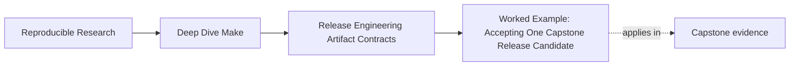

# Worked Example: Accepting One Capstone Release Candidate

This worked example uses the course capstone rather than a hypothetical `app` and
`LICENSE`. You will produce two candidates, inspect the archive before extraction, compare
the member contract, rehearse installation below a repository-owned root, inject two
failures, and write an acceptance record bound to exact bytes.

No command writes to a host install path or publishes remotely.

<!-- page-maps:start -->
## Page Maps

```mermaid
flowchart LR
  build["produce candidate twice"] --> identity["compare exact bytes"]
  identity --> members["compare declared and observed members"]
  members --> safety["reject unsafe archive paths and types"]
  safety --> extract["extract under consumer root"]
  extract --> install["rehearse install twice"]
  install --> reject["prove corrupt and unsafe candidates fail"]
  reject --> accept["bind acceptance to digest"]
```




<!-- page-maps:end -->

## What this example does and does not claim

The capstone `dist` producer is intentionally small. It creates deterministic archive bytes
with normalized ownership and timestamps. It does not implement signing, remote
publication, system installation, or a package-manager transaction.

The example treats its archive as an **internal transfer candidate** with this exact
payload:

```text
app
build/bin/dyn1
build/bin/dyn2
build/include/dynamic.h
```

That scope matters. A public end-user package would normally add a versioned top-level
directory, license, consumer documentation, and a supported install route. Passing this
acceptance packet does not turn the capstone archive into that broader product.

The existing `dist` target archives the whole `build/bin` directory, including dependency
files. This example repairs that package-selection defect by invoking the same deterministic
producer with only the four declared payloads. The resulting evidence shows why explicit
member policy is stronger than "archive whatever is nearby."

## Prepare one repository-owned packet

Run every command from the `bijux-masterclass` repository root. Use GNU Make 4.3 or newer;
on macOS that command is normally `gmake`.

```sh
CAPSTONE=programs/reproducible-research/deep-dive-make/capstone
PACKET=artifacts/module08-release

test ! -e "$PACKET" || {
  printf '%s\n' "Refusing to replace existing evidence: $PACKET" >&2
  exit 2
}
mkdir -p \
  "$PACKET/candidate" \
  "$PACKET/evidence" \
  "$PACKET/consumer" \
  "$PACKET/failures"
```

The packet separates candidate bytes, observations, consumer state, and deliberate
failures. It can be removed after the exercise without touching source files.

## Declare package policy independently

Create the expected regular-file list before inspecting a candidate:

```sh
printf '%s\n' \
  app \
  build/bin/dyn1 \
  build/bin/dyn2 \
  build/include/dynamic.h \
  > "$PACKET/evidence/package-members.txt"
```

This manifest comes from package policy. Do not replace it with output generated from the
archive and then compare that output with itself.

## Produce the first candidate

Build the payloads, then call the capstone's deterministic archive producer with explicit
inputs:

```sh
gmake -C "$CAPSTONE" clean all

(
  cd "$CAPSTONE"
  python3 scripts/mkdist.py \
    "$OLDPWD/$PACKET/candidate/capstone.tar.gz" \
    app \
    build/bin/dyn1 \
    build/bin/dyn2 \
    build/include/dynamic.h
)

cp \
  "$PACKET/candidate/capstone.tar.gz" \
  "$PACKET/evidence/capstone-first.tar.gz"
```

`mkdist.py` sorts members, fixes modification times, normalizes uid and gid, and sets the
gzip header time. It also gives gzip the output pathname, whose basename is recorded in the
header. Reproducibility must therefore use the same publication pathname on each run.
Changing only the output filename would change the candidate bytes.

Compute the exact candidate identity:

```sh
shasum -a 256 "$PACKET/candidate/capstone.tar.gz" \
  > "$PACKET/evidence/capstone.sha256"
cat "$PACKET/evidence/capstone.sha256"
```

If your environment uses `sha256sum`, use it consistently for generation and checking.
The algorithm and sidecar format are part of the local tool contract.

## Produce independently again

Recreate the payload tree and produce another candidate under a different name:

```sh
gmake -C "$CAPSTONE" clean all

(
  cd "$CAPSTONE"
  python3 scripts/mkdist.py \
    "$OLDPWD/$PACKET/candidate/capstone.tar.gz" \
    app \
    build/bin/dyn1 \
    build/bin/dyn2 \
    build/include/dynamic.h
)

cp \
  "$PACKET/candidate/capstone.tar.gz" \
  "$PACKET/evidence/capstone-second.tar.gz"
cmp \
  "$PACKET/evidence/capstone-first.tar.gz" \
  "$PACKET/evidence/capstone-second.tar.gz"
```

No output from `cmp` and exit status zero establish identical bytes for these two observed
builds. They do not prove every future tool version and platform will produce the same
bytes.

Keep `capstone.tar.gz` as the candidate under review. Later commands must inspect that
file without rebuilding it.

## Inspect members before extraction

Record the verbose archive view:

```sh
tar -tvzf "$PACKET/candidate/capstone.tar.gz" \
  > "$PACKET/evidence/archive-listing.txt"
cat "$PACKET/evidence/archive-listing.txt"
```

Now derive the observed regular-file paths and compare them with policy:

```sh
tar -tzf "$PACKET/candidate/capstone.tar.gz" \
  | sed '/\/$/d' \
  | LC_ALL=C sort \
  > "$PACKET/evidence/archive-members.txt"

cmp \
  "$PACKET/evidence/package-members.txt" \
  "$PACKET/evidence/archive-members.txt"
```

The terse listing is sufficient only because the producer received regular files and the
next gate audits member types. A general package verifier must not infer types from trailing
slashes alone.

## Audit extraction safety

Use Python's archive reader to reject absolute paths, traversal components, links, and
special file types before extraction:

```sh
python3 - "$PACKET/candidate/capstone.tar.gz" <<'PY'
from pathlib import PurePosixPath
import sys
import tarfile

archive = sys.argv[1]
with tarfile.open(archive, "r:gz") as bundle:
    for member in bundle.getmembers():
        path = PurePosixPath(member.name)
        if path.is_absolute() or ".." in path.parts:
            raise SystemExit(f"unsafe path: {member.name}")
        if member.issym() or member.islnk():
            raise SystemExit(f"links are not allowed: {member.name}")
        if not (member.isfile() or member.isdir()):
            raise SystemExit(f"unsupported member type: {member.name}")
print("PASS: archive member paths and types satisfy policy")
PY
```

This gate inspects, but does not rewrite, the candidate. An unsafe name causes rejection.

## Extract under a contained consumer root

Only after the safety and member-contract gates pass. The new packet guarantees this
destination does not contain an older extraction:

```sh
mkdir -p "$PACKET/consumer/extracted"
tar -xzf "$PACKET/candidate/capstone.tar.gz" \
  -C "$PACKET/consumer/extracted"

find "$PACKET/consumer/extracted" -type f -print \
  | sed "s#^$PACKET/consumer/extracted/##" \
  | LC_ALL=C sort \
  > "$PACKET/evidence/extracted-members.txt"

cmp \
  "$PACKET/evidence/package-members.txt" \
  "$PACKET/evidence/extracted-members.txt"
```

The second comparison proves the extracted regular-file view still matches policy. It does
not replace the pre-extraction safety audit.

## Rehearse a bounded install twice

The capstone does not claim a public `install` target. For this consumer rehearsal, define a
narrow mapping for the accepted `app` payload:

```text
app -> /usr/local/bin/make-capstone
```

Apply it below a repository-owned `DESTDIR` equivalent:

```sh
INSTALL_ROOT="$PACKET/consumer/install-root"
SOURCE_APP="$PACKET/consumer/extracted/app"
INSTALLED_APP="$INSTALL_ROOT/usr/local/bin/make-capstone"

install -d "$(dirname "$INSTALLED_APP")"
install -m 0755 "$SOURCE_APP" "$INSTALLED_APP"

find "$INSTALL_ROOT" -type f -print \
  | sed "s#^$INSTALL_ROOT/##" \
  | LC_ALL=C sort \
  > "$PACKET/evidence/install-first-paths.txt"
shasum -a 256 "$INSTALLED_APP" \
  > "$PACKET/evidence/install-first.sha256"

install -d "$(dirname "$INSTALLED_APP")"
install -m 0755 "$SOURCE_APP" "$INSTALLED_APP"

find "$INSTALL_ROOT" -type f -print \
  | sed "s#^$INSTALL_ROOT/##" \
  | LC_ALL=C sort \
  > "$PACKET/evidence/install-rerun-paths.txt"
shasum -a 256 "$INSTALLED_APP" \
  > "$PACKET/evidence/install-rerun.sha256"

cmp \
  "$PACKET/evidence/install-first-paths.txt" \
  "$PACKET/evidence/install-rerun-paths.txt"
cmp \
  "$PACKET/evidence/install-first.sha256" \
  "$PACKET/evidence/install-rerun.sha256"
```

The rehearsal proves convergence for this one-file mapping. It does not claim rollback,
upgrade, removal, or package-manager ownership semantics.

## Prove identity corruption is rejected

Create a corrupted copy, leaving the reviewed candidate untouched:

```sh
cp \
  "$PACKET/candidate/capstone.tar.gz" \
  "$PACKET/failures/corrupt-capstone.tar.gz"
printf 'corruption' >> "$PACKET/failures/corrupt-capstone.tar.gz"
```

Compare its digest with the accepted candidate's recorded digest:

```sh
accepted_digest=$(
  awk '{print $1}' "$PACKET/evidence/capstone.sha256"
)
corrupt_digest=$(
  shasum -a 256 "$PACKET/failures/corrupt-capstone.tar.gz" \
  | awk '{print $1}'
)

test "$accepted_digest" != "$corrupt_digest"
```

Success means the test observed different identities. The corrupt copy must not receive an
acceptance record merely because its archive parser still tolerates trailing bytes.

## Prove unsafe paths are rejected

Create a deliberately unsafe archive in the failures area:

```sh
python3 - "$PACKET/failures/unsafe-capstone.tar.gz" <<'PY'
from io import BytesIO
import sys
import tarfile

with tarfile.open(sys.argv[1], "w:gz") as bundle:
    payload = b"must not escape\n"
    member = tarfile.TarInfo("../escape.txt")
    member.size = len(payload)
    bundle.addfile(member, BytesIO(payload))
PY
```

Run the same safety logic and expect a nonzero status:

```sh
if python3 - "$PACKET/failures/unsafe-capstone.tar.gz" <<'PY'
from pathlib import PurePosixPath
import sys
import tarfile

with tarfile.open(sys.argv[1], "r:gz") as bundle:
    for member in bundle.getmembers():
        path = PurePosixPath(member.name)
        if path.is_absolute() or ".." in path.parts:
            raise SystemExit(f"unsafe path: {member.name}")
        if member.issym() or member.islnk():
            raise SystemExit(f"links are not allowed: {member.name}")
        if not (member.isfile() or member.isdir()):
            raise SystemExit(f"unsupported member type: {member.name}")
PY
then
  printf '%s\n' "FAIL: unsafe archive was accepted" >&2
  exit 1
else
  printf '%s\n' "PASS: unsafe archive was rejected"
fi
```

Do not extract the unsafe archive. Member inspection is enough to reject it.

## Bind acceptance to exact bytes

After all successful gates, write a small local record:

```sh
candidate_digest=$(
  awk '{print $1}' "$PACKET/evidence/capstone.sha256"
)

cat > "$PACKET/evidence/acceptance.txt" <<EOF
candidate=capstone.tar.gz
sha256=$candidate_digest
member_contract=PASS
repeat_build=PASS
extraction_safety=PASS
contained_extraction=PASS
install_rerun=PASS
corruption_rejection=PASS
unsafe_path_rejection=PASS
publication=NOT_ATTEMPTED
EOF

cat "$PACKET/evidence/acceptance.txt"
```

The record is local evidence, not a signature. Its value is that each claim names a gate
and the record binds those claims to one digest.

## Read the result as a reviewer

The candidate is accepted for the narrow internal-transfer contract because:

- two clean productions yielded identical bytes
- the archive's regular-file members matched independent package policy
- paths and member types passed inspection before extraction
- extraction remained below the consumer root
- the install rehearsal converged on the same paths and content
- controlled corrupt and unsafe candidates were rejected
- the acceptance record names the reviewed digest

The candidate is **not** accepted as a public end-user release because that contract was
never tested. It still lacks a versioned package root, license, consumer documentation,
supported installation interface, signature policy, and remote publication controls.

That distinction is release engineering: evidence supports a bounded claim, not a vague
feeling that the archive "looks good."

## End-of-example checkpoint

Before continuing, make sure you can explain:

- why this example bypasses the capstone's broad `build/bin` selection
- why the expected member list is written before archive inspection
- why deterministic producer code still needs two observed builds
- why member inspection must happen before extraction
- what the one-file install rehearsal proves and what it does not
- why the acceptance record belongs to a digest rather than a mutable filename
