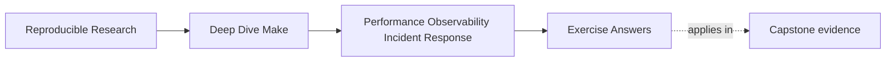

# Exercise Answers


<!-- page-maps:start -->
## Page Maps




<!-- page-maps:end -->

Use this after you have written your own answers. The point is comparison, not copying.

Strong Module 09 answers do not just list commands. They explain:

- what operational question is being asked
- why the chosen evidence surface matches that question
- how the resulting change or response preserves truth

## Exercise 1: Split one "slow build" complaint into layers

A strong answer compares at least:

- a dry-run timing signal such as `/usr/bin/time -p make -n all`
- a full-build timing signal such as `/usr/bin/time -p make all`
- a trace or evidence-size signal such as `make --trace all > build/trace.log && wc -l build/trace.log`

The key reasoning is:

- expensive dry-run suggests parse or evaluation cost
- cheap dry-run plus expensive full build suggests recipe cost
- huge trace output suggests observability overhead as an operational problem

The answer is strongest when it says how the next decision would differ depending on which
layer dominates.

## Exercise 2: Add one bounded observability surface

A strong answer names one explicit question, such as:

> how many lines of trace output does a normal route emit?

and then proposes a bounded route such as:

```make
.PHONY: trace-count

trace-count:
	@make --trace -n all 2>&1 | wc -l
```

The important move is architectural:

- the evidence surface is named
- it answers one question
- it does not mutate normal outputs

A good answer usually removes some ad hoc recipe prints in exchange.

## Exercise 3: Write a triage ladder for one flaky symptom

A strong answer usually includes:

1. confirm the exact symptom
2. reproduce the same target and assumptions
3. preview with `-n` if intent is the question
4. use `--trace` if causality is the question
5. use `-p` if resolved state is the question

The strongest answers explicitly say why editing the Makefile is not the first move:

> editing too early changes the conditions before the failure boundary is understood.

That is the real lesson.

## Exercise 4: Propose one truth-preserving optimization

A good answer might identify repeated parse-time discovery shell-outs and replace them with
built-in discovery over declared roots.

For example:

```make
APP_SRCS := $(sort $(wildcard src/app/*.c))
LIB_SRCS := $(sort $(wildcard src/lib/*.c))
SRCS := $(APP_SRCS) $(LIB_SRCS)
```

This is strong because the optimization removes repeated work while preserving:

- explicit discovery roots
- observation of additions on the next Make invocation
- inspectable resolved lists

The post-change proof should usually include both a timing comparison and a truth check such
as `make -q all` or a discovery audit.

## Exercise 5: Write a small operational runbook entry

A strong runbook entry includes:

- one sanity or convergence check
- one command for resolved-state or serial/parallel comparison
- one escalation trigger
- one warning against destructive first moves

For example:

> Run `make all` and `make -q all`. If flakiness is reported, compare serial and `-j`
> behavior before editing the build. Escalate if the symptom cannot be reproduced with a
> stable route. Avoid cleaning first unless the runbook explicitly says the question is about
> clean-state behavior.

That is a real operational note, not just a command list.

## Exercise 6: Build a repeatable timing baseline

A defensible baseline records commands and context:

```sh
for run in 1 2 3; do /usr/bin/time -p make -n all >/dev/null; done
for run in 1 2 3; do make clean >/dev/null; /usr/bin/time -p make -j2 all >/dev/null; done
make all >/dev/null
for run in 1 2 3; do /usr/bin/time -p make all >/dev/null; done
```

The loop variable labels repetitions even if the shell does not print it. A strong
submission records OS, Make version, job count, and relevant tool versions. Background
load, filesystem cache state, thermal throttling, and network access can all add noise.
Use a median or another stated representative value rather than selecting the fastest run.

## Exercise 7: Explain an unexpected rebuild

Start narrowly:

```sh
make --trace path/to/target
stat path/to/target path/to/suspected/prerequisite
```

The answer should quote only the trace line that names the rebuild cause, then compare the
relevant timestamps or generated content. Common repairs include restoring a missing
edge, stopping a prerequisite from rewriting identical content, or changing an
order-sensitive directory edge to an order-only prerequisite. If the prerequisite is
genuinely newer, "the rebuild is correct" is a valid diagnosis.

## Exercise 8: Audit parse-time shell work

Find calls with:

```sh
rg -n '\$\(shell[[:space:]]' Makefile mk
```

Classify tool lookup, source discovery, version queries, and generated configuration
separately. For known shallow roots, `$(sort $(wildcard ...))` can replace a `find`
subprocess. A checked-in source manifest can be appropriate when repository policy
updates and verifies it. An untriggered generated cache is not acceptable: it can miss a
new source file and appear fast only because its truth went stale.

## Exercise 9: Measure useful parallelism

A useful comparison repeats the same clean route:

```sh
make clean && /usr/bin/time -p make -j1 all
make clean && /usr/bin/time -p make -j2 all
make clean && /usr/bin/time -p make -j4 all
```

Repeat each configuration and inspect the graph for independent prerequisites. If a long
serial generator feeds every other target, increasing `-j` cannot parallelize that
critical path. CPU count, memory, storage, network, compiler behavior, and neighboring
workloads make the saturation point machine-specific.

## Exercise 10: Respond to a complete build incident

A strong evidence directory contains small, named artifacts:

```text
environment.txt
timings.tsv
dry-run.txt
trace.log
make-database.txt
diagnosis.md
```

The responder records evidence before cleaning or editing, identifies whether cost or
failure lives in parsing, graph decisions, recipes, environment, or diagnostics, and
makes the smallest repair consistent with that classification. Verification repeats the
original route and one adjacent invariant such as no-op convergence or parallel safety.
The runbook captures the shortest reliable route, expected evidence range, and escalation
condition.

## What mastery-level answers sound like

A mastery-level answer set in this module does three things well:

- it separates cost and incident layers instead of using vague words like "slow" or "flaky"
- it treats observability as a designed surface rather than as scattered prints
- it treats performance tuning as valid only when truth and evidence quality survive the change

That is the standard Module 09 is trying to build.
