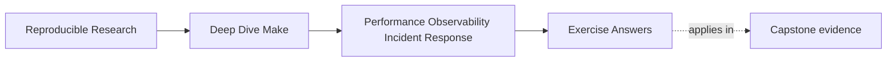
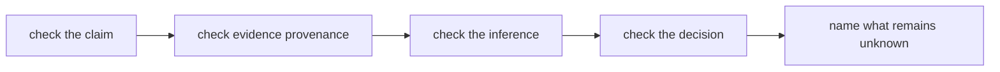
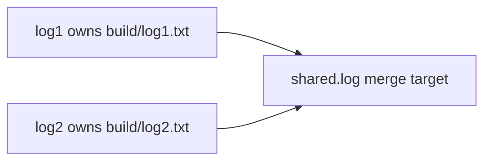

# Exercise Answers

<!-- page-maps:start -->
## Page Maps




<!-- page-maps:end -->

Use these answers after completing your own packet. They model reasoning shape, not
machine-independent numeric results. Your timing values, trace count, and tool versions
will differ.

For each exercise, compare four things:

1. Is the observed fact reproducible from the packet?
2. Does the inference stay within what the evidence can establish?
3. Does the decision follow from that inference?
4. Is the remaining uncertainty named?

An answer can be technically accurate and still be operationally weak if another
maintainer cannot reconstruct those links.

## Exercise 1: Open the incident without accepting its diagnosis

A strong `incident.md` separates the report:

| Claim | Route and state | Expectation source | First evidence |
| --- | --- | --- | --- |
| clean build is slow | `gmake -j4 all` from documented clean state | controlled prior baseline, if one exists | five clean samples |
| no-op route is slow | `gmake all` after `gmake -q all` succeeds | convergence contract | five no-op samples |
| pre-recipe work is slow | `gmake -n all` from converged state | current or prior dry-run baseline | five dry-run samples |
| trace is noisy | `gmake --trace -n all` | responder usability requirement and trace guardrail | line count plus inspection |
| parallel route is wrong | governed pressure route or repro | serial/parallel equivalence contract | artifact comparison or incident bundle |

Model reasoning:

```text
Observed:
The report contains broad claims but no route, state, samples, or comparison baseline.

Inferred:
Neither regression nor parallel root cause has been established.

Still unknown:
Which cost layer dominates, whether trace is unusable, and whether a real capstone output
differs by schedule.

Decision:
Preserve context and establish separate baselines before changing diagnostics or
parallelism.
```

Immediate containment would be justified if a trusted artifact were corrupted or at risk
of publication. In that case, stop publication and preserve the outputs before ordinary
measurement.

The proposed remedies are premature because they alter evidence and scheduling before the
claims are classified.

## Exercise 2: Capture a reproducibility context

A useful context packet might contain:

```text
context/
├── revision.txt
├── worktree.txt
├── make-version.txt
├── portability.txt
├── compiler-version.txt
├── python-version.txt
├── help.txt
└── conditions.md
```

The conditions table should distinguish ownership:

| Condition | Controlled by repository? | Effect on interpretation |
| --- | ---: | --- |
| requested target | yes | defines the contract under test |
| checkout revision | yes | anchors source and Makefile state |
| `-j4` | yes | fixes requested scheduling pressure |
| GNU Make version | partly | must satisfy the course boundary |
| compiler version | partly | may change clean recipe cost |
| background load | no | may widen timing variation |
| filesystem cache | not fully | can make clean samples non-identical |

A strong limitation statement is:

> Background load and cache state were not fully controlled, so these measurements can
> localize large cost differences and establish a local baseline, but they do not support
> fine-grained cross-machine comparisons.

Do not retain a raw environment dump without reviewing it for secrets.

## Exercise 3: Establish controlled cost baselines

The answer key cannot supply your values. It can show how to audit the bundle before
interpreting them.

| Scenario | Policy evidence | Raw evidence | Semantic evidence |
| --- | --- | --- | --- |
| `clean-build` | `clean`, `-j4`, `all` | five elapsed samples and command log | convergence plus trusted-output inventory |
| `converged-noop` | `converged`, `-j1`, `all` | five elapsed samples and command log | convergence plus trusted-output inventory |
| `converged-dry-run` | `converged`, `-j1`, `dry-run-all` | five elapsed samples and command log | convergence plus trusted-output inventory |

The exact sample count comes from `evidence.json`; five is the default, not a fact to copy
without checking. Recalculate one median from the raw elapsed values and confirm it matches
`summary.tsv`. Then verify that every exit status is zero, convergence is `PASS`, and the
inventory names the expected outputs.

Example reasoning:

```text
Observed:
Clean samples are substantially larger than both no-op and dry-run samples. No-op and
dry-run samples overlap within the observed range.

Inferred:
Most clean-build cost appears during recipes. No-op overhead appears mostly before ordinary
recipe execution.

Still unknown:
Which clean-build recipe lies on the critical path and whether current values regress from
an earlier compatible baseline. Background load and cache state also remain imperfectly
controlled.

Decision:
Record the current baseline. Do not claim a regression. Profile a recipe only if an
operational objective makes clean-build cost worth reducing.
```

A weak answer subtracts one dry-run value from one clean value and calls the result recipe

Another weak answer submits only `summary.tsv`. Without policy, raw samples, command logs,
convergence, and output inventories, a reviewer cannot tell whether the route asked the
same question or became faster by doing less necessary work.

## Exercise 4: Choose observability by question

Good questions are narrower than "what is Make doing?"

Trace question:

> Why does Make consider `all` complete or in need of work from this state?

Retain the smallest lines naming `all`, its relevant prerequisites, and the rule location.
Trace can establish Make's causal decision. It cannot establish whether the modeled edge
matches artifact meaning.

Database question:

> Which final rule owns `all`, or which origin and value does one chosen variable have?

Use a focused search over the `-np` output. Retain the command and excerpt, not only the
excerpt, so another maintainer can reproduce it.

Trace usability review:

| Property | Model judgment |
| --- | --- |
| searchability | target names can be found directly |
| attribution | trace names Makefile locations and targets |
| causal usefulness | selected prerequisites are visible |
| side effects | `-n` avoids ordinary recipes, subject to recursive-Make caveat |

A defensible `trace-count` decision is "keep as a heuristic guardrail" when:

- the target has a documented question
- it remains non-semantic
- selftest uses the threshold as a review signal rather than universal performance truth

Line count alone cannot show whether evidence is understandable.

It also cannot replace `perf`. The performance bundle answers cost and semantic-preservation
questions. `trace-count` answers only how many lines one trace emitted from one state.

## Exercise 5: Generate and preserve a parallel incident

The current shared-log incident bundle records a command equivalent to:

```sh
make -f repro/shared-log-interleaving.mk -j2 all
```

An observed run can report:

```text
exit_status=0
```

The copied Makefile shows:

```make
all: log1 log2

log1:
	printf 'A\n' >> shared.log

log2:
	printf 'B\n' >> shared.log
```

The two targets are `log1` and `log2`; both mutate `shared.log`.

Model reasoning:

```text
Observed:
Two independently schedulable targets append to one undeclared shared path, and the command
can exit successfully.

Inferred:
Process success does not prove unique output ownership or deterministic publication.

Still unknown:
Which repaired ownership model best matches the intended log contract.

Decision:
Preserve the copied repro, command, output, status, and any shared-file content before
cleanup. Classify ownership before proposing scheduler changes.
```

Exit status proves only that the shell commands returned success in that run.

## Exercise 6: Classify ownership and reject false repairs

A completed explanation table might be:

| Explanation | Evidence expected if true | Evidence that weakens it |
| --- | --- | --- |
| missing ownership/publication model | multiple independent recipes write `shared.log`; no target owns it | one declared writer or isolated worker files plus one merge |
| parallel scheduler defect | incorrect scheduling despite complete edges and unique writers | defect disappears after ownership repair without changing scheduler |
| external filesystem failure | write errors or corruption outside the graph pattern | same logical defect is visible directly in the Makefile on ordinary storage |

Classify this as graph truth plus publication ownership.

Proposal labels:

| Proposal | Label | Reason |
| --- | --- | --- |
| force `-j1` | temporary mitigation | reduces schedule exposure but preserves multiple writers |
| add more `echo` lines | rejected action | adds noise without repairing ownership |
| one target owns the shared file | plausible repair | ownership becomes explicit |
| private worker outputs plus declared merge | plausible repair | workers own isolated state; merge owns publication |

One repaired graph shape is:



Closure proof should include repeated pressure runs, stable content under the intended
ordering contract, unique writers, failure cleanup, and convergence. If line order matters,
the merge recipe must define it.

## Exercise 7: Write a falsifiable tuning proposal

`performance-selftest` should pass thirteen tests in the current capstone. The number is
less important than the behavior covered. Two essential rejection explanations are:

- policy drift is rejected because two scenario names can hide different state, route, or
  scheduling questions
- trusted-output drift is rejected because reduced work is not a valid speedup when artifact
  meaning changed

Other valid cases include failed capture, too few samples, different sample counts, and a
failed candidate bundle. A learner should be able to explain the dishonest claim each gate
prevents.

The best answer may reject change:

```text
Measured cost:
Current clean, no-op, and dry-run baselines have been established.

Decision:
No performance edit is justified because no historical regression or violated feedback
objective has been demonstrated.

Reopen when:
No-op median exceeds the agreed objective on the same runner class for three consecutive
baseline collections, or trace guardrail and usability review both show responder cost.
```

This is stronger than inventing a speedup to satisfy the exercise.

If your measurements reveal a real candidate, the proposal must include:

| Proof obligation | Example |
| --- | --- |
| cost | compatible governed bundles with every raw sample retained |
| experiment identity | matching policy digest, sample count, state, route, and job count |
| critical path | graph shows the changed work delays requested completion |
| requested work | change a declared input and inspect selected work |
| convergence | successful run followed by successful `make -q` |
| artifact meaning | domain comparison or stable hash where byte equality is expected |
| pressure behavior | serial/parallel comparison |
| rejection | revert if discovery becomes stale or effect is within noise |

An unsafe optimization is removing a prerequisite to suppress rebuilds. A cache introduces
a new question: which declared inputs refresh the cached value, including additions,
removals, policy changes, and producer changes?

A passing `performance-compare` report establishes comparability, semantic equivalence for
the inventoried outputs, and timing deltas. It does not establish materiality. The decision
still needs the observed spread, a local operational objective, and any change-specific
requested-work proof outside the generic bundle.

## Exercise 8: Audit the capstone proof route

Map the selftest bundle:

| Claim | Evidence file |
| --- | --- |
| result, stopping boundary, and checks not reached | `summary.txt` |
| runtime boundary and guardrails | `settings.env` |
| exact commands and captured output | `commands.txt` and `logs/` |
| semantic schedule-equivalence decision | `schedule-comparison.json` |
| serial artifact contract | `serial-inventory.json` |
| parallel artifact contract | `parallel-inventory.json` |
| dishonest hidden input is detected | `hidden-input.txt` |
| sandbox at the stopping boundary | `workspace/` |

The semantic comparison should report no missing, unexpected, or changed artifacts for
a passing run. The summary should report convergence and the negative hidden-input check.
On failure, `FAIL` names the broken claim; `NOT_RUN` means the harness stopped before
collecting that proof.

Important limitation:

> This bundle proves selected build-system invariants. It does not establish a performance
> regression or prove that a proposed edit improved timing.

A tuning proposal still needs controlled before/after measurements and any
change-specific requested-work test.

## Exercise 9: Write an executable runbook

A model runbook is:

```text
Title:
Parallel build route differs or fails

Use when:
A public target fails only under `-jN`, or trusted artifacts differ from the serial route.

Do not use when:
The failure is remote upload, authentication, or another external-service boundary.

Trusted outputs:
Name the repository-specific artifacts before using this runbook.

Preserve:
- revision, worktree state, GNU Make and tool versions
- target, job count, full target-attributed output
- suspect artifacts and prerequisite metadata
- do not clean or rerun the first useful state

Contain:
- stop publication of suspect artifacts
- a documented serial route may restore feedback temporarily
- label serial mode as mitigation and retain the pressure reproducer

Branch A: multiple targets write one path
- classify graph/publication ownership
- repair to one writer or isolated outputs plus one merge

Branch B: one consumer starts before its producer completes
- inspect non-executing trace
- repair the missing semantic edge

Branch C: artifacts match and only logs interleave
- classify evidence attribution
- test `--output-sync=target` without changing semantic outputs

Escalate:
- trusted release or research output may be corrupt
- evidence points outside repository ownership
- logs may expose sensitive data
- repeated branches no longer narrow the cause

Close:
- original pressure route passes the stated repetition count
- serial and parallel artifacts satisfy the contract
- successful route converges
- incident packet and follow-up owner are recorded
```

A command deliberately excluded from the first response is `rm -rf build`: it destroys
incremental evidence before classification.

A useful peer-review question is:

> Can you choose the next branch from the stated observations without asking the original
> author what they meant?

## Exercise 10: Hand off the incident

A concise handoff begins with the decision, not the diary:

```text
Summary:
The broad complaint was split into cost, evidence, and pressure claims. Current baselines
were established, but no historical performance regression was proven. The controlled
parallel incident demonstrates two undeclared writers to one shared path despite exit
status 0.

Impact:
The repro demonstrates a graph/publication failure class. No evidence currently shows the
real capstone artifact is corrupt.

Preserved:
Revision, worktree state, versions, raw timing samples, trace and database excerpts,
incident bundle, and selftest report.

Current classification:
Controlled incident: graph truth and publication ownership.
Performance claim: baseline only; regression unproven.
Evidence claim: trace retained as a bounded heuristic plus usability surface.

Mitigation:
Serial execution may be used only as a labeled temporary route for an equivalent real
incident. It is not the repair.

Verification:
Capstone selftest report covers convergence, semantic serial/parallel comparison,
hidden-input detection, command logs, and preserved stopping state. It does not prove a
speedup.

Unresolved question:
Which production output, if any, currently has more than one writer or lacks an honest
publication owner?

Reading order:
incident.md, context summary, measurement summary, observability decision, parallel
incident, tuning decision, verification map, runbook.
```

The packet audit should remove or redact secrets, redundant full dumps, generated outputs
that do not affect a decision, and repeated copies already addressed by a manifest.

The packet shortens the next response because it transfers observations, rejected
explanations, current classification, and one bounded question instead of requiring the
next owner to reconstruct the investigation from shell history.

## Mastery review

A mastery-level packet has these properties:

- numeric claims retain commands, state, samples, and limitations
- trace and database evidence answer different questions
- successful exit is not confused with truthful output ownership
- no-change is accepted when tuning evidence is insufficient
- proof surfaces are mapped to claims they actually establish
- the runbook changes action based on observations
- the handoff says exactly what remains unknown

If your packet sounds more certain than its evidence, revise the claim rather than adding
more confident language.
