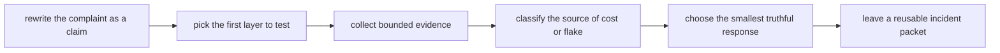

# Exercises

Use these after reading the five core lessons and the worked example. The goal is not to
produce more diagnostics for their own sake. The goal is to make your measurement,
observability, and incident-response reasoning visible.

## How to work through this set

Treat the ten exercises as one full lab day on operational investigation.

Before each answer:

1. rewrite the complaint as a measurable claim
2. decide which layer you are investigating first
3. keep the smallest evidence packet that would let another maintainer reuse your work

If you skip the measurement question, "slow," "flaky," and "noisy" stay vague and every
response becomes guesswork.

Do the exercises in order. The day is one progression:

- Exercises 1-3 split symptoms into layers, create bounded observability, and define
  triage ladders
- Exercises 4-6 build truthful optimization habits and repeatable baselines
- Exercises 7-9 explain rebuilds, parse-time shell cost, and useful parallelism with
  measured context
- Exercise 10 preserves a complete incident record another maintainer could actually reuse

Every timing answer must retain the semantic guardrail:

| Baseline command and samples | Proposed change | After samples | Convergence check | Artifact-equivalence check |
| --- | --- | --- | --- | --- |

If the last two columns are absent, you have measured speed but not a safe optimization.

Keep one incident packet as you go. By the end of the day it should contain:

- one complaint rewritten as a measurable claim
- one bounded observability route
- one triage ladder
- one truth-preserving optimization or justified rejection
- one repeated timing baseline
- one compact evidence directory and runbook entry

If those six artifacts are missing, you are probably collecting commands rather than
learning how to respond to build incidents professionally.

## Recommended working layout

If you want one lab tree that can support the whole day, use something like:

```text
module09-lab/
├── Makefile
├── build/
├── logs/
├── reports/
├── notes/
└── artifacts/
```

Keep one investigation table while you work:

| Symptom | Layer under test | First probe | Evidence captured | Next decision |
| --- | --- | --- | --- | --- |

Also keep one response table:

| Proposed change | Cost reduced | Truth preserved by | How verified |
| --- | --- | --- | --- |

That second table matters because Module 09 is not about tuning for its own sake. It is
about proving that tuning did not damage graph truth.



Use that route on purpose. It keeps the day centered on operational truth instead of on
random command accumulation.

## Exercise 1: Split one "slow build" complaint into layers

Take one build route and describe how you would tell whether the cost is mainly parse-time,
recipe-time, or evidence-surface overhead.

What to hand in:

- the commands you would run
- the three measurements or observations you would compare
- one sentence explaining how different results would change the diagnosis
- one sentence explaining why "felt slow" is not operational evidence

Study note:
The point is not to collect every timing number possible. The point is to identify which
layer deserves attention first.

## Exercise 2: Add one bounded observability surface

Your repository has many ad hoc debug prints inside recipes, but no named diagnostic
route.

Design one observability surface that would help incidents without mutating semantic
outputs.

What to hand in:

- the question the surface should answer
- the target name or command route you would add
- one current debug habit that should be removed instead
- one sentence explaining why this surface is bounded enough to keep

Study note:
Observability becomes technical debt when it is scattered, noisy, and semantically
entangled with normal build outputs.

## Exercise 3: Write a triage ladder for one flaky symptom

Choose one flaky symptom such as:

- "rebuild happens for no obvious reason"
- "`-j` occasionally fails"
- "CI and local behave differently"

Write the first five steps of the evidence ladder you would follow.

What to hand in:

- the measurable symptom
- the ordered triage steps
- one sentence explaining why editing the Makefile should not be the first move
- one sentence explaining how the ladder narrows scope instead of widening it

Study note:
The right ladder moves from smallest-disruption evidence to heavier inspection only when
the earlier step leaves real uncertainty.

## Exercise 4: Propose one truth-preserving optimization

You identify repeated parse-time shell work as a likely cost. Explain one optimization
that reduces that waste without hiding real inputs or dropping rebuilds.

What to hand in:

- the expensive habit
- the truthful replacement boundary
- one command you would use afterward to prove the build is still honest
- one sentence explaining what shortcut you rejected and why

Study note:
This module does not treat every speedup as a win. If the speedup hides input changes or
turns evidence stale, it is the wrong optimization.

## Exercise 5: Write a small operational runbook entry

Take one build route and write a short runbook entry another engineer could use under
pressure.

What to hand in:

- one convergence or sanity check
- one serial/parallel comparison or resolved-state inspection
- one escalation trigger
- one thing the responder should avoid doing too early

Study note:
Good runbooks reduce panic by making the first few safe steps obvious.

## Midday self-check

Before you move into repeated baselines, rebuild diagnosis, and parallel measurements,
make sure your packet can already answer these questions cleanly:

- which layer you would test first for one chosen complaint
- which observability surface is worth keeping and which ad hoc print should disappear
- which shortcut would make a speedup look good while damaging truth
- which first responder mistake your runbook explicitly prevents

If you cannot answer those four questions in plain language, return to Exercises 1-5 and
make the packet more explicit before continuing.

## Exercise 6: Build a repeatable timing baseline

Measure dry-run, clean-build, and no-op-build cost at least three times each. Keep target,
parallelism, environment, and machine conditions recorded.

What to hand in:

- the exact commands and conditions
- all measurements plus a representative value
- one source of noise and how you limited it
- one sentence explaining why a single fastest run is weak evidence

Study note:
This is where you learn to write numbers another maintainer can actually reuse instead of
numbers that only made sense in one unrecorded shell session.

## Exercise 7: Explain an unexpected rebuild

Choose a target that rebuilds when you expect a no-op. Use trace output and timestamps to
identify the prerequisite edge that caused the decision.

What to hand in:

- the target and expected behavior
- the smallest useful trace excerpt
- prerequisite timestamps or content evidence
- the graph repair, or an explanation that the rebuild is correct

Study note:
A correct rebuild is a successful diagnosis. Module 09 is about understanding behavior,
not assuming every surprise is a defect.

## Exercise 8: Audit parse-time shell work

Find every `$(shell ...)` in a Make build. Measure dry-run cost, classify each shell call,
and replace one avoidable call without caching away real discovery.

What to hand in:

- the search result and baseline
- the selected shell call and its semantic purpose
- the replacement
- post-change timing, discovery, and convergence evidence

Study note:
The hard part here is not deleting shell calls. The hard part is keeping the discovery and
graph semantics truthful after you reduce them.

## Exercise 9: Measure useful parallelism

Compare `-j1`, `-j2`, and a higher job count for one clean route. Inspect the graph before
interpreting the timings.

What to hand in:

- repeated measurements
- the independent work visible in the graph
- the job count after which speedup becomes small or negative
- one reason the result must not be generalized to every machine

Study note:
Parallel speedup is a graph fact plus a machine fact. Either one alone gives an incomplete
story.

## Exercise 10: Respond to a complete build incident

Investigate a slow, noisy, flaky, or unexpectedly rebuilding route without cleaning or
editing first. Preserve commands, environment, timing, trace, resolved state, and the
final classification.

What to hand in:

- the incident statement and reproduction route
- a compact evidence directory
- the diagnosis and smallest truth-preserving repair
- before-and-after verification
- a runbook entry for the next responder

Study note:
The goal is not to create an enormous postmortem. The goal is to leave behind the
smallest packet that makes the next response calmer and faster.

## Before you read the answers

Do not open `exercise-answers.md` until you can already point to:

- one symptom rewritten as a measurable claim
- one baseline with repeated samples
- one incident you investigated without editing first
- one optimization you rejected because it would have hidden truth
- one evidence packet another maintainer could reuse

If you do not yet have those five things, the answer page will sound stronger than it can
teach.

## Mastery standard for this exercise set

Across all ten answers, the module wants the same habits:

- you name the cost or incident boundary being tested
- you choose evidence before choosing edits
- you explain the response in terms of measurement, observability quality, or
  truth-preserving tuning

If an answer says only "the build should be easier to debug," keep going.
